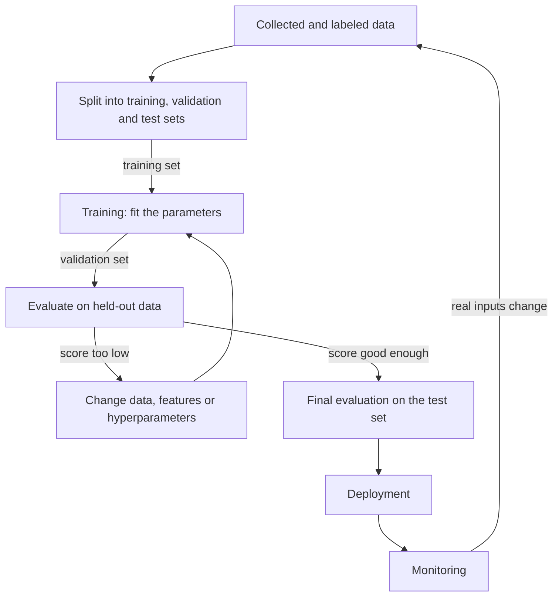

# 01. Machine Learning in a Nutshell for Software Engineers

**Level:** Foundation · **Reading time:** 25 min · **Exercise:** 60 min

> **In one sentence:** After this chapter you can read a machine-learning component the way you read ordinary code: you know where its behavior comes from, why unit tests cannot verify it, and what to do instead.

## Why this matters

A service has one function that sorts support tickets into `billing`, `bug` and `question`. It is a chain of `if`/`elif` statements and a few regular expressions, and it has tests. One day a colleague replaces the body with a call to a trained model. The signature is unchanged. The diff is five lines.

From then on, the function stops behaving like code.

- A test that passed now fails, but only sometimes.
- Adding the failing example to `tests/` changes nothing, because the model never sees the test suite.
- Retraining "the same thing" gives a model that scores slightly differently.
- Nobody can point at the line that makes the model choose `bug`.

This chapter answers three questions. What kind of artifact is this? How is it built? And how do you gain confidence in it when reading and testing the code is not enough?

## The core idea

Ordinary software has two parts: code you wrote, and data that flows through it at run time. **Machine learning (ML)** swaps their roles. You describe the *shape* of a function and you supply examples of the behavior you want. A search then finds the numbers that make the function fit the examples. The logic moves into the data, and the result is a **model**: a function whose behavior was learned from data instead of written by hand.

Every learned model has three parts:

1. **A function with blanks.** For example `price = w * size`. The number `w` is a **parameter**: a value the training fills in.
2. **Examples.** The **training data** is a collection of inputs together with the output you wanted for each. The wanted output is the **label**. Learning from input-label pairs is **supervised learning**.
3. **A score for being wrong.** The **loss** is a cost function. It takes the parameters and the examples and returns one number: how wrong the model is on that data.

**Training** is an optimization loop that changes the parameters to lower the loss on the training data. **Inference** is calling the trained function on a new input. The output is called a **prediction**, even when nothing about the future is involved.

Christian Kästner offers an analogy in *Machine Learning in Production*. A compiler takes source code and produces an executable. An ML algorithm takes training data and produces a function. Its **hyperparameters** (settings that control the learning process, such as when to stop) correspond to compiler options. And like the compiler, the algorithm is not needed once the model is in use.

The analogy breaks in two places:

- A compiler is deterministic. It fails, or it produces a program that does what the source says. A training run is a search. Run it twice on the same data and you can land on two models that differ slightly.
- A compiled program implements a specification. A trained model only *fits the examples it saw*. Nothing checks the result against a spec, because the examples are the spec.

Doing well on inputs the model has never seen is called **generalization**. Training does not reward it directly, so it is never guaranteed.

## How it works, step by step

### The pipeline

Kästner breaks the work into steps that look like a software life cycle:

1. **Model requirements.** Decide what the model should predict, and how good is good enough.
2. **Data collection.** Gather inputs.
3. **Data labeling.** Record the wanted output for each input.
4. **Data cleaning and feature engineering.** A **feature** is one input variable. Fix mistakes, fill gaps, and shape the inputs.
5. **Training.** Run the learning algorithm.
6. **Evaluation.** Measure the model on data it did not train on.
7. **Deployment.** Put it behind an API that other code calls.
8. **Monitoring.** Keep measuring it in production.

The loop is iterative, like a dev cycle. A bad evaluation sends you back to the data, the hyperparameters or the choice of algorithm. Kästner also notes that training itself typically takes very few lines of code that call a library, though deployment and monitoring can require substantial infrastructure. Much of the work, and the value, sits in the data.

### Three data splits

You judge generalization by hiding part of the data from training. The usual split is:

| Split | Who uses it | When |
|---|---|---|
| Training set | The training loop | On every step |
| Validation set (also "dev set") | You, the developer | While you choose data, features and hyperparameters |
| Test set | Nobody, until the end | Once, to report how good the model is |

Think of the validation set as the tests you run while developing, and the test set as the final exam.

**Figure 1.** The pipeline as a loop, and which split each step may use.



A bad validation score sends you back to the data or the hyperparameters, and the test set is opened only when the validation score is good enough.

**Overfitting** is when the model memorizes the training examples instead of learning the rule behind them. The programmer's version is hard-coding the answers to your unit tests. The analogy breaks on intent. Nobody decides to overfit. The training loop minimizes the training loss and nothing else, so a model with enough free parameters drifts into memorization on its own.

The symptom is a widening gap: the training loss keeps falling while the validation loss stops improving or rises. The fixes are more data, a simpler model, or stopping the training earlier.

### What changes compared with ordinary software

| Aspect | Ordinary component | Learned component |
|---|---|---|
| Where the logic lives | In the code you wrote | In parameter values fitted to data |
| How you change behavior | Edit the code | Change the data or hyperparameters and retrain, or change the prompt |
| How you check it | Unit tests against a specification | Evaluation on held-out data, with a metric and a threshold |
| What a bug looks like | A wrong line you can find and read | Wrong, missing or biased data; nobody can read billions of numbers |
| Rebuilding | Same code, same behavior | Same data, a slightly different model |
| What you version | Code | Code, data, hyperparameters and the model file |
| Failure over time | Only when code or dependencies change | Also when real inputs stop resembling the training data |

A **metric** is the number you use to summarize quality, such as the percentage of correct answers.

### Why tests alone cannot verify a model

1. **There is no specification to assert against.** A unit test pins the exact output of an input. For a model, you rarely know the correct output of a new input. If you did, you would add it to the training data.
2. **Quality is a statistic.** "Correct on 92% of tickets like these" is a statement about a whole distribution of inputs (the full range of real inputs and how often each occurs), measured on a sample. It needs a data set, a metric and, as you will see in [Why LLM Outputs Are Noisy](07-why-llm-outputs-are-noisy.md), an error bar.
3. **The behavior lives outside the code.** The same code with a new model file or new training data behaves differently.

Four habits take the place of exact-output tests:

1. **Unit-test everything that is not the model.** Parsing, validation, the wrapper and the output format are ordinary code. Ordinary engineering applies in full.
2. **Assert invariants of the call.** The output has the right type, lies in the allowed range, and arrives within the latency budget.
3. **Evaluate, and treat the evaluation as a regression test.** Keep a frozen held-out set. Define a metric and a threshold. Run it in CI whenever the model, the prompt or the data changes.
4. **Version what produces the behavior.** Code, data, hyperparameters and the random seed, the number that makes a training run's random choices repeatable. A model is only reproducible together with all four.

### From training your own model to using a foundation model

Kästner describes a second shift, triggered by large language models. Many projects no longer train a model per task. A **foundation model** is a large general-purpose model that somebody else trained. You customize it with a **prompt**: the text you pass in, which acts as the function's argument.

His example is toxicity detection. Instead of training a classifier on examples of toxic and non-toxic language, you send the model a prompt such as: answer only yes or no, is the following sentence toxic, followed by the sentence. He lists two ways to customize a foundation model:

- **Fine-tuning:** train a copy of it on your own examples.
- **In-context learning:** put information or examples into the prompt. [Chapter 05](05-prompting-and-in-context-learning.md) covers this in depth.

For you, the shift means less time training and more time writing prompts and supplying context. The logic of this chapter still holds. The behavior depends on data (now the prompt, its examples and any context you attach), and you verify it by evaluation, not by unit tests.

## Worked example

The script below trains a model in plain Python, with no ML library. It fits apartment prices from the apartment's size. Step 5 computes the **gradient**, the direction that raises the loss fastest, and steps the opposite way; the **learning rate** is the size of that step.

```python
import random

# 1. Data: size in square meters, price in thousands of euros.
#    We invent it from a rule we know, plus noise: price = 5 * size + noise.
random.seed(0)
sizes = [random.uniform(20, 120) for _ in range(200)]
data = [(size, 5 * size + random.gauss(0, 15)) for size in sizes]

# 2. Splits: the model trains on one part and is judged on parts it never saw.
train, val, test = data[:120], data[120:160], data[160:]

# 3. The model: a function whose behavior depends on a number we did not write.
def predict(size, w):
    return w * size

# 4. The loss: mean squared error, meaning how wrong the model is on some data.
def loss(examples, w):
    return sum((predict(size, w) - price) ** 2 for size, price in examples) / len(examples)

# 5. Training: nudge w, over and over, in the direction that lowers the loss.
w, learning_rate = 0.0, 1e-6
for step in range(2001):
    if step % 500 == 0:
        print(f"step {step:4d}  w = {w:.3f}  train loss = {loss(train, w):,.0f}")
    gradient = sum(2 * (predict(size, w) - price) * size for size, price in train) / len(train)
    w -= learning_rate * gradient          # the learning rate is a hyperparameter

# 6. Inference, then evaluation on data the model never trained on.
print(f"predict(80 m2) = {predict(80, w):.1f}k")
print(f"validation loss = {loss(val, w):,.0f}   test loss = {loss(test, w):,.0f}")

# 7. A "model" that memorizes: one stored answer per training example.
memorized = dict(train)
def loss_memorized(examples):
    errors = ((memorized.get(size, 0.0) - price) ** 2 for size, price in examples)
    return sum(errors) / len(examples)

print(f"memorizer: train loss = {loss_memorized(train):.0f}, test loss = {loss_memorized(test):,.0f}")
```

What to observe:

- **Training lowers the loss.** The training loss starts around 165,000 and falls to a few hundred, which is the noise we added. `w` ends close to 5, the number we hid in the data.
- **The line generalizes.** The validation and test losses are in the same range as the training loss, because the true rule is a line.
- **The memorizer does not.** Its training loss is exactly 0. Its test loss is about 120,000, close to the 165,000 the line had before training, because every test size is new to it. A perfect score on the training data proves nothing.

## What the practitioners say

Kästner's chapter draws three distinctions that prevent confusion later:

- **Algorithm versus model.** The ML algorithm is the technique that creates the model. The model is the learned function that the running system calls. The first is used only during training.
- **Parameter versus hyperparameter.** Parameters are the values the training finds, such as the thresholds in a decision tree or the values of the matrices in a neural network. Hyperparameters are the settings you choose, including the network's architecture. The book counts these as hyperparameters too.
- **Two kinds of determinism.** For many algorithms the learning process is non-deterministic. The learned model itself is a pure, deterministic function. (When you call an LLM as a service, sampling adds randomness on top. [Chapter 04](04-using-llms-tokens-context-and-sampling.md) explains this.)

He also warns that ML terminology is not used consistently: different authors use different words for the same concept, and the same word for different concepts. "Model" is one of the words with several meanings, hence his term "machine-learned model".

Yann Dubois shows the same loop at the scale of LLMs, in his Fall 2025 lecture *Introduction to training LLMs for AI agents*. The stages are the same: data, a training objective, then evaluation. The numbers are different. As he reports them, pre-training, the first stage that teaches the model to predict the next word, reads more than 10 trillion [tokens](04-using-llms-tokens-context-and-sampling.md) (the short pieces of text a model reads), takes months and costs more than $10 million per run. Classic post-training, the stage after it, uses on the order of 100,000 problems and takes days ([0:00](https://www.youtube.com/watch?v=r1qZpYAmqmg&t=0), [2:00](https://www.youtube.com/watch?v=r1qZpYAmqmg&t=120)).

His closing point on evaluation is the one to carry into any ML project: "evaluation is really important to know whether your model is ready to be put in production" ([84:00](https://www.youtube.com/watch?v=r1qZpYAmqmg&t=5040)). Dawn Song's course introduction makes the same point for the whole field: "AI's evolution is upper-bounded by eval," because "you can only improve what you can measure" ([slides](https://rdi.berkeley.edu/agentic-ai/slides/introduction_25.pdf), slide 18). A model can be the best available and still not be good enough for your application. He separates two kinds of evaluation there. **Closed-ended** tasks have few possible answers, so a program can check them. **Open-ended** tasks, such as answering a chat message, have no single correct answer, so they need human or model judgments ([86:00](https://www.youtube.com/watch?v=r1qZpYAmqmg&t=5160)). He names two problems with the easy kind: the score changes with the wording of the prompt, and the test questions may already be in the training data.

His slides give evaluation the same weight: it quantifies progress toward the task, so that you can identify improvements, select models and decide whether one is ready for production. Evaluation is not the paperwork at the end. It is the goalpost.

## Pitfalls

1. **Treating the model as code.** You expect the same input to give the same correct output, and you fix a wrong answer by adding an `if`. *Fix:* fix it with data (add or correct examples, retrain) or, with a foundation model, with the prompt. Then re-evaluate.
2. **Judging a model on its training data.** The score looks great and means nothing. *Fix:* split first. Train on one part, choose with the validation part, report on the test part.
3. **Tuning on the test set.** Every time you adjust the model because of a test-set result, the test set becomes a validation set, and your reported score drifts upward. *Fix:* open the test set once per model.
4. **Writing tests as exact-output assertions.** They fail randomly and tell you nothing about quality. *Fix:* assert invariants in unit tests, and assert quality with an evaluation set and a threshold.
5. **Versioning only the code.** Without the data and hyperparameters, you cannot rebuild or explain a model. *Fix:* record code revision, data version, hyperparameters and seed with every model.
6. **Skipping tests for the surrounding code.** Many failures in ML systems come from plain engineering: a changed schema, a wrong join, a lost label. *Fix:* test the plumbing as strictly as anywhere else. [Testing generative and LLM components](../08-quality-assurance/05-testing-generative-and-llm-components.md) goes further.
7. **Trusting one number.** A metric from one run on one sample has noise in it. *Fix:* repeat the measurement and report the spread before you compare two models.

## Try it

Run the worked example, then turn it into a small project with a check that CI could run.

**Deliverable:** a repository with the script, a `pytest` file and a short `NOTES.md`.

1. Keep the three splits as they are. Record the training, validation and test losses of the trained line in `NOTES.md`.
2. Write unit tests for the invariants of `predict`: it returns a number, `predict(size, 0) == 0`, and doubling the size doubles the prediction.
3. Write one evaluation test: load the frozen test split, compute the loss of the trained `w`, and fail if it is above 1,000.
4. Break it on purpose. Call the evaluation test with `w = 0` and confirm that it fails.

**You are done when:** the evaluation test fails for `w = 0` and passes for the trained `w`; the unit tests pass without touching any data; and `NOTES.md` lists the seed, the learning rate and the three losses.

**Stretch goal:** add a second parameter, a constant term `b`, so that `price = w * size + b`. Train both with one learning rate and watch how much slower `b` moves than `w`. You have just met your first hyperparameter problem.

## Key takeaways

- A model is a function whose logic sits in parameters that were fitted to data. Training is an optimization loop over a loss. Inference is calling the result.
- Training rewards a low loss on the data seen. Generalization to new inputs is a separate property, and you measure it on held-out data.
- A low training loss proves nothing. Always compare it with the validation and test losses.
- Unit tests cannot verify a model, because there is no specification and quality is a statistic. Test the surrounding code exactly as before, and test the model with an evaluation.
- With a foundation model you rarely train. The prompt plays the role of the function's argument, and evaluation still replaces the unit test.

## Self-check

1. A model has a training loss of 0.02 and a validation loss of 1.90. What is the most likely explanation?
   - A. The validation labels follow a different convention.
   - B. The training loop stopped before it converged.
   - C. The model has memorized its training examples.
   - D. The learning rate was chosen far too small.

2. In Kästner's compiler analogy, what plays the role of the source code?
   - A. The training data
   - B. The learned model
   - C. The hyperparameters
   - D. The training library

3. A wrong answer is added to the unit-test suite. Why does the model's behavior not change?
   - A. Unit tests run on a different machine than training.
   - B. The training loop only ever sees the training data.
   - C. One example is too small to matter statistically.
   - D. Test files are excluded from the data pipeline.

4. Which data do you watch to decide when to stop training?
   - A. The test set, once at the very end
   - B. The training set, at every step
   - C. The validation set, during development
   - D. A fresh sample drawn from production

5. A ticket classifier must stay above 90% accuracy. How do you turn that into a check for CI?
   - A. Add 90 example tickets as individual unit tests.
   - B. Assert that the model's confidence stays above 0.9.
   - C. Measure accuracy on a frozen held-out set and fail below it.
   - D. Run the whole training set through the model after each commit.

<details><summary>Show answers</summary>

1. C. The training loss is low and the validation loss is high, which is the signature of overfitting. Fixes are more data, a simpler model or earlier stopping.
2. A. The ML algorithm is the compiler, the hyperparameters are the compiler options, and the model is the executable. The algorithm is not needed at run time.
3. B. The model only changes when its training data, hyperparameters or prompt change. A test file is invisible to it.
4. C. The training loss keeps falling on an overfitting model, and the test set must stay untouched until the end.
5. C. Quality is a statistic over a distribution, so it needs a held-out set, a metric and a threshold. A handful of unit tests cannot express it.

</details>

## Sources

- **Lecture:** Yann Dubois, "Introduction to training LLMs for AI agents", LLM Agents MOOC (Fall 2025): [video](https://www.youtube.com/watch?v=r1qZpYAmqmg) · [guide](../lectures/f25-01-llm-agents-overview.md), used at [the training pipeline](https://www.youtube.com/watch?v=r1qZpYAmqmg&t=0), [classic post-training](https://www.youtube.com/watch?v=r1qZpYAmqmg&t=120), [evaluation](https://www.youtube.com/watch?v=r1qZpYAmqmg&t=5040), [open-ended evaluation](https://www.youtube.com/watch?v=r1qZpYAmqmg&t=5160)
- **Slides:** Dawn Song, "Introduction", Agentic AI MOOC (Fall 2025): [slides](https://rdi.berkeley.edu/agentic-ai/slides/introduction_25.pdf), slide 18
- **Book:** Christian Kästner, *Machine Learning in Production: From Models to Products* (MIT Press, 2025), chapter 3: [link](https://mlip-cmu.github.io/book/03-machine-learning-for-software-engineers-in-a-nutshell.html)

## Next

→ [How Large Language Models Are Trained](02-how-large-language-models-are-trained.md). The same loop (data, a loss, training, evaluation) applied to one task: predicting the next token.
