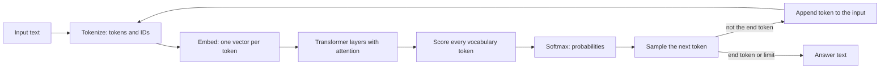

# 02. How Large Language Models Are Trained

**Level:** Foundation · **Reading time:** 30 min · **Exercise:** 45 min
**Prerequisites:** [Machine Learning in a Nutshell](01-machine-learning-in-a-nutshell.md) (parameters, loss, training versus inference)

> **In one sentence:** After this chapter you can explain what happens between "the model reads your text" and "it writes the next word", and you know what a base model can and cannot do.

## Why this matters

You send a prompt to a model and text comes back in a second. Most engineers leave it there and form one of two mental pictures. Either the model is magic. Or it is a search engine that looks up stored sentences.

Both pictures lead to bad decisions. If it is magic, you expect it to be consistent and to know your company's data. If it is a lookup, you expect exact quotes and no mistakes. The model does neither.

This chapter answers four questions. What is the object you are calling? How was it built from data? What did that process put into it? And what did it leave out?

## The core idea

A **large language model (LLM)** is a function with one job. Give it a sequence of text and it returns a probability for every possible next piece of text. Answering questions, writing code and translating all come from doing that one job extremely well on a very large amount of text.

The pieces have names:

- A **token** is a short chunk of text, typically a few characters: a word, part of a word, a space plus a word, or a punctuation mark. "Unbelievable" might be three tokens: `Un`, `belie`, `vable`.
- The **vocabulary** is the fixed list of all tokens the model knows, usually tens to hundreds of thousands of entries.
- An **embedding** is a list of numbers (a **vector**) that stands for a token. Every token ID maps to one vector, as in a lookup table.
- The **transformer** is the network architecture that processes the vectors. Its adjustable numbers are the **parameters**, billions of them.
- **Pre-training** is the process that sets those parameters.

The closest everyday analogy is the autocomplete on your phone. It also predicts the next word from what you typed. The analogy breaks in three ways:

- Phone autocomplete looks at the last word or two. An LLM's prediction depends on everything you gave it, up to its **context window** (the maximum number of tokens it can consider at once).
- Autocomplete counts how often words follow each other. An LLM computes its answer from parameters fitted during training, so it can handle sentences nobody wrote before.
- One call produces one token. A long answer is a loop that feeds the model's own output back into it.

## How it works, step by step

### Inference: from prompt to next token

Yann Dubois lists five steps on his slides: tokenize, forward, predict the probability of the next token, sample, detokenize. Here is what each one means.

1. **Tokenize.** A program called the **tokenizer** cuts your text into tokens from the vocabulary and gives each an ID. Tokenizers are usually trained with **byte pair encoding**: start with one token per character, repeatedly merge the pair of adjacent tokens that appears most often, and stop when the vocabulary reaches the wanted size. Dubois gives the reasons for tokens of this size in his appendix slides: they make shorter sequences than characters, and they handle unseen words and typos better than whole words do.
2. **Embed.** Each token ID is replaced by its vector. Dubois describes the intuition as points in space, where words with similar meanings lie close together ([20:00](https://www.youtube.com/watch?v=r1qZpYAmqmg&t=1200)). Nobody assigns the coordinates. Training moves them.
3. **Combine.** The vectors go through a neural network, a function built by stacking many simple arithmetic steps whose numbers are the parameters. Dubois keeps his description plain: the network is a nonlinear aggregator that merges the vectors into a new one, and its key property is that it is differentiable (you can compute how the output changes when any parameter moves a little), so training can adjust it ([22:00](https://www.youtube.com/watch?v=r1qZpYAmqmg&t=1320)). He even notes that a plain average would already count as such a network. In current LLMs the aggregator is a **transformer**, a stack of many identical layers. In each layer, every token looks back at the earlier tokens and weighs how relevant each one is to it. That step is called **attention** ([deeper explanation](../10-llm-internals/03-transformer-architectures-and-hyperparameters.md)). Consider "she sat on the bank of the river" and "she walked to the bank to withdraw money". The word "bank" starts with the same vector in both. After a few layers its vectors differ, because the neighbors differ.
4. **Score.** His concrete numbers: a 768-number vector times a 768 by 20,000 matrix gives one score for each of the 20,000 words in the vocabulary ([24:00](https://www.youtube.com/watch?v=r1qZpYAmqmg&t=1440)). A function called **softmax** turns the scores into probabilities that add up to 1. He calls it the usual trick for turning any vector into a probability distribution.
5. **Sample, then repeat.** One token is chosen according to those probabilities (more on how in [Chapter 04](04-using-llms-tokens-context-and-sampling.md)), converted back to text, appended to the input, and the whole function runs again. It stops when the model emits a special end-of-output token or hits a limit.

Step 3 is where "looking up" breaks down as a picture. Attention blends information from many tokens into a weighted average. There is no table of sentences to search.

**Figure 1.** One call to a language model: five steps, then a loop until the answer ends.



The model never writes a sentence in one go: each turn of the loop adds one token, and the input grows by one.

### Training: the loop from chapter 01, at scale

Pre-training is the optimization loop you met in [Chapter 01](01-machine-learning-in-a-nutshell.md), with one change of ingredient:

1. **The function with blanks** is the transformer, with billions of parameters.
2. **The examples** come from cleaned text, cut into chunks of a few thousand tokens.
3. **The loss** is low when the model gives a high probability to the token that actually comes next, at every position in the chunk. Dubois names it, the cross-entropy loss.
4. **Training** nudges every parameter a little in the direction that lowers that loss, then moves to the next chunk. In his description, training pushes the true next token's probability up a little and every other one down, then backpropagates, which applies the change to every layer back to the embeddings ([24:00](https://www.youtube.com/watch?v=r1qZpYAmqmg&t=1440)).

No labeling step is needed. The next token is already in the text, so the text supplies its own labels. That is why pre-training can run on the whole web, and why its cost is measured in data and compute rather than in annotators.

### Pre-training data

Dubois's recipe, as he presents it in his Fall 2025 lecture:

1. Download pages. He names **Common Crawl**, a public snapshot of the web with about 250 billion pages ([26:00](https://www.youtube.com/watch?v=r1qZpYAmqmg&t=1560)).
2. Extract text from the HTML. Math and page furniture are hard, and at this scale the extraction itself is expensive.
3. Filter unwanted content, such as personal information.
4. Deduplicate. Headers, footers and menus repeat on every page of a forum. Dubois says deduplication can run by document, by line or by paragraph ([28:00](https://www.youtube.com/watch?v=r1qZpYAmqmg&t=1680)).
5. Apply heuristic filters. Drop very short or very long documents and pages full of rare tokens ([30:00](https://www.youtube.com/watch?v=r1qZpYAmqmg&t=1800)).
6. Apply model-based filters. One method he likes: train a classifier that predicts whether Wikipedia would link to a page, then keep the pages it scores highly ([30:00](https://www.youtube.com/watch?v=r1qZpYAmqmg&t=1800)).
7. Set the **data mix**. Classify pages by domain and re-weight them. His example: a coding model may raise the share of code from about 5% to about 50% ([32:00](https://www.youtube.com/watch?v=r1qZpYAmqmg&t=1920)).

The funnel is steep. In the FineWeb pipeline he shows, blocklists and simple document filters take 200 billion pages to 36 billion, deduplication to 20 billion, and a last round that removes more JavaScript and placeholder text to 15 billion (his slide; he walks through the last rounds at [36:00](https://www.youtube.com/watch?v=r1qZpYAmqmg&t=2160)). After the main run comes **mid-training**: continued training on under a trillion tokens of higher-quality data, with more code, science or multilingual text and a longer context ([36:00](https://www.youtube.com/watch?v=r1qZpYAmqmg&t=2160)).

He argues that this work is the decisive part: processing data well is "basically the key for training LLMs" ([40:00](https://www.youtube.com/watch?v=r1qZpYAmqmg&t=2400)). He also notes that labs keep their data secret, for competitive reasons and because of copyright risk.

### Pre-training compute

- **Scale drives quality.** Dubois's claim, as an empirical observation: for any model and data, the most important factor is how much compute training uses ([40:00](https://www.youtube.com/watch?v=r1qZpYAmqmg&t=2400)).
- **Scaling laws** make that predictable. Loss falls smoothly as data, parameters and compute grow, so you can run small experiments and extrapolate. Dubois contrasts the old approach (train about 30 full candidates and pick the best) with the new one (tune on small models, fit the law, spend about 90% of the compute on one final run) ([44:00](https://www.youtube.com/watch?v=r1qZpYAmqmg&t=2640)).
- **Data and parameters must grow together.** The Chinchilla rule of thumb, from a paper of that name, is about 20 training tokens per parameter ([46:00](https://www.youtube.com/watch?v=r1qZpYAmqmg&t=2760)). He notes that it ignores the cost of serving the model, so labs train smaller models on more tokens than that ([48:00](https://www.youtube.com/watch?v=r1qZpYAmqmg&t=2880)).

Dubois walks through a worked estimate for LLaMA 3 405B ([50:00](https://www.youtube.com/watch?v=r1qZpYAmqmg&t=3000)). Training cost is roughly 6 × tokens × parameters floating-point operations (**FLOPs**). For 15.6 trillion tokens and 405 billion parameters that is about 3.8 × 10²⁵ FLOPs, roughly half the 10²⁶ threshold at which, he notes, an executive order asks for more care. His slides complete the arithmetic: on 16,000 H100 **GPUs** (the processors built for this kind of math), about 26 million GPU-hours and 70 days, roughly $52 million at $2 per GPU-hour, and about 4,400 tons of CO₂. In the lecture he gives the cost as a range, $15 million to $80 million, depending on the price of compute, and compares the emissions to about 2,000 return flights from New York to London. This is why only a few organizations pre-train, and why you will start from an existing base model.

## Worked example

A counting model shows why LLMs are neural networks. This is the n-gram idea Dubois starts from: the probability of the next word is how often it followed the context, divided by how often the context occurred ([18:00](https://www.youtube.com/watch?v=r1qZpYAmqmg&t=1080)). A plain Python version:

```python
from collections import Counter

text = ("the grass is green . the grass is wet . the car is red . "
        "the car is fast . the river is cold .")
tokens = text.split()

def build(tokens, n):
    """Count how often each token follows each context of n-1 tokens."""
    counts = Counter()
    for i in range(len(tokens) - n + 1):
        counts[tuple(tokens[i:i + n])] += 1
    return counts

def probs(counts, context):
    """P(next | context) = count(context, next) / count(context)."""
    total = sum(c for key, c in counts.items() if key[:-1] == context)
    if total == 0:
        return {}                              # context never seen: nothing to say
    return {key[-1]: round(c / total, 2) for key, c in counts.items() if key[:-1] == context}

print(probs(build(tokens, 2), ("is",)))                       # {'green': 0.2, 'wet': 0.2, ...}
print(probs(build(tokens, 3), ("grass", "is")))               # {'green': 0.5, 'wet': 0.5}
print(probs(build(tokens, 5), ("the", "car", "is", "red")))   # {'.': 1.0}
print(probs(build(tokens, 5), ("a", "car", "is", "red")))     # {}  never seen
```

What to observe:

- **More context sharpens the prediction.** After "is", five continuations tie. After "grass is", two remain.
- **More context also makes the table sparse.** With four tokens of context, every context in this corpus is unique, so every probability is 1.0.
- **Anything new gets nothing.** Change "the" to "a" and the model has no distribution at all.

Dubois names both problems at [20:00](https://www.youtube.com/watch?v=r1qZpYAmqmg&t=1200): the table needs too much memory, and a context that never occurred gets a probability of zero, even though the true probability is above zero. His fix is to replace the table of counts with a neural network. The network has a fixed number of parameters, whatever text it meets, and it generalizes to new contexts because similar contexts produce similar calculations.

## What a base model is and is not

The result of pre-training is a **base model**. It is an excellent text-continuer, and that is all it was trained to be.

Dubois describes the gap with a GPT-3 example ([52:00](https://www.youtube.com/watch?v=r1qZpYAmqmg&t=3120), [54:00](https://www.youtube.com/watch?v=r1qZpYAmqmg&t=3240)). Asked to explain the moon landing to a six-year-old, the model answered with more questions of the same kind, such as asking to explain gravity to a six-year-old. On the web, a question like that is often followed by more questions, so that is the likely continuation. In his words at [2:00](https://www.youtube.com/watch?v=r1qZpYAmqmg&t=120), it is "a model that knows everything about the world, but it doesn't actually know how to interact with a human".

| A base model is | A base model is not |
|---|---|
| A next-token predictor trained on text | An assistant that waits for instructions |
| A broad statistical picture of how text goes | A database that returns stored facts |
| Able to continue any pattern, including your question | Dependable about facts, above all rare or private ones |
| The raw material for assistants | Usually the thing you ship to users |
| Limited to what was in its training data | Aware of later or private information |

The right-hand column is what **post-training** fixes. [Chapter 03](03-from-base-model-to-assistant-post-training.md) covers it.

## What the practitioners say

Dubois organized the lecture around five things a trainer must decide: the architecture, the training algorithm and loss, the data and RL environments, the evaluation, and the systems that let it scale ([8:00](https://www.youtube.com/watch?v=r1qZpYAmqmg&t=480)). He spent little time on architecture and much on data, compute and systems.

Three of his points are worth keeping:

- **The bitter lesson.** He endorses Richard Sutton's 2019 argument: methods that make the best use of growing compute win in the long run, so do the simple thing and scale it ([48:00](https://www.youtube.com/watch?v=r1qZpYAmqmg&t=2880), [50:00](https://www.youtube.com/watch?v=r1qZpYAmqmg&t=3000)). This is his position, not a settled fact.
- **Size has orders of magnitude.** As he reports them, pre-training takes more than 10 trillion tokens and months. LLaMA 2 used about 2 trillion tokens, LLaMA 3 about 15 trillion, LLaMA 4 between 20 and 40 trillion ([40:00](https://www.youtube.com/watch?v=r1qZpYAmqmg&t=2400)).
- **Efficiency is part of the design.** A training run rarely reaches a processor's theoretical speed. The share it does reach is the **model FLOP utilization (MFU)**, the ratio of observed to theoretical throughput ([94:00](https://www.youtube.com/watch?v=r1qZpYAmqmg&t=5640)). Dubois treats 50% as very good, and says even big companies may be working to get past 15 or 20% ([96:00](https://www.youtube.com/watch?v=r1qZpYAmqmg&t=5760)). Two techniques push it up: lower-precision arithmetic, with matrix multiplications in 16-bit rather than 32-bit numbers, and fusing operations so that data moves less between slow and fast memory.

His slides also introduce **perplexity**, the standard pre-training score. It is the model's loss on unseen text, converted into the number of tokens the model hesitates between. Lower is better. Between 2017 and 2023, as his slides report, models went from hesitating among about 70 tokens to fewer than 10. The same slides add that it is no longer used for academic benchmarks but still matters during development.

## Pitfalls

1. **Thinking the model looks answers up.** It computes a probability distribution. It can produce sentences no one wrote, and confident sentences that are false. *Fix:* treat every factual claim as unverified unless the context supports it.
2. **Sending instructions to a base model.** It continues them. *Fix:* use a post-trained chat model. With a base model, show examples of what you want first (see [Chapter 05](05-prompting-and-in-context-learning.md)).
3. **Expecting private or recent knowledge.** It was never in the training data. *Fix:* put the information in the prompt or attach it through retrieval.
4. **Counting words.** Models count tokens, and a token is not a word. Prices, context limits and speeds are all per token. *Fix:* measure in tokens.
5. **Equating more parameters with a better model.** Parameters, data and compute must grow together. *Fix:* when you compare models, look at the whole training recipe and at evaluation results.
6. **Planning to pre-train your own model.** As of 2025, a frontier-scale run costs tens of millions of dollars by the lecture's estimate. *Fix:* start from an existing base model and adapt it by prompting or fine-tuning. Dubois's slides contrast the budgets: prompting takes hours and no compute budget, fine-tuning takes days.

## Try it

Grow the counting model until it breaks. That failure is the reason LLMs exist.

**Deliverable:** the script above, extended, plus a short results file.

1. Save a long plain-text file, for example a book in English from Project Gutenberg. Split it into a training part (90%) and a held-out part (10%).
2. For context lengths of 1, 2, 3 and 4 tokens, build the counting model on the training part (in `build`, pass `n` one higher than the context length). For each length, report the share of contexts in the held-out part that the model has never seen.
3. Add a `generate(context, n_tokens)` function that always picks the most likely next token. Generate 30 tokens from the best length.

**You are done when:** your results file contains a four-row table (context length versus share of unseen contexts) and the generated text. The share of unseen contexts should rise with context length. If it does not, check that you are measuring on the held-out part.

**Stretch goal:** smooth the model so an unseen context no longer returns an empty distribution: back off to a shorter context. Then compare the output with step 3 and describe which one reads better and why.

## Key takeaways

- An LLM is a function from a token sequence to a probability for every next token. Text comes out by sampling a token, appending it and calling again.
- Text is cut into tokens, each token becomes a vector, and a transformer refines the vectors layer by layer through attention. The parameters are the numbers in those layers.
- Pre-training is the loop from chapter 01: a loss on next-token prediction, lowered by adjusting parameters over trillions of tokens. The text labels itself.
- Data processing is most of the craft: extraction, filtering, deduplication and data mix. Compute, data and parameters must scale together.
- A base model only continues text. Knowing how to help a user is added later, by post-training.

## Self-check

1. Why split text into sub-word tokens rather than characters or whole words?
   - A. They keep sequences short and still handle unseen words.
   - B. They make every sentence the same number of tokens.
   - C. They let the tokenizer discard punctuation and spaces.
   - D. They remove the need for an embedding table.

2. Where does what a model "knows" live?
   - A. In an index of the sentences it was trained on.
   - B. In the parameter values set during training.
   - C. In the vocabulary file of the tokenizer.
   - D. In the system prompt sent with each call.

3. A base model answers your question with three more questions. Why?
   - A. It was trained with too few parameters.
   - B. Its tokenizer split the question incorrectly.
   - C. Online, a question is often followed by more questions.
   - D. Its sampling temperature was set too high.

4. About how many training tokens per parameter does the Chinchilla rule of thumb suggest?
   - A. 2
   - B. 20
   - C. 200
   - D. 2,000

5. Why does pre-training need no labeling step?
   - A. Volunteers labeled the public web in advance.
   - B. The token that follows is already in the text.
   - C. Pre-training has no loss, so there are no labels.
   - D. A reward model supplies the missing labels.

6. What makes a counting model fail on text it has never seen?
   - A. It stores its counts in floating-point numbers.
   - B. It cannot be trained on more than one language.
   - C. It assigns no probability to unseen contexts.
   - D. It always picks the most frequent token.

<details><summary>Show answers</summary>

1. A. Tokens are a compromise: shorter sequences than characters, and more robust to new words than whole words.
2. B. There is no index to search. Behavior is computed from the parameters.
3. C. A base model continues text. More questions of the same kind is a plausible continuation.
4. B. About 20. Dubois adds that the rule ignores inference cost, so practical ratios are higher.
5. B. The next token is the label, so pre-training scales with available text and compute.
6. C. A context that never occurred has a count of zero, so the model has nothing to predict with. A neural network gives similar inputs similar outputs instead.

</details>

## Sources

- **Lecture:** Yann Dubois, "Introduction to training LLMs for AI agents", LLM Agents MOOC (Fall 2025): [video](https://www.youtube.com/watch?v=r1qZpYAmqmg), used at [pre-training](https://www.youtube.com/watch?v=r1qZpYAmqmg&t=0), [the base-model gap](https://www.youtube.com/watch?v=r1qZpYAmqmg&t=120), [counting versus neural models](https://www.youtube.com/watch?v=r1qZpYAmqmg&t=1200), [neural language models](https://www.youtube.com/watch?v=r1qZpYAmqmg&t=1320), [data filtering](https://www.youtube.com/watch?v=r1qZpYAmqmg&t=1800), [scaling laws](https://www.youtube.com/watch?v=r1qZpYAmqmg&t=2640), [the cost of one run](https://www.youtube.com/watch?v=r1qZpYAmqmg&t=3000), [a base model's behavior](https://www.youtube.com/watch?v=r1qZpYAmqmg&t=3120), [utilization](https://www.youtube.com/watch?v=r1qZpYAmqmg&t=5640)

## Next

→ [From Base Model to Assistant: Post-Training](03-from-base-model-to-assistant-post-training.md). Pre-training gives a text-continuer. The next chapter shows how fine-tuning and reinforcement learning turn it into something that follows instructions and reasons.
