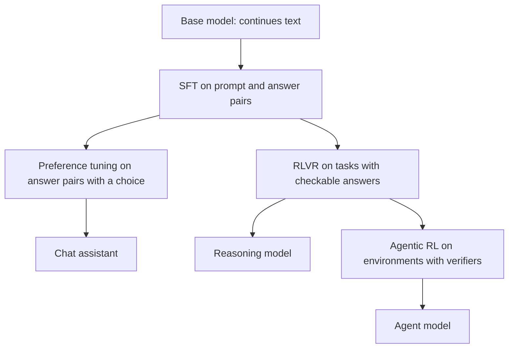

# 03. From Base Model to Assistant: Post-Training

**Level:** Practitioner · **Reading time:** 30 min · **Exercise:** 60 min
**Prerequisites:** [How Large Language Models Are Trained](02-how-large-language-models-are-trained.md) (the training loop and what a base model is)

> **In one sentence:** After this chapter you can explain what each post-training stage adds to a base model, and choose between prompting, fine-tuning, preference tuning and reinforcement learning for a product.

## Why this matters

You can download a base model today. Ask it a question and it answers with more questions, because it only continues text ([Chapter 02](02-how-large-language-models-are-trained.md)). The chat model you call through an API behaves differently. It answers, follows instructions, refuses some requests and reasons step by step.

Something was done to it. If you want a model to behave differently for your product, you have to know what that something is. You also have to choose a lever, and the levers differ by orders of magnitude in cost.

## The core idea

**Post-training** is every training stage that comes after pre-training. It uses the same loop you met in [Chapter 01](01-machine-learning-in-a-nutshell.md): parameters, a loss, small nudges. What changes is the objective. Pre-training rewards predicting the next token of web text. Post-training rewards something you actually want.

Yann Dubois states the problem in his Fall 2025 lecture. Pre-training data scales, but it is not what you want. The answers you want are scarce and expensive ([58:00](https://www.youtube.com/watch?v=r1qZpYAmqmg&t=3480)). Post-training is the bridge: a pre-trained model plus a little of the right data.

It comes as a ladder. Each rung optimizes a different thing, from a different kind of data. The top three rungs rely on **reinforcement learning (RL)**: the model tries, a score called a **reward** rates the try, and training nudges the model toward the tries that scored higher.

| Rung | What it optimizes | The data | An algorithm |
|---|---|---|---|
| Supervised fine-tuning | Imitating good answers | Prompt and answer pairs | Next-token loss on the answer |
| Preference tuning | Answers people prefer | Prompt, two answers, a choice | RLHF with PPO, or DPO |
| RL with verifiable rewards | Answers a program accepts | Tasks with checkable answers | GRPO and similar |
| Agentic RL | Task success in an environment | Environments, tools, verifiers | RL on whole trajectories |

An analogy is onboarding a brilliant new hire. Pre-training is their education. Supervised fine-tuning is showing them examples of good work. Preference tuning is reviewing pairs of their drafts and saying which is better. Verifiable-reward training is handing them problems with an answer key and letting them practice until they solve them. The analogy breaks on memory. The hire keeps what they learn. The model changes only when a training run updates its parameters.

## How it works, step by step

### 1. Supervised fine-tuning: imitate good answers

**Supervised fine-tuning (SFT)** keeps the pre-training objective and changes the data. The model practices predicting the tokens of a good answer, given a prompt. "Supervised" means each prompt comes with a target answer.

- **What it teaches.** Dubois lists instruction following, format and style, tool use and early reasoning ([64:00](https://www.youtube.com/watch?v=r1qZpYAmqmg&t=3840)).
- **How much data.** Dubois says about 10,000 examples are enough for style and instruction following, citing the LIMA paper of 2023, which showed the effect with 2,000. DeepSeek-R1 used about 800,000 to teach reasoning ([66:00](https://www.youtube.com/watch?v=r1qZpYAmqmg&t=3960)).
- **Why so little works.** His mental model: the knowledge is already in the pre-trained model. SFT selects one way of using it, as if specializing to one kind of user. For content the model rarely saw during pre-training, he adds, you need much more data ([68:00](https://www.youtube.com/watch?v=r1qZpYAmqmg&t=4080)).
- **Where the answers come from.** From people, which is slow. From a stronger model, which is the idea of Alpaca. Or by **rejection sampling**: let a model write many answers and keep the ones a checker accepts. Dubois points to Kimi K2, which taught tool use by having three LLMs play the agent, the user and the tools ([66:00](https://www.youtube.com/watch?v=r1qZpYAmqmg&t=3960)).

Hanna Hajishirzi's team, which builds the open Tülu recipes, adds two findings. Step-by-step solutions train better than bare final answers. Her example is a shirt sale: a model fine-tuned only on the question and the final answer, $125, learns little from that example, so her data explains the steps as if to a child ([20:00](https://www.youtube.com/watch?v=cMiu3A7YBks&t=1200)). And data quality beats quantity. For the synthetic math data, her team generated several solutions per problem, kept those agreeing with the majority answer and threw away about 40%. The remaining 60% gave similar math results and a larger gain on GSM8K, a grade-school math test set ([28:00](https://www.youtube.com/watch?v=cMiu3A7YBks&t=1680)).

**Figure 1.** The post-training ladder: what each rung trains on and what comes out of it.



The branch at the second rung is a choice of data: preference pairs when there is no single right answer, tasks with a checker when there is one.

Jiantao Jiao, in his Fall 2025 lecture, adds a warning about the dose. SFT should be light, and its examples diverse. A model fine-tuned heavily on one "right" answer per question loses the ability to find answers itself ([46:00](https://www.youtube.com/watch?v=3l0Zxus34es&t=2760)).

### 2. Why imitation is not enough

Dubois describes SFT as behavior cloning, and names three costs ([68:00](https://www.youtube.com/watch?v=r1qZpYAmqmg&t=4080), [70:00](https://www.youtube.com/watch?v=r1qZpYAmqmg&t=4200)):

1. **It is bounded by what people can write.** People can recognize a better answer than they can produce.
2. **It teaches hallucination.** If the training answer contains a reference the model never saw, the lesson is: produce plausible-looking references even when you do not know.
3. **Good answers are expensive.**

So the next rungs replace "copy this" with "be judged".

### 3. Preference tuning: reward models, RLHF and DPO

For an open-ended request there is no correct answer to copy. There are only judgments: of these two answers, this one is better. Two methods use them.

- **RLHF**, or reinforcement learning from human feedback, works in two training phases. First, people compare pairs of answers to the same prompt. A **reward model**, a second model trained on those comparisons, learns to score answers. Then the language model is trained by RL to maximize that score.
- **DPO**, or direct preference optimization, removes the reward model and the RL loop. It applies a loss directly to the language model: raise the probability of the preferred answer and lower that of the rejected one.

Dubois walks through the original RLHF pipeline: an instruction goes to an SFT model, which writes two answers; labelers pick the better one; the model is then trained to produce more answers like the winner. He adds: "This is really what made ChatGPT work in 2022" ([78:00](https://www.youtube.com/watch?v=r1qZpYAmqmg&t=4680)). The optimizer used for the second phase is usually **PPO**, proximal policy optimization, which improves the model in small clipped steps. His slides show the ordering of results: pre-trained, then SFT, then RL, each better than the last.

Human preference data has known problems, which he lists ([80:00](https://www.youtube.com/watch?v=r1qZpYAmqmg&t=4800)). It is slow and expensive. People judge form, such as length, more than content. The results depend on who the annotators are. A common replacement is an LLM judge: AlpacaFarm used model preferences, and Jason Weston's **self-rewarding language models** let a model score its own answers and train on them in a loop. In his version a Llama 2 70B model, seeded with Open Assistant instructions, grades each answer from 0 to 5 after writing its reasoning ([40:00](https://www.youtube.com/watch?v=_MNlLhU33H0&t=2400)).

A further risk is **over-optimization**: the model learns to please the learned reward model rather than the people it stands for. Hajishirzi shows it in her own training curves. As preference training goes on, the chat score flattens, the instruction-following score dips, and the math score rises and then falls ([50:00](https://www.youtube.com/watch?v=cMiu3A7YBks&t=3000)). Her remedy, for tasks that can be checked, is to drop the learned reward model and use a rule instead ([52:00](https://www.youtube.com/watch?v=cMiu3A7YBks&t=3120)).

### 4. Reinforcement learning with verifiable rewards

A **verifiable reward** comes from a program, not from a person or a learned model: a string match, a math check, a unit test that passes. **RLVR**, reinforcement learning with verifiable rewards, trains the model on tasks with such a checker.

- **Hajishirzi's version.** She calls RLVR the third stage of Tülu 3 ([48:00](https://www.youtube.com/watch?v=cMiu3A7YBks&t=2880)). For a question such as "what is 2 plus 2?", the reward is 1 if the final answer equals the gold answer, the known correct one, and 0 otherwise. She used it for two math sets and for precise instruction following, where the checker tests constraints such as starting a sentence with a given letter. No chain of thought (the steps written before the answer) is needed, only the final answer ([52:00](https://www.youtube.com/watch?v=cMiu3A7YBks&t=3120), [54:00](https://www.youtube.com/watch?v=cMiu3A7YBks&t=3240)). It helps more as the base model gets stronger: on math, her 405B model went from 60 to 67 and a model with a weaker base only from 42 to 45 ([62:00](https://www.youtube.com/watch?v=cMiu3A7YBks&t=3720)).
- **How one step looks.** Dubois explains GRPO, the algorithm DeepSeek-R1 used ([72:00](https://www.youtube.com/watch?v=r1qZpYAmqmg&t=4320), [74:00](https://www.youtube.com/watch?v=r1qZpYAmqmg&t=4440)). The model writes several answers to one question. A checker scores each. The scores are normalized within the group, so the better-than-average answers are made more likely and the others less. A penalty keeps the model close to a reference copy of its starting point. He calls that penalty a hack, because RL can wander where you do not want. Infrastructure matters here too: every question needs several samples, and long agent runs can block the training compute.
- **Which tasks.** In DeepSeek-R1, as Dubois describes it, math, code and logic prompts got rule-based checkers. Open-ended writing still used a reward model ([72:00](https://www.youtube.com/watch?v=r1qZpYAmqmg&t=4320)).

**Reasoning models** are trained this way on hard problems with checkable answers. They learn to write a long chain of thought before the final answer, because that raises their score. OpenAI's o1 (September 2024) made the approach public. As Weston says, its exact method is unknown, because no paper was published ([50:00](https://www.youtube.com/watch?v=_MNlLhU33H0&t=3000)). DeepSeek-R1 (January 2025) published a recipe. Weston's team had used the same kind of reward on math in 2024: take the text after "Final answer:", compare it with the known answer, and use the result to build preference pairs, then repeat with the improved model ([48:00](https://www.youtube.com/watch?v=_MNlLhU33H0&t=2880)). He stresses that fine-tuning on the correct answers alone did not work. The wrong answers had to be pushed down too ([50:00](https://www.youtube.com/watch?v=_MNlLhU33H0&t=3000)). What he likes about R1 is its simplicity: only the final answer is rewarded, and the model learns by itself to stop and re-evaluate a step ([54:00](https://www.youtube.com/watch?v=_MNlLhU33H0&t=3240)).

Jiao extends the idea from single answers to whole tasks, which is the last rung. An **agentic model**, in his definition, is aligned, meaning tuned, to environment feedback and maximizes verifiable rewards in addition to human preference ([0:00](https://www.youtube.com/watch?v=3l0Zxus34es&t=0)). Its training data has three parts:

1. **Environments** the model must understand, such as a code repository or a browser.
2. **Tools** it can call.
3. **Verifiers** that judge the result: unit tests, proof checkers, page checks.

His two rules: verifiers must be diverse, and their quality matters. A verifier must neither accept wrong answers nor reject correct ones. His example is a change problem where ½ and 2/4 are both right, unless the question asks for the simplest form (his slides). He also argues for judging more than correctness: cost in steps and tokens belongs in the score too ([14:00](https://www.youtube.com/watch?v=3l0Zxus34es&t=840)).

### 5. Jiao's recipe: imitate, then explore

Jiao's principle for the order of stages is to imitate first and then explore. SFT is there to jump-start the model and cut out meaningless attempts. RL then reinforces the attempts that succeed, because, as he puts it, the more you explore by yourself, the better you learn ([44:00](https://www.youtube.com/watch?v=3l0Zxus34es&t=2640)). His summary: "RL is here to truly reinforce intelligence" ([48:00](https://www.youtube.com/watch?v=3l0Zxus34es&t=2880)). His advice falls in three parts:

1. **Train longer.** Watch for **entropy collapse**. **Entropy** here is the uncertainty in the model's next-token choice. Left alone, training raises the reward and lowers the entropy until the model gives one token 99% of the probability and always produces the same answer ([58:00](https://www.youtube.com/watch?v=3l0Zxus34es&t=3480)). Remedies he lists include learning only from the model's own current attempts and adding a loss that rewards entropy ([60:00](https://www.youtube.com/watch?v=3l0Zxus34es&t=3600), [64:00](https://www.youtube.com/watch?v=3l0Zxus34es&t=3840)).
2. **Train on hard tasks**, ones with a low but nonzero chance of success. His evidence: a model trained only on GSM8K, which he calls too easy, ends with a low validation accuracy. He also warns against simply piling in very hard prompts ([68:00](https://www.youtube.com/watch?v=3l0Zxus34es&t=4080), [70:00](https://www.youtube.com/watch?v=3l0Zxus34es&t=4200)).
3. **See diverse responses** with high-quality feedback. Good and bad attempts should both be varied, because diversity speeds up learning ([44:00](https://www.youtube.com/watch?v=3l0Zxus34es&t=2640)).

### 6. Open training recipes

Tülu 3, from Hajishirzi's group and AI2, is an open, reproducible recipe that starts from a base model and goes through SFT, preference tuning and RLVR, sometimes moving back and forth between the stages. Her group applied it to open-weight models, whose parameters are published, OLMo among them ([10:00](https://www.youtube.com/watch?v=cMiu3A7YBks&t=600)). Before any training, the team fixed evaluations for each targeted skill, from chat and math to safety and precise instruction following ([10:00](https://www.youtube.com/watch?v=cMiu3A7YBks&t=600)). Her team's study of preference tuning found that high-quality data was the most important factor. PPO worked better than DPO, but DPO was much cheaper to experiment with ([44:00](https://www.youtube.com/watch?v=cMiu3A7YBks&t=2640)). When they built Tülu 3 itself, they saw little gain from PPO and kept DPO for simplicity ([46:00](https://www.youtube.com/watch?v=cMiu3A7YBks&t=2760)). Dubois makes a related point about pre-training data: labs keep it secret because it is the most important part ([40:00](https://www.youtube.com/watch?v=r1qZpYAmqmg&t=2400)).

## Worked example

The three kinds of post-training data, and the code that makes the third kind work:

```python
import re
from math import isclose

sft_row = {"prompt": "Explain recursion in one sentence.",
           "answer": "Recursion is a function that solves a problem by calling itself on a smaller case."}

preference_row = {"prompt": "Explain recursion in one sentence.",
                  "chosen": "Recursion is a function that solves a problem by calling itself on a smaller case.",
                  "rejected": "Recursion is when recursion happens."}

task = {"question": "What is 17 * 23?", "answer": "391"}      # for RLVR: a program can check it

def reward(model_output, task):
    """Rule-based verifier: 1 if the number after 'Final answer:' is right, else 0."""
    tail = model_output.split("Final answer:")[-1]
    numbers = re.findall(r"\d+(?:\.\d+)?", tail)
    return int(bool(numbers) and isclose(float(numbers[-1]), float(task["answer"])))

print(reward("17 * 23 = 391. Final answer: 391", task))   # 1
print(reward("Let me compute. Final answer: 390", task))  # 0
print(reward("I am not sure.", task))                     # 0
```

What to observe:

- The reward is ordinary code. You can unit-test it, review it and version it. That is the whole advantage of verifiable rewards.
- A near miss and a non-answer both score 0. The signal is binary, so the model needs many attempts per task.
- The same `reward` function lets you build SFT data by rejection sampling: sample many answers, keep those that score 1.

## Pitfalls

1. **Fine-tuning to add knowledge.** SFT mainly teaches format and behavior. *Fix:* put facts in the prompt or attach them by retrieval. Fine-tune for style, format and tool use.
2. **Training on answers the model cannot know.** You reward confident invention. *Fix:* fine-tune only on what it can learn, or use checkable tasks.
3. **Choosing by data volume.** *Fix:* curate for quality and diversity, then measure with an ablation (train again with one ingredient removed and compare).
4. **Over-optimizing a learned reward model.** The output drifts toward what that model likes, such as length. *Fix:* prefer rule-based rewards, keep the drift penalty, and evaluate with people on fresh prompts.
5. **Tuning before evaluating.** *Fix:* define evaluations for each target skill first, as the Tülu team does.
6. **Starting at the top of the ladder.** *Fix:* climb. Prompt, then SFT, then preference tuning, then RLVR.
7. **A weak verifier.** A checker with false accepts trains the wrong behavior. *Fix:* test the verifier with correct answers in every allowed form.

## Try it

**Deliverable:** three data files and one tested checker for a single task of your choice.

1. Write 20 SFT rows, 20 preference rows and 20 verifiable tasks, each as one JSON object per line.
2. Write the checker for the verifiable tasks. Unit-test it with right answers in several forms, wrong answers and non-answers.
3. With any chat model you can call, sample 16 answers per verifiable task. Record how many pass.
4. Convert every passing answer into an SFT row.

Calling a hosted model 320 times costs well under one dollar with a small model (estimate, as of November 2026; check your provider's prices).

**You are done when:** the checker's tests include at least one case that must not be accepted; the three files parse line by line; and you report the share of tasks solved 0 times in 16 and the share solved 16 times. Those are the tasks Jiao says teach nothing.

**Stretch goal:** fine-tune a small open model on your SFT rows with an open recipe such as Tülu. This needs a GPU or a rented one. Compare it against the base model on held-out tasks.

## Key takeaways

- Post-training is the same training loop with a new objective and far less data than pre-training.
- SFT imitates good answers. It teaches format, instruction following and tool use, but cloning what the model cannot know teaches it to invent.
- Preference tuning optimizes what people prefer: RLHF through a reward model and PPO, or DPO directly on pairs. Watch for over-optimization.
- RLVR optimizes what a program can check. It is how reasoning models learn to think at length, and it extends to whole tasks through environments, tools and verifiers.
- Imitate first, then explore. Then train long on hard tasks without letting the model collapse to one answer.
- Climb the ladder: prompt, SFT, preference tuning, RLVR. Each rung costs more than the one below.

## Self-check

1. What does supervised fine-tuning optimize?
   - A. The next-token loss on provided good answers
   - B. The score of a separately trained reward model
   - C. The pass or fail result of a unit test
   - D. The share of human votes won against another model

2. How can SFT teach a model to hallucinate?
   - A. By lowering the sampling temperature during the training run
   - B. By removing the rare tokens from the tokenizer's vocabulary
   - C. By cloning answers that contain facts the model never knew
   - D. By training on web text that was never deduplicated

3. What does DPO leave out compared with RLHF?
   - A. The pairs of preferred and rejected answers
   - B. The separate reward model and the RL loop
   - C. The supervised fine-tuning stage before it
   - D. The evaluation that follows the training

4. What supplies the reward in RLVR?
   - A. A crowd of human voters on answer pairs
   - B. A reward model trained on human preferences
   - C. A program that checks the answer
   - D. The model's own confidence in its output

5. According to Dubois, about how many examples does SFT need to teach style and instruction following?
   - A. About one hundred
   - B. About ten thousand
   - C. About one million
   - D. About ten trillion

6. During RL, a model's reward rises and it starts giving the same answer to every prompt. What did Jiao call this?
   - A. Over-optimization
   - B. Data contamination
   - C. Reward sparsity
   - D. Entropy collapse

<details><summary>Show answers</summary>

1. A. SFT reuses the pre-training objective on chosen prompt-answer pairs.
2. C. The model learns that a confident-sounding invented reference is a correct answer.
3. B. DPO applies a loss directly to the language model on the preference pairs.
4. C. A rule, such as a string match or a passing test. No human or learned model sits in the loop.
5. B. About 10,000, against about 800,000 for DeepSeek-R1's reasoning data.
6. D. The model stops exploring. Jiao's first pillar is to train longer while avoiding this.

</details>

## Sources

- **Lecture:** Yann Dubois, "Introduction to training LLMs for AI agents", LLM Agents MOOC (Fall 2025): [video](https://www.youtube.com/watch?v=r1qZpYAmqmg) · [guide](../lectures/f25-01-llm-agents-overview.md), used at [why post-training](https://www.youtube.com/watch?v=r1qZpYAmqmg&t=3480), [what SFT teaches](https://www.youtube.com/watch?v=r1qZpYAmqmg&t=3840), [limits of imitation](https://www.youtube.com/watch?v=r1qZpYAmqmg&t=4080), [GRPO](https://www.youtube.com/watch?v=r1qZpYAmqmg&t=4320), [RLHF](https://www.youtube.com/watch?v=r1qZpYAmqmg&t=4680), [human data](https://www.youtube.com/watch?v=r1qZpYAmqmg&t=4800)
- **Lecture:** Jiantao Jiao, "Post-Training Verifiable Agents", Agentic AI MOOC (Fall 2025): [video](https://www.youtube.com/watch?v=3l0Zxus34es) · [guide](../lectures/f25-03-post-training-verifiable-agents.md), used at [agentic models](https://www.youtube.com/watch?v=3l0Zxus34es&t=0), [verifiers](https://www.youtube.com/watch?v=3l0Zxus34es&t=840), [light SFT](https://www.youtube.com/watch?v=3l0Zxus34es&t=2760), [explore](https://www.youtube.com/watch?v=3l0Zxus34es&t=2640), [imitate then explore](https://www.youtube.com/watch?v=3l0Zxus34es&t=2880), [entropy collapse](https://www.youtube.com/watch?v=3l0Zxus34es&t=3480), [hard tasks](https://www.youtube.com/watch?v=3l0Zxus34es&t=4080)
- **Lecture:** Hanna Hajishirzi, "Open Training Recipes: LLM Reasoning", Advanced LLM Agents MOOC (Spring 2025): [video](https://www.youtube.com/watch?v=cMiu3A7YBks) · [guide](../lectures/sp25-04-open-training-recipes-for-reasoning-in-language.md), used at [the Tülu 3 recipe](https://www.youtube.com/watch?v=cMiu3A7YBks&t=600), [step-by-step data](https://www.youtube.com/watch?v=cMiu3A7YBks&t=1200), [data filtering](https://www.youtube.com/watch?v=cMiu3A7YBks&t=1680), [preference tuning](https://www.youtube.com/watch?v=cMiu3A7YBks&t=2640), [over-optimization](https://www.youtube.com/watch?v=cMiu3A7YBks&t=3000), [RLVR](https://www.youtube.com/watch?v=cMiu3A7YBks&t=3120)
- **Lecture:** Jason Weston, "Learning to Reason with LLMs", Advanced LLM Agents MOOC (Spring 2025): [video](https://www.youtube.com/watch?v=_MNlLhU33H0) · [guide](../lectures/sp25-02-learning-to-reason-with-llms.md), used at [self-rewarding models](https://www.youtube.com/watch?v=_MNlLhU33H0&t=2400), [verifiable rewards](https://www.youtube.com/watch?v=_MNlLhU33H0&t=2880), [o1](https://www.youtube.com/watch?v=_MNlLhU33H0&t=3000)

## Next

→ [Using LLMs: Tokens, Context and Sampling](04-using-llms-tokens-context-and-sampling.md). Post-training produced the assistant. The next chapter covers how to call it: tokens, sampling parameters, context limits and cost.
