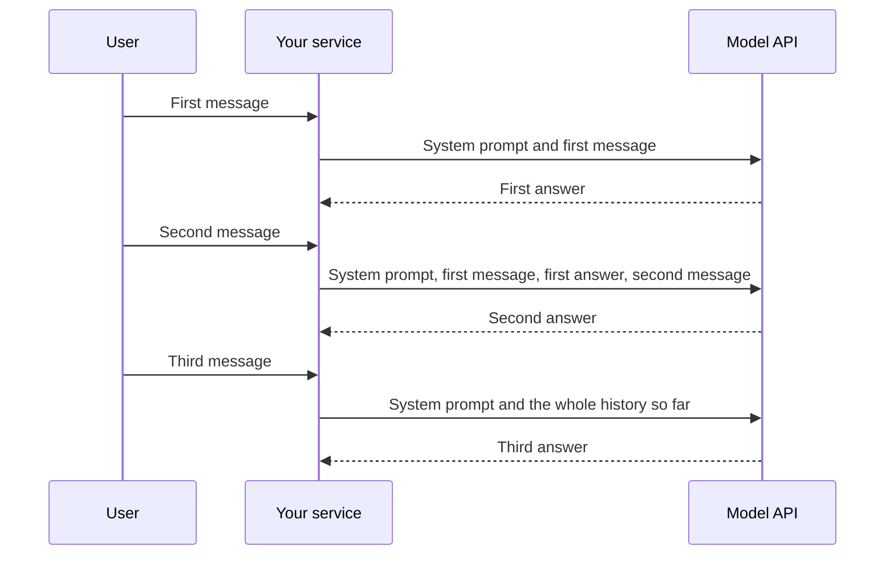

# 04. Using LLMs: Tokens, Context and Sampling

**Level:** Foundation · **Reading time:** 30 min · **Exercise:** 60 min
**Prerequisites:** [How Large Language Models Are Trained](02-how-large-language-models-are-trained.md) (tokens and the generate-one-token loop)

> **In one sentence:** After this chapter you can read a model's API parameters, predict what a call will cost and how long it will take, and get output that your code can parse.

## Why this matters

You add an LLM call to a service. It works in the demo. Then the questions start:

- The same request gives a slightly different answer on each run.
- A JSON answer arrives cut in half, and the parser crashes.
- The bill is ten times what you estimated, and the chat feature gets slower with every turn.
- The request fails with a message about "maximum context length".

All four come from the same handful of settings. None of them is visible in the code that calls the API.

## The core idea

An LLM API is a function with one input, the **prompt** (everything you send: the **system prompt** with instructions for the whole conversation, the earlier turns, and the new request), and a few knobs. It returns text produced one token at a time by sampling from a probability distribution ([Chapter 02](02-how-large-language-models-are-trained.md)).

- A **token** is the unit the model reads and writes, and the unit you pay for. A rough rule for English is that one token is about three quarters of a word.
- The **context window** is the maximum number of tokens a single call can hold, counted across the input and the output together.

A good analogy is a function with a very small stack and a very large code segment. The code segment is the model's parameters, where its knowledge lives, and it is fixed. The stack is the context window, the only thing the call can see while it runs, and it is cleared when the call returns. The analogy breaks on size. A context window holds tens of thousands to millions of tokens. But, as with a stack, anything not placed there this time does not exist.

## How it works, step by step

### 1. Count everything in tokens

Yann Dubois, in his Fall 2025 lecture, suggests thinking of tokens as words or sub-words ([0:00](https://www.youtube.com/watch?v=r1qZpYAmqmg&t=0)). His appendix slides explain why they sit between the two: they make shorter sequences than characters, and they cope with typos and new words better than whole words do.

Three practical rules follow:

- Measure, do not guess. Count the tokens of a typical request with your provider's counting tool or tokenizer library.
- Every example in a few-shot prompt, a prompt that contains examples, is paid for on every call ([Chapter 05](05-prompting-and-in-context-learning.md)).
- Reserve room. The context window covers input and output. A 200,000-token window does not accept a 200,000-token prompt.

Context windows are extended after the main pre-training run. Dubois's slides give DeepSeek v3 as an example, extended to 128,000 tokens. Limits differ by model, so read the model's page as of the day you integrate it.

A large window is not a license to fill it. Each token costs money and time on every call, and accuracy on a detail buried in a very long input is not guaranteed.

That accuracy can be tested. Burak Gokturk shows the **needle-in-a-haystack test**: hide one sentence, image or clip, the needle, in a long input and check whether the model finds it ([11:15](https://www.youtube.com/watch?v=Sy1psHS3w3I&t=675)). In Google's results for Gemini, which takes image, text, audio and video as input and was tried internally with up to ten million tokens of context, green marks a found needle and red a missed one. He leaves one question open: now that context can be this large, will a model replace traditional search, by keyword or by embedding?

### 2. The call does not remember

Each API call is independent. The provider does not keep your previous turn. For a conversation, you send the whole history every time. Turn nine costs more than turn one because turn nine includes turns one to eight in its input.

**Figure 1.** A three-turn conversation: what your service sends on each call.



The API keeps nothing between calls, so the input grows with every turn, while the system prompt at the top stays the same.

Shunyu Yao, in his Fall 2024 lecture, describes the context window as an agent's **short-term memory** ([24:37](https://www.youtube.com/watch?v=RM6ZArd2nVc&t=1477)). It has three limits. You can only append to it. Its size is fixed. And it is gone when the task ends, so an agent that solves a hard problem today starts from nothing tomorrow unless the model is fine-tuned. What must persist goes outside the model, into a **long-term memory**: text that the program writes and reads back later. His simplest example is Reflexion. When a program fails its tests, the agent notes what it missed and reads that note before the next attempt. Nothing is trained. The feedback may be the output of a test run or an error from the compiler, and the thing that changes is text, which steers the next run. He names two larger stores: the game-playing agent Voyager keeps each learned skill as code, and Generative Agents has each of its roughly twenty townspeople keep a diary of what happened and add conclusions drawn from it.

### 3. Control randomness with temperature and top-p

At each step the model has a probability for every token in its vocabulary, and it picks one. Two parameters shape that choice:

- **Temperature** rescales the probabilities before the pick. Lower values make the most likely tokens more dominant, so the output becomes more predictable. At zero the model almost always takes the most likely token. Higher values spread the probability out and produce more varied, and more risky, text.
- **Top-p** (also called nucleus sampling) removes the long tail first. It keeps the smallest set of tokens whose probabilities add up to p, and discards the rest. With p = 0.9 the model can only choose among the tokens that carry 90% of the probability.

For classification, extraction and JSON, use a low temperature. For brainstorming, or for the multiple samples that self-consistency needs ([Chapter 06](06-reasoning-in-llms-from-chain-of-thought-to-search.md)), use a higher one. Change one of the two parameters and leave the other at its default.

### 4. Cap the output with max tokens

The maximum-tokens parameter stops generation after a set number of output tokens. Anthropic's Messages API reference defines it as "The maximum number of tokens to generate before stopping". The model may stop earlier, the limit depends on the model, and as of November 24, 2026 the page also documents that setting it to 0 fills the prompt cache without generating a response ([reference](https://platform.claude.com/docs/en/api/messages)).

If the limit is reached, the text is cut, often in the middle of a sentence or a JSON object. Always check the response's stop reason. The same reference documents **stop sequences**: strings that make the model stop as soon as it writes them.

### 5. Put stable instructions in the system prompt

The system prompt is a separate input field for instructions that apply to the whole conversation. The reference describes it: "A system prompt is a way of providing context and instructions to Claude, such as specifying a particular goal or role" ([reference](https://platform.claude.com/docs/en/api/messages)). Put the role, the rules and the output format there. Put the user's data in the message.

### 6. Get structured output

You want data, not prose. The procedure:

1. Describe the exact format in the system prompt, or pass a schema if your provider's API offers one.
2. Ask for one object and nothing else.
3. Parse and validate the answer in your own code.
4. On failure, retry once or twice, including the validation error in the retry. Then fall back to a safe default.

Many providers also offer a mode that constrains the output to a schema. Names and guarantees differ by provider, so check the current documentation. Even then, keep your validator. A valid JSON object can still be an incorrect one.

### 7. Reuse work with prompt caching

Because each call resends the history, the model reprocesses the same prefix, the unchanged beginning of the prompt, again and again. **Prompt caching** stores the processed form of a prefix on the provider's side, so a later request that starts with the same prefix is cheaper and quicker to start. In the Messages API, you mark the cacheable prefix with `cache_control`. The cached entry lives for 5 minutes by default, or 1 hour in a longer option, as of November 24, 2026 ([reference](https://platform.claude.com/docs/en/api/messages)).

To benefit, order the prompt so that the stable part comes first: system prompt, long reference document, then the varying user message. If something changes near the top, everything after it must be processed again.

### 8. A cost and latency mental model

- **Cost** is input tokens times the input price plus output tokens times the output price. Output tokens usually cost more than input tokens. Prices change often, so read them from your provider's page, dated.
- **Latency** has two parts. First the model processes the whole prompt before the first token appears. Then tokens arrive one at a time at a roughly steady rate. Total time is about time-to-first-token plus output tokens divided by tokens per second.
- **Streaming** sends tokens as they are produced, which shortens the wait the user perceives. It does not shorten the total time.

## Worked example

An estimator for one call. The constants are illustrative. Replace them with your provider's current prices and with speeds you measure yourself.

```python
PRICE_IN, PRICE_OUT = 0.50, 2.00     # dollars per million tokens (example prices)
TOKENS_PER_SECOND = 60               # example speed once generation has started
SECONDS_PER_1K_INPUT = 0.4           # example processing time before the first token

def estimate(prompt_tokens, output_tokens, history_tokens=0):
    """Cost in dollars and latency in seconds for one call."""
    input_tokens = history_tokens + prompt_tokens
    cost = input_tokens / 1e6 * PRICE_IN + output_tokens / 1e6 * PRICE_OUT
    latency = input_tokens / 1000 * SECONDS_PER_1K_INPUT + output_tokens / TOKENS_PER_SECOND
    return round(cost, 5), round(latency, 1)

print(estimate(prompt_tokens=500, output_tokens=200))                        # (0.00065, 3.5)
print(estimate(prompt_tokens=500, output_tokens=200, history_tokens=8_000))  # (0.00465, 6.7)
```

This script calls no API and costs nothing. To calibrate it you will make real calls. At the example prices above, 20 short calls cost just over one cent.

What to observe:

- **The history dominates.** With 8,000 tokens of earlier turns, the input is 17 times larger, and the cost rises sevenfold.
- **The output sets a floor on the time.** The 200 output tokens take 3.3 seconds in both calls, almost the whole latency of the short one.
- **A conversation grows at every turn.** Sum the estimator over ten turns of a chat and the total rises much faster than the number of turns.

The shape of the request, in illustrative pseudocode. Field names follow one provider's API and differ elsewhere:

```json
{
  "system": "Classify the ticket as billing, bug or question. Answer with one lowercase word.",
  "messages": [{"role": "user", "content": "The export button does nothing when I click it."}],
  "max_tokens": 10,
  "temperature": 0
}
```

## What the practitioners say

The Berkeley lectures leave this ground to the API documentation. Dubois closes his with a list of topics he did not cover, and "decoding & inference" and "context size" are both on it (his outlook slide). What his lecture does supply is the mechanism behind the settings:

- **Generation is a loop.** His slides list the steps of inference: tokenize, forward, predict the probability of the next token, sample, detokenize. Temperature and top-p act in the "sample" step, and the max-tokens parameter decides when the loop is stopped from outside.
- **Sampling is a feature.** Denny Zhou shows in his Fall 2024 lecture that always taking the most likely token can start an answer on the wrong foot, and that exploring alternatives finds correct reasoning paths ([38:00](https://www.youtube.com/watch?v=QL-FS_Zcmyo&t=2280)). His example is an apple-counting question that a model answers wrongly when its first token is a bare number. A low temperature is a tool for reproducibility, not a setting for every task.

Clay Bavor describes what latency means inside voice agents at Sierra ([17:15](https://www.youtube.com/watch?v=sfJM4LaiYsM&t=1035)). Besides the pipeline itself, three of his observations are worth keeping:

- **Latency varies from call to call.** He gives the slow tail as roughly 500 to 2,500 milliseconds. Sierra fires off identical requests to the provider and takes whichever answer arrives first. It trades money for time.
- **The user's clock starts early.** In voice, the wait runs from the moment the person stops talking, not from the end of the audio received. So it has to spot quickly that the person has finished speaking. Sierra starts several reasoning and speech-synthesis runs so that an answer is ready, and filler phrases such as "Let me look up that for you" cover the rest.
- **Model providers are less reliable than cloud services.** In his account, frontier models do not reach the five or six nines of uptime of hardened cloud services, so failing over from one provider to another is part of the design.

He builds voice as a chain of speech to text, then a reasoning loop, then a synthesizer, because the audio-to-audio models he tried were smaller and easy to steer off course.

Evan Miller's paper, covered in [Chapter 07](07-why-llm-outputs-are-noisy.md), adds the rule for evaluations: measure at the settings you deploy. Do not lower the temperature only to make the numbers calm.

## Pitfalls

1. **Assuming the API remembers the last turn.** *Fix:* resend the history, and budget for it.
2. **Treating the context window as the model's memory or knowledge.** It is the working memory of one call. *Fix:* send what the call needs. For facts, use retrieval, a search that puts the matching documents into the prompt.
3. **Setting max tokens too low.** *Fix:* allow enough for the largest valid answer, and check the stop reason.
4. **Expecting perfect determinism at temperature 0.** Model updates and small numerical differences still change outputs. *Fix:* never compare raw output strings for equality. [Testing generative and LLM components](../08-quality-assurance/05-testing-generative-and-llm-components.md) shows what to do instead.
5. **Changing temperature and top-p together.** You cannot tell which one caused the change. *Fix:* adjust one.
6. **Filling the context because it fits.** *Fix:* send only the relevant material, with the stable part first so caching applies.
7. **Parsing free text without validation.** *Fix:* validate, retry with the error message, then fall back.
8. **Estimating the bill from input tokens only.** *Fix:* count output tokens, which cost more and take the time.

## Try it

**Deliverable:** a calibration report for one model and one task.

1. Write a request with a system prompt, a structured output requirement, a max-tokens value and a low temperature.
2. Count the tokens of a typical request. Write down the provider's current input and output prices, with the date.
3. Run the request 20 times. Measure time to first token and total time.
4. Replace the constants in the estimator with what you measured. Predict the cost and latency of a call with a 5,000-token prompt and 500 output tokens. Run it and compare.
5. Run the request with streaming on and off, and note when the first characters appear.

This makes about 25 paid calls, more with the stretch goal. At the example prices above they cost under two cents in total, and under ten with the stretch goal. Real prices depend on the model and the provider.

**You are done when:** your report has a two-column table, predicted against measured, for cost and for latency, and a sentence explaining any estimate that was off by more than a factor of two.

**Stretch goal:** put a 5,000-token document at the start of ten requests and enable prompt caching, if your provider offers it. Compare cost or latency against the same ten requests without caching.

## Key takeaways

- Tokens are the unit of reading, writing, pricing and limits. Measure them.
- The context window is the working memory of one call, shared by input and output. Each call is independent, so conversations resend their history.
- Temperature and top-p shape the sampling. Use low values for structured output and higher ones when you need variety. Change one at a time.
- Max tokens cuts generation from outside. Check the stop reason before you parse.
- For structured output, specify the format, validate in code, retry with the error, and fall back.
- Cost is input plus output tokens. Latency is time to first token plus output length divided by speed. Prompt caching reuses a stable prefix.

## Self-check

1. What does the context window limit?
   - A. The tokens of the input plus the output of one call
   - B. The tokens a model can generate over its whole lifetime
   - C. The number of API calls allowed per minute
   - D. The space the model's parameters take on disk

2. What does lowering the temperature do?
   - A. It cuts the length of every answer in half
   - B. It removes the need for a system prompt
   - C. It makes the model pick more probable tokens more often
   - D. It makes the model pay less attention to the prompt

3. What does top-p do?
   - A. It keeps exactly p tokens at every step
   - B. It keeps the smallest set of tokens whose probabilities add up to p
   - C. It stops the answer after p hundred words
   - D. It raises the price per token by p percent

4. A response ends in the middle of a sentence. What do you check first?
   - A. The temperature, because it must be above zero
   - B. The system prompt, because it must be missing
   - C. The cache, because it must have expired
   - D. The stop reason, because the token limit may be reached

5. Why does the ninth turn of a chat cost more than the first?
   - A. Providers charge more as a conversation goes on
   - B. Each call resends the whole conversation as input
   - C. The model becomes slower the more it has written
   - D. Later turns are set to produce longer answers

6. What does prompt caching reuse?
   - A. The final answers given to earlier requests
   - B. A copy of the model's parameters on your machine
   - C. The processing of a prefix sent in an earlier request
   - D. The random choices made in earlier calls

<details><summary>Show answers</summary>

1. A. Input and output share one window. A long prompt leaves little room for the answer.
2. C. Low temperature concentrates probability on the likeliest tokens, which makes output more repeatable.
3. B. The tail of unlikely tokens is removed before the choice is made.
4. D. Generation stops at the maximum-tokens limit and the text is cut. Raise the limit or shorten the answer.
5. B. The API has no memory. Turn nine carries turns one to eight in its input.
6. C. A request that starts with the same cached prefix skips reprocessing that prefix, within the cache's lifetime.

</details>

## Sources

- **Documentation:** Anthropic, "Messages" API reference (parameters `max_tokens`, `stop_sequences`, `system`, `stream`, `cache_control`), accessed November 24, 2026: [reference](https://platform.claude.com/docs/en/api/messages). Temperature and top-p were not visible on the fetched page.
- **Lecture:** Yann Dubois, "Introduction to training LLMs for AI agents", LLM Agents MOOC (Fall 2025): [video](https://www.youtube.com/watch?v=r1qZpYAmqmg) · [guide](../lectures/f25-01-llm-agents-overview.md), used at [tokens](https://www.youtube.com/watch?v=r1qZpYAmqmg&t=0), and on his slides for the inference loop, the tokenizer and the outlook
- **Lecture:** Burak Gokturk, "Enterprise trends for generative AI, and key components of building successful agents/applications", LLM Agents MOOC (Fall 2024): [video](https://www.youtube.com/watch?v=Sy1psHS3w3I) · [guide](../lectures/f24-04-enterprise-trends-for-generative-ai-and-key.md), used at [the needle-in-a-haystack test](https://www.youtube.com/watch?v=Sy1psHS3w3I&t=675)
- **Lecture:** Shunyu Yao, "LLM agents: brief history and overview", LLM Agents MOOC (Fall 2024): [video](https://www.youtube.com/watch?v=RM6ZArd2nVc) · [guide](../lectures/f24-02-llm-agents-brief-history-and-overview.md), used at [long-term memory](https://www.youtube.com/watch?v=RM6ZArd2nVc&t=1477)
- **Lecture:** Denny Zhou, "LLM Reasoning: Key Ideas and Limitations", LLM Agents MOOC (Fall 2024): [video](https://www.youtube.com/watch?v=QL-FS_Zcmyo) · [guide](../lectures/f24-01-llm-reasoning.md), used at [greedy decoding versus alternatives](https://www.youtube.com/watch?v=QL-FS_Zcmyo&t=2280), [the comparison](https://www.youtube.com/watch?v=QL-FS_Zcmyo&t=2520)
- **Lecture:** Clay Bavor, "Practical Lessons from Deploying Real-World AI Agents", Agentic AI MOOC (Fall 2025): [video](https://www.youtube.com/watch?v=sfJM4LaiYsM) · [guide](../lectures/f25-09-practical-lessons-from-deploying-real-world-ai.md), used at [voice latency](https://www.youtube.com/watch?v=sfJM4LaiYsM&t=1035)

## Next

→ [Prompting and In-Context Learning](05-prompting-and-in-context-learning.md). You can now call the model. The next chapter is about what to put in the call.
