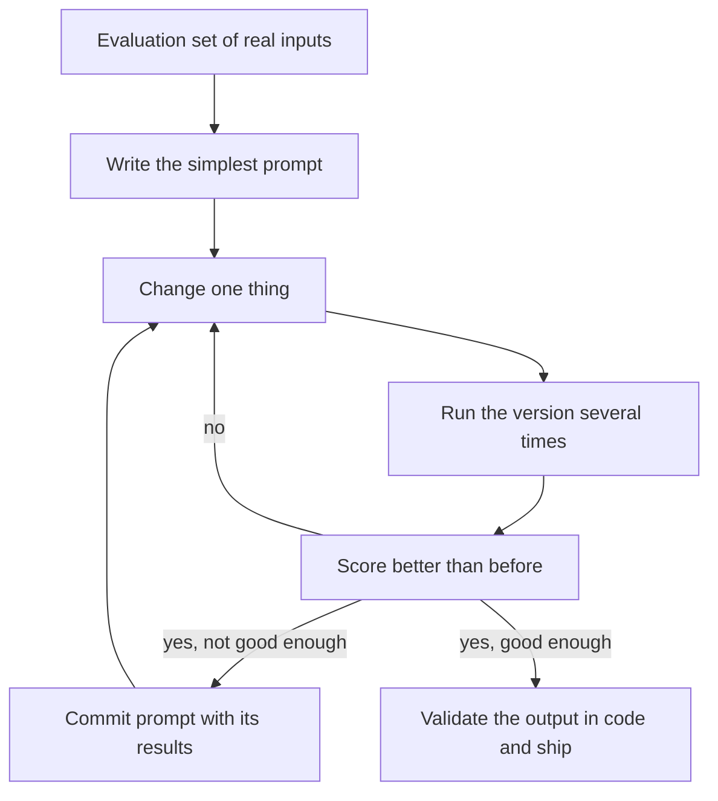

# 05. Prompting and In-Context Learning

**Level:** Foundation · **Reading time:** 26 min · **Exercise:** 60 min
**Prerequisites:** [How Large Language Models Are Trained](02-how-large-language-models-are-trained.md) (what a base model does)

> **In one sentence:** After this chapter you can write prompts that use instructions, examples and reasoning steps on purpose, and you can version and test them like code.

## Why this matters

You need a model to sort support tickets into `billing`, `bug` and `question`.

Your first prompt says: "Classify this ticket." The model answers with a paragraph. You paste three examples into the prompt, and now it answers with one word. But it writes "Billing." with a capital letter and a full stop, which breaks your parser. You fix the format. Then you swap two examples, and accuracy moves by eight points.

Nothing was trained at any point. So why did the examples change the behavior? Why did their order matter? And how do you make something this twitchy dependable?

## The core idea

A prompt is the argument of a function, as [Chapter 01](01-machine-learning-in-a-nutshell.md) put it. The model's parameters do not change between two calls. What changes is the text in its input.

That is enough, because the model was trained to continue text. Whatever sits in the input shapes what looks likely to come next. **In-context learning** is the model picking up a task from what is in its input, with no training step. Three names cover most of it:

- **Zero-shot prompting:** give the instruction only, with no examples.
- **Few-shot prompting:** include a handful of worked examples, called **exemplars**, before the real input.
- **Chain-of-thought (CoT) prompting:** ask for the reasoning steps before the answer, either in the exemplars or with an instruction.

A useful analogy: you brief a contractor who has read almost everything ever published but knows nothing about your company. They are capable, they skipped your onboarding, and your brief plus two examples are all they get. The analogy breaks on memory. A contractor can ask questions and remembers tomorrow. The model starts from nothing on every call. Whatever is not in the context does not exist for that call.

## How it works, step by step

### 1. Start with zero-shot

Write a plain instruction and say exactly what the output must look like:

```text
Classify the support ticket into one of: billing, bug, question.
Answer with exactly one lowercase word and nothing else.

Ticket: I was charged twice this month.
Answer:
```

Modern chat models are post-trained to follow instructions, so this is the cheapest place to start. If the result is already good, stop.

### 2. Add exemplars when format or judgment is off

Show two to five examples in exactly the output format you want, then the new input:

```text
Ticket: I was charged twice this month.
Answer: billing

Ticket: The export button does nothing when I click it.
Answer: bug

Ticket: Do you support single sign-on?
Answer: question

Ticket: <the new ticket>
Answer:
```

The model imitates two things at once: the surface format and the decision boundary between the labels, meaning where one label ends and the next begins.

Denny Zhou shows a sharper version in his Fall 2024 lecture. The task is to take the last letter of each word in a name and join them: "Elon Musk" gives `nk`. With examples that show only the answers, the model struggles. With one example that spells out the steps (the last letter of "Elon" is "n", the last letter of "Musk" is "k", joined they give "nk"), one demonstration was enough for perfect accuracy on that task, as he reports it ([18:00](https://www.youtube.com/watch?v=QL-FS_Zcmyo&t=1080)). He then walks through the research line behind this, from training on worked solutions in 2017 to prompting with them in 2022, and draws one conclusion: it does not matter whether the steps arrive through training, fine-tuning or prompting. The intermediate steps are what help ([22:00](https://www.youtube.com/watch?v=QL-FS_Zcmyo&t=1320)).

### 3. Ask for reasoning on multi-step tasks

For arithmetic, logic or planning, have the model write its steps before the answer. There are three ways:

- **Few-shot CoT:** the exemplars contain the steps.
- **Zero-shot CoT:** add one line, "Let's think step by step". Zhou admits he took the paper for a joke when it came out ([32:00](https://www.youtube.com/watch?v=QL-FS_Zcmyo&t=1920)). The method is usually worse than few-shot CoT. Xinyun Chen puts it more precisely: it beats plain zero-shot clearly, but remains much worse than few-shot CoT ([20:00](https://www.youtube.com/watch?v=g0Dwtf3BH-0&t=1200)).
- **Decomposition:** split the problem into subquestions and answer them easiest first. Zhou calls this **least-to-most prompting** ([26:00](https://www.youtube.com/watch?v=QL-FS_Zcmyo&t=1560)). For "Mia buys 4 pencils at 2 euros each and pays with a 20-euro note", the model first answers "What did she spend?" and only then "What is her change?".

Why does writing steps help? Each generated token gives the network more computation before it commits to an answer. Zhou cites a theory result for this: a transformer of fixed depth can solve problems that need one step after another, as long as it writes enough intermediate steps, while a transformer that must answer directly may need impractical depth ([30:00](https://www.youtube.com/watch?v=QL-FS_Zcmyo&t=1800)).

Xinyun Chen adds a property that matters in practice: chain of thought makes the amount of thinking variable. The model writes more for a harder problem. A direct answer always costs the same ([34:42](https://www.youtube.com/watch?v=g0Dwtf3BH-0&t=2082)).

Reasoning steps are not free. They cost tokens and latency on every call, and they leave free text that you must parse. For a three-way ticket label, skip them.

### 4. Let the model supply the examples

Writing exemplars by hand does not scale. **Analogical prompting**, a method Zhou and Xinyun Chen published together, instructs the model to first recall a relevant solved problem, then solve the new one. Because the examples are generated per question, they fit its topic. On math, code generation and BIG-Bench, a collection of reasoning tasks, it beat both zero-shot CoT and few-shot CoT with hand-written examples ([24:00](https://www.youtube.com/watch?v=g0Dwtf3BH-0&t=1440)). Two findings from Chen's lecture keep it honest:

- **The self-made examples are imperfect.** For math, about 70% were accurate and relevant. The rest were irrelevant or contained wrong calculations, and the model still gained ([24:00](https://www.youtube.com/watch?v=g0Dwtf3BH-0&t=1440)).
- **It needs a strong model.** Weaker models benefit less. From a certain size up, the method overtakes few-shot CoT with hand-written examples and beats retrieved examples too ([24:00](https://www.youtube.com/watch?v=g0Dwtf3BH-0&t=1440), [26:00](https://www.youtube.com/watch?v=g0Dwtf3BH-0&t=1560)).

Chen's follow-up work lets the model choose more of the prompt itself. Least-to-most prompting, from step 3, has a limit on real tasks. Natural and programming languages have many more grammar rules and a far larger vocabulary than the toy tasks where it was first shown, so a single prompt can run out of room for the rules one problem needs. Her answer is to keep the split into sub-problems and to give each one its own examples, the ones whose rules matter most for it. She reports that this beat fine-tuning a model on the full training set of the CFQ benchmark of compositional questions ([39:17](https://www.youtube.com/watch?v=g0Dwtf3BH-0&t=2357)). **Self-Discover** goes further and drops the written demonstrations. You give the model a list of a few dozen reasoning strategies, such as decomposition or self-reflection. It picks the ones that suit the task and composes them into a reasoning structure to follow, and she reports that this beat chain-of-thought prompting on several reasoning benchmarks.

A model can also write the prompt itself. In her setup one LLM proposes instructions and an evaluator scores each on a held-out set of examples. With PaLM 2 as the model, the loop started from `Let's solve the problem`, at about 61% on GSM8K, a grade-school math test set, and found `Take a deep breath and work on this problem step-by-step`. That scored about 8 points above `Let's think step by step` and matched few-shot CoT with human-written examples. Nothing is trained ([30:00](https://www.youtube.com/watch?v=g0Dwtf3BH-0&t=1800), [32:00](https://www.youtube.com/watch?v=g0Dwtf3BH-0&t=1920)).

### 5. Put the stable rules in the system prompt

Chat APIs usually accept two kinds of input. The **system prompt** is a separate text that applies to the whole conversation. The user messages carry the changing requests. Put role, rules, output format and refusal conditions in the system prompt. Put the ticket in the user message.

A system prompt is still only text in the input. It is guidance, not a security boundary. [Jailbreaks and prompt injection](../04-safety-and-security/02-jailbreaks-and-prompt-injection.md) covers why.

### 6. Expect sensitivity

**Prompt sensitivity** is the tendency of outputs to change when the wording, the order or the formatting of the prompt changes a little. The lectures give three kinds of evidence:

- **Irrelevant information distracts.** Zhou shows a bank-balance problem with one added sentence about another person's rent. The model subtracted the rent ([52:00](https://www.youtube.com/watch?v=QL-FS_Zcmyo&t=3120)). His slides report a drop of over 20 points on the GSM8K math set when such sentences are added. He adds two observations. Telling the model to ignore irrelevant context fixes his example, and even filler sentences such as "the sky is blue and the grass is green" lower the score ([52:00](https://www.youtube.com/watch?v=QL-FS_Zcmyo&t=3120)).
- **Order matters.** He reports about 10 points lost across frontier models when the sentences of a problem are reordered ([58:00](https://www.youtube.com/watch?v=QL-FS_Zcmyo&t=3480)).
- **Models differ in taste.** Chen notes that some models prefer clear guidelines, some an interactive discussion, and some one long detailed instruction ([44:00](https://www.youtube.com/watch?v=g0Dwtf3BH-0&t=2640)).

The consequence is the theme of the next section: a prompt is code, and it needs an engineering process.

### 7. Engineer the prompt like code

Yann Dubois's slides describe prompting as the art of asking the model for what you want: no training data, hours of work, no compute budget. The bottleneck, he writes, is evaluation. That suggests the procedure:

1. **Collect an evaluation set first.** Thirty to a hundred real inputs with the wanted outputs. Without it you cannot tell whether an edit helped.
2. **Write the simplest prompt.** Zero-shot.
3. **Change one thing per iteration.** Add examples, or change the format instruction. Never both.
4. **Measure, and measure again.** Run each version several times, because outputs vary. [Chapter 07](07-why-llm-outputs-are-noisy.md) explains why.
5. **Commit every version.** Prompts live in Git, next to the code that sends them, with the measured results in the commit message.
6. **Review prompts.** A second reader catches ambiguity and accidental bias in the examples.
7. **Validate the output in code.** Check the type and the allowed values. Retry or fall back when the check fails. [Chapter 04](04-using-llms-tokens-context-and-sampling.md) shows how.

**Figure 1.** The prompt-engineering loop: each turn changes one thing and is judged on the same evaluation set.



The loop ends when the score on the evaluation set is good enough, and every turn of it leaves a committed version behind.

Chen offers two criteria for prompts meant to make a model reason: they should draw out longer thinking as the task gets harder, and they should support the reasoning strategy the task needs ([44:00](https://www.youtube.com/watch?v=g0Dwtf3BH-0&t=2640)).

## Worked example

A minimal harness for the ticket classifier. Fill in `call_model` with your provider's call. Everything else works unchanged.

```python
ALLOWED = {"billing", "bug", "question"}

SYSTEM = "Classify support tickets. Answer with exactly one lowercase word: billing, bug or question."

EXEMPLARS = """Ticket: I was charged twice this month.
Answer: billing
Ticket: The export button does nothing when I click it.
Answer: bug
Ticket: Do you support single sign-on?
Answer: question
"""

def build_prompt(ticket):
    return EXEMPLARS + f"Ticket: {ticket}\nAnswer:"

def call_model(system, prompt):
    """Call your model here and return its text as a string."""
    raise NotImplementedError

def parse(answer):
    word = answer.strip().split()[0].lower().rstrip(".")   # "Billing." -> "billing"
    return word if word in ALLOWED else None

test_set = [  # grow this to at least 30 real tickets, kept in its own file
    ("Refund please, the amount is wrong on my invoice.", "billing"),
    ("The app crashes when I open settings.", "bug"),
    ("Can I import data from a CSV file?", "question"),
]

correct = sum(parse(call_model(SYSTEM, build_prompt(t))) == expected for t, expected in test_set)
print(f"accuracy: {correct / len(test_set):.0%}")
```

This calls a paid API once per ticket. With a small model and short tickets, 30 calls cost far less than one cent in total (estimate, as of November 2026; check your provider's prices).

What to observe:

- `parse` returns `None` for "I think this is a bug", because the first word is not a label. That is a failure you want to count, not to hide.
- Delete `EXEMPLARS` from `build_prompt` and rerun. You now have a zero-shot baseline to compare against.
- Run the same version three times. The three accuracies may differ.

## What the practitioners say

Zhou's closing caution belongs on every prompt author's desk: "keep in mind that LLMs are probabilistic models of generating next tokens" ([42:00](https://www.youtube.com/watch?v=QL-FS_Zcmyo&t=2520)). He then demonstrates that they "are not humans" ([44:00](https://www.youtube.com/watch?v=QL-FS_Zcmyo&t=2640)). A prompt that would annoy a person, such as six similar solved problems followed by "let's think step by step", is often exactly what helps a model.

Chen's Spring 2025 lecture puts prompting in a sequence. Better prompts are the first way to spend more compute at inference time: they let the model use more tokens on one solution. Sampling several answers and searching over them come next. That is the subject of [Chapter 06](06-reasoning-in-llms-from-chain-of-thought-to-search.md).

Shunyu Yao makes a related point about exemplars in his Fall 2024 lecture. Showing the model a worked trajectory of thoughts, actions and observations is a way of *using* the model, not a fine-tuning trick: the same method works with one example, with a few, or with many turned into training data ([16:00](https://www.youtube.com/watch?v=RM6ZArd2nVc&t=960)).

## Pitfalls

1. **Polishing a prompt without an evaluation set.** You cannot know what helped. *Fix:* build the set before the second draft.
2. **Changing several things at once.** You learn nothing from the result. *Fix:* one edit, one measurement.
3. **Assuming examples are free.** They cost tokens and latency on every call, and they can bias the model. *Fix:* use the fewest that work, and inspect errors for echoes of the examples.
4. **Asking for reasoning everywhere.** It slows and complicates simple tasks. *Fix:* use CoT for multi-step problems, and measure whether it pays.
5. **Trusting the output format.** *Fix:* state the format in the system prompt, validate it in code, and retry on failure.
6. **Editing prompts in a dashboard.** *Fix:* keep them in Git and deploy them like code.
7. **Expecting the model to remember.** In-context learning lasts one call. *Fix:* send the context every time, or fine-tune when it is stable (see [Chapter 03](03-from-base-model-to-assistant-post-training.md)).

## Try it

**Deliverable:** a small repository with the classifier above, a file of at least 30 labeled tickets, and a results table.

1. Commit three prompt versions: zero-shot, few-shot with three exemplars, and few-shot plus a stricter format rule in the system prompt.
2. Run each version three times against the same tickets. Record the mean accuracy and the range.
3. Add the two worst failures as new exemplars. Rerun version 2 and record what changed, including on the tickets that were fine before.

**You are done when:** the results table has nine cells (three versions, three runs), each version has its own commit, and you can name one edit that helped and one that hurt, with numbers.

**Stretch goal:** swap the first and the last exemplar and rerun. If accuracy moves by more than the range of your repeated runs, you have reproduced prompt sensitivity on your own data.

## Key takeaways

- A prompt changes only the input. In-context learning is the model picking up a task from instructions and examples in that input.
- Start with a zero-shot instruction. Add exemplars to fix format or judgment. Add reasoning steps for multi-step problems.
- Written intermediate steps are what make chain-of-thought work, whether they come from examples or from an instruction.
- Prompts are sensitive to wording, order and irrelevant information, and each model responds differently.
- So treat a prompt as code: evaluation set first, one change at a time, repeated runs, version control, review, validation of the output.

## Self-check

1. What differs between a zero-shot call and a few-shot call to the same model?
   - A. Only the text sent as input
   - B. A small update to the parameters
   - C. The size of the token vocabulary
   - D. The number of layers that run

2. What does a chain-of-thought exemplar contain that a standard one lacks?
   - A. The answer without any explanation
   - B. The steps that lead to the answer
   - C. A list of tools the model should call
   - D. A second copy of the task text

3. Swapping two exemplars moved accuracy by eight points. What is the best next step?
   - A. Restore the old order and ship it
   - B. Rewrite the whole prompt from scratch
   - C. Move the task to a larger model
   - D. Test several orders and report the spread

4. For which task are written reasoning steps the least worthwhile?
   - A. Multi-step arithmetic word problems
   - B. Sorting tickets into three fixed labels
   - C. Logic puzzles with several rules
   - D. Planning a route with many constraints

5. What belongs in the system prompt rather than in a user message?
   - A. One particular ticket to classify
   - B. A follow-up question from the user
   - C. Rules and output format for every request
   - D. The answer the user expects to get

6. Why does few-shot prompting work without any training?
   - A. The provider fine-tunes a private copy per request
   - B. The examples are appended to the model file
   - C. The examples enlarge the model's parameter count
   - D. The model continues the pattern the examples set

<details><summary>Show answers</summary>

1. A. The parameters are frozen. In-context learning happens entirely in the input.
2. B. The reasoning steps come before the final answer, and the model imitates them.
3. D. Order is a variable like any other. Measure it over several runs before deciding.
4. B. A three-way label needs no intermediate computation. Reasoning steps add cost and parsing problems.
5. C. The system prompt carries what applies to the whole conversation. The ticket goes in the user message.
6. D. The model predicts what comes next, and the examples make the wanted format and decision look likely to continue.

</details>

## Sources

- **Lecture:** Denny Zhou, "LLM Reasoning: Key Ideas and Limitations", LLM Agents MOOC (Fall 2024): [video](https://www.youtube.com/watch?v=QL-FS_Zcmyo) · [guide](../lectures/f24-01-llm-reasoning.md), used at [exemplars with steps](https://www.youtube.com/watch?v=QL-FS_Zcmyo&t=1080), [why steps matter](https://www.youtube.com/watch?v=QL-FS_Zcmyo&t=1320), [a theory of intermediate steps](https://www.youtube.com/watch?v=QL-FS_Zcmyo&t=1800), [least-to-most prompting](https://www.youtube.com/watch?v=QL-FS_Zcmyo&t=1560), [zero-shot CoT](https://www.youtube.com/watch?v=QL-FS_Zcmyo&t=1920), [probabilistic models](https://www.youtube.com/watch?v=QL-FS_Zcmyo&t=2520), [irrelevant context](https://www.youtube.com/watch?v=QL-FS_Zcmyo&t=3120), [premise order](https://www.youtube.com/watch?v=QL-FS_Zcmyo&t=3480)
- **Lecture:** Xinyun Chen, "Inference-Time Techniques for LLM Reasoning", Advanced LLM Agents MOOC (Spring 2025): [video](https://www.youtube.com/watch?v=g0Dwtf3BH-0) · [guide](../lectures/sp25-01-inference-time-techniques-for-llm-reasoning.md), used at [zero-shot and analogical prompting](https://www.youtube.com/watch?v=g0Dwtf3BH-0&t=1200), [dynamic examples and Self-Discover](https://www.youtube.com/watch?v=g0Dwtf3BH-0&t=2357), [prompt optimization](https://www.youtube.com/watch?v=g0Dwtf3BH-0&t=1800), [variable computation](https://www.youtube.com/watch?v=g0Dwtf3BH-0&t=2082), [prompt styles and criteria](https://www.youtube.com/watch?v=g0Dwtf3BH-0&t=2640)
- **Lecture:** Shunyu Yao, "LLM agents: brief history and overview", LLM Agents MOOC (Fall 2024): [video](https://www.youtube.com/watch?v=RM6ZArd2nVc) · [guide](../lectures/f24-02-llm-agents-brief-history-and-overview.md), used at [exemplars as trajectories](https://www.youtube.com/watch?v=RM6ZArd2nVc&t=960)
- **Lecture:** Yann Dubois, "Introduction to training LLMs for AI agents", LLM Agents MOOC (Fall 2025): [video](https://www.youtube.com/watch?v=r1qZpYAmqmg) · [guide](../lectures/f25-01-llm-agents-overview.md), used for the slide that compares prompting with fine-tuning

## Next

→ [Reasoning in LLMs: From Chain-of-Thought to Search](06-reasoning-in-llms-from-chain-of-thought-to-search.md). One good prompt produces one answer. The next chapter shows what happens when you sample many and choose.
