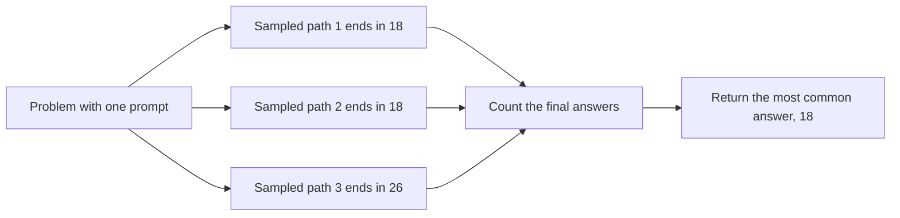
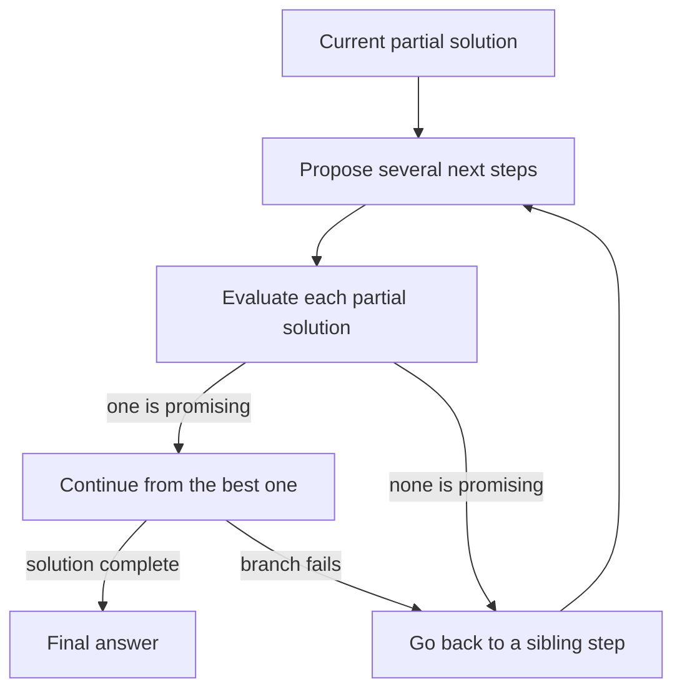

# 06. Reasoning in LLMs: From Chain-of-Thought to Search

**Level:** Practitioner · **Reading time:** 32 min · **Exercise:** 90 min
**Prerequisites:** [Prompting and In-Context Learning](05-prompting-and-in-context-learning.md) (few-shot prompting and chain-of-thought)

> **In one sentence:** After this chapter you can choose between chain-of-thought, self-consistency, search and iterative refinement for a reasoning task, and you know when "review your answer" makes things worse.

## Why this matters

A model solves a word problem and gets it wrong. You run the same prompt again and it gets it right. The answer flips from run to run, and you have three decisions to make:

- Should you ask the model to check its own answer?
- Should you generate ten answers and take a vote, or search step by step?
- If you double what you spend per problem, how much accuracy does that buy?

Each is a routine engineering choice, and each has a well-tested answer.

## The core idea

A model call is one sample from a probability distribution. One call gives one reasoning path. On a hard problem, the chance of a correct path is below 100% and above 0%. That gap is the opportunity. The techniques in this chapter spend more computation per problem at inference time to close it. The trend has a name: **inference-time scaling**. Accuracy rises as you spend more compute on a single problem while the model stays unchanged.

There are three ways to spend it:

1. **Width.** Generate several complete candidates and pick one. This is search and selection.
2. **Depth.** Take one candidate and improve it over several rounds.
3. **Better paths.** Change the prompt so that each candidate is stronger. [Chapter 05](05-prompting-and-in-context-learning.md) covered this.

A useful analogy for the first two is getting a second opinion. Ask five colleagues the same question and take the majority. The analogy breaks on independence. Colleagues know different things and can argue it out. Samples from one model share every blind spot, so they repeat the same wrong path.

Xinyun Chen puts numbers on the trend ([8:23](https://www.youtube.com/watch?v=g0Dwtf3BH-0&t=503)). On ARC-AGI, a set of pattern puzzles, most models before o1 stay below 25% when they answer directly. o3, given about $20 of compute per task, matches the average human annotator. Given about $1,000 per problem, it reaches 87.5%. She calls that a very expensive way to solve one task. It shows what the model can do when inference cost is no object.

## How it works, step by step

### 1. Self-consistency: sample, then vote

**Self-consistency** keeps one prompt and samples several answers.

1. Write a chain-of-thought prompt for the problem.
2. Ask for N independent answers, with sampling switched on. Diverse answers are the point.
3. Extract the final answer from each response.
4. Return the answer that appears most often.

**Figure 1.** Self-consistency: several complete paths, one vote on the final answers.



The two paths that end in 18 count together although their steps differ, and the steps themselves are never compared.

The vote is on final answers, not on reasoning paths. Denny Zhou's example, from his Fall 2024 lecture, is Janet, whose ducks lay 16 eggs a day. She eats 3 and bakes with 4, and sells the rest at $2 each. One sampled path computes $26. Two others compute $18 by different routes. The vote returns 18 ([46:00](https://www.youtube.com/watch?v=QL-FS_Zcmyo&t=2760)). Zhou calls the reasoning path a hidden variable: many paths lead to one answer, so the answer is what counts. He adds that the method beat the state of the art of its time.

Three practical limits come from the two lectures:

- **You need an extractable answer**, such as a number or an option. For free-form text, Xinyun Chen presents **universal self-consistency**: show the model all its candidates and ask which is most consistent with the others. It helps on summarization and question answering, and matches ordinary self-consistency on math without any answer extraction ([56:00](https://www.youtube.com/watch?v=g0Dwtf3BH-0&t=3360)).
- **Consistency is a signal.** Zhou reports that when over 80% of the samples agree, the answer is almost always right ([48:00](https://www.youtube.com/watch?v=QL-FS_Zcmyo&t=2880)).
- **Diversity is a requirement.** Voting over near-identical samples votes over one answer. Chen says to sample at a high temperature or with nucleus sampling so that the answers differ ([50:00](https://www.youtube.com/watch?v=g0Dwtf3BH-0&t=3000)).
- **A stronger selector helps.** Chen shows two. For code, her AlphaCode work ran the candidate programs on test inputs generated by another model and grouped the programs that produced the same outputs. It then took one program from each of the ten largest groups ([54:00](https://www.youtube.com/watch?v=g0Dwtf3BH-0&t=3240)). For math, a trained verifier can beat voting. One kind judges the whole solution. The other, from the *Let's Verify Step by Step* paper, judges each step and scales better with more samples. Both depend on the verifier's quality and may not carry over to other tasks ([58:00](https://www.youtube.com/watch?v=g0Dwtf3BH-0&t=3480), [60:00](https://www.youtube.com/watch?v=g0Dwtf3BH-0&t=3600)).
- **Picking the most confident sample works less well.** Chen compares against choosing the response with the highest probability. That baseline stops improving after about 10 responses, while voting keeps improving up to 40 ([48:00](https://www.youtube.com/watch?v=g0Dwtf3BH-0&t=2880)).

### 2. Why "review your answer" often hurts

The intuitive fix for a wrong answer is to ask the model to look again. Zhou's experiments, which he presents in the same lecture, found that this does not work:

- Asked to review, the model does find and fix some wrong answers.
- It also finds imaginary problems in correct answers and changes them to wrong ones. His example is a yogurt problem: the first answer is right, and the revised answer is wrong ([54:00](https://www.youtube.com/watch?v=QL-FS_Zcmyo&t=3240)).
- On three benchmarks, GSM8K, CommonSenseQA and HotpotQA, his team measured no gain from self-correction. Reported gains in other papers came from setups with an oracle: the model was asked to correct only answers already known to be wrong ([54:00](https://www.youtube.com/watch?v=QL-FS_Zcmyo&t=3240)).

His summary is that "the model doesn't know if the answer is correct or wrong" ([56:00](https://www.youtube.com/watch?v=QL-FS_Zcmyo&t=3360)). He also reports that letting several models debate did not beat self-consistency given the same number of responses. His lesson: self-correction needs oracle feedback, and his self-debugging work gets it from unit tests ([56:00](https://www.youtube.com/watch?v=QL-FS_Zcmyo&t=3360)).

Chen's Spring 2025 lecture reaches the same conclusion from the other direction. Iterative self-improvement works when it has a good external evaluation. Her examples are Reflexion, where the environment returns observations after each action ([68:00](https://www.youtube.com/watch?v=g0Dwtf3BH-0&t=4080)), and self-debugging, where running the code supplies the feedback. She compared feedback formats, from a bare pass-or-fail message to unit-test results and a line-by-line trace, and found that more informative feedback debugs better ([70:00](https://www.youtube.com/watch?v=g0Dwtf3BH-0&t=4200)). Without such a signal, her study finds the opposite. The model cannot judge its own answers, so it often turns correct solutions into wrong ones, and accuracy falls with each round ([72:00](https://www.youtube.com/watch?v=g0Dwtf3BH-0&t=4320)).

The rule for practice: revise only when something outside the model can say that the answer is wrong. Unit tests, a compiler, a schema check or a database lookup all qualify.

### 3. Search: branch at each step

Self-consistency branches only at the start. **Tree search** also branches in the middle. **Tree-of-thought** is the version Chen presents ([62:00](https://www.youtube.com/watch?v=g0Dwtf3BH-0&t=3720)). Her picture of the three methods: chain of thought is one chain, self-consistency is several parallel chains, and tree of thought branches at every step. The method first needs a good step-level scorer ([60:00](https://www.youtube.com/watch?v=g0Dwtf3BH-0&t=3600)):

1. Ask the model for several possible next reasoning steps.
2. Let the model compare the resulting partial solutions and choose the most promising.
3. Continue from that one. Go back to a sibling if the branch fails.

**Figure 2.** Tree search: each step proposes several continuations, and a failed branch returns to a sibling.



Unlike the vote, search spends its tokens only on the branches that still look promising.

Her example is the game of 24, where four numbers must be combined into 24. It suits the method because a partial expression can be judged before it is complete. Chen names the two moves at each step: propose the next steps, here picking two numbers to combine, and evaluate the state, here whether 24 is still reachable. On Game of 24, tree of thought with breadth-first search scales better than standard prompting and chain of thought as the token budget grows ([64:00](https://www.youtube.com/watch?v=g0Dwtf3BH-0&t=3840)).

Zhou's slides name a more systematic alternative for problems where the steps get long: calling an external search tool such as **Monte Carlo tree search (MCTS)**, a search algorithm that grows a tree of moves by repeatedly picking a promising node, simulating a completion, and pushing the score back up the path. Chen says later work plugs such algorithms into tree of thought, and she notes the payoff: a search that judges early can drop unpromising branches before spending tokens on them ([64:00](https://www.youtube.com/watch?v=g0Dwtf3BH-0&t=3840)).

A chess engine is a good mental picture. It looks several moves ahead, scores each position and backs out of bad lines. The picture breaks on the scoring. A chess engine evaluates positions exactly. In tree search with an LLM, the same noisy model writes the moves and judges them.

### 4. Ordering effects

Where information sits in the prompt changes the result. Two findings:

- **Premise order.** Zhou reports that reordering the sentences of some GSM8K problems cost the frontier models about 10 points ([58:00](https://www.youtube.com/watch?v=QL-FS_Zcmyo&t=3480)). In a logic task with made-up words, randomly reordering only the rules relevant to the query caused a significant drop across all frontier models ([60:00](https://www.youtube.com/watch?v=QL-FS_Zcmyo&t=3600)). His example moves one sentence, about losing 10 bills on the way home, from the middle of the story to the end, and the model's arithmetic changes.
- **The first token.** Zhou describes a decoding finding from his group: whether the model's first token is a thought or a direct answer decides the whole path. Asked how many apples he and his father have together, a model that starts with a bare number answers 5. Started on the words "I have three apples" instead, it reasons its way to the right total ([38:00](https://www.youtube.com/watch?v=QL-FS_Zcmyo&t=2280)). Asked whether Nicolas Cage was born in an even or an odd year, the direct answer gets a low probability. Once the model has written that he was born in 1964, the probability of the final answer jumps to 98% ([40:00](https://www.youtube.com/watch?v=QL-FS_Zcmyo&t=2400)). Exploring the top few first tokens and continuing each one greedily, he says, beats plain greedy decoding ([42:00](https://www.youtube.com/watch?v=QL-FS_Zcmyo&t=2520)).

In practice, do not trust a model to be robust to the order of facts in user-written text. Normalize the order in your prompt, and include reordered variants in your evaluation.

### 5. Choosing how to spend the budget

| Technique | What you vary | It needs | Cost |
|---|---|---|---|
| One chain-of-thought answer | Nothing | Nothing | 1× |
| Self-consistency | N complete samples | A final answer you can extract | N× tokens, in parallel |
| Trained scorer or verifier | N samples plus a ranking model | Training data for the scorer | N× plus scoring |
| Tree search | Branches per step plus judging | A way to judge partial solutions | Variable, usually more than N× |
| Iterative refinement | Rounds of revision | An external check such as tests | k× tokens, sequential latency |
| Self-review without a check | Rounds of revision | Nothing | Avoid for reasoning |

Chen's advice on budget comes from studies of inference scaling: allocate the compute per problem according to its difficulty. Easy problems need few samples. She also notes that the right model depends on the budget. A small budget favors more samples from a lighter model. A large budget justifies a stronger model for the problems a light model cannot solve at all ([78:00](https://www.youtube.com/watch?v=g0Dwtf3BH-0&t=4680)).

Hajishirzi's s1 recipe spends the budget on a longer thought instead of more samples. Her team filtered 59,000 hard questions down to 1,000, trained on reasoning traces from a thinking model, and got about the same results as with the full set ([64:51](https://www.youtube.com/watch?v=cMiu3A7YBks&t=3891)). At inference, **budget forcing** sets the length of the thought: when the model stops early, "wait" is appended and it continues. Accuracy rose with the tokens generated, and in her comparison this beat majority voting.

## Worked example

This simulation needs no model. It shows when a majority vote helps and when it does harm.

```python
import random
from collections import Counter

def solve(p_right, p_tempting):
    """One sampled answer: right with probability p_right, one tempting wrong
    path with probability p_tempting, otherwise one of eight other wrong paths."""
    r = random.random()
    if r < p_right:
        return "right"
    if r < p_right + p_tempting:
        return "tempting-wrong"
    return f"wrong-{random.randrange(8)}"

def majority(p_right, p_tempting, n):
    answers = [solve(p_right, p_tempting) for _ in range(n)]
    return Counter(answers).most_common(1)[0][0]

random.seed(0)
problems = 500
for p_right, p_tempting in [(0.30, 0.05), (0.45, 0.05), (0.60, 0.05), (0.35, 0.50)]:
    one = sum(solve(p_right, p_tempting) == "right" for _ in range(problems)) / problems
    voted = sum(majority(p_right, p_tempting, 16) == "right" for _ in range(problems)) / problems
    print(f"right path {p_right:.0%}, tempting path {p_tempting:.0%}: "
          f"one sample {one:.0%}, majority of 16 {voted:.0%}")
```

What to observe:

- **Voting lifts a weak plurality into a safe win.** In the first three rows the right path is only 30% to 60% likely. One sample is right in 28%, 49% and 62% of the problems, a vote over 16 samples in 78%, 97% and 100%. The wrong paths scatter.
- **Voting can backfire.** In the last row a tempting wrong path is more likely than the right one. The vote falls from 35% to 26%. Self-consistency amplifies whatever the model finds most plausible.

## What the practitioners say

Jason Weston frames the whole area with two terms from psychology, in his Spring 2025 lecture ([2:00](https://www.youtube.com/watch?v=_MNlLhU33H0&t=120)). **System 1** thinking is fast and associative. In an LLM it is the transformer itself: a fixed amount of computation per token, producing the answer directly. **System 2** thinking is slow and deliberate. Chain-of-thought and search are System 2 built on top with prompting. Weston dates the prompting wave to 2022 and describes its results as real but limited. The next wave, in his telling, trains the models to reason instead of prompting them into it ([34:00](https://www.youtube.com/watch?v=_MNlLhU33H0&t=2040)). [Chapter 03](03-from-base-model-to-assistant-post-training.md) covers that training.

Chen's structure for her lecture is the practical summary. Better prompting is the first way to spend inference compute: it lets the model use more tokens on one solution. Search and selection over several candidates is the second. Iterative self-improvement with external feedback is the third. Her closing principle is Sutton's bitter lesson: prefer methods that keep improving as compute grows ([80:00](https://www.youtube.com/watch?v=g0Dwtf3BH-0&t=4800)).

Zhou's last word is a warning about the picture you form. These models write steps that read like human thought. They remain next-token predictors, and they fail in ways a person would not: one irrelevant sentence or one moved clause is enough.

## Pitfalls

1. **Voting when no answer can be extracted.** *Fix:* use universal self-consistency, or redesign the output so the answer is a short checkable field.
2. **Using greedy decoding, always taking the most likely token, for self-consistency.** Without randomness every sample is the same. *Fix:* sample with a temperature above zero and compare a few settings.
3. **Assuming more samples always help.** *Fix:* check agreement on your own problems. If the model agrees on a wrong answer, fix the prompt or the model.
4. **Adding "review your answer" to a pipeline without an external check.** *Fix:* remove it, or attach a real checker.
5. **Running self-review or tree search sequentially on a latency budget.** *Fix:* parallel samples add latency only once. Sequential rounds multiply it.
6. **Testing with one order of the facts.** *Fix:* evaluate on shuffled variants and normalize the order in the prompt.
7. **Spending the same compute on every problem.** *Fix:* sample once, and escalate only when agreement is low.

## Try it

**Deliverable:** a script and a one-page results table, using 30 math word problems with known answers (GSM8K is a public source).

1. For each problem, sample 16 chain-of-thought answers. Record single-sample accuracy (the first sample) and majority-vote accuracy.
2. Add a self-review step: "review your previous answer and improve it". Apply it to the first sample of each problem and record the accuracy.
3. Record how often at least one of the 16 samples was right, even when the vote was wrong. This is the headroom a better selector could recover.
4. Record the tokens used per problem for each method.

This calls a paid API 17 times per problem or more. With a small model and short problems, the whole run stays well under one dollar (estimate, as of November 2026; check your provider's prices).

**You are done when:** the table shows four numbers per method (accuracy, tokens per problem, and two others you choose), the self-review column is no better than the single-sample column or you can explain why, and you have listed three problems where a correct sample existed but the vote was wrong.

**Stretch goal:** add a cheap filter before the vote. Discard answers whose final line is not a number, and discard chains that contradict their own arithmetic. Measure how much accuracy the filter adds.

## Key takeaways

- A single call is one sample. On hard problems, spending more compute per problem at inference time buys accuracy.
- Self-consistency samples several complete answers and votes on the final answer. It works when the right answer is the most likely single answer, and it backfires otherwise.
- Asking a model to review its own answer, with no other information, corrects some errors and introduces others, for no net gain. Revise only with an external check.
- Tree search branches at intermediate steps. It pays when partial solutions can be judged.
- The order of facts and the first generated token both change results. Evaluate on shuffled inputs.
- Allocate compute by difficulty: one sample for easy problems, more samples or a stronger model for hard ones.

## Self-check

1. What does self-consistency count to pick its answer?
   - A. The final answers across samples
   - B. The reasoning paths across samples
   - C. The first tokens across samples
   - D. The longest response among samples

2. When does self-consistency lower accuracy?
   - A. When the sampling temperature is above zero
   - B. When the model has many billions of parameters
   - C. When a wrong answer is the most likely one
   - D. When the problem takes many steps to solve

3. What happens when a model is asked to review its answer with no extra information?
   - A. It fixes wrong answers and leaves right ones alone
   - B. It fixes some wrong answers and breaks some right ones
   - C. It changes nothing in most of the answers
   - D. It refuses to answer until a checker is provided

4. What made iterative improvement work in the lectures?
   - A. A longer chain of thought in the first answer
   - B. Several models debating their answers in turn
   - C. A larger model reviewing a smaller one
   - D. Feedback from outside the model, such as unit tests

5. As reported on Zhou's slides, about how much did shuffling the sentences of GSM8K problems cost frontier models?
   - A. About 10 points
   - B. About 1 point
   - C. About 50 points
   - D. Nothing measurable

6. With a small budget per problem, which allocation did Chen's lecture favor?
   - A. One sample from the strongest model
   - B. More samples from a lighter model
   - C. A wide tree search with many branches
   - D. Several rounds of debate between agents

<details><summary>Show answers</summary>

1. A. The vote is over extracted final answers. Two different paths that reach 18 count together.
2. C. Voting amplifies the most plausible answer, right or wrong.
3. B. Zhou's team measured both effects and no net gain on three benchmarks.
4. D. Environments that return observations, and code execution with tests. The model alone cannot tell whether it is wrong.
5. A. About 10 points on GSM8K. Reordering the rules of his logic task also cost the frontier models a significant share of their accuracy.
6. B. The same budget buys many more samples from a lighter model. Stronger models pay off on hard problems when the budget is large.

</details>

## Sources

- **Lecture:** Denny Zhou, "LLM Reasoning: Key Ideas and Limitations", LLM Agents MOOC (Fall 2024): [video](https://www.youtube.com/watch?v=QL-FS_Zcmyo) · [guide](../lectures/f24-01-llm-reasoning.md), used at [first-token decoding](https://www.youtube.com/watch?v=QL-FS_Zcmyo&t=2280), [self-consistency](https://www.youtube.com/watch?v=QL-FS_Zcmyo&t=2760), [limits of self-correction](https://www.youtube.com/watch?v=QL-FS_Zcmyo&t=3240), [the need for oracle feedback](https://www.youtube.com/watch?v=QL-FS_Zcmyo&t=3360), [premise order](https://www.youtube.com/watch?v=QL-FS_Zcmyo&t=3480), [reordered rules](https://www.youtube.com/watch?v=QL-FS_Zcmyo&t=3600)
- **Lecture:** Xinyun Chen, "Inference-Time Techniques for LLM Reasoning", Advanced LLM Agents MOOC (Spring 2025): [video](https://www.youtube.com/watch?v=g0Dwtf3BH-0) · [guide](../lectures/sp25-01-inference-time-techniques-for-llm-reasoning.md), used at [self-consistency](https://www.youtube.com/watch?v=g0Dwtf3BH-0&t=2760), [clustering code by outputs](https://www.youtube.com/watch?v=g0Dwtf3BH-0&t=3240), [universal self-consistency](https://www.youtube.com/watch?v=g0Dwtf3BH-0&t=3360), [verifiers](https://www.youtube.com/watch?v=g0Dwtf3BH-0&t=3480), [tree search](https://www.youtube.com/watch?v=g0Dwtf3BH-0&t=3720), [iterative self-improvement](https://www.youtube.com/watch?v=g0Dwtf3BH-0&t=3960), [Reflexion](https://www.youtube.com/watch?v=g0Dwtf3BH-0&t=4080), [self-debugging](https://www.youtube.com/watch?v=g0Dwtf3BH-0&t=4200), [budget allocation](https://www.youtube.com/watch?v=g0Dwtf3BH-0&t=4680), [design principle](https://www.youtube.com/watch?v=g0Dwtf3BH-0&t=4800), [o3 on ARC-AGI](https://www.youtube.com/watch?v=g0Dwtf3BH-0&t=503)
- **Lecture:** Hanna Hajishirzi, "Open Training Recipes for Reasoning in Language Models", Advanced LLM Agents MOOC (Spring 2025): [video](https://www.youtube.com/watch?v=cMiu3A7YBks) · [guide](../lectures/sp25-04-open-training-recipes-for-reasoning-in-language.md), used at [budget forcing](https://www.youtube.com/watch?v=cMiu3A7YBks&t=3891)
- **Lecture:** Jason Weston, "Learning to Reason with LLMs", Advanced LLM Agents MOOC (Spring 2025): [video](https://www.youtube.com/watch?v=_MNlLhU33H0) · [guide](../lectures/sp25-02-learning-to-reason-with-llms.md), used at [System 1 and System 2](https://www.youtube.com/watch?v=_MNlLhU33H0&t=120), [from prompting to training](https://www.youtube.com/watch?v=_MNlLhU33H0&t=2040)

## Next

→ [Why LLM Outputs Are Noisy, and What To Do About It](07-why-llm-outputs-are-noisy.md). Sampling is the source of the noise. The next chapter shows how to measure it and how to design around it.
