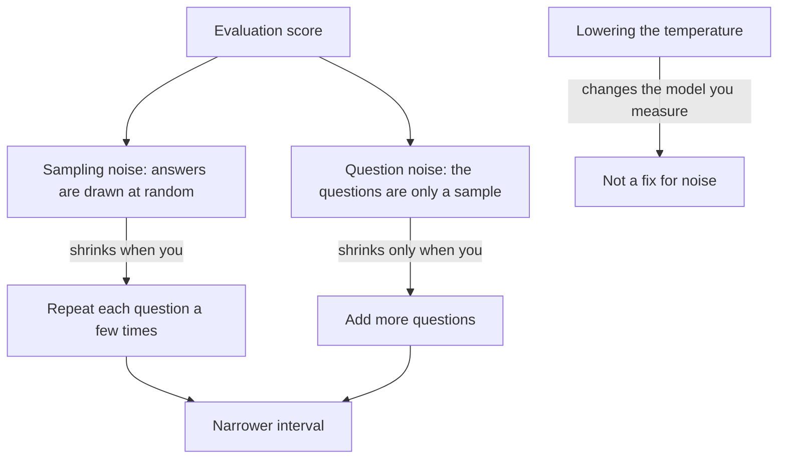

# 07. Why LLM Outputs Are Noisy, and What To Do About It

**Level:** Practitioner · **Reading time:** 28 min · **Exercise:** 60 min
**Prerequisites:** [Machine Learning in a Nutshell](01-machine-learning-in-a-nutshell.md) (evaluation on held-out data)

> **In one sentence:** After this chapter you can state how wide the error bar of an evaluation result is, before and after you run it, and you stop making decisions from differences that are noise.

## Why this matters

You change a prompt. On your internal set of 100 tickets, the score rises from 61% to 64%. You ship the change.

Two weeks later you compare the two prompts again, and the order has reversed. Nobody touched either prompt. Was the first result real?

Most likely not. With 100 questions at this accuracy, the error bar is about ±9.5 points. A 3-point gap sits well inside it. This chapter shows where that number comes from, what it means for your product, and what to do instead.

## The core idea

An evaluation score is a measurement, and every measurement has an error bar. For an LLM evaluation, two things make the score move:

- **Sampling noise.** The model chooses each token at random from a probability distribution ([Chapter 02](02-how-large-language-models-are-trained.md)). Ask the same question twice and you can get different answers, with different correctness.
- **Semantic noise.** Your questions are a sample of all the questions users could ask. A different set of 100 tickets would give a different score, because some tickets are harder than others. Wording and order shift results too ([Chapter 05](05-prompting-and-in-context-learning.md)).

**Figure 1.** Two sources of noise in a score, and the lever that acts on each.



Repeats and more questions are not interchangeable: each one removes only its own kind of noise.

"Semantic noise" is this chapter's name for the second kind. Sida Wang, in his Fall 2025 lecture *Predictable Noise in LLM Benchmarks*, makes the point without the label: resampling a model is "a remarkable ability", and treating that as the only kind of noise is "a common confusion" (his slide 22).

His title has a second half that matters more: the noise is **predictable**. You can estimate its size from two numbers, the accuracy and the number of questions. You can do it before the evaluation runs.

An analogy is an opinion poll. A poll of 100 people reports a margin of error of about ±10 points, and nobody reports a 3-point lead on such a poll. The analogy breaks in one useful way. You cannot ask each person the same question ten times. You can ask a model, which lets you shrink one part of the noise.

## How it works, step by step

### 1. Compute the error bar

For a score that counts right and wrong answers, the **standard error** (the typical distance between the score you got and the score you would get on the whole population of questions) is:

```
SE = sqrt(p * (1 - p) / n)          p = accuracy, n = number of questions
95% interval = score ± 1.96 * SE
```

This is the formula in Evan Miller's 2024 paper *Adding Error Bars to Evals*, which treats the questions of an evaluation as a random sample from an unseen population. For a run with one answer per question, it already includes both kinds of noise, because they add.

| Questions (n) | Accuracy | Standard error | 95% interval |
|---|---|---|---|
| 10 | 80% | 12.6 points | ±25 points |
| 30 | 80% | 7.3 points | ±14 points |
| 100 | 80% | 4.0 points | ±8 points |
| 500 | 80% | 1.8 points | ±3.5 points |
| 5,000 | 80% | 0.6 points | ±1.1 points |

Two consequences follow from the square root:

- **To halve the interval, quadruple the questions.**
- **Small sets cannot see small gains.** A 10-point improvement can hide inside the interval of 30 questions.

### 2. Decide the size before you run

Because the noise is predictable, you can answer the question "can this evaluation test my hypothesis?" in advance. Miller calls the tool **power analysis**. A rough version, by this chapter's own calculation: to trust a 5-point difference between two unpaired runs, made on different questions, near 65%, you need on the order of 700 questions per run. Comparing on the same questions needs fewer.

### 3. Compare on the same questions

Run both models or both prompts on identical questions and analyze the difference question by question. Miller's recommendation is to test the paired differences, not the two summary scores. The difficulty of each question appears in both results and cancels. Wang reports that three methods agree in practice, as long as the two models are not far apart: the direct calculation, resampling the data (the **bootstrap**), and the **sign test**, which treats every question where they disagree as a coin flip ([28:00](https://www.youtube.com/watch?v=HV8pugcFVO0&t=1680)). He gives one concrete size. HumanEval, a coding benchmark, has 164 questions, so one model's standard error is about 4 points. To reach the usual 5% threshold, an unpaired comparison needs about a 10-point gap and a paired one about 8 points. Both are larger than the gains many papers report ([22:00](https://www.youtube.com/watch?v=HV8pugcFVO0&t=1320)).

### 4. Know what repeated answers buy

Ask each question K times and average. Miller shows that this shrinks only the sampling part. In his worked example, a second answer per question removes some of the variance, and each further answer adds a smaller gain, because the remaining noise comes from the questions. His other warning: do not pool K × n answers as if they were independent observations.

### 5. Do not turn the temperature down

It is tempting to set the sampling temperature to zero and get "stable" numbers. Miller's section title is "Don't touch the thermostat!". Lowering the temperature changes the model you are measuring. It can move the noise into the part that repeats cannot fix, and it can bias the score. Evaluate with the settings you deploy. If you need a quiet score for a short-answer task, Miller suggests scoring the probability of the answer token instead of sampling.

### 6. Treat small, hard benchmarks with suspicion

Benchmarks are shrinking as they get harder. Wang's slides list the sizes: MNIST 10,000, ImageNet 100,000, MMLU about 10,000, HumanEval 164, SWE-bench Verified 500, τ-bench 80 ([2:00](https://www.youtube.com/watch?v=HV8pugcFVO0&t=120)).

The new kind is also expensive to run. He says generative and agentic benchmarks take a while to build and to evaluate ([1:39](https://www.youtube.com/watch?v=HV8pugcFVO0&t=99)). LiveCodeBench, a coding benchmark, aims for about a thousand problems. Agentic evaluations such as SWE-bench often need hours and hundreds of thousands of tokens, and they stay in the hundreds of problems. He adds that the improvements reported on such benchmarks are relatively small, and that many would not pass the usual test for statistical significance.

The counter-argument is that each question now carries a long generation, so it is more informative. Wang tested this. He sorted the models by their average score and the questions from easiest to hardest, and colored each cell with the model's pass rate on that question, over several draws where he had them ([6:00](https://www.youtube.com/watch?v=HV8pugcFVO0&t=360), [8:00](https://www.youtube.com/watch?v=HV8pugcFVO0&t=480)). The result was "a lot of inconsistency" ([10:00](https://www.youtube.com/watch?v=HV8pugcFVO0&t=600)). The best model fails easy items. Weak models solve some hard ones. If a model has a 30% chance on a "hard" item, he argues, the first percent of improvement is worth more: once a model has a decent chance and a verifier exists, it can simply try again ([12:00](https://www.youtube.com/watch?v=HV8pugcFVO0&t=720), [14:00](https://www.youtube.com/watch?v=HV8pugcFVO0&t=840)).

He also measured how much signal each benchmark carries, relative to its noise ([42:00](https://www.youtube.com/watch?v=HV8pugcFVO0&t=2520)). His signal is the gain from doubling a model's size, and his noise is the spread implied by statistical testing. On his slide's ratio scale, MMLU scores 13.2, GSM8K 7.1, HumanEval 1.1 and HumanEval+ 0.50. Below 2, a benchmark cannot reliably detect that gain, and that holds for most code benchmarks. In his words, MMLU can reliably tell a model from the next larger one, while code benchmarks such as HumanEval cannot even detect a doubling in size ([42:00](https://www.youtube.com/watch?v=HV8pugcFVO0&t=2520)).

His explanation is uncomfortable for benchmark builders. The models are less consistent than the benchmarks. His team tried to repair noisy sets by modelling the difficulty and error of each question, and got little signal (his slide 36). The same slide notes that others' attempts to correct benchmark errors brought no measurable improvement.

### 7. Use Wang's shortcuts

- **Per-question pass rates follow a pattern.** Across models, they fit a Beta distribution, a flexible distribution for values between 0 and 1. This lets you predict the noise of a data set from its accuracy alone ([36:00](https://www.youtube.com/watch?v=HV8pugcFVO0&t=2160)).
- **Three levels of effort.** Read the standard error from his table. Or read it from his curve at your accuracy. Or export your question-level results and run his code, which places your comparison among all the other model pairs, so that a strange result stands out at once ([38:00](https://www.youtube.com/watch?v=HV8pugcFVO0&t=2280)). The tool is called Eval-Arena.
- **Do not improvise the statistics.** In his experience, hand-rolled tests are error-prone, and he has seen many examples of the bootstrap done incorrectly in the literature ([28:00](https://www.youtube.com/watch?v=HV8pugcFVO0&t=1680)). Estimates from a few random seeds understate the noise ([38:00](https://www.youtube.com/watch?v=HV8pugcFVO0&t=2280)).

## Worked example

This script computes error bars and checks the formula by simulation. It needs only the standard library.

```python
import math
import random

def standard_error(correct, n):
    """Typical distance between the observed score and the population score,
    when the n results are independent and each is right with probability p."""
    p = correct / n
    return math.sqrt(p * (1 - p) / n)

for n in (10, 30, 100, 500, 5000):
    se = standard_error(int(0.8 * n), n)        # a model that scores 80%
    print(f"n = {n:4d}: SE = {se:.1%}, 95% interval = 80% +/- {1.96 * se:.1%}")

# Check: 10,000 evaluation runs of 30 questions, on a model that answers each
# question correctly with probability 0.8. The spread should match the formula.
random.seed(0)
runs = [sum(random.random() < 0.8 for _ in range(30)) / 30 for _ in range(10_000)]
mean = sum(runs) / len(runs)
spread = math.sqrt(sum((r - mean) ** 2 for r in runs) / len(runs))
print(f"simulated score: mean {mean:.1%}, spread {spread:.1%}")
```

What to observe:

- **The first five lines are the table above.** Thirty questions give an interval of ±14 points.
- **The simulation agrees with the formula.** The spread of the 10,000 runs is close to 7.3%.
- **Some runs land far from 80%.** On 30 questions, two prompts that are equally good will often differ by 10 points or more, in either direction.

## What the practitioners say

Wang's lecture is a researcher's audit of his own field. Two of his images are worth keeping:

- **The kettle.** His kettle broke. He took it apart, photographed it and asked a model, which said it looked like a robot vacuum. He trusted its later advice less. His point: hard tasks have many steps, and with a fixed chance of error per step, the chance of going wrong somewhere grows with the number of steps ([14:00](https://www.youtube.com/watch?v=HV8pugcFVO0&t=840)). For a product, keep chains short and check intermediate results.
- **Complicated evaluations invite mistakes.** When an evaluation needs 100,000 tokens to describe, he says, few people look at the details, and errors survive (his slide 41, which links to a bug report on SWE-bench).

His method for auditing a benchmark is to look for questions on which better models do worse. On MBPP several of those turned out to be real errors, later corrected in MBPP+. Models that reproduce the wrong answers are then suspects for having trained on the test data ([40:00](https://www.youtube.com/watch?v=HV8pugcFVO0&t=2400)).

Shunyu Yao's benchmark shows a second way a score can mislead, one that more samples make worse ([62:35](https://www.youtube.com/watch?v=RM6ZArd2nVc&t=3755)). For code with a unit test, sampling more answers helps: the chance that one of them passes keeps rising, and he calls that rate **pass@k**, the share of tasks solved at least once in *k* samples. Most jobs are not like that. In customer service one failure can cost a customer, so what matters is whether the task is solved every time. His benchmark, τ-bench, has the agent serve a simulated customer through a company's tools. When he samples each task more often with the same simulated user, the share of tasks that come out right in all samples falls, at every model size he tested. An ideal model, he says, would keep it flat.

Miller's paper closes the loop with reporting practice from other sciences: print the number of questions next to each score, and the standard error in parentheses.

## Pitfalls

1. **Reporting a score with no size and no interval.** *Fix:* always report n and the 95% interval.
2. **Comparing runs that share nothing.** Different questions, different settings. *Fix:* same questions, same settings, paired comparison.
3. **Calling a winner inside the error bar.** *Fix:* treat overlapping intervals as a tie until more data separates them.
4. **Repeating each question 50 times on a 40-question set.** *Fix:* repeat a few times, then add questions.
5. **Judging a slice of ten items.** Its interval is about ±25 points. *Fix:* [widen the slice or drop the claim](../08-quality-assurance/03-slicing.md).
6. **Lowering the temperature to quiet an evaluation.** *Fix:* measure the settings you ship, and reduce noise with repeats and questions.
7. **Several questions about one document, counted as independent.** *Fix:* cluster the questions by document. Miller finds the corrected interval can be up to three times wider.
8. **Judging an agent by whether a task was solved at least once.** That rate rises with more samples while the share solved on every sample falls. *Fix:* report both, and state the number of samples.

## Try it

**Deliverable:** an evaluation report for one task, with error bars.

1. Collect at least 100 real inputs with known correct outputs.
2. Evaluate two variants (two prompts or two models) on the same inputs, three times each, at the settings you deploy.
3. For each variant, report the mean score with its 95% interval.
4. Compute the per-input difference between the variants and its interval.
5. Write a decision: ship the change only if the interval of the difference excludes zero.

This calls a model at least 600 times. With a small model and short inputs, the whole run costs well under one dollar (estimate, as of November 2026; check your provider's prices).

**You are done when:** the report shows n for every score, includes the paired comparison, and states the decision rule before the verdict.

**Stretch goal:** add 50 inputs and rerun. Confirm that the interval narrows by about the square root of 100/150, which is a factor of about 0.82.

## Key takeaways

- An evaluation score is a measurement with an error bar. It moves because answers are sampled and because your questions are only a sample.
- The standard error is `sqrt(p * (1 - p) / n)`. Thirty questions give about ±14 points at 95% confidence, so small sets cannot see small gains.
- The noise is predictable. Decide the size of an evaluation before running it, with a power calculation.
- Compare variants on the same questions, with paired differences. Repeat each question a few times, not many.
- Do not lower the temperature to get quiet numbers, and do not trust small, hard benchmarks to rank close models.
- In a product, errors compound over steps. Keep chains short, and use agreement across samples as a confidence signal ([Chapter 06](06-reasoning-in-llms-from-chain-of-thought-to-search.md)).
- For a product task, what counts is the share solved on every sample, not only solved once. Yao's benchmark shows that share falling as the number of samples grows.

## Self-check

1. An evaluation has 100 questions and the model scores 80%. About how wide is the 95% interval?
   - A. About 8 points either side
   - B. About 0.8 points either side
   - C. About 40 points either side
   - D. It cannot be computed in advance

2. Which action shrinks the sampling part of the noise and leaves the question part?
   - A. Adding more questions to the set
   - B. Answering each question several times
   - C. Scoring the model on a second benchmark
   - D. Running both models on the same questions

3. Why compare two models on identical questions?
   - A. It halves the number of model calls needed
   - B. It removes the randomness of sampling
   - C. Their shared difficulty cancels in the difference
   - D. It makes the two models agree more often

4. What did Wang find when he plotted models against individual questions?
   - A. Hard items gave more exact measurements than easy ones
   - B. The noise of a small benchmark could not be estimated
   - C. Small benchmarks ranked close models more reliably
   - D. Weak models sometimes solve hard items and strong ones fail easy ones

5. Why does Miller advise against lowering the temperature during an evaluation?
   - A. It changes the model that is being measured
   - B. It makes every generated answer longer
   - C. It raises the cost of the evaluation run
   - D. It breaks the tokenizer of the model

6. Roughly how many questions do you need to halve the width of the interval?
   - A. About twice as many
   - B. About four times as many
   - C. About half as many
   - D. The number of questions makes no difference

7. An agent is run several times on each task of Yao's benchmark. What happens as the number of runs per task grows?
   - A. Both the share solved at least once and the share solved every time rise
   - B. The share solved at least once rises, and the share solved every time falls
   - C. Both shares stay where they were
   - D. The share solved at least once falls

<details><summary>Show answers</summary>

1. A. The standard error is sqrt(0.8 × 0.2 / 100) = 4 points, and 1.96 × 4 is about 8.
2. B. Repeats average out the answer-to-answer variation. The variation between questions stays, so only more questions shrink it.
3. C. The paired test analyzes the difference on each question, where the question's difficulty appears on both sides.
4. D. He found a lot of inconsistency, which is why a high pass rate on a "hard" item is less impressive than it looks.
5. A. The temperature changes the model's behavior, can shift variance into a part that repeats cannot fix, and can bias the score.
6. B. The standard error falls with the square root of n, so four times the questions halve it.
7. B. More samples raise the chance of one pass and lower the chance that every sample passes, at every model size he tested. An ideal model would keep the second share flat.

</details>

## Sources

- **Lecture:** Sida Wang, "Predictable Noise in LLM Benchmarks", Agentic AI MOOC (Fall 2025): [video](https://www.youtube.com/watch?v=HV8pugcFVO0) · [guide](../lectures/f25-07-predictable-noise-in-llm.md), used at [benchmark sizes](https://www.youtube.com/watch?v=HV8pugcFVO0&t=120), [inconsistency](https://www.youtube.com/watch?v=HV8pugcFVO0&t=600), [hard items](https://www.youtube.com/watch?v=HV8pugcFVO0&t=720), [the kettle](https://www.youtube.com/watch?v=HV8pugcFVO0&t=840), [paired tests](https://www.youtube.com/watch?v=HV8pugcFVO0&t=1680), [predictable noise](https://www.youtube.com/watch?v=HV8pugcFVO0&t=2160), [recommendations](https://www.youtube.com/watch?v=HV8pugcFVO0&t=2280), [auditing a benchmark](https://www.youtube.com/watch?v=HV8pugcFVO0&t=2400), [signal to noise](https://www.youtube.com/watch?v=HV8pugcFVO0&t=2520), [the cost of generative benchmarks](https://www.youtube.com/watch?v=HV8pugcFVO0&t=99)
- **Lecture:** Shunyu Yao, "LLM agents: brief history and overview", LLM Agents MOOC (Fall 2024): [video](https://www.youtube.com/watch?v=RM6ZArd2nVc) · [guide](../lectures/f24-02-llm-agents-brief-history-and-overview.md), used at [solved once against solved every time](https://www.youtube.com/watch?v=RM6ZArd2nVc&t=3755)
- **Reading:** Evan Miller, "Adding Error Bars to Evals: A Statistical Approach to Language Model Evaluations" (2024): [arXiv](https://arxiv.org/abs/2411.00640)
- **Tool:** Eval-Arena, pairwise statistical tests on public benchmarks (linked from Wang's slides): [project page](https://crux-eval.github.io/); the results page the slides point to no longer resolves

## Next

→ [A Short History of LLM Agents](08-a-short-history-of-llm-agents.md). The part closes with where agents came from, and with the definition of "agent" the rest of the course uses.
