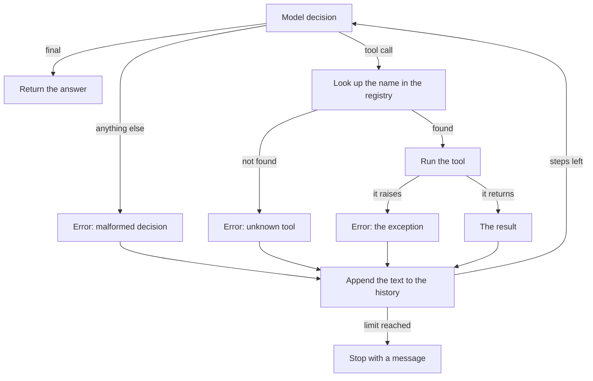

# 01. The Anatomy of an Agent

**Level:** Practitioner · **Reading time:** 30 min · **Exercise:** 60 min
**Prerequisites:** [A Short History of LLM Agents](../01-foundations/08-a-short-history-of-llm-agents.md) (the definition of "agent" used here)

> **In one sentence:** After this chapter you can name the five parts of any single-agent system, decide when you should not build one, and write a working agent loop in plain Python without a framework.

## Why this matters

You have used a chat model through an API, and it answers questions well. Then a colleague asks: "Can it check yesterday's failed orders in the database and file a ticket for each one?" It cannot. The model only produces text. It has no database, no clock, and no way to say "done".

The gap between "a model that answers" and "a program that acts" is not a better prompt. It is a small program around the model. This chapter shows what goes into that program.

## The core idea

An agent is a loop that lets a language model choose actions. Each turn, the program shows the model the task and everything that happened so far. The model answers with either an action or a final answer. The program runs the action, appends the result to the history, and asks again.

Five parts make up that program:

| Part | What it is | The question it answers |
|---|---|---|
| Model | The language model, hidden behind a small interface | What chooses the next action? |
| Tools | Functions the program runs on the model's behalf | What can the agent do? |
| Loop | The code that calls the model, runs tools, and checks for a stop | When does the run end? |
| Memory | The history in the context, plus anything saved outside it | What does the model see on the next turn? |
| Environment | Everything outside the model that the tools can reach | Where does it act, and what can it break? |

Three words carry most of the weight. A **tool** is an ordinary function with a name and a description. A **tool call** is the model's structured request to run one with given arguments. An **observation** is the text your program sends back after running it. All of this travels in the **context**: the text the model can see when it answers, measured in **tokens**, the short chunks of text (roughly a word or part of a word) that providers bill for.

The loop is close to code you already write: `while not done: action = decide(history)`. The analogy breaks at `decide`. It is not a normal function. Its result arrives as text that merely looks structured, it can be wrong, every call costs money and time, and the same input can give a different answer on a second run because models choose each next token with some randomness. So the loop has to parse, validate and budget.

## How it works, step by step

1. **Define the environment.** List what the agent may observe and what it may change: one database, one directory, one ticket system. Everything else is out of reach. The tools are this list written as code.
2. **Write the tools.** Each tool is a function, a description, and a schema: a small JSON description of the arguments it accepts. [Chapter 02](02-tool-design-and-function-calling.md) shows how.
3. **Write the system prompt.** This first message holds the rules: what the tools are for and when to stop.
4. **Write the loop.** Call the model with the history, parse one decision, run the tool, append both the decision and the observation to the history.
5. **Add stop conditions.** At minimum three: the model returns a final answer, the run passes a step limit, or the run passes a time or token budget.
6. **Handle errors as observations.** A failing tool returns an `Error:` text to the model, which can try something else. Only failures the model cannot fix, such as a missing API key, end the run with an exception.

**Figure 1.** What `run_agent` does with each model decision, and what ends the run.



A final answer or the step limit ends the run; every other failure becomes text in the history, and the model tries again.

### Workflows versus agents

A **workflow** is a sequence of model calls that you wrote in advance. An **agent** picks its own steps at run time.

| | Workflow | Agent |
|---|---|---|
| Who decides the steps | Your code | The model |
| Cost and [latency](../GLOSSARY.md) | Fixed, known in advance | Grows with the task |
| How you debug it | Read the code | Read the transcript, the log of every model call and tool result |
| Typical failure | A case the code did not expect | A loop, a wrong tool, a wrong plan |
| Fits best | Known, repeated tasks | Open-ended tasks |

### When an agent is the wrong tool

Skip the agent when any of these hold:

- **The steps never change.** Write the steps down. You gain a guarantee and lose nothing.
- **The output must be correct by construction.** Use ordinary code and tests. A model call adds a chance of error to every step it touches.
- **The result cannot be checked.** An agent improves only when it can observe the effect of its actions.
- **The actions are hard to undo.** No later observation repairs a sent email or a deleted table. Keep a human or a confirmation step in the path.
- **The task is one question with a known source.** One [retrieval](../GLOSSARY.md) step and one model call are enough.

### Memory, in one page

- **Working memory is the context window.** In the loop below it is the `messages` list: system prompt, task, every decision, every observation. It is limited, and you pay for it again at every step. If the history grows by a fixed amount each turn, the total input over *n* turns grows roughly with *n* squared.
- **Long-term memory is everything else.** Files, a database, a search index: anything stored outside the context and loaded back later. It costs engineering, because you must decide what to save, when to load it, and how to keep it true.

An agent remembers only what your program puts in front of the model. [Chapter 04](04-memory-and-knowledge-for-agents.md) covers what to do when the history no longer fits.

## Worked example

A complete agent in 105 lines of Python. There is no framework and no network: the model is a deterministic stub that replays a fixed script, so you can run and test the loop without an API key. This is the exact content of [`examples/minimal_agent.py`](../examples/minimal_agent.py), which you can run directly.

```python
"""A minimal agent in plain Python: a model behind an interface, a tool
registry, a loop with a stop condition, and error handling.
No framework and no network: the model is a deterministic stub."""

import json
from dataclasses import dataclass


# ---------- 1. Tools: a function plus the text the model sees ----------
@dataclass(frozen=True)
class Tool:
    name: str
    description: str        # the model reads this: it is a prompt
    parameters: dict        # JSON Schema describing the arguments
    fn: object              # the Python function to call

    def run(self, arguments: dict) -> str:
        """Call the function. Always returns text; never raises."""
        missing = [k for k in self.parameters.get("required", []) if k not in arguments]
        if missing:
            return "Error: missing required arguments %s." % missing
        try:
            return str(self.fn(**arguments))
        except Exception as exc:                 # tool errors go back to the model
            return "Error: %s: %s" % (type(exc).__name__, exc)


def add(a: float, b: float) -> float:
    return a + b


def divide(a: float, b: float) -> float:
    return a / b


TOOLS = [
    Tool("add", "Add two numbers.",
         {"type": "object", "required": ["a", "b"]}, add),
    Tool("divide", "Divide a by b.",
         {"type": "object", "required": ["a", "b"]}, divide),
]


# ---------- 2. The model: the loop sees only this interface ----------
class Model:
    """Messages in, one decision out. A decision is either
    {"type": "tool_call", "name": ..., "arguments": {...}}
    {"type": "final", "text": ...}
    A real adapter implements step() on top of a chat API."""

    def step(self, messages: list, tools: list) -> dict:
        raise NotImplementedError


class ScriptedModel(Model):
    """Deterministic stand-in for an LLM: replays a fixed list of decisions."""

    def __init__(self, script: list):
        self.script, self.i = script, 0

    def step(self, messages: list, tools: list) -> dict:
        decision = self.script[min(self.i, len(self.script) - 1)]
        self.i += 1
        return decision


# ---------- 3. The agent loop ----------
def run_agent(model: Model, tools: list, task: str,
              max_steps: int = 8, log=print) -> str:
    registry = {tool.name: tool for tool in tools}
    messages = [{"role": "system", "content": "Solve the task with the tools available."},
                {"role": "user", "content": task}]
    for _ in range(max_steps):
        decision = model.step(messages, tools)              # 1. ask for the next decision
        messages.append({"role": "assistant", "content": json.dumps(decision)})
        if decision.get("type") == "final":                 # 2. stop condition: model is done
            return decision["text"]
        if decision.get("type") != "tool_call":             # 3. malformed output: report it
            result = "Error: reply with a tool call or a final answer."
        else:
            tool = registry.get(decision.get("name"))       # 4. look the tool up
            if tool is None:
                result = "Error: unknown tool %r. Known tools: %s" % (
                    decision.get("name"), sorted(registry))
            else:
                result = tool.run(decision.get("arguments", {}))   # 5. errors become text
        log("model -> %s" % json.dumps(decision))
        log("loop  -> %s" % result)
        messages.append({"role": "tool", "content": result})      # 6. show it to the model
    return "Stopped: step limit reached before a final answer."


if __name__ == "__main__":
    script = [
        {"type": "tool_call", "name": "divide", "arguments": {"a": 10, "b": 0}},    # tool error
        {"type": "tool_call", "name": "multiply", "arguments": {"a": 10, "b": 2}},  # unknown
        {"type": "tool_call", "name": "add", "arguments": {"a": 10}},               # bad args
        {"type": "oops"},                                                          # malformed
        {"type": "tool_call", "name": "add", "arguments": {"a": 10, "b": 5}},       # works
        {"type": "final", "text": "10 divided by 0 is undefined; 10 + 5 = 15."},
    ]
    print(run_agent(ScriptedModel(script), TOOLS, "Add 10 and 5."))
    print("---")
    stuck = [{"type": "tool_call", "name": "divide", "arguments": {"a": 10, "b": 0}}]
    print(run_agent(ScriptedModel(stuck), TOOLS, "Divide 10 by 0.", max_steps=3))
```

Run it with `python3 minimal_agent.py`. Four things to observe in the output:

1. **Every failure comes back as text.** A division by zero, an unknown tool, a missing argument and a malformed decision each produce an `Error:` line, and the loop continues.
2. **The step limit is real.** In the second run the stub repeats one failing call, and the loop stops after three steps with a message instead of running forever.
3. **The loop knows nothing about the tools.** It looks names up in `registry`. A new tool is one more `Tool(...)` entry.
4. **`Model` is the seam.** To use a real model, write a class whose `step()` makes one chat API call and maps the provider's tool-call format to the `{"type": "tool_call", ...}` dictionary. Nothing else changes. That is the shape of the adapter (illustrative pseudocode: check your provider's current API documentation):

```python
class HttpModel(Model):
    def step(self, messages, tools):
        response = client.chat(messages=messages, tools=as_provider_schemas(tools))
        if response.tool_calls:
            call = response.tool_calls[0]
            return {"type": "tool_call", "name": call.name,
                    "arguments": json.loads(call.arguments)}
        return {"type": "final", "text": response.text}
```

A real adapter calls a paid API. Each step sends the whole history, so a 10-step run whose context grows to about 3,000 tokens costs roughly 15,000 input tokens plus a few hundred output tokens: a fraction of a cent to a few cents on small hosted models. Check the current price page.

## What the practitioners say

Graham Neubig teaches coding agents at CMU and maintains the open-source coding agent OpenHands. In his Fall 2024 lecture he puts the environment first: "one of the things that defines agents is how they can interact with the environment" ([10:00](https://www.youtube.com/watch?v=f9L9Fkq-8K4&t=600)). His list of the problems in a coding agent reads like a table of contents for building any agent ([8:00](https://www.youtube.com/watch?v=f9L9Fkq-8K4&t=480), [10:00](https://www.youtube.com/watch?v=f9L9Fkq-8K4&t=600)):

| His problem | In this part |
|---|---|
| Defining the environment | This chapter |
| Designing observations and actions | [Chapter 02](02-tool-design-and-function-calling.md) |
| Generating the atomic action (the code) | [Chapter 07](07-coding-agents.md) |
| File localization: finding where to act | [Chapter 04](04-memory-and-knowledge-for-agents.md) |
| Planning and error recovery | [Chapter 03](03-planning-search-and-decision-making.md) |
| Safety | [Part 04](../04-safety-and-security/01-threat-modeling-llm-applications-and-agents.md) |

Three more of his points apply here.

- **Automation comes in levels.** He borrows the self-driving scale and separates *development copilots*, which work synchronously with a developer, from *development agents*, which take a whole task ([4:00](https://www.youtube.com/watch?v=f9L9Fkq-8K4&t=240)). A copilot is one model call per action, with a human as the loop.
- **A fixed process often wins.** He describes Agentless, a system with three hard-coded steps that generates several patches, checks them, and keeps the best. It is cheap and scores well, he says, but it is inflexible: it cannot decide to read documentation online ([46:00](https://www.youtube.com/watch?v=f9L9Fkq-8K4&t=2760)). That is the workflow-versus-agent trade from the table above.
- **The environment is bigger than a shell.** Real development also touches issue trackers, documents and chat tools, and his slides add that testing environments are mostly focused on coding ([10:00](https://www.youtube.com/watch?v=f9L9Fkq-8K4&t=600)).

Yu Su (Ohio State University, Spring 2025) defends two words that this chapter and the next ones use. The first is *reasoning*. People separate perception, fast intuition and slow symbolic thought. A model has no separate machinery for them: nearly everything it does is one mechanism, generating tokens. When GPT-4o describes an image, that one mechanism produces what would be called perception, intuitive inference and some symbolic reasoning in a person, so he considers "reasoning" the proper word for all of it. The second is the name **language agents**, which he prefers to LLM agents, probably the most popular name at the time. Language is the most salient trait of this generation of agents. Multimodal agents also perceive in other modalities, but language still does the heavy lifting of reasoning and communication. What defines them, in his view, is a general capability to understand and produce language, and it does not have to come from a language model: the model may be a means to an end ([8:56](https://www.youtube.com/watch?v=zvI4UN2_i-w&t=536)).

Su also offers a map of the field, which he uses to place the claims of any new agent paper. Earlier agent designs captured single facets of intelligence, such as logical reasoning or perception in one modality. A multimodal language model is, in his account, the first to encode several senses in one representation, which makes agents more expressive and more adaptive. Their reasoning works in language: it is fuzzy, flexible and semi-explicit, so you can read the chain of thought, but it gives no guarantee. He does not count that a defect: the world is fuzzy too, and a strictly sound and rigid system, he says, loses much expressiveness. The map stacks what he calls **core competencies**, the abilities an agent needs, in a loose hierarchy. Perception, memory and embodiment sit at the bottom. Reasoning, world models and planning rest on them, and issues such as safety, evaluation, synthetic data and efficiency cut across every level ([12:34](https://www.youtube.com/watch?v=zvI4UN2_i-w&t=754)).

Su closes his lecture with safety, which, he says, keeps him up at night. For a web agent, the attack surface is the whole internet: a deep research agent can visit a harmless-looking page, be tricked by it and reveal private information. He separates **endogenous risks**, which arise from the agent itself, usually from its incompetence, as when it takes a mistaken action that cannot be undone, from **exogenous risks**, which come from the environment ([90:00](https://www.youtube.com/watch?v=zvI4UN2_i-w&t=5400)). The first kind calls for the guards of this chapter; the second calls for treating everything the agent reads as data, not as instructions ([prompt injection](../04-safety-and-security/02-jailbreaks-and-prompt-injection.md)).

Yangqing Jia, who started the AI infrastructure company Lepton AI, adds the application-side view. In his Fall 2025 lecture he describes Duolingo using models to produce course content faster: the product improved because better models were combined with the company's own language-teaching knowledge, not because of the model alone ([32:00](https://www.youtube.com/watch?v=xqRAS6rAouo&t=1920)). The lesson for an agent builder: the model is one part. The tools, the environment and the data you connect are where your system differs from everyone else's.

## Pitfalls

1. **No step limit.** A model that repeats a failing call will run until your budget is gone. Fix: set a step limit, a token or money budget, and a wall-clock timeout, and test that each one fires.
2. **Letting tool exceptions escape.** A crashed run loses the chance to recover. Fix: catch exceptions inside the tool wrapper and return `Error: ...` as the observation. Raise only for failures the model cannot fix.
3. **Dropping history.** If you do not append the model's own decision and the tool result to `messages`, the model cannot see what it tried. Fix: append every decision and every observation, in order.
4. **Trusting the model's output.** A model can invent a tool name or omit an argument. Fix: look tools up in a registry, validate arguments against the schema, and report what was wrong.
5. **Starting with an agent.** A workflow with two model calls would have shipped in a day. Fix: write the fixed version first, and add autonomy only where the steps really vary.
6. **Giving the agent the whole machine.** Tools that reach production data make every model mistake an incident. Fix: give the tools the narrowest access that works, and run them in a sandbox, an isolated environment that cannot touch anything else ([sandboxes](../05-frameworks-and-multi-agent/06-agent-infrastructure-sandboxes-browser-use-and-protocols.md)).

## Try it

Turn the stub into a real agent over a folder of notes.

1. Add two tools: `list_files()` and `read_file(path)` that work only inside one fixed directory. Reject paths that escape it: resolve the path with `os.path.realpath`, then reject it unless `os.path.commonpath` of that directory and the path equals the directory.
2. Write a real `Model` adapter for a hosted model of your choice, following that provider's current documentation.
3. Keep `ScriptedModel` and write a test that runs the loop offline: one script that triggers an unknown tool, one that hits the step limit.

**Deliverable:** a repository with the agent, the test, and a README that answers: what is the environment, what are the stop conditions, and which errors go back to the model?

**You are done when:** (1) the agent answers a question that needs at least two tool calls; (2) a tool that raises an exception produces an `Error:` observation and the run continues; (3) the offline tests pass with the network turned off; (4) a run that cannot finish stops at the limit with a clear message.

**Stretch goal:** add a token budget that stops the run, and log every step to a file so you can replay a failed run. Replaying is the first step toward an [evaluation harness](../03-evaluation/02-a-minimal-eval-harness.md).

## Key takeaways

- An agent is a loop around a model: decide, act, observe, repeat, stop.
- Five parts: model, tools, loop, memory, environment. Define the environment first.
- Working memory is the context and is paid for at every step. Long-term memory is whatever your code saves and reloads.
- Tool errors are observations, not exceptions.
- Use a workflow when the steps are fixed. Use an agent when they are not.
- Keep the model behind one small interface so the loop can be tested without it.

## Self-check

1. A tool raises an exception during a run. What does the loop do with it, and why?
2. An agent repeats the same failing call for 40 steps. Name two independent guards and when each one fires.
3. A task always has the same three steps and a test suite checks the output. Workflow or agent? Give the deciding reason.
4. Why append the model's decision to `messages` before checking what kind of decision it is?
5. What is the difference between an agent's memory and its context window?
6. Why does the example use `ScriptedModel` when it contains no language model at all?

<details><summary>Show answers</summary>

1. The tool wrapper catches it and returns an `Error:` text as the observation. The model then sees what went wrong and can choose a different action, instead of the run ending with a stack trace.
2. Any two of: a step limit (fires after a fixed number of turns), a token or money budget (fires when spending passes a limit), a wall-clock timeout (fires after a fixed time). Each covers a case the others miss, such as a few very expensive calls.
3. A workflow. The model would add cost and a chance of error to steps whose order and content are already known, and the tests already give the guarantee you need.
4. So that on the next turn the model sees its own previous decision, including a malformed one, next to the error it caused. Without it the history shows an error with no cause.
5. The context window is what the model can see on one call. Memory is the broader term: the context plus anything your program stores outside it and loads back later.
6. It makes the loop deterministic and free to test. The same script always produces the same decisions, so you can check error handling and stop conditions without a network or an API key.

</details>

## Sources

- **Lecture:** Graham Neubig, "Agents for Software Development", UC Berkeley LLM Agents MOOC (Fall 2024): [video](https://www.youtube.com/watch?v=f9L9Fkq-8K4) · [guide](../lectures/f24-06-agents-for-software-development.md), used at [what defines agents](https://www.youtube.com/watch?v=f9L9Fkq-8K4&t=600), [copilots versus agents](https://www.youtube.com/watch?v=f9L9Fkq-8K4&t=240), [hard-coded processes](https://www.youtube.com/watch?v=f9L9Fkq-8K4&t=2760)
- **Lecture:** Yangqing Jia, "Evolution of System Designs from an AI Engineer Perspective", UC Berkeley Agentic AI MOOC (Fall 2025): [video](https://www.youtube.com/watch?v=xqRAS6rAouo) · [guide](../lectures/f25-02-evolution-of-system-designs-from-an-ai-engineer.md), used at [models and applications reinforce each other](https://www.youtube.com/watch?v=xqRAS6rAouo&t=1920)
- **Lecture:** Yu Su, "Reasoning, Memory and Planning of Language Agents", UC Berkeley Advanced LLM Agents MOOC (Spring 2025): [video](https://www.youtube.com/watch?v=zvI4UN2_i-w) · [guide](../lectures/sp25-03-on-reasoning-memory-and-planning-of-language.md), used at [why "reasoning" and why "language agents"](https://www.youtube.com/watch?v=zvI4UN2_i-w&t=536), [a map of core competencies](https://www.youtube.com/watch?v=zvI4UN2_i-w&t=754), [two kinds of safety risk](https://www.youtube.com/watch?v=zvI4UN2_i-w&t=5400)
- **Reading:** Anthropic, "Building effective agents" (2024): [link](https://www.anthropic.com/engineering/building-effective-agents)

## Next

→ [02. Tool Design and Function Calling](02-tool-design-and-function-calling.md), because the tools decide what an agent can do and how often it fails.
