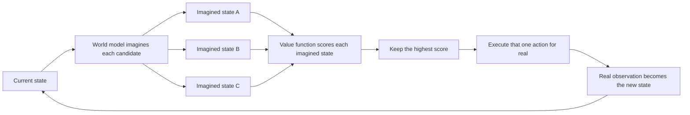

# 03. Planning, Search and Decision-Making

**Level:** Practitioner · **Reading time:** 30 min · **Exercise:** 60 min
**Prerequisites:** [Tool Design and Function Calling](02-tool-design-and-function-calling.md) (actions and observations); [Reasoning in LLMs: From Chain of Thought to Search](../01-foundations/06-reasoning-in-llms-from-chain-of-thought-to-search.md) (chain of thought and search as a reasoning technique)

> **In one sentence:** After this chapter you can choose how much deliberation an agent should do before each action, pick between letting the model decide and handing a sub-problem to a solver, and explain the cost of each choice.

## Why this matters

An agent is asked to book a trip: three cities, fixed dates, a budget. It works step by step. It books the first flight, then finds that no hotel near the second city fits what is left of the budget. The flight cannot be unbooked.

Two mistakes happened. The agent acted without looking ahead, and it tried to satisfy many constraints in its head. This chapter answers two questions: how much thinking should precede each action, and which decisions belong to the model at all.

## The core idea

**Planning** is choosing a sequence of actions before taking them. A plan leads from the current **state**, the situation the agent is in, to a state that passes a **goal test**, the check that says the task is done. The agent needs three things to plan: a description of the state, the available actions, and some way to predict what an action will do.

There are two separate decisions in every design:

1. **How much to deliberate.** From none (act on the first idea) to full search (compare many possible futures).
2. **Who deliberates.** The language model, or an algorithm such as a **solver**, a program that returns a provably valid or optimal answer to a problem written in formal notation.

Yu Su opens his planning section with a simplified definition: given a goal, decide on the sequence of actions that ends in a state passing the goal test ([76:00](https://www.youtube.com/watch?v=zvI4UN2_i-w&t=4560)). Yuandong Tian, in the title of his lecture, calls the second decision the neural and the symbolic side.

The patterns below are like the difference between writing straight-line code, computing a call stack up front, and running a backtracking parser. The analogy breaks because the planner is a language model: its plan is plausible text, not a proof.

## How it works: six patterns

| # | Pattern | What happens in one step | Main cost | Use it when |
|---|---|---|---|---|
| 1 | Reactive | The model picks the next action and takes it | Cheapest | Steps are cheap to undo and the goal is near |
| 2 | Interleaved reasoning | The model writes a short thought, then acts | One longer call | The next action depends on what was just observed |
| 3 | Plan, then execute | The model writes all steps, then carries them out | One extra call | The task has a stable order |
| 4 | Reflection | After an outcome, the model critiques its run and writes a lesson | Calls at the end of a run | The agent retries similar tasks |
| 5 | Search | Several branches are tried, with backtracking | Calls multiply per step | Actions are reversible or run in a simulator |
| 6 | Simulate, then act | A model imagines each candidate action; the best is executed | Calls per candidate | Actions are real and hard to undo |

**1. Reactive.** Su names this the most common paradigm and, in his words, calls it reactive planning or ReAct: at each state the agent observes, reasons, decides and commits. It is fast and easy to implement, he says, but greedy and short-sighted, so the agent often ends up stuck in a bad state with no way out ([80:00](https://www.youtube.com/watch?v=zvI4UN2_i-w&t=4800)). It is the right default for a strong model on a short task, and the wrong one for the trip.

**2. Interleaved reasoning.** ReAct, from Yao and colleagues in 2022, writes that reasoning step down, so a thought, an action and an observation alternate: *thought* "only $600 is left, so check hotel prices first"; *action* search hotels; *observation* three results. Su gives this a precise place in the classic agent picture: reasoning is a new kind of action, taken in an inner monologue instead of in the environment, and self-reflection is a reasoning action about the reasoning itself ([8:00](https://www.youtube.com/watch?v=zvI4UN2_i-w&t=480)).

**3. Plan, then execute.** The model first writes a numbered plan and then executes one item per turn. Keep the plan in the context as a checklist, and replan when an observation contradicts it. This is where **task decomposition** happens: the plan splits the goal into sub-goals. Su names hierarchical planning and dynamic replanning as important topics that his lecture did not cover ([88:00](https://www.youtube.com/watch?v=zvI4UN2_i-w&t=5280)). Graham Neubig shows the pattern in coding agents. In CodeR, a manager writes a plan and sub-agents carry it out under a hard-coded control flow: a reproducer, a fault localizer, an editor, a verifier ([48:00](https://www.youtube.com/watch?v=f9L9Fkq-8K4&t=2880)). His warning is the failure to design against: agents often see only after planning that an assumption was wrong, for instance a test directory they named does not exist, so the plan needs a way back to the planner.

**4. Reflection.** After a run or a failed step, the model answers: what went wrong, what would I do differently? The text is saved and shown on the next attempt. Reflection only pays when the same kind of task comes back. For a one-off task it is a wasted call. Neubig counts fixing code from error messages as a central part of error recovery, and as an advantage an agent has over a fixed pipeline: it can run the code, see the result and go back ([50:00](https://www.youtube.com/watch?v=f9L9Fkq-8K4&t=3000)). His example of the failure: GPT-4o would try one fix, fail, and repeat the same fix in a loop until the turns ran out. A critique that does not change the next attempt is only a wasted call.

**5. Search.** Tree search keeps several open branches, expands the most promising, and backtracks when a branch fails. Su's objection is about the real world: many actions change state and cannot be undone. On one shopping site, he says, an agent can place orders, make returns, open accounts and change privacy settings, and there is no universal undo ([82:00](https://www.youtube.com/watch?v=zvI4UN2_i-w&t=4920)). Search belongs in a [sandbox](../GLOSSARY.md).

**6. Simulate, then act.** A **world model** is a model of what happens next: if the agent takes this action in this state, what is the resulting state? Su defines it exactly that way ([84:00](https://www.youtube.com/watch?v=zvI4UN2_i-w&t=5040)). The agent asks a language model to imagine the outcome of each candidate action, scores each imagined state, and executes only the best one.

## Worked example

Su's group built this last pattern for web agents in a system called WebDreamer ([86:00](https://www.youtube.com/watch?v=zvI4UN2_i-w&t=5160)). The loop, in illustrative pseudocode:

```python
def choose_action(goal, state, candidates, world_model, value_function):
    """Simulate every candidate before touching the real environment."""
    best, best_value = None, -1.0
    for action in candidates:                        # e.g. ["type 'disk'", "click 'electronics'"]
        imagined = world_model(state, action)        # one model call: "what happens next?"
        value = value_function(goal, imagined)       # one model call: "how close are we to the goal?"
        if value > best_value:
            best, best_value = action, value
    return best                                      # the only action executed for real
```

On a slide, the goal is to buy the least expensive 512 GB disk. The planner scores each candidate action, here typing a search query or clicking a category, and executes the one that scores best: the search. His summary of language models as world models: "Far from perfect, but reasonable" ([86:00](https://www.youtube.com/watch?v=zvI4UN2_i-w&t=5160)). On the VisualWebArena benchmark he reports model-based planning as more accurate than reactive planning, slightly better than tree search, and much cheaper and faster than tree search, which was only possible there because the test ran in a sandbox ([88:00](https://www.youtube.com/watch?v=zvI4UN2_i-w&t=5280)).

Count the cost before choosing a pattern. With three candidates and a look-ahead of one step, a ten-step task costs ten real actions plus about sixty model calls (one world-model call and one value call per candidate per step). With a look-ahead of two steps it is about 240: each of the three first-step outcomes is simulated and scored, and each opens three more. Reactive costs ten.

**Figure 1.** Simulate, then act: each candidate action is imagined and scored, and only the best one is executed.



Only the execution step touches the real environment; the imagined states are model output, and the real observation replaces them.

## A unified view: neural plus symbolic

Tian starts from the trip-planning failure. Even the strongest models of late 2024 produced poor or infeasible plans on a travel benchmark, and results fell as the number of cities grew (slides 6 to 8, [6:49](https://www.youtube.com/watch?v=wm9-7VBpdEo&t=409)). He lays out three responses (slide 10, [10:00](https://www.youtube.com/watch?v=wm9-7VBpdEo&t=600)): scale up the model, combine models with solvers, or study how symbolic structure appears inside networks. The middle one rests on a clean split:

| | Neural: the model decides | Symbolic: an algorithm decides |
|---|---|---|
| Understands a request in plain language | Yes | No |
| Copes with vague goals and open action spaces | Yes | No |
| Guarantees constraints and optimality | No | Yes |
| Needs GPUs | Yes, one call per decision | Usually not |
| Typical failure | A confident, plausible wrong answer | Cannot read a request that is not written formally |

Tian shows three ways to join the two sides.

**1. The model calls the solver.** In his travel-planning demo, a [fine-tuned](../GLOSSARY.md) model translates the request into a symbolic description, flight and hotel information is added, the problem is written as **mixed integer linear programming (MILP)**, an optimization method for decisions with hard constraints, and a solver returns an optimal itinerary ([12:00](https://www.youtube.com/watch?v=wm9-7VBpdEo&t=720)). As reported in the lecture, the translation took about two seconds and the solve between half a second and seven seconds ([14:00](https://www.youtube.com/watch?v=wm9-7VBpdEo&t=840)). A slide in Su's planning section names the same design LLM+P: it applies when the domain and the problem can be described formally, for example in PDDL, a standard planning language. He skips that slide in the talk (slide 55, [78:00](https://www.youtube.com/watch?v=zvI4UN2_i-w&t=4680)).

The demo takes one complete request, which, Tian says, is not how people talk: a traveller starts with a rough idea, and the agent has to ask about the budget, or whether price or experience matters more. His group therefore trained an agent that asks the traveller questions over several rounds, gathers the missing details in as few rounds as it can, and only then writes the JSON. It was tuned against a short written constitution with four demands: be accurate; be proactive, meaning ask questions that matter and not random ones; be efficient and adapt to the type of traveller; and be credible, with few hallucinations. On 50 traveller personas, each hiding a sheet of critical facts, several rounds of direct preference optimization (see [From Base Model to Assistant: Post-Training](../01-foundations/03-from-base-model-to-assistant-post-training.md)) made it collect more of the overall and of the critical information than an untuned model. A related paper, he adds, replaces the human judge with an agent that checks every step of the target agent, which gives richer feedback ([15:13](https://www.youtube.com/watch?v=wm9-7VBpdEo&t=913)).

**2. The solver teaches the model.** Tian's Searchformer trains a small [transformer](../GLOSSARY.md) to output the trace of the A* search algorithm, a classic shortest-path search, before the plan. A 15-million-parameter model trained on search traces reached about 80% on unseen 30 by 30 mazes with about 50,000 training examples, where a 175-million-parameter model trained on plans alone scored about 20% on that budget and needed about a million examples to reach high accuracy (as reported in the lecture, [24:00](https://www.youtube.com/watch?v=wm9-7VBpdEo&t=1440)). A later step keeps only the shortest traces that still give optimal plans and retrains on them ([28:00](https://www.youtube.com/watch?v=wm9-7VBpdEo&t=1680)). Its successor, DualFormer, is trained on traces with random parts removed, because Searchformer's traces often run to a thousand tokens or more. It switches by itself between a fast mode and a slow, deliberate mode ([32:00](https://www.youtube.com/watch?v=wm9-7VBpdEo&t=1920), [34:00](https://www.youtube.com/watch?v=wm9-7VBpdEo&t=2040)). He notes himself that its maze comparison with o1-preview, a reasoning model from OpenAI at the time, is unfair, since o1-preview was not fine-tuned on the task ([40:00](https://www.youtube.com/watch?v=wm9-7VBpdEo&t=2400)).

His account adds three details ([32:50](https://www.youtube.com/watch?v=wm9-7VBpdEo&t=1970)). A model trained on the mixtures, with different amounts removed, scored better than a model trained on plans only or on complete traces, and its outputs were more diverse, which he says matters when more compute is spent at test time. The first token shows the chosen mode: a plan token means an immediate answer, a create token means a search first. Forcing that first token selects the mode, and a forced mode still beat the model trained for that mode alone. On maths problems, removing sentences at random from long explanations produced shorter reasoning with slightly better accuracy.

**3. Train both together.** His SurCo work learns a linear stand-in, also called a surrogate, for a nonlinear optimization objective, hands the stand-in to an existing solver, and trains the stand-in by backpropagating through the solver, so that training judges only the final loss ([44:00](https://www.youtube.com/watch?v=wm9-7VBpdEo&t=2640), [46:00](https://www.youtube.com/watch?v=wm9-7VBpdEo&t=2760)). One of his examples is placing a large embedding table across GPUs. Another is inverse photonic design: an 80 by 80 grid of nanometre-scale cells that bends or splits light by diffraction. Each cell is on or off, a constraint from the size of the brush that will carve the design rules out isolated dots, and the loss comes from a physical simulation. He reports that two of his variants converge more smoothly than the standard method that uses no neural network, and names three limits: the objective must be differentiable, a solver is called in every training step, which is slow, and that solver must be differentiable too ([49:34](https://www.youtube.com/watch?v=wm9-7VBpdEo&t=2974)).

The lesson for a practitioner is the first way. When a sub-problem has hard constraints and a known algorithm, write the translator and call the algorithm. Use the model for what it is good at: understanding the request and explaining the result.

His third response, to study how symbolic structure appears inside networks, starts from a dispute. One camp expects emergent abilities from more parameters. The other holds that a model mostly retrieves patterns seen in training, and he cites an Apple study: adding irrelevant sentences to a maths word-problem benchmark changed no answer but made every model's score drop sharply. What representation a language model uses for reasoning and planning is, in his words, a core problem ([54:02](https://www.youtube.com/watch?v=wm9-7VBpdEo&t=3242)). His probe is addition modulo a number, small enough to memorize. Networks trained on it do not build a lookup table: they represent numbers with sine and cosine features, and in a two-layer network with quadratic activations the hidden neurons respond strongly at only a few frequencies ([56:36](https://www.youtube.com/watch?v=wm9-7VBpdEo&t=3396)). These solutions can be built by algebra alone, with no gradient descent, because the loss has a structure under which two partial solutions multiply into one that satisfies both ([1:02:00](https://www.youtube.com/watch?v=wm9-7VBpdEo&t=3720)). About 95% of the solutions gradient descent found split as that construction predicts, and 98% match it entry by entry. Training had converged on a symbolic solution; whether larger models do the same, in a form nobody has constructed yet, he leaves open ([1:06:00](https://www.youtube.com/watch?v=wm9-7VBpdEo&t=3960)).

## Pitfalls

1. **Solving constraints in prose.** A model asked to juggle budgets and dates produces plans that read well and break rules. Fix: extract constraints and use a solver or a validator.
2. **Searching the real world.** Fix: search only where actions are reversible, or simulate first.
3. **Simulating everything.** Fix: simulate at hard decisions only. Su makes the same point about people ([90:00](https://www.youtube.com/watch?v=zvI4UN2_i-w&t=5400)).
4. **Trusting the imagined state.** A world model guesses. Fix: execute the chosen action and use the real observation as the next state.
5. **Planning once.** Fix: keep the plan in the context and replan whenever an observation breaks it.
6. **Scaffolding a strong model.** Su's takeaway: the best strategy depends on the model, and a stronger model may need less scaffolding, meaning added structure around the model such as search or simulation, and can plan more reactively ([88:00](https://www.youtube.com/watch?v=zvI4UN2_i-w&t=5280)). Fix: measure the reactive baseline first.
7. **Translating a rough idea.** A solver returns an optimal answer to the request it was given, and a first request is rarely complete. Fix: ask for the missing details first, as Tian's dialogue agent does ([15:13](https://www.youtube.com/watch?v=wm9-7VBpdEo&t=913)).

## Try it

Build a 5 by 5 grid world in Python: a start cell, a goal cell, walls, and moves in four directions. It is reversible and has an exact checker, so you can compare patterns against a known answer. The two model-driven policies send the grid as text to a hosted model and read back one move or a whole path.

1. Write a reactive [policy](../GLOSSARY.md), the rule that picks one move per step.
2. Write a plan-then-execute policy that outputs the whole path first, then follows it.
3. Write breadth-first search as the oracle, the answer known to be shortest.
4. Log, per policy: steps taken, success, and number of decisions made.

**Deliverable:** the three policies, the log, and a table comparing them.

**You are done when:** the oracle always finds a shortest path; the reactive policy fails on at least one maze and your table shows why; and the plan-then-execute policy recovers after you move a wall mid-run.

**Stretch goal:** replace the oracle with a simulate-then-act loop that scores candidate moves with a language model, and compare its success and its call count with the table.

## Key takeaways

- Planning is choosing actions before taking them, against a goal test.
- Deliberation is a dial: reactive, interleave thought and action, plan first, reflect, search, simulate.
- Search needs reversible actions. In the real world, simulate before you act.
- Simulation costs model calls per candidate per step. Count them before choosing it.
- Give sub-problems with hard constraints to a solver and let the model translate in and out.
- Measure the reactive baseline before adding scaffolding.

## Self-check

1. Name the two independent decisions in every planning design.
2. Why does Su say tree search is a poor fit for a real shopping site?
3. In simulate-then-act, what do the two kinds of model calls compute?
4. In Tian's travel demo, what does the language model do and what does the solver do?
5. What did training on search traces buy Searchformer compared with training on plans alone?
6. When is reflection worth its cost?

<details><summary>Show answers</summary>

1. How much to deliberate before each action, and who deliberates: the language model or an algorithm such as a solver.
2. Because many actions on such a site change state and cannot be undone, such as placing an order or opening an account, so backtracking is impossible and exploring is unsafe.
3. A world-model call predicts the state that follows a candidate action. A value call estimates how close that imagined state is to the goal.
4. The model translates the request in plain language into a symbolic description. The solver finds an itinerary that satisfies all constraints.
5. Far better data and parameter efficiency: by his summary, about the same performance with a model ten times smaller and a tenth of the training examples.
6. When the agent will face similar tasks again, so that the written lesson can be reused on a later attempt.

</details>

## Sources

- **Lecture:** Yu Su, "Reasoning, Memory and Planning of Language Agents", UC Berkeley Advanced LLM Agents MOOC (Spring 2025): [video](https://www.youtube.com/watch?v=zvI4UN2_i-w) · [guide](../lectures/sp25-03-on-reasoning-memory-and-planning-of-language.md), used at [reasoning as an action](https://www.youtube.com/watch?v=zvI4UN2_i-w&t=480), [a definition of planning](https://www.youtube.com/watch?v=zvI4UN2_i-w&t=4560), [tree search and irreversible actions](https://www.youtube.com/watch?v=zvI4UN2_i-w&t=4920), [reactive planning](https://www.youtube.com/watch?v=zvI4UN2_i-w&t=4800), [world models](https://www.youtube.com/watch?v=zvI4UN2_i-w&t=5040), [WebDreamer](https://www.youtube.com/watch?v=zvI4UN2_i-w&t=5160), [takeaways](https://www.youtube.com/watch?v=zvI4UN2_i-w&t=5280)
- **Lecture:** Yuandong Tian, "Towards a unified framework of Neural and Symbolic Decision Making", UC Berkeley LLM Agents MOOC (Fall 2024): [video](https://www.youtube.com/watch?v=wm9-7VBpdEo) · [guide](../lectures/f24-08-towards-a-unified-framework-of-neural-and.md), used at [the travel planning problem](https://www.youtube.com/watch?v=wm9-7VBpdEo&t=120), [three options](https://www.youtube.com/watch?v=wm9-7VBpdEo&t=600), [model plus solver](https://www.youtube.com/watch?v=wm9-7VBpdEo&t=720), [Searchformer](https://www.youtube.com/watch?v=wm9-7VBpdEo&t=1440), [DualFormer](https://www.youtube.com/watch?v=wm9-7VBpdEo&t=2040), [SurCo](https://www.youtube.com/watch?v=wm9-7VBpdEo&t=2760), [clarifying dialogue](https://www.youtube.com/watch?v=wm9-7VBpdEo&t=913), [a training mixture and two modes](https://www.youtube.com/watch?v=wm9-7VBpdEo&t=1970), [photonic design and its limits](https://www.youtube.com/watch?v=wm9-7VBpdEo&t=2974), [what models learn](https://www.youtube.com/watch?v=wm9-7VBpdEo&t=3242)
- **Lecture:** Graham Neubig, "Agents for Software Development", UC Berkeley LLM Agents MOOC (Fall 2024): [video](https://www.youtube.com/watch?v=f9L9Fkq-8K4) · [guide](../lectures/f24-06-agents-for-software-development.md), used at [plans with wrong assumptions](https://www.youtube.com/watch?v=f9L9Fkq-8K4&t=2880), [fixing from error messages](https://www.youtube.com/watch?v=f9L9Fkq-8K4&t=3000)
- **Reading:** Shunyu Yao, Jeffrey Zhao, et al., "ReAct: Synergizing Reasoning and Acting in Language Models" (2022): [link](https://arxiv.org/abs/2210.03629)
- **Reading:** Bo Liu, Yuqian Jiang, et al., "LLM+P: Empowering Large Language Models with Optimal Planning Proficiency" (2023): [link](https://arxiv.org/abs/2304.11477)
- **Reading:** Yu Gu, Boyuan Zheng, et al., "Is Your LLM Secretly a World Model of the Internet? Model-based Planning for Web Agents" (2024): [link](https://arxiv.org/abs/2411.06559)
- **Reading:** Lucas Lehnert, Sainbayar Sukhbaatar, et al., "Beyond A*: Better Planning with Transformers via Search Dynamics Bootstrapping" (2024): [link](https://arxiv.org/abs/2402.14083)

## Next

→ [04. Memory and Knowledge for Agents](04-memory-and-knowledge-for-agents.md), because a plan and the observations it produces all have to fit somewhere.
