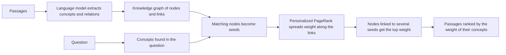

# 04. Memory and Knowledge for Agents

**Level:** Practitioner · **Reading time:** 30 min · **Exercise:** 60 min
**Prerequisites:** [The Anatomy of an Agent](01-the-anatomy-of-an-agent.md) (the loop and its `messages` list)

> **In one sentence:** After this chapter you can decide what an agent keeps in its context and what it stores outside, compact a long run without losing the thread, and build retrieval that answers questions spread over several documents.

## Why this matters

A support agent is on turn 40 of a session. Its context is full. It reads the same file for the third time, it has lost the order number from turn 3, and every turn costs more than the last.

A second agent is asked: "Which of our engineers worked on both the payments migration and the iOS app?" No single document says both. The agent searches, finds twenty passages that each match half of the question, and gives up.

Both are memory problems. The first is about the context. The second is about how knowledge outside the context is found.

## The core idea

Memory for an agent is three decisions: what to **write down**, where to **store** it, and what to **read back** before each step.

| | Working memory | Long-term memory |
|---|---|---|
| Where it lives | The context window: the `messages` list | Files, a database, a search index |
| Size | Small | As large as you like |
| How the model reaches it | It is already in front of the model | Your code must retrieve it and add it to the context |
| Cost | Paid again at every step | Paid once per lookup |
| Typical failure | Overflow, or old facts pushed out | Wrong or missing item retrieved |

This is like the difference between RAM and a database. The analogy breaks twice. A program follows a pointer to exactly the item it wants; a model sees only what your code put in front of it. And a model does not weight every line of a long context evenly: it tends to use what sits at the start and the end better than what sits in the middle.

To store knowledge outside the context you need three terms. A **chunk** is one piece of a document, a few hundred tokens. An **embedding** is a list of numbers that stands for a piece of text, placed so that similar meanings get similar numbers. **Vector search** finds the stored chunks whose embeddings are closest to the embedding of the question.

## How it works, step by step

### A. Context management: five rules

1. **Keep the front stable.** System prompt and task come first and never change. Providers charge less for a repeated prefix, and the model sees the rules every turn.
2. **Keep tool results small.** Return counts and a page, not whole files. Save large outputs to a file and keep only the path. ([Chapter 02](02-tool-design-and-function-calling.md))
3. **Compact when the history passes a limit.** Replace the oldest steps with a summary (next subsection).
4. **Let the agent take notes.** Give it a notes file it reads at the start and writes before each compaction. The file keeps exact values that a summary would garble: IDs, paths, numbers.
5. **Load on demand.** Keep instructions and reference material outside the context and retrieve them when they are relevant.

### B. Compaction

**Compaction** is shortening the history by summarizing it. It is lossy, so the summary must keep what the task cannot run without: the goal, each decision and its reason, every ID and path learned, each failure and its error text, and the open questions.

```python
def maybe_compact(messages, limit, count_tokens, summarize):
    """Illustrative pseudocode: shrink the history once it passes a limit."""
    if count_tokens(messages) <= limit:
        return messages
    system, task, history = messages[0], messages[1], messages[2:]
    summary = summarize(system, task, history)        # one model call
    return [system, task,
            {"role": "assistant", "content": "State so far:\n" + summary}]
```

A prompt for `summarize`:

> Summarize this conversation for an agent that will continue the task. Keep: the goal; every decision and why it was made; every fact, ID and file path learned; what failed and the exact error text; open questions. Drop: file contents, repeated tool output, and successful steps that need no follow-up. At most 300 words.

### C. Retrieval: the standard pipeline

**Retrieval-augmented generation (RAG)** is the common way to add knowledge: find relevant chunks and put them in the prompt.

1. Split documents into chunks.
2. Compute an embedding for each chunk and store all of them in an index, a data structure that makes nearest-neighbor lookup fast.
3. When a question arrives, compute its embedding.
4. Fetch the nearest few chunks.
5. Add them to the prompt, each with its source.
6. Measure two things separately: whether the right chunk was fetched, and whether the answer was correct.

Step 6 matters because the two failures need different fixes. If the chunk was never fetched, improve the index or the query. If it was fetched and the answer is still wrong, the problem is the prompt or the model ([evaluation](../03-evaluation/02-a-minimal-eval-harness.md)).

### D. Retrieval that follows associations

Vector search compares each chunk with the question on its own. That fails when the answer is a combination of facts that no single chunk contains. Yu Su's research group built HippoRAG for this case. The idea: add structure, a network of concepts and their links, on top of the embeddings, and let retrieval spread across the links.

## Worked example

Six short passages and a two-part question. Which person is at Stanford and works on Alzheimer's? Run it: it needs only Python.

```python
PASSAGES = [("Ada", "Stanford"), ("Ada", "systems"), ("Linus", "Stanford"),
            ("Linus", "Alzheimer's"), ("Grace", "MIT"), ("Grace", "Alzheimer's")]
query = {"Stanford", "Alzheimer's"}

# 1. Similarity search: rank passages by how much of the question each one covers.
ranked = sorted(PASSAGES, key=lambda p: -len(query & {p[1]}))
print([p for p in ranked if query & {p[1]}])
# [('Ada', 'Stanford'), ('Linus', 'Stanford'), ('Linus', "Alzheimer's"), ('Grace', "Alzheimer's")]
# Four passages tie at half of the question. No single passage holds the answer.

# 2. Association: join what is said about each person, then test the whole question.
joined = {person: {topic for name, topic in PASSAGES if name == person}
          for person, _ in PASSAGES}
print([person for person, topics in joined.items() if query <= topics])   # ['Linus']
```

The first search ranks by similarity and returns a four-way tie. The second joins the passages that share an entity, in this case a person's name, and only then tests the question. The join is what a structured index does.

## What memory buys and what it costs

| Memory buys | Memory costs |
|---|---|
| Facts newer than the model's training, or private to a user | A retrieval step that can miss or return noise |
| Continuity from one session to the next | Stale or contradictory entries |
| More knowledge than fits in any context window | Latency and money on every lookup |
| Lessons from earlier runs | Engineering: indexing, updates, access control, evaluation |

A concrete risk comes from Yu Su's own study. He describes language models as "highly receptive" to outside evidence ([24:00](https://www.youtube.com/watch?v=zvI4UN2_i-w&t=1440)). Correct retrieved facts repair wrong answers. Coherent false evidence replaces right answers with wrong ones. So whatever an agent retrieves must be treated as data to check, not as truth or as instructions ([prompt injection](../04-safety-and-security/02-jailbreaks-and-prompt-injection.md)).

## What the practitioners say

**Yu Su (Spring 2025)** devotes the first third of his lecture to memory.

- **Changing the model itself is hard.** People learn all the time. Neural networks struggle to add one fact without disturbing others, a problem he illustrates with catastrophic forgetting, when learning something new overwrites what was known before, and its ripple effects ([16:00](https://www.youtube.com/watch?v=zvI4UN2_i-w&t=960), [20:00](https://www.youtube.com/watch?v=zvI4UN2_i-w&t=1200), [22:00](https://www.youtube.com/watch?v=zvI4UN2_i-w&t=1320)).
- **So keep memory outside the model.** He calls this non-parametric memory: store new experience outside the parameters and retrieve it, which is what RAG does ([22:00](https://www.youtube.com/watch?v=zvI4UN2_i-w&t=1320)).
- **Plain RAG is weaker than human memory.** Embedding documents and comparing vectors can do little of what people do: recognize patterns, form associations, and recall what fits the present context ([26:00](https://www.youtube.com/watch?v=zvI4UN2_i-w&t=1560)). His example is the professor in the worked example above: every passage matches half of the question, and with thousands of professors the model has to read them all.
- **Borrow the brain's index.** He turns to the hippocampal indexing theory: raw memories live in the cortex, and a structured index in the hippocampus links them ([28:00](https://www.youtube.com/watch?v=zvI4UN2_i-w&t=1680)). The index supports **pattern completion**, recovering a whole memory from partial cues ([30:00](https://www.youtube.com/watch?v=zvI4UN2_i-w&t=1800)).
- **HippoRAG adds that kind of index.** It has two phases ([32:00](https://www.youtube.com/watch?v=zvI4UN2_i-w&t=1920), [34:00](https://www.youtube.com/watch?v=zvI4UN2_i-w&t=2040)). Offline, a language model plays the cortex: it reads each passage and extracts facts as concepts and their relations, which become the nodes and links of a knowledge graph with no predefined schema. Online, the query's concepts (Stanford, Alzheimer's) are matched to nodes, which serve as seeds for personalized PageRank, a random walk that spreads weight along the links. A node linked to several seeds, such as the one professor, ends up with the highest weight, and each passage is weighted by its concepts. He reports that this beat the dense, meaning embedding-based, retrievers that were state of the art at the time by a large margin on three standard multi-hop question answering datasets, where the answer needs more than one fact, and also beat IRCoT, an iterative retrieval method ([36:00](https://www.youtube.com/watch?v=zvI4UN2_i-w&t=2160)). Earlier structured retrievers did well only on the multi-hop test sets they were built for and poorly on ordinary questions, he says, so nobody could drop them in. HippoRAG 2, which he hoped to release soon at the time, was comparable or better than the best embedding models across the board in his tests ([40:00](https://www.youtube.com/watch?v=zvI4UN2_i-w&t=2400)).
- **His summary:** memory is central to learning, non-parametric memory is the practical route, and the trend is to add structure to embeddings, as HippoRAG and GraphRAG, a related method from Microsoft, do, to improve **sensemaking** (reading large, uncertain contexts) and **associativity** (connecting scattered pieces) ([40:00](https://www.youtube.com/watch?v=zvI4UN2_i-w&t=2400)).

**Figure 1.** HippoRAG: the index is built once from the passages, and each question is then answered by a search over that index.



The passages are processed once, when the index is built; each question then needs only a concept lookup and a graph search to find the passage that joins both facts.

**Yangqing Jia (Fall 2025)** makes one point from the infrastructure side: retrieval and accurate data-processing pipelines are what matter ([68:00](https://www.youtube.com/watch?v=xqRAS6rAouo&t=4080)). The hard part of moving AI workloads is data locality, getting the data next to the machines that read it ([70:00](https://www.youtube.com/watch?v=xqRAS6rAouo&t=4200)). For an agent, the knowledge store is infrastructure: where it lives, how fast it can be read, and how it is kept accurate.

## Pitfalls

1. **Storing everything.** An index of everything retrieves noise. Fix: decide per source whether it belongs in memory, and test retrieval hit rate.
2. **Summarizing away the state.** A summary that drops the goal or an ID sends the agent off course. Fix: a fixed summary format and a notes file for exact values.
3. **Compacting too late.** Fix: compact at a threshold well below the window's limit, because the next tool result still has to fit.
4. **Trusting retrieved text.** Fix: keep sources on every chunk, and treat text as data, never as instructions.
5. **Forgetting access rules.** A shared index can surface a document the current user may not see. Fix: filter by permission before retrieval, not after.
6. **Assuming long context solves it.** A big window still costs more at every step and is read unevenly. Fix: retrieve what is needed and leave the rest outside.

## Try it

Add memory to the agent from [Chapter 01](01-the-anatomy-of-an-agent.md).

1. Create a notes file. The agent reads it at the start and rewrites it before every compaction.
2. Implement `maybe_compact` with a token counter and `summarize`. With a stub model, write `summarize` as plain code that copies every history line containing an ID or a path.
3. Run a scripted task of at least 15 tool calls with the deterministic stub model. Set a low limit and let each tool return long text, so the limit is passed twice.

**Deliverable:** the code, the notes file after the run, and the log of when compaction fired.

**You are done when:** an ID learned early in the run still appears verbatim in the final answer; the system prompt is never summarized; and the run's largest context stays under your limit.

**Stretch goal:** add vector retrieval over a folder of documents and measure separately how often the right chunk is fetched and how often the answer is right.

## Key takeaways

- Memory is three decisions: what to write down, where to store it, what to read back.
- The context is working memory. Keep its front stable, keep tool results small, and compact when it grows.
- A compaction summary must keep the goal, decisions, exact identifiers, failures and open questions.
- Vector search compares chunks one at a time, so it ties on questions whose answer is a combination of facts. A structured index joins facts before testing them.
- Models follow retrieved evidence readily. Retrieved text can fix an answer or corrupt one.
- Separate the two retrieval metrics: was the right chunk fetched, and was the answer right.

## Self-check

1. Why must the front of the context stay unchanged from step to step?
2. Name four things a compaction summary must keep.
3. In the worked example, why does similarity search return a four-way tie?
4. What does the association step do that similarity search does not?
5. What did Su's study find about models and outside evidence, and what are the two consequences?
6. Why measure chunk retrieval and answer correctness separately?

<details><summary>Show answers</summary>

1. The model sees the rules and the task on every turn, and the provider can reuse the unchanged prefix at a lower price instead of processing it as new text.
2. Any four of: the goal; each decision and its reason; facts, IDs and file paths learned; what failed and the exact error text; open questions.
3. Each passage holds one topic, so each covers exactly half of the two-part question. All four matching passages score the same.
4. It joins the passages that share an entity, so the facts about one person are combined before the question is tested. That exposes the one person connected to both topics.
5. Models follow coherent outside evidence even when it conflicts with what they learned. Correct evidence fixes wrong answers, and false evidence overwrites right ones.
6. Because they fail for different reasons. A missed chunk calls for a better index or query. A wrong answer despite the right chunk calls for a better prompt or model.

</details>

## Sources

- **Lecture:** Yu Su, "Reasoning, Memory and Planning of Language Agents", UC Berkeley Advanced LLM Agents MOOC (Spring 2025): [video](https://www.youtube.com/watch?v=zvI4UN2_i-w) · [guide](../lectures/sp25-03-on-reasoning-memory-and-planning-of-language.md), used at [non-parametric memory](https://www.youtube.com/watch?v=zvI4UN2_i-w&t=1320), [receptivity to evidence](https://www.youtube.com/watch?v=zvI4UN2_i-w&t=1440), [limits of embedding retrieval](https://www.youtube.com/watch?v=zvI4UN2_i-w&t=1560), [hippocampal indexing](https://www.youtube.com/watch?v=zvI4UN2_i-w&t=1680), [pattern completion](https://www.youtube.com/watch?v=zvI4UN2_i-w&t=1800), [how HippoRAG is built and searched](https://www.youtube.com/watch?v=zvI4UN2_i-w&t=1920), [HippoRAG's results](https://www.youtube.com/watch?v=zvI4UN2_i-w&t=2160), [HippoRAG 2 and takeaways](https://www.youtube.com/watch?v=zvI4UN2_i-w&t=2400)
- **Lecture:** Yangqing Jia, "Evolution of System Designs from an AI Engineer Perspective", UC Berkeley Agentic AI MOOC (Fall 2025): [video](https://www.youtube.com/watch?v=xqRAS6rAouo) · [guide](../lectures/f25-02-evolution-of-system-designs-from-an-ai-engineer.md), used at [retrieval pipelines](https://www.youtube.com/watch?v=xqRAS6rAouo&t=4080), [data locality](https://www.youtube.com/watch?v=xqRAS6rAouo&t=4200)
- **Reading:** Bernal Jiménez Gutiérrez, Yiheng Shu, et al., "HippoRAG: Neurobiologically Inspired Long-Term Memory for Large Language Models" (2024): [link](https://arxiv.org/abs/2405.14831)
- **Reading:** Jian Xie, Kai Zhang, et al., "Adaptive Chameleon or Stubborn Sloth: Revealing the Behavior of Large Language Models in Knowledge Conflicts" (2023): [link](https://arxiv.org/abs/2305.13300)
- **Reading:** Nelson F. Liu, Kevin Lin, et al., "Lost in the Middle: How Language Models Use Long Contexts" (2023): [link](https://arxiv.org/abs/2307.03172)

## Next

→ [05. Compound AI Systems and DSPy](05-compound-ai-systems-and-dspy.md), because tools, planning and memory turn a single prompt into a pipeline, and pipelines need a way to be written and tuned.
