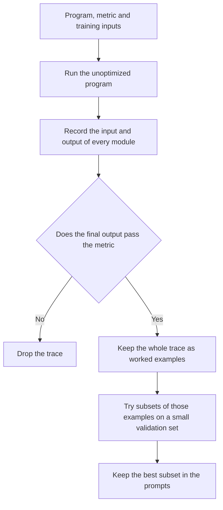

# 05. Compound AI Systems and DSPy

**Level:** Practitioner · **Reading time:** 30 min · **Exercise:** 60 min
**Prerequisites:** [Memory and Knowledge for Agents](04-memory-and-knowledge-for-agents.md) (retrieval); [The Anatomy of an Agent](01-the-anatomy-of-an-agent.md) (the loop)

> **In one sentence:** After this chapter you can write a language-model pipeline as a short declarative program and tune its prompts with a metric and an optimizer instead of by hand.

## Why this matters

You have a prompt of about 2,000 tokens. It scores 33% on your test set. You reword one sentence and the score moves by a few points, in either direction. You cannot say why. When the provider ships a new model, you start over.

The prompt is doing five jobs at once: it describes the task, it chooses a thinking strategy, it formats the input, it states what a good answer is, and it holds the wording that happens to work with today's model. This chapter asks: what if those five jobs were separated, and the wording were found by a program?

## The core idea

A **compound AI system** is a modular program in which language models play specialized roles instead of answering as one black box. A retrieval pipeline is one: a search step feeds passages to a model that writes the answer. Omar Khattab, the creator of DSPy, gives five reasons to build this way (slides 7 to 12, [2:00](https://www.youtube.com/watch?v=JEMYuzrKLUw&t=120), [4:00](https://www.youtube.com/watch?v=JEMYuzrKLUw&t=240)):

| Reason | What it means |
|---|---|
| Quality | Each model call has a narrow job, and narrow jobs are easier to do well |
| Control | You can improve one step and connect steps to tools |
| Transparency | You can inspect what each step did and show where an answer came from |
| Efficiency | Small models suffice when knowledge and control flow live in the program |
| Inference-time scaling | The program can try several outputs and keep the best |

Khattab's complaint is that such systems are built from long strings: teams write thousands of tokens of English to coerce a model into each role, and when the model changes or a sixth module is added, the old wording is, in his words, "basically irrelevant at that point" ([12:00](https://www.youtube.com/watch?v=JEMYuzrKLUw&t=720)). The systems are too "stringly-typed", as he puts it: one prompt mixes the essential design with accidental wording. He lists the five roles a prompt couples ([10:00](https://www.youtube.com/watch?v=JEMYuzrKLUw&t=600)). DSPy, a framework he developed with over 200 contributors, gives each role its own name:

| Role | Name in DSPy | The question it answers | Relative in ordinary programming |
|---|---|---|---|
| The input-to-output behavior | **Signature** | What does this step transform, into what? | A function's type signature |
| The strategy for one step | **Module** | Plain answer, step-by-step reasoning, several tries? | The implementation |
| Formatting and parsing | **Adapter** | How are fields laid out and read back? | Serialization |
| The objective | **Metric** | What counts as a good output? | A test |
| The tuning | **Optimizer** | Which instructions and examples work? | A compiler pass |

The idea is close to SQL: you declare the result you want and a planner decides how to get it. The analogy breaks on cost and certainty. A database planner is exact and free. A DSPy optimizer is a search that spends model calls and needs a small set of examples. Khattab's own analogy is a compiler: the same C code becomes different machine code on different processors, and one program should become different prompts on different models ([14:00](https://www.youtube.com/watch?v=JEMYuzrKLUw&t=840)).

## How it works, step by step

1. **Write a signature for each step.** A signature is a short declaration of inputs and outputs.
2. **Compose the steps in plain Python.** Each step becomes a module; loops and conditions are ordinary code.
3. **Write the metric.** A function that scores one output. It must be separate from the program.
4. **Collect a small training set.** A few dozen examples of inputs, with the outputs the metric needs.
5. **Pick an optimizer and compile.** The optimizer runs the program on the training set and searches for better instructions and examples.
6. **Evaluate on held-out examples** that the optimizer never saw.

Three families of optimizers appear in the lecture:

| Optimizer family | What it searches | How |
|---|---|---|
| Bootstrap few-shot | Demonstrations, worked input-output examples placed in the prompt | Runs the program, keeps traces that scored well, searches over subsets |
| Instruction proposal | The wording of instructions | A model proposes candidates, given earlier candidates and their scores |
| MIPRO | Both together | Bootstraps examples, proposes instructions, then a Bayesian optimizer, a probabilistic model that predicts the score of a combination from earlier trials, picks what to try next; each candidate is scored on a small sample of the validation set ([52:00](https://www.youtube.com/watch?v=JEMYuzrKLUw&t=3120), [54:00](https://www.youtube.com/watch?v=JEMYuzrKLUw&t=3240)) |

## Worked example

A two-step question-answering program in DSPy style. The API is the one shown in the October 2024 lecture; DSPy changes often, so treat this as illustrative pseudocode and check the current documentation.
```python
import dspy

class TwoHopQA(dspy.Module):
    def __init__(self):
        # Signatures: what each step transforms, not how to prompt.
        self.rewrite = dspy.ChainOfThought("question -> search_query")
        self.answer = dspy.ChainOfThought("passages, question -> answer")

    def forward(self, question, search):                 # plain Python between the calls
        query = self.rewrite(question=question).search_query
        passages = search(query, k=3)
        return self.answer(passages=passages, question=question)

def score_answer(example, prediction, trace=None):       # the metric, kept outside the program
    return prediction.answer.strip().lower() == example.answer.strip().lower()

optimizer = dspy.BootstrapFewShotWithRandomSearch(metric=score_answer)
best_program = optimizer.compile(TwoHopQA(), trainset=trainset)
```

The last line is what replaces manual prompt editing. Khattab describes what a bootstrap optimizer does ([42:00](https://www.youtube.com/watch?v=JEMYuzrKLUw&t=2520)):

1. Run the unoptimized program on each training input.
2. Record the input and output of every module along the way.
3. If the final output passes the metric, keep that whole trace.
4. Put the kept traces into the prompts as worked examples.
5. Try several subsets of examples on a small validation set and keep the best.

**Figure 1.** A bootstrap optimizer: the traces that pass the metric become the worked examples in the prompts.



The program generates its own examples from the training inputs; the metric decides which ones are worth keeping.

Compiling calls a paid API many times: each training example, times several candidate programs, times the number of steps. As a rough estimate, a training set of 50 examples takes hundreds to a few thousand calls, often cents to a few US dollars on a small hosted model. Log the count.

## What the practitioners say

Khattab's Fall 2024 lecture makes five points.

- **Fluency hides mistakes.** A monolithic model's errors are hard to see because the wrong answer reads as well as the right one. He shows one chat in which a model gave Stanford's founding year wrong and then returned parallel code with the very bug he had asked it to avoid ([0:00](https://www.youtube.com/watch?v=JEMYuzrKLUw&t=0)). A pipeline lets you inspect the trace, the recorded inputs and outputs of every step.
- **Composition raises quality fast.** His slide reports scores on HotpotQA, a public benchmark of questions whose answers combine several documents, from a year before the lecture: adding retrieval and then a second retrieval hop, each with an optimized program, moved GPT-3.5 from 34.3 to 54.7 and Llama-2-13B-Chat from 27.5 to 50.0 (slide 30). He adds that newer models score substantially higher ([28:00](https://www.youtube.com/watch?v=JEMYuzrKLUw&t=1680)). A small model with an optimized program beat a larger one without.

| Program on his slide | GPT-3.5 | Llama-2-13B-Chat |
|---|---|---|
| Question straight to answer, not optimized | 34.3 | 27.5 |
| Retrieve once, then answer: before and after optimization | 36.4 to 42.3 | 34.5 to 38.3 |
| Retrieve twice, then answer: before and after optimization | 36.9 to 54.7 | 34.7 to 50.0 |

- **Models propose, search disposes.** The optimizer uses language models to draft instructions and examples without assuming they are good at it. In his words, a model gives you twenty candidates and nineteen are poor; trying many is what finds the good one ([32:00](https://www.youtube.com/watch?v=JEMYuzrKLUw&t=1920)).
- **Ground the proposals.** An instruction writer does better when it sees more than past prompts and scores: worked examples for that module, a summary of the data set, and a description of the program's own code ([48:00](https://www.youtube.com/watch?v=JEMYuzrKLUw&t=2880), [50:00](https://www.youtube.com/watch?v=JEMYuzrKLUw&t=3000)).
- **Show, don't tell.** On a benchmark of many programs, bootstrapped demonstrations gave the clearest gains. Optimized instructions helped most on tasks with many conditional rules, where a few examples cannot show every case ([56:00](https://www.youtube.com/watch?v=JEMYuzrKLUw&t=3360), [58:00](https://www.youtube.com/watch?v=JEMYuzrKLUw&t=3480)).

His summary: write about ten lines of declarative code, state an objective, pick an optimizer, and spend your effort on which modules to build and how to connect them ([58:00](https://www.youtube.com/watch?v=JEMYuzrKLUw&t=3480)). As he tells it, Toronto researchers used it to win a medical question-answering competition against 15 other groups, and a Maryland researcher who had spent 20 hours on prompts for a text classifier beat his own system with DSPy in 10 minutes ([34:00](https://www.youtube.com/watch?v=JEMYuzrKLUw&t=2040), [36:00](https://www.youtube.com/watch?v=JEMYuzrKLUw&t=2160)). On his slides from October 2024, DSPy was in production use at JetBlue, Databricks, Walmart, VMware, Replit and others. For where DSPy sits among agent frameworks, see [Part 05](../05-frameworks-and-multi-agent/01-the-agent-framework-landscape.md).

## Pitfalls

1. **A metric that does not match the goal.** The optimizer will maximize whatever you wrote. Fix: write the metric first and check it by hand on ten outputs.
2. **Tiny data.** Khattab notes that instruction optimization can overfit a very small training set ([56:00](https://www.youtube.com/watch?v=JEMYuzrKLUw&t=3360)). Fix: keep a held-out set and compare on it.
3. **Hand-written prompts inside modules.** Fix: move wording into signatures and let the optimizer supply instructions and examples.
4. **Expecting magic from one proposal.** Fix: treat the optimizer as a search and give it a call budget.
5. **Tuning instructions before examples.** Fix: start with bootstrapped demonstrations, which gave the largest gains in his results.
6. **Trusting an old tutorial's API.** Fix: work from the current documentation and pin the library version.

## Try it

Build and optimize a two-step program on a task with known answers.

1. Install DSPy with `pip install dspy` and configure a hosted model, following the current documentation.
2. Collect 50 input and answer pairs. Hold out 20.
3. Write a two-module program and a metric. A plain keyword search over your documents can serve as the search step.
4. Run the unoptimized program on the held-out 20 and record the score.
5. Run a bootstrap few-shot optimizer on the other 30, then score again on the same 20.

**Deliverable:** the program, the metric, both scores, and the number of model calls each run used.

**You are done when:** the metric file has no reference to the program; the optimized program scores higher on the held-out set than the unoptimized one, or you can explain from the traces why it does not; and the call counts are logged.

**Stretch goal:** write the instructions by hand and compare against the optimizer's on the same held-out set. Keep whichever wins, and write down why ([evaluation harness](../03-evaluation/02-a-minimal-eval-harness.md)).

## Key takeaways

- A compound AI system is a program in which language models do narrow, specialized jobs.
- A prompt hides five roles. DSPy separates them: signature, module, adapter, metric, optimizer.
- Write signatures and plain Python, declare a metric, and let an optimizer find the wording and the examples.
- Bootstrapped demonstrations are the first thing to try; instructions matter most on tasks with many conditional rules.
- An optimizer is a search that spends model calls. Give it a budget and a held-out set.

## Self-check

1. What is a compound AI system, and what does it replace?
2. Name the five roles that a hand-written prompt couples.
3. What does a signature declare, and what does it leave open?
4. How does a bootstrap optimizer obtain its worked examples?
5. Why must the metric be written separately from the program?
6. On which kind of task did optimized instructions help most in Khattab's results?

<details><summary>Show answers</summary>

1. A modular program in which language models carry out specialized steps. It replaces a single monolithic model call that does the whole task.
2. The signature (input-to-output behavior), the predictor or module (the strategy), the adapter (formatting and parsing), the metric, and the optimizer (instructions or weights).
3. It declares which fields go in and which field comes out. It leaves open the instructions and the examples; the strategy comes from the module and the wording from the optimizer.
4. It runs the unoptimized program on training inputs, records every module's input and output, and keeps the traces whose final output passes the metric.
5. So the optimizer can maximize the goal while the program's modules, connections and wording all change. A metric inside the program would change with it.
6. Tasks with many isolated conditional rules, where a handful of examples cannot show every case and the rule itself must be stated.

</details>

## Sources

- **Lecture:** Omar Khattab, "Compound AI Systems and the DSPy Framework", UC Berkeley LLM Agents MOOC (Fall 2024): [video](https://www.youtube.com/watch?v=JEMYuzrKLUw), used at [why compound systems](https://www.youtube.com/watch?v=JEMYuzrKLUw&t=120), [stringly-typed prompts](https://www.youtube.com/watch?v=JEMYuzrKLUw&t=600), [the compiler analogy](https://www.youtube.com/watch?v=JEMYuzrKLUw&t=840), [case studies](https://www.youtube.com/watch?v=JEMYuzrKLUw&t=2040), [results](https://www.youtube.com/watch?v=JEMYuzrKLUw&t=1680), [metric and traces](https://www.youtube.com/watch?v=JEMYuzrKLUw&t=1920), [bootstrapping](https://www.youtube.com/watch?v=JEMYuzrKLUw&t=2520), [MIPRO](https://www.youtube.com/watch?v=JEMYuzrKLUw&t=3120), [grounding](https://www.youtube.com/watch?v=JEMYuzrKLUw&t=2880), [findings](https://www.youtube.com/watch?v=JEMYuzrKLUw&t=3360), [lessons](https://www.youtube.com/watch?v=JEMYuzrKLUw&t=3480)
- **Reading:** Omar Khattab, Arnav Singhvi, et al., "DSPy: Compiling Declarative Language Model Calls into Self-Improving Pipelines" (2023): [link](https://arxiv.org/abs/2310.03714)
- **Reading:** Krista Opsahl-Ong, Michael Ryan, et al., "Optimizing Instructions and Demonstrations for Multi-Stage Language Model Programs" (2024): [link](https://arxiv.org/abs/2406.11695)
- **Reading:** Matei Zaharia, Omar Khattab, et al., "The Shift from Models to Compound AI Systems" (2024): [link](https://bair.berkeley.edu/blog/2024/02/18/compound-ai-systems/)
- **Documentation:** DSPy: [dspy.ai](https://dspy.ai)

## Next

→ [06. How Agent System Designs Evolve](06-how-agent-system-designs-evolve.md), because pipelines, agents and fixed workflows are stages on one timeline.
