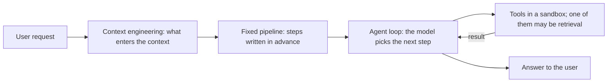

# 06. How Agent System Designs Evolve

**Level:** Practitioner · **Reading time:** 15 min · **Exercise:** 30 min
**Prerequisites:** [The Anatomy of an Agent](01-the-anatomy-of-an-agent.md) (the five parts of an agent)

> **In one sentence:** After this chapter you can place any LLM application on a short timeline of system designs, name the failure that pushed designers to the next step, and reuse the infrastructure lessons that keep repeating.

## Why this matters

You join a team. The product has a chatbot written in 2023, a search pipeline added in 2024, and an "agent" someone attached in 2025. Nobody can say why all three exist.

Each piece was a reasonable answer to a problem of its moment. If you do not know the sequence, you will either rebuild a step that was already tried or skip one that is still needed. This chapter gives you the sequence, then the infrastructure lessons that an AI engineer draws from watching three decades of system designs repeat.

## The core idea

A system design changes when the previous design hits a failure it cannot fix. Each generation answers one failure and exposes the next. The old designs do not disappear: a current system contains all of them at once. One model call for the answer, a retrieval step, a loop, a few fixed steps, a context manager and a sandbox.

**Figure 1.** One current system contains every older design: fixed steps, the loop, retrieval as a tool, all inside a managed context.

Moving down the timeline adds pieces; it does not remove the ones already there.

## A short history

| Period | Dominant design | What you built | The failure it exposed |
|---|---|---|---|
| Late 2022 to 2023 | Wrapper | A prompt and one model call behind an API | Confident wrong answers, stale knowledge |
| 2023 | RAG stack | Search for documents, put them in the prompt, answer | Tasks that need several steps and real actions |
| 2023 to 2024 | Agent loop | Model, tools and a loop, using provider tool calling | Cost multiplied by steps, unreliable long runs |
| 2024 | Fixed pipeline | Three or four hard-coded steps, each a model call | Works only for tasks you understood in advance |
| 2024 to 2025 | Coding agent and harness | A shell, an editor, a sandbox, tests as feedback | Context growth in long sessions, safety, environment setup |
| 2025 on | Context engineering, sandboxes, protocols | Manage what enters the context; isolate the agent; standard tool connections | Cost and evaluation at scale, still open |

**Wrappers.** The first useful products were thin: a system prompt, one call, the answer back. They failed on facts the model never learned and on events after its training data ended.

**RAG stacks.** **Retrieval-augmented generation (RAG)** fixes that by searching a document index for relevant passages and adding them to the prompt. Search became the part that decided quality, and researchers showed that models use long contexts unevenly, paying less attention to the middle. RAG also could not act: it answers, it does not file tickets.

**Agent loops.** Tool calling in provider APIs, first shipped by OpenAI in June 2023, and the ReAct pattern (see [Chapter 03](03-planning-search-and-decision-making.md)) turned the model into a component that acts. Autonomy had a price: a twenty-step run costs at least twenty times a single call, more as the history grows, and adds twenty chances to go wrong.

**Fixed pipelines.** In 2024 the Agentless paper showed that a hard-coded process with a few model calls scored well on real GitHub issues for a fraction of the cost of agent-style planning ([Chapter 07](07-coding-agents.md) and [Chapter 05](05-compound-ai-systems-and-dspy.md) develop this). The lesson spread: buy autonomy only where the steps really vary.

**Coding agents and harnesses.** Giving the model a shell and an editor, running everything in a sandbox (an isolated environment that cannot touch the rest of the machine), and letting tests report success produced the first agents that did hours of useful work. The code around the model, its tools, context rules and stop conditions, became a design object of its own, sometimes called the **harness**.

**Context engineering.** Long sessions made the context window the scarce resource. **Context engineering** is deciding what enters it: compacting old steps, selecting relevant material, loading instructions only when needed. Prompt caching, which lets providers reuse an unchanged prefix at a lower price, made large stable contexts affordable. Sandboxes became hosted products, and the Model Context Protocol (MCP), announced by Anthropic in November 2024, standardized how models reach tools. As of November 2026 these are the working defaults for serious agent systems; evaluation of long runs is still the weak point ([Part 03](../03-evaluation/01-evaluation-is-the-product.md)).

## What the practitioners say

Yangqing Jia co-created GoogLeNet at Google, wrote early deep-learning frameworks, and founded Lepton AI, an AI infrastructure company. In his Fall 2025 lecture he tells the history from the infrastructure side. His stated disclaimer: the opinions are his own.

- **The application layer stays fluid.** He shows the consumer app landscape as "highly fluid" because base models keep improving, and a slide sums it up: a perfect app experience correlates with the model but is independent of it (slides 14 to 17, [23:42](https://www.youtube.com/watch?v=xqRAS6rAouo&t=1422)). His Duolingo example: the product improved when better models met the company's own teaching knowledge ([32:00](https://www.youtube.com/watch?v=xqRAS6rAouo&t=1920)). The durable value sits in the environment you connect, not in the call to the model.
- **New algorithms keep arriving.** He compares mixture-of-experts models, networks in which only a small part activates per input, to ensembles of simple classifiers and to Inception's sparse structure, and test-time scaling, where a model reflects on its own intermediate results, to repeating a prediction over time instead of over space ([16:00](https://www.youtube.com/watch?v=xqRAS6rAouo&t=960)). His point: the stack you build on will change again.
- **AI compute is a different workload.** Data jobs move more data than they compute and need a scheduler such as MapReduce, but a failed machine loses only one chunk, which is recomputed elsewhere. AI jobs compute far more than they move data, and one failed GPU machine can take down a whole distributed training run ([38:00](https://www.youtube.com/watch?v=xqRAS6rAouo&t=2280)). The conventional cloud promise, that any virtual machine can replace any other, stops holding.
- **Two efficiencies fight.** Researchers want four machines and a rerun when one dies; operators need abstractions because GPUs fail more often than people think ([44:00](https://www.youtube.com/watch?v=xqRAS6rAouo&t=2640)).
- **Use standard services where you do not differ.** His best practices for AI startups: several cloud suppliers, watched utilization, one platform that hides the cluster orchestration, and your own team around the model and the application. He cites Cursor, which used standard services to stabilize inference and spent its effort on its coding models ([46:00](https://www.youtube.com/watch?v=xqRAS6rAouo&t=2760)).
- **Make work interruptible.** He praises an old Google practice, from the Borg paper, of writing workloads that can be interrupted and rerun with the same result, and notes that many training jobs are not written that way ([60:00](https://www.youtube.com/watch?v=xqRAS6rAouo&t=3600)).
- **Tokens have a cost problem.** He observes that some applications pay model providers more than they collect from users ([60:00](https://www.youtube.com/watch?v=xqRAS6rAouo&t=3600)). His own view is that token prices keep falling while quality rises, so a product that loses half its money breaks even a year later ([62:00](https://www.youtube.com/watch?v=xqRAS6rAouo&t=3720)).
- **Retrieval did not go away.** Asked whether long contexts make retrieval obsolete, he agrees that you cannot put all the information into a long context and get an accurate result ([64:00](https://www.youtube.com/watch?v=xqRAS6rAouo&t=3840)). RAG is not falling out of favor, he says, but adopted implicitly, like databases that nobody talks about. His retrieval runs in two stages: cheap coarse ranking, then fine ranking by a language model ([66:00](https://www.youtube.com/watch?v=xqRAS6rAouo&t=3960)). He links [hallucination](../GLOSSARY.md) to the unclear boundary between common and specific knowledge, which is why "RAG and accurate data processing pipelines is super important" ([68:00](https://www.youtube.com/watch?v=xqRAS6rAouo&t=4080)).

Three of these translate directly to an agent loop, which is a small distributed system:

| His infrastructure lesson | In an agent |
|---|---|
| A step can lose a machine | Make every step resumable: save the history after each turn so a crash does not restart the task |
| Interruptible and rerunnable | Make side-effecting tools idempotent before you add retries |
| Token cost can exceed revenue | Budget tokens per task from the first prototype, and log them per run |

After all the differences he lists, his conclusion is that the old operational wisdom comes back once AI infrastructure turns into a product ([46:00](https://www.youtube.com/watch?v=xqRAS6rAouo&t=2760)). For agents the same holds: the new part is the model. The loop around it is ordinary engineering.

## Pitfalls

1. **Defaulting to the newest design.** An agent where two fixed calls would do. Fix: start at the top of the table and move down only when you meet that row's failure.
2. **Designing around today's model limits.** Context sizes and prices change every few months. Fix: keep the model behind one interface and keep context logic in one module you can rewrite.
3. **Counting the cost of one call.** A twenty-step agent with a growing context costs far more than twenty calls. Fix: log tokens per task from day one.
4. **Building infrastructure where you do not differ.** Fix: buy the sandbox and the serving layer; build the tools, the data pipeline and the evaluation.
5. **Treating retrieval as obsolete.** Agents made retrieval one tool among several, not unnecessary. Fix: keep the retrieval pipeline accurate; it is where wrong context enters.
6. **Forgetting that runs fail.** Fix: checkpoint the run, make side effects idempotent, and give every run a budget ([operations](../07-ml-in-production/10-planning-for-operations.md)).

## Try it

Review one LLM feature, your own or a public one, in one page.

1. List its components and place each on a row of the timeline.
2. For each component, name the failure it answers and what breaks if you remove it.
3. Estimate tokens per task: number of steps times the context size at each step.
4. Propose one change, forward or backward on the table, and say what it buys.

**You are done when:** a teammate who has not seen the feature can read your page and say which generation each component belongs to, and what the most expensive step is and why.

**Stretch goal:** find one component that could move *up* the table (less autonomy) without hurting results, and measure the cost difference.

## Key takeaways

- Designs change when the previous one hits a failure it cannot fix: wrong facts, then no actions, then cost and unreliability, then context growth.
- Older designs stack, they do not vanish. Choose the oldest design that solves your task.
- Autonomy is a cost. Buy it only where the steps vary.
- The application layer is fluid because models improve; durable value is in the environment, the data and the evaluation.
- An agent loop is a small distributed system: resumable steps, idempotent side effects, a budget per run.

## Self-check

1. Which failure of the wrapper design led to RAG, and which failure of RAG led to agent loops?
2. What did the Agentless result teach designers about autonomy?
3. Name two problems long coding sessions created that led to context engineering and sandboxes.
4. According to Jia, why does the consumer application landscape stay fluid, and what should a builder conclude from it?
5. Why does one failed GPU machine take down a whole training run, while one failed web server does not take down a web service?
6. Give two practices from Jia's infrastructure lessons that apply to an agent loop.

Show answers

1. Wrappers answered with wrong or stale facts because the model had no access to outside documents. RAG could find documents but could not take actions or carry out multi-step tasks, which the loop provided.
2. A hard-coded process with a few model calls can match agent-style planning on known tasks at much lower cost, so autonomy should be added only where the steps cannot be fixed in advance.
3. Any two of: the history outgrew the context window; each step resent a larger context at higher cost; agents ran arbitrary code that could damage the machine; environments were hard to reproduce.
4. Because base models keep improving, an advantage that rests on the model call alone does not last. Put the effort into the environment, the data and the evaluation.
5. Web servers work independently, so a lost machine loses only its own requests. A distributed training run is one tightly coupled job in which every machine participates at every step, so one loss stops the whole job.
6. Any two of: make steps resumable by saving state; make side effects idempotent before retrying; budget tokens per task; use standard services where the product does not differ.

## Sources

- **Lecture:** Yangqing Jia, "Evolution of System Designs from an AI Engineer Perspective", UC Berkeley Agentic AI MOOC (Fall 2025): [video](https://www.youtube.com/watch?v=xqRAS6rAouo) · [guide](../lectures/f25-02-evolution-of-system-designs-from-an-ai-engineer.md), used at [fluid application landscape](https://www.youtube.com/watch?v=xqRAS6rAouo&t=1422), [new algorithms](https://www.youtube.com/watch?v=xqRAS6rAouo&t=960), [AI compute as a workload](https://www.youtube.com/watch?v=xqRAS6rAouo&t=2280), [developer versus infrastructure efficiency](https://www.youtube.com/watch?v=xqRAS6rAouo&t=2640), [best practices](https://www.youtube.com/watch?v=xqRAS6rAouo&t=2760), [interruptible work](https://www.youtube.com/watch?v=xqRAS6rAouo&t=3600), [token economics](https://www.youtube.com/watch?v=xqRAS6rAouo&t=3728), [retrieval in the question round](https://www.youtube.com/watch?v=xqRAS6rAouo&t=3840), [hallucination and the knowledge boundary](https://www.youtube.com/watch?v=xqRAS6rAouo&t=3960), [retrieval pipelines](https://www.youtube.com/watch?v=xqRAS6rAouo&t=4080)
- **Reading:** Anthropic, "Building effective agents" (2024): [link](https://www.anthropic.com/engineering/building-effective-agents)
- **Reading:** Chunqiu Steven Xia, Yinlin Deng, et al., "Agentless: Demystifying LLM-based Software Engineering Agents" (2024): [link](https://arxiv.org/abs/2407.01489)
- **Reading:** Nelson F. Liu, Kevin Lin, et al., "Lost in the Middle: How Language Models Use Long Contexts" (2023): [link](https://arxiv.org/abs/2307.03172)

## Next

→ [07. Coding Agents](07-coding-agents.md), because coding agents are where every design in this timeline is in use at once.
