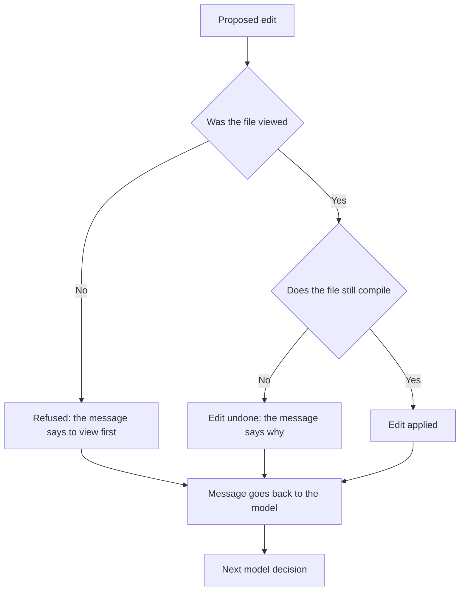

# 07. Coding Agents

**Level:** Practitioner · **Reading time:** 30 min · **Exercise:** 90 min
**Prerequisites:** [Tool Design and Function Calling](02-tool-design-and-function-calling.md) (observations, errors, the agent-computer interface)

> **In one sentence:** After this chapter you can describe how a coding agent is put together, choose its action space and safety setup, read a coding benchmark with its limits in mind, and carry the lessons over to agents in other domains.

## Why this matters

You paste a stack trace into a chat model and get a working fix. Then you want the whole job done: open the repository, find the function, change it, run the tests, and hand you a diff. Chat cannot do that. It cannot see your repository and it cannot run anything.

A **coding agent** can. It is the agent loop from [Chapter 01](01-the-anatomy-of-an-agent.md) pointed at a code base. Coding is where agent engineering is most developed, because coding gives an agent three things other domains lack.

## The core idea

| What coding gives an agent | Why it matters | What to look for in your own domain |
|---|---|---|
| Actions are exact text | A command or an edit can be checked before it runs | A format you can validate |
| An automatic checker | Tests and compilers report success with no human in the loop | Any cheap, automatic test of the result |
| State is visible as files | The agent can re-read anything it forgot | A place to look things up instead of remembering them |

Because tests exist, a coding agent can try, fail, read the error, and try again. In practice, that feedback loop is what lets a long task finish.

## How it works, step by step

### 1. Environment

A coding agent runs in a **sandbox**, an isolated environment that cannot touch the rest of the machine. Inside it: a checkout of the repository with its dependencies installed, and a shell. OpenHands executes every action in a Docker container, an isolated package for running software, as Neubig describes ([54:00](https://www.youtube.com/watch?v=f9L9Fkq-8K4&t=3240)).

### 2. Action space

The **action space** is the set of moves the agent can make. Coding agents use three styles:

| Style | The agent acts by | Strength | Weakness |
|---|---|---|---|
| Plain tools | Calling one function per step, such as `read_file` | Every action is logged and checked | Many steps for simple things |
| Code actions | Writing code or shell commands that do several things at once | Fast, flexible | Each step is harder to check |
| Specialized tools | Purpose-built commands to view, search and edit | Matches what editing needs | You must design them |

Neubig presents the second style through CodeAct, which acts by writing code and, in his account, resolves tasks faster and with higher success than direct tool use ([24:00](https://www.youtube.com/watch?v=f9L9Fkq-8K4&t=1440)). The third style is the subject of the next subsection.

### 3. Context

The agent starts with the issue text and a repository it has never seen. Getting the right code into the context is the hard part. Neubig calls this **file localization**: finding the files a request is about. In his words, it "might even be the biggest problem in coding agents nowadays" ([38:00](https://www.youtube.com/watch?v=f9L9Fkq-8K4&t=2280)). Four designs from his lecture:

1. Let the user name the files. Accurate, but it only works for people who know the project.
2. Give the agent a search tool and let it explore.
3. Build a map of the repository up front. Aider produces a tree-shaped map; the user can mark files as important.
4. Search in stages. Agentless narrows from the whole repository to files, then to functions ([42:00](https://www.youtube.com/watch?v=f9L9Fkq-8K4&t=2520)).

### 4. The loop and its guardrails

The loop needs a step limit, a cost limit, and a way to notice that the agent is stuck repeating itself. It also needs to keep the context small as the session grows, by dropping text that is no longer useful.

### 5. A checker

Tests, a linter (a tool that flags suspicious code), and a compiler tell the agent whether its change worked. With a checker you can also afford to try several candidates and keep the best. That is how Agentless works: it generates several patches, checks them, and applies one that passes ([46:00](https://www.youtube.com/watch?v=f9L9Fkq-8K4&t=2760)).

### 6. Safety

Neubig lists three mitigations, each borrowed from ordinary software security: the sandbox, credentials that follow the **principle of least privilege** (the agent gets only the permissions its task needs), and an audit of each action after it is generated and before it runs ([54:00](https://www.youtube.com/watch?v=f9L9Fkq-8K4&t=3240), [56:00](https://www.youtube.com/watch?v=f9L9Fkq-8K4&t=3360)). In the audit, the action is checked by a language model or by static analysis tools, programs that inspect code without running it; if it is judged harmful it is not executed, and the agent gets a message saying so. His examples of harm are plain: an agent pushes to the main branch by accident, or, told that the tests need to pass, deletes the tests ([52:00](https://www.youtube.com/watch?v=f9L9Fkq-8K4&t=3120)). He also warns of the opposite failure: an agent sandboxed with no access to anything can do nothing but work as a calculator ([56:00](https://www.youtube.com/watch?v=f9L9Fkq-8K4&t=3360)). The details belong to [Part 04](../04-safety-and-security/04-defenses-guardrails-detection-and-secure-design.md).

### The agent-computer interface

The SWE-agent project, from a team at Princeton, made the third style a design principle: the **agent-computer interface (ACI)**, the set of commands an agent uses to work with a computer. Its 2024 paper argues that these commands matter as much as the model. Neubig makes the same point about SWE-agent: it defines specialized tools that make it efficient to explore repositories and edit code, giving the model commands designed to be friendly to it and feedback in the same style ([26:00](https://www.youtube.com/watch?v=f9L9Fkq-8K4&t=1560)). In his walkthrough, a command that shows a file around a given line returns a window of lines, so a file of thousands of lines can be read without spending the whole context; the model then writes a thought and calls an edit command on a range of lines ([28:00](https://www.youtube.com/watch?v=f9L9Fkq-8K4&t=1680)).

The interface treats the model as what it is: a program that reads a limited amount of text, cannot count reliably, and learns nothing between calls. So every command is built to keep its output small and to stop a mistake before it happens.

- The file viewer shows line numbers and at most 100 lines per call. Edits then quote lines the model has actually seen.
- Search returns a capped number of results.
- The edit command refuses a file the agent has not viewed, and runs a syntax check after each edit. If the check fails, the edit is undone.
- A guard interrupts the agent when it repeats the same action.
- Old file views are dropped from the history to keep it short.

**Figure 1.** The two guards of the edit command: every refusal comes back as a message the model can act on.



A refused edit changes nothing and tells the model what to do next, so the next attempt can succeed.

The paper reports 12.5% of SWE-bench solved with GPT-4 Turbo, and large drops when the line limit, the search tools or the syntax check were removed.

### OpenHands

OpenHands is the open-source coding agent Neubig maintains; it was first released under the name OpenDevin. In his account it combines CodeAct with SWE-agent's editing and observation commands: every action is executed as code, so one loop can apply an edit at ten places that a search found ([28:00](https://www.youtube.com/watch?v=f9L9Fkq-8K4&t=1680)). His slide adds the rest of the design (slide 27):

- An **event stream**: a single, ordered log in which every action and every observation is an event, covering coding, command execution and browsing. The agent, the sandbox and the user interface all read and write this one log.
- SWE-agent-style commands are available as **agent skills**: named bundles of instructions and tools the agent can call.
- All execution happens in a Docker sandbox.

## Worked example

Three tools in the ACI style, each with one guardrail. The repository is a dictionary, so the file runs without a model or a disk. The file is also in the repository as [`examples/agent_computer_interface.py`](../examples/agent_computer_interface.py).

```python
"""Three tools in the style of an agent-computer interface, each with a guardrail.
No model and no disk: a short script stands in for the agent."""

REPO = {
    "app.py": "def mean(prices):\n    return sum(prices) / (len(prices) - 1)\n",
    "app_test.py": "from app import mean\n\n\ndef test_mean():\n    assert mean([2, 4]) == 3\n",
}
WINDOW, MAX_HITS = 100, 10
viewed = set()                       # files the agent has looked at in this run

def view(path: str, start: int = 1) -> str:
    """Show one window of a file, with line numbers."""
    if path not in REPO:
        return f"Error: no file {path!r}. Files: {sorted(REPO)}"
    lines = REPO[path].splitlines()
    if not 1 <= start <= len(lines):
        return f"Error: {path!r} has {len(lines)} lines; 'start' must be in 1..{len(lines)}."
    shown = lines[start - 1:start - 1 + WINDOW]
    viewed.add(path)
    body = "".join(f"{start + i}  {line}\n" for i, line in enumerate(shown))
    return body + f"[Showing lines {start}-{start + len(shown) - 1} of {len(lines)}]\n"

def search(word: str) -> str:
    """Find lines containing a word; return at most MAX_HITS of them."""
    hits = [f"{path}:{n}" for path in sorted(REPO)
            for n, line in enumerate(REPO[path].splitlines(), 1) if word in line]
    if not hits:
        return f"0 hits for {word!r}."
    return ("\n".join(hits[:MAX_HITS])
            + f"\n[{min(len(hits), MAX_HITS)} of {len(hits)} hits shown, max {MAX_HITS} per call]\n")

def edit(path: str, line: int, new_line: str) -> str:
    """Replace one line. Refuse unviewed files; undo edits that break the syntax."""
    if path not in viewed:
        return f"Error: view {path!r} before editing it, so line numbers are real."
    lines = REPO[path].splitlines()
    if not 1 <= line <= len(lines):
        return f"Error: {path!r} has {len(lines)} lines; 'line' must be in 1..{len(lines)}."
    candidate = lines[:line - 1] + [new_line] + lines[line:]
    try:
        compile("\n".join(candidate), path, "exec")
    except SyntaxError as exc:
        return f"Error: edit not applied, syntax error: {exc.msg}. The file is unchanged."
    REPO[path] = "\n".join(candidate) + "\n"
    return f"Edited line {line} of {path!r}."

if __name__ == "__main__":
    print(edit("app.py", 2, "    return sum(prices) / len(prices)"))    # refused: not viewed
    print(search("mean"))
    print(view("app.py"))
    print(edit("app.py", 2, "    return sum(prices) / len(prices"))     # refused: bad syntax
    print(edit("app.py", 2, "    return sum(prices) / len(prices)"))    # applied
    print(view("app.py"))
```

Observe three things. The first edit is refused with a message that says what to do first. The second is refused and the repository is unchanged, because the new line does not compile. The third passes both checks. No guard needs the model to be careful.

## How coding agents are evaluated

Neubig walks through a ladder of test sets. Each step adds realism ([12:00](https://www.youtube.com/watch?v=f9L9Fkq-8K4&t=720)).

| Test set | The task | What it adds | What it leaves out |
|---|---|---|---|
| HumanEval, MBPP | Small functions from a docstring | Nothing: a first sanity check | Software engineering. Neubig compares it to interview puzzles |
| CoNaLa, ODEX | CoNaLa mines answers from Stack Overflow; ODEX adds execution-based scoring | Many libraries | Short snippets, not whole programs |
| ARCADE | Data-science notebooks | Context and incremental work | Small scale |
| SWE-bench | A real GitHub issue, scored by the tests added with the fix | A whole repository, a precise change | Refactoring, features, documentation |
| Design2Code | Reproduce a web page from a screenshot | Visual input and output | Anything but front ends |

Three cautions from the lecture:

- **Bias.** SWE-bench keeps only high-quality repositories and only issues whose fix came with new tests, which skews it toward bug fixes ([16:00](https://www.youtube.com/watch?v=f9L9Fkq-8K4&t=960)).
- **Leakage.** Models train on public code, so some test problems were seen during training. He cites ARCADE, where new notebooks were harder than published ones, and LiveCodeBench, which exists to measure this gap ([19:16](https://www.youtube.com/watch?v=f9L9Fkq-8K4&t=1156)).
- **The metric.** The common measure is **pass@k**: the chance that at least one of *k* generated samples passes the tests. To estimate it without noise, the HumanEval authors generate *n* larger than *k* samples, count the *c* that pass, and compute 1 − C(n−c, k) / C(n, k), where C(a, b) is the number of ways to choose b items out of a. Text-overlap scores such as BLEU, which measures shared word sequences between two texts, exist but ignore whether the code runs.

General evaluation methods are in [Part 03](../03-evaluation/06-evaluating-capabilities-and-risks.md).

## What the practitioners say

Graham Neubig is a professor at CMU and the maintainer of OpenHands. His Fall 2024 lecture makes seven further points.

- **Copilots already pay off.** He cites GitHub's study of 95 developers: those with Copilot finished the task 56% faster ([8:00](https://www.youtube.com/watch?v=f9L9Fkq-8K4&t=480)).
- **Recovery from errors is weak.** GPT-4o, he says, would try a fix, fail, and repeat the same fix in a loop until the turns ran out, while Claude was better at trying different approaches. He calls training models to recover from errors a big research topic ([50:00](https://www.youtube.com/watch?v=f9L9Fkq-8K4&t=3000)).
- **Better training comes next.** His first future direction is agentic training: training on agent-style data so that models follow agent formats, plan better and recover from errors better ([58:00](https://www.youtube.com/watch?v=f9L9Fkq-8K4&t=3480)).

- **Coding is a small part of the job.** He cites a 2019 study where developers spent 15% of their time coding, 36% communicating and 17% on other things ([2:00](https://www.youtube.com/watch?v=f9L9Fkq-8K4&t=120)). Real development also touches issue trackers, documents and chat tools, while test sets cover only code ([10:00](https://www.youtube.com/watch?v=f9L9Fkq-8K4&t=600)).
- **Fixed processes compete.** Many top systems on the SWE-bench leaderboard, he says, hard-code their process. Agentless is cheap and effective, and cannot decide to read documentation online ([46:00](https://www.youtube.com/watch?v=f9L9Fkq-8K4&t=2760)).
- **The interface is still under-designed.** GitHub Copilot's completion prompt gathers the 20 most recently used files in the same language, imported files and more. In his view, agents had not invested as much in assembling their context ([38:00](https://www.youtube.com/watch?v=f9L9Fkq-8K4&t=2280)).
- **A human helps.** He reports that he is far more effective when he watches the agent work and redirects it when it goes wrong, and that there were no good benchmarks for that interaction ([58:00](https://www.youtube.com/watch?v=f9L9Fkq-8K4&t=3480)). His summary at the time: copilots are very useful and code agents "are getting there". He expected agents to handle mundane tasks within one or two years. That is a forecast from October 2024, not a measurement.

The lecture is from October 2024. Product names and benchmark scores have moved since; treat the tools as examples and the design lessons as the durable part.

**Charles Sutton (Google DeepMind, Spring 2025)** frames the choice as how to spend compute at test time ([40:00](https://www.youtube.com/watch?v=JCk6qJtaCSU&t=2400)). A dynamic agent such as SWE-agent lets the model pick its strategy: after a failed test it may search the code further or adjust the patch. A procedural system such as Agentless suits a task that a simple workflow solves: its tools run around the model, not inside it, so there are fewer tool errors, and an early mistake cannot derail the run. A dynamic agent chooses whether to extend a failed patch or start over; Agentless generates and tests. He guesses that generate-and-test suits small patches and that flexibility wins on long, complex changes. A bare shell, SWE-agent and Agentless form a continuum whose best point moves with model capability and task complexity.

Two more of his examples sit between those poles ([43:34](https://www.youtube.com/watch?v=JCk6qJtaCSU&t=2614)). AutoCodeRover searches with tools that index classes and methods as an IDE does, so the agent can ask for a class or a method by name. It runs two dynamic agents in turn, one to gather context and one to write the patch, each with its own system instruction and tools, and only the first one's result passes to the second. RepairAgent makes the design a state machine: each state has its own system instruction, and the model's next tool call decides the transition. A code search keeps it in the information-gathering state; a call to write the fix moves it on.

He also describes an industrial agent he knows from inside, a research agent at Google that fixes internal issues in a monorepo too large for a laptop. Its evaluation was built as SWE-bench was, from internal bugs and fixes filtered by heuristics such as a change in tests and the size of the patch; the patches people wrote for it are larger and touch more files than SWE-bench's ([48:00](https://www.youtube.com/watch?v=JCk6qJtaCSU&t=2880)). His list of the design space these agents share: which tools; who writes the control flow (dynamic, a state machine, recursive sub-agents, or plain code); the wording of instructions, tool descriptions and summaries of tool outputs; a sandbox for model-generated code; contact with external services; and when to ask a human.

## What coding agents teach about any agent

1. **Find an automatic checker.** Tests made coding agents work first. In your domain, look for the cheapest test of a result: a schema, a dry run, a lint.
2. **Design the interface for the model.** Small outputs, line numbers, guardrails that return errors.
3. **Finding where to act is half the task.** Give the agent a way to locate things before it acts.
4. **Run the simple baseline.** A fixed pipeline is often good enough and always easier to debug.
5. **Isolate first.** The sandbox is not the last step of the design. It is the first.

## Pitfalls

1. **A shell and nothing else.** With no way to look around, the agent reads whole files until the context is full. Fix: a windowed viewer and a capped search.
2. **Editing by memory.** An edit that quotes lines the model never saw will miss. Fix: require a view before an edit, and check the result.
3. **Trusting one benchmark number.** Fix: check what the benchmark contains, when it was collected, and whether models saw it.
4. **Running on your own machine.** Fix: a sandbox and least-privilege credentials from the first day.
5. **Building the agent before the baseline.** Fix: write the fixed three-step version first and measure it ([testing LLM components](../08-quality-assurance/05-testing-generative-and-llm-components.md)).
6. **No history management.** Long sessions fill the context with old file contents. Fix: drop stale observations ([Chapter 04](04-memory-and-knowledge-for-agents.md)).

## Try it

Take a small open-source project with a failing test. Run an open-source coding agent on it, for example OpenHands or Aider, inside a container with a throwaway token, an API key with a small spending limit. Follow the agent's current installation documentation, which names the container runtime it needs, such as Docker.

1. Save the full trace: every action and observation. The agent's own session log is enough.
2. Mark each time the agent searched, read, edited, and ran a check.
3. Count the errors the agent caused itself and repaired from a message.

**Deliverable:** the trace and a one-page review that answers: how did the agent localize the files, which guardrails fired, and at which step would a fixed pipeline have done the same job?

**You are done when:** the trace is complete and readable by someone else; every self-inflicted error in it is listed with the message that repaired it; and the agent never had access outside the container.

**Stretch goal:** remove one navigation tool and run the same task again. Compare steps and tokens.

## Key takeaways

- A coding agent is the standard agent loop in a sandbox, with a shell and a checker.
- Coding works well because tests give automatic feedback. Find your domain's checker.
- The agent-computer interface matters as much as the model: small outputs, guardrails, errors that say what to do.
- Finding the right files is the bottleneck. Search, a repository map and staged narrowing are the known designs.
- Read coding benchmarks with their biases and leakage in mind, and always run a fixed-pipeline baseline.

## Self-check

1. Name the three properties of coding that make it a good first home for agents, and one counterpart to look for in another domain.
2. Why does the SWE-agent edit command refuse a file the agent has not viewed?
3. What is file localization, and what are two designs that address it?
4. Why is SWE-bench biased toward bug fixes?
5. How is pass@k estimated without generating exactly k samples?
6. What are Neubig's three safety mitigations?

<details><summary>Show answers</summary>

1. Actions are exact text, an automatic checker exists in tests and compilers, and state is visible as files. A counterpart in another domain could be a schema that validates an output, a dry run, or a search index the agent can query instead of remembering.
2. So that the edit quotes line numbers the model has actually seen. Without the rule the model invents line numbers and the edit lands in the wrong place.
3. Finding the files that a request is about. Any two of: let the user name them; give the agent a search tool; build a map of the repository up front; narrow in stages from repository to files to functions.
4. It keeps only issues whose fix arrived with new tests, because it needs tests to score the fix. Such fixes are mostly bug fixes.
5. Generate n samples, more than k. Count the c that pass. Compute one minus the number of ways to choose k samples out of the n−c failing ones, divided by the number of ways to choose k out of n.
6. Sandboxing the execution environment, giving the agent least-privilege credentials, and auditing each action after it is generated and before it runs.

</details>

## Sources

- **Lecture:** Graham Neubig, "Agents for Software Development", UC Berkeley LLM Agents MOOC (Fall 2024): [video](https://www.youtube.com/watch?v=f9L9Fkq-8K4) · [guide](../lectures/f24-06-agents-for-software-development.md), used at [how developers spend time](https://www.youtube.com/watch?v=f9L9Fkq-8K4&t=120), [the Copilot study](https://www.youtube.com/watch?v=f9L9Fkq-8K4&t=480), [environments](https://www.youtube.com/watch?v=f9L9Fkq-8K4&t=600), [benchmarks](https://www.youtube.com/watch?v=f9L9Fkq-8K4&t=720), [SWE-bench and its limits](https://www.youtube.com/watch?v=f9L9Fkq-8K4&t=960), [leakage](https://www.youtube.com/watch?v=f9L9Fkq-8K4&t=1156), [CodeAct](https://www.youtube.com/watch?v=f9L9Fkq-8K4&t=1440), [SWE-agent's commands](https://www.youtube.com/watch?v=f9L9Fkq-8K4&t=1560), [OpenHands](https://www.youtube.com/watch?v=f9L9Fkq-8K4&t=1680), [localization](https://www.youtube.com/watch?v=f9L9Fkq-8K4&t=2280), [error recovery](https://www.youtube.com/watch?v=f9L9Fkq-8K4&t=3000), [safety](https://www.youtube.com/watch?v=f9L9Fkq-8K4&t=3240), [conclusion](https://www.youtube.com/watch?v=f9L9Fkq-8K4&t=3480)
- **Lecture:** Charles Sutton, "Coding Agents and AI for Vulnerability Detection", UC Berkeley Advanced LLM Agents MOOC (Spring 2025): [video](https://www.youtube.com/watch?v=JCk6qJtaCSU) · [guide](../lectures/sp25-05-coding-agents-and-ai-for-vulnerability-detection.md), used at [two designs compared](https://www.youtube.com/watch?v=JCk6qJtaCSU&t=2400), [AutoCodeRover and RepairAgent](https://www.youtube.com/watch?v=JCk6qJtaCSU&t=2614), [an industrial agent and the design space](https://www.youtube.com/watch?v=JCk6qJtaCSU&t=2880)
- **Reading:** John Yang, Carlos E. Jimenez, et al., "SWE-agent: Agent-Computer Interfaces Enable Automated Software Engineering" (2024): [link](https://arxiv.org/abs/2405.15793)
- **Reading:** Xingyao Wang, Boxuan Li, et al., "OpenHands: An Open Platform for AI Software Developers as Generalist Agents" (2024): [link](https://arxiv.org/abs/2407.16741)
- **Reading:** Chunqiu Steven Xia, Yinlin Deng, et al., "Agentless: Demystifying LLM-based Software Engineering Agents" (2024): [link](https://arxiv.org/abs/2407.01489)
- **Reading:** Carlos E. Jimenez, John Yang, et al., "SWE-bench: Can Language Models Resolve Real-World GitHub Issues?" (2023): [link](https://arxiv.org/abs/2310.06770)

## Next

→ [08. Training Models for Agentic Tasks](08-training-models-for-agentic-tasks.md), because the loop, the tools and the environment in this chapter also define what a model must be trained to use.
