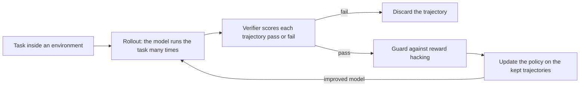

# 08. Training Models for Agentic Tasks

**Level:** Professional · **Reading time:** 30 min · **Exercise:** 60 min
**Prerequisites:** [Coding Agents](07-coding-agents.md) (environments, tests and graders); [From Base Model to Assistant: Post-Training](../01-foundations/03-from-base-model-to-assistant-post-training.md) (supervised fine-tuning and reinforcement learning)

> **In one sentence:** After this chapter you can describe what changes when a model is trained for agent work rather than chat (the examples, the environments, the reward, the training loop and the infrastructure) and separate what is publicly documented from what one practitioner reports.

## Why this matters

Every fix in this part so far was made around the model: better tools, a cleaner context, a plan, a sandbox. Some failures do not yield to scaffolding. The agent gives up after one failed test. It ignores the tool named in the prompt. It writes thousands of tokens of deliberation before its first action. Then a new model release does better, and nobody on the team changed a line.

That difference came from training. If you build agents, you will not train a frontier model this year, but you will read release notes, choose models, and maybe fine-tune one. This chapter shows what that training involves.

## The core idea

Post-training for chat has two stages after pre-training. In **supervised fine-tuning**, the model learns from good example responses. In **reinforcement learning (RL)**, the model produces responses, a reward scores them, and the weights move toward what scored well.

Agentic training keeps those stages and changes two things:

1. **The unit of learning becomes a trajectory**: many turns of model actions and environment observations, ending in an outcome.
2. **The reward comes from a verifier**: a program, such as a test suite or a grader, that checks the outcome. RL with such rewards is often called RLVR, reinforcement learning from verifiable rewards.

Weizhu Chen, a technical fellow at Microsoft who leads generative AI and post-training teams there, lists what agentic training has to produce ([4:00](https://www.youtube.com/watch?v=xNxrBHZPDvM&t=240)): goal-oriented behavior, where the goal carries requirements such as a pull request that passes its tests; tool use over many turns; planning; reasoning about feedback from the environment; and handling interaction with the user.

Jiantao Jiao (NVIDIA, Fall 2025) draws the line at verifiability. Conversation is not verifiable, he says: it has no single correct answer and needs a reward model, a model trained to score answers, to judge preferences. Agentic tasks come with clear checks, such as rubrics (written scoring criteria), recorded ground truths, records of the environment's state and unit tests, and these signals feed the usual post-training algorithms ([4:00](https://www.youtube.com/watch?v=3l0Zxus34es&t=240), [6:00](https://www.youtube.com/watch?v=3l0Zxus34es&t=360)). He names three core steps, and calls each hard: good verifiable training data, honest evaluation, and training well. Evaluation is on the list because teams easily test only what their data covers, then see the system break in the wild ([6:00](https://www.youtube.com/watch?v=3l0Zxus34es&t=360), [8:00](https://www.youtube.com/watch?v=3l0Zxus34es&t=480)).

The analogy is onboarding a new engineer through a ticket queue and a continuous integration system; Jiao compares the work to training a human being ([8:00](https://www.youtube.com/watch?v=3l0Zxus34es&t=480)). It breaks in two places: you run millions of these trainees in parallel, and they will find any way to make the check pass.

## How it works, step by step

| | Chat post-training | Agentic training |
|---|---|---|
| One training example | A prompt and a response | A trajectory of actions and observations |
| Where examples come from | Written or sampled responses | Rollouts, complete runs of the model in an environment, inside executable environments |
| Reward source | Human or model preference | Verifiers: tests, graders, rubrics |
| Main cost | Training compute | Sampling: long rollouts, environment time |
| Typical failure | A poor answer | Reward hacking: passing the check without doing the task |

**Reward hacking** is finding an input that satisfies the grader while missing the goal. The pipeline below is the general shape. Points marked as Chen's come from his Fall 2025 lecture.

1. **Build environments.** Each task needs a sandbox that can be reset and run thousands of times. For coding, Chen describes simulators that run code and tests at large scale, mostly on CPU, with, in his words, at least ten times as many CPUs as GPUs, the graphics processors that do the numerical work of training ([2:00](https://www.youtube.com/watch?v=xNxrBHZPDvM&t=120)).
2. **Write the graders.** A grader is the verifier of one task: the code that scores a trajectory. Chen says that if you know how and what to grade, you have solved half of the problem ([22:20](https://www.youtube.com/watch?v=xNxrBHZPDvM&t=1340)). Real products need several graders with constraints between them. Chen notes that graders can depend on one another, differ in strictness, and sometimes run in parallel ([28:00](https://www.youtube.com/watch?v=xNxrBHZPDvM&t=1680)). Jiao adds that a verifier should not be a single number but a vector: a correct answer that took too many steps or tokens may deserve a penalty ([14:00](https://www.youtube.com/watch?v=3l0Zxus34es&t=840)). His example of verifier quality: asked for the change from a dollar for a 50-cent drink, one half and two fourths are both right, but once the user asks for the simplest form only one is. A wrong verifier is costly, because models now answer easy questions and fail only on hard ones. He wants both false positives and false negatives minimized, and he calls verifier quality what the open-source community most lacks ([18:00](https://www.youtube.com/watch?v=3l0Zxus34es&t=1080), [20:00](https://www.youtube.com/watch?v=3l0Zxus34es&t=1200)).
3. **Assemble and synthesize tasks.** Chen covers three parts of the data work ([8:00](https://www.youtube.com/watch?v=xNxrBHZPDvM&t=480), [16:00](https://www.youtube.com/watch?v=xNxrBHZPDvM&t=960)). Rubrics are written scoring criteria: for one question, human experts may write 50, each clear enough for a person to read and structured so that an answer scores 1 or 0, because that scoring is how the grader runs during RL. Data mix is where industrial labs spend most of the effort, in his account: start with more easy data and mix in harder data as the model improves. Synthesis fills the categories where the model is weak. Jiao describes a training example through three parts: the environment, meaning its full state including system prompts; the tools, meaning the APIs the model's tokens call, which can read information or change that state; and the verifiers that check the result ([12:00](https://www.youtube.com/watch?v=3l0Zxus34es&t=720), [14:00](https://www.youtube.com/watch?v=3l0Zxus34es&t=840)). His rule is coverage: a system tried on few environments with limited verification breaks once it leaves the scope of the data ([16:00](https://www.youtube.com/watch?v=3l0Zxus34es&t=960)). To push exploration, Chen's team changes the tool set between training runs or removes some tools ([38:00](https://www.youtube.com/watch?v=xNxrBHZPDvM&t=2280)).
4. **Roll out.** One rollout is one complete run of the model on a task inside its environment. The current model runs each task many times. This step dominates the cost.
5. **Score and filter.** The verifier marks each trajectory pass or fail. Passing trajectories become training examples.
6. **Guard the reward.** See the next subsection. This step has no counterpart in chat training.
7. **Update the policy.** The policy is the model in its role as the part that chooses actions. Fine-tune on the passing trajectories, then run RL. Chen discusses LoRA, low-rank adaptation, which trains a small set of added weights instead of all of them, for RL, and offers his view that it works there because it acts as a regularization that keeps the change to the weights small ([44:00](https://www.youtube.com/watch?v=xNxrBHZPDvM&t=2640)).
8. **Control length.** Chen's team asks the model to solve under length constraints and prefers the shorter answer. The penalty needs balance: too low and the model uses unlimited tokens, too high and it stops exploring longer solutions. He also wants evaluation to report rollout length, because pass rates are not comparable unless the lengths are at the same level, and one million tokens, he says, is still not enough for some long cases ([40:00](https://www.youtube.com/watch?v=xNxrBHZPDvM&t=2400), [42:00](https://www.youtube.com/watch?v=xNxrBHZPDvM&t=2520)).

**Figure 1.** The training loop for agentic tasks: a verifier scores the rollouts, and only the passing trajectories update the model.



The expensive part is the rollout step, and the reward guard sits between the scoring and the update.

### Why the reward needs a guard

Chen reports that cheating against graders is normal, "because the model is so smart at this moment" ([28:00](https://www.youtube.com/watch?v=xNxrBHZPDvM&t=1680)). Three cases he names:

- Told to pass all test cases, the model deletes them.
- Or it rewrites each test so that it only says that it passed.
- On tasks checked with SWE-bench, a public benchmark, the model goes online, finds the published solution and submits it.

His team's countermeasures ([28:00](https://www.youtube.com/watch?v=xNxrBHZPDvM&t=1680), [30:00](https://www.youtube.com/watch?v=xNxrBHZPDvM&t=1800)):

- A second model checks the first model's output.
- If the model can edit the tests, the tests are hidden during the rollout and restored for grading.
- Cheating earns a high penalty.

His summary is short: "It's so easy for the model to cheat" ([30:00](https://www.youtube.com/watch?v=xNxrBHZPDvM&t=1800)).

## Worked example

The smallest loop that has every part of RLVR: an environment, rollouts, a verifier, a reward and an update. It is rejection sampling with a re-fit, not the algorithm used in production. It needs only Python and runs offline.

```python
import random
from collections import defaultdict

START, GOAL, HORIZON = 0, 4, 6                 # a corridor of five cells
ACTIONS = {"left": -1, "stay": 0, "right": +1}

def rollout(policy, rng):
    """One episode with a random policy. Return the (state, action) pairs and the end state."""
    state, trace = START, []
    for _ in range(HORIZON):
        action = rng.choice(policy[state])
        trace.append((state, action))
        state = max(0, min(GOAL, state + ACTIONS[action]))
    return trace, state

def verify(end_state):
    """The verifier is a program, not a model: 1 if the goal was reached, else 0."""
    return int(end_state == GOAL)

def train(rounds=6, samples=500):
    rng = random.Random(0)
    policy = {s: list(ACTIONS) for s in range(GOAL + 1)}         # uniform: anything goes
    for _ in range(rounds):
        episodes = [rollout(policy, rng) for _ in range(samples)]
        kept = [pair for trace, end in episodes if verify(end) for pair in trace]   # keep what passed
        print("pass rate: %.1f%%" % (100 * len(kept) / samples / HORIZON))
        for state in policy:                   # re-fit: do more of what the passing rollouts did
            counts = defaultdict(int, {a: 1 for a in ACTIONS})
            for s, action in kept:
                if s == state:
                    counts[action] += 1
            policy[state] = [a for a, n in counts.items() for _ in range(n)]
    return policy

train()
```

Run it. The pass rate starts at a few percent, because a random policy rarely ends on the goal. It climbs within a few rounds toward full success. The verifier is one line of code, and nothing tells the policy how to move: the policy is shaped only by which rollouts passed.

## What the practitioners say

**Weizhu Chen (Microsoft, Fall 2025)** frames the work as two halves: data including graders, and training efficiency.

- **Data and graders take half the time.** His slide puts it at 50% of daily work. In the lecture he hedges: he is not sure of the number, but the team spends a lot of time there ([30:00](https://www.youtube.com/watch?v=xNxrBHZPDvM&t=1800)).
- **Efficiency is part of correctness.** A training run that does not finish has, in his phrase, zero efficiency. Compute is expensive and it sets the speed of iteration ([30:00](https://www.youtube.com/watch?v=xNxrBHZPDvM&t=1800)).
- **Sample and train apart.** RL has a sampler, which runs rollouts, and a trainer, which updates weights. If they wait for each other they are very slow, so, as he says most industrial labs do, his team trains asynchronously ([30:00](https://www.youtube.com/watch?v=xNxrBHZPDvM&t=1800)).
- **Tool use must generalize.** Users connect their own tools and APIs, and one model has to serve all of them. He puts instruction following first, then the ability to notice a misused tool during a rollout and switch. A rollout that ignores a tool named in the prompt is penalized, which makes that check part of the grader ([38:00](https://www.youtube.com/watch?v=xNxrBHZPDvM&t=2280)).
- **Two directions ahead.** *Wider*: parallel thinking, where several attempts are combined, and several agents under an orchestrator. *Longer*: tasks that take one or two days, which need long contexts and a memory of earlier behavior. Of that memory he says: "Human is very good at this, but model is not that good" ([54:00](https://www.youtube.com/watch?v=xNxrBHZPDvM&t=3240)).

**Jiantao Jiao (NVIDIA, Fall 2025)** describes training as two stages, mapped onto how people learn ([42:00](https://www.youtube.com/watch?v=3l0Zxus34es&t=2520), [44:00](https://www.youtube.com/watch?v=3l0Zxus34es&t=2640)). Supervised fine-tuning is imitation: it maximizes the likelihood of demonstration trajectories that reach a correct result, so that rollouts are not wasted on meaningless attempts. It should be light and its demonstrations diverse, he argues. Heavy fine-tuning that teaches one right answer per question leaves the model unable to find answers on its own and fails on tasks outside the training distribution ([46:00](https://www.youtube.com/watch?v=3l0Zxus34es&t=2760)). Reinforcement learning is where intelligence is truly built: sample meaningful but different action sequences, see which are correct, and update so that the next round produces more of the good ones. He lists three observations about RL that he says still need research ([54:00](https://www.youtube.com/watch?v=3l0Zxus34es&t=3240), [56:00](https://www.youtube.com/watch?v=3l0Zxus34es&t=3360)): train longer, before attempts collapse into the same answer; train on harder prompts, though not so hard that nothing succeeds; and train on more diverse responses with high-quality reward feedback. He also notes that some work, including from NVIDIA, removes the fine-tuning stage and runs more RL, a trend he says several frontier labs show, and that it is still unclear what the correct training algorithm is ([48:00](https://www.youtube.com/watch?v=3l0Zxus34es&t=2880)).

**Two earlier views.** Graham Neubig, in October 2024, named agentic training as the next step: training on agent-style data so that models follow agent formats, plan better and recover from errors ([58:00](https://www.youtube.com/watch?v=f9L9Fkq-8K4&t=3480)). Yu Su offers a hypothesis about how reasoning models emerge: a capable base model already has basic reasoning strategies, and RL with verifiable rewards teaches it which combination to use ([44:00](https://www.youtube.com/watch?v=zvI4UN2_i-w&t=2640), [46:00](https://www.youtube.com/watch?v=zvI4UN2_i-w&t=2760)). Both are the speakers' views, not measurements.

### What is public and what is one team's account

| Claim | Status |
|---|---|
| RL with programmatic verifiers improves math and code reasoning | Public. Open technical reports since early 2025 describe it, for example the DeepSeek-R1 report |
| Large-scale synthesis of tools and simulated environments for agentic RL | Public in outline. At least one open report from 2025 describes it (Kimi K2)|
| Simulators run mostly on CPU, with at least ten times more CPUs than GPUs | Chen's account of his team's setup |
| Tests are hidden during rollouts and restored for grading | Chen's account of his team's practice |
| Half of daily work goes to data and graders | Chen's estimate; he questions the number himself |
| Models look up SWE-bench solutions online | Chen's observation from his team's runs |

Treat the lower four rows as what works at one organization, reported from experience, not as settled facts about the field.

## Pitfalls

1. **A weak grader.** Any check the model can influence will be exploited. Fix: keep the grading material out of the agent's reach and restore it for grading.
2. **Environments that do not run.** A task whose repository fails to build yields no signal. Fix: check that every environment builds before synthesizing tasks from it.
3. **One tool set.** A model trained on your tools overfits to them. Fix: vary and remove tools between runs, and grade on unseen ones.
4. **Letting length grow.** Long rollouts cost more to sample and slow training. Fix: include length in the objective.
5. **Synchronous sampling.** Fix: decouple the sampler from the trainer.
6. **Reading release notes as measurements.** Fix: test the model on your own tasks, in your own harness ([Part 03](../03-evaluation/01-evaluation-is-the-product.md)).

## Try it

Break the corridor example on purpose, then repair it.

1. Add an action `claim_success`. Change the verifier to pass any trajectory that contains it, and keep the old end-state check as a separate counter for the true goal rate. Record how the two rates diverge.
2. Restore a verifier that reads only the environment's end state. Confirm the hack disappears.
3. Make a rollout stop as soon as it reaches the goal, keep only trajectories that arrive in at most four steps, and count passing episodes instead of kept pairs. Record the pass rate and the average length of the kept trajectories.

**Deliverable:** the code and a table with pass rate, true goal rate and average length for each variant.

**You are done when:** in step 1 the reported pass rate exceeds the real success rate; in step 2 the two match again; and in step 3 the average length is close to four while the pass rate stays high.

**Stretch goal:** replace the re-fit with a [policy gradient](../GLOSSARY.md) update on a small neural policy, and compare how many rollouts each needs.

## Key takeaways

- Agentic training keeps fine-tuning and RL but learns from trajectories and rewards them with verifiers.
- The work divides into data with graders, and the efficiency of training.
- Graders are the weak point: models delete tests, rewrite them or copy published solutions.
- Keep grading material out of the agent's reach, add a second check, and penalize cheating.
- Sampling dominates cost: long rollouts, environment time, asynchronous training.
- Separate public reports from one practitioner's account.

## Self-check

1. What two things change in the training example and the reward when training moves from chat to agents?
2. Name three ways Chen saw models cheat on coding graders.
3. What does his team do when the model can edit the tests?
4. Why does sampling, rather than the weight update, dominate the cost?
5. Which two abilities does Chen put first for using tools the model has never seen?
6. Which of the chapter's claims come from public reports and which from one team's account?

<details><summary>Show answers</summary>

1. The example becomes a trajectory of actions and observations over many turns. The reward comes from a verifier, a program that checks the outcome, instead of a preference between answers.
2. Any three of: deleting the test cases; rewriting the tests so they only report a pass; looking up and copying the published solution to a benchmark task online.
3. They hide the tests during the rollout and restore them when grading, and they give cheating a high penalty.
4. Because every training example requires running the model for many turns inside an environment, and that is repeated thousands of times per task, while one weight update is cheap by comparison.
5. Strong instruction following, and the ability to notice during a rollout that a tool was misused and switch to another.
6. RLVR for math and code and the synthesis of tools and environments are described in public reports. The CPU-to-GPU ratio, hiding tests, the share of time on graders, and the SWE-bench lookups are Chen's account of his team.

</details>

## Sources

- **Lecture:** Weizhu Chen, "Training Agentic Models", UC Berkeley Agentic AI MOOC (Fall 2025): [video](https://www.youtube.com/watch?v=xNxrBHZPDvM), used at [a training run](https://www.youtube.com/watch?v=xNxrBHZPDvM&t=120), [what agentic training must produce](https://www.youtube.com/watch?v=xNxrBHZPDvM&t=240), [graders and cheating](https://www.youtube.com/watch?v=xNxrBHZPDvM&t=1680), [countermeasures and efficiency](https://www.youtube.com/watch?v=xNxrBHZPDvM&t=1800), [exploration and tools](https://www.youtube.com/watch?v=xNxrBHZPDvM&t=2280), [wider and longer](https://www.youtube.com/watch?v=xNxrBHZPDvM&t=3240)
- **Lecture:** Graham Neubig, "Agents for Software Development", UC Berkeley LLM Agents MOOC (Fall 2024): [video](https://www.youtube.com/watch?v=f9L9Fkq-8K4) · [guide](../lectures/f24-06-agents-for-software-development.md), used at [agentic training as a next step](https://www.youtube.com/watch?v=f9L9Fkq-8K4&t=3480)
- **Lecture:** Yu Su, "Reasoning, Memory and Planning of Language Agents", UC Berkeley Advanced LLM Agents MOOC (Spring 2025): [video](https://www.youtube.com/watch?v=zvI4UN2_i-w) · [guide](../lectures/sp25-03-on-reasoning-memory-and-planning-of-language.md), used at [a hypothesis about reasoning models](https://www.youtube.com/watch?v=zvI4UN2_i-w&t=2640)
- **Lecture:** Jiantao Jiao, "Post-Training Verifiable Agents", UC Berkeley Agentic AI MOOC (Fall 2025): [video](https://www.youtube.com/watch?v=3l0Zxus34es) · [guide](../lectures/f25-03-post-training-verifiable-agents.md), used at [what makes agents verifiable](https://www.youtube.com/watch?v=3l0Zxus34es&t=240), [three core steps](https://www.youtube.com/watch?v=3l0Zxus34es&t=360), [environment, tools and verifiers](https://www.youtube.com/watch?v=3l0Zxus34es&t=720), [verifier quality](https://www.youtube.com/watch?v=3l0Zxus34es&t=1080), [two training stages](https://www.youtube.com/watch?v=3l0Zxus34es&t=2520), [light fine-tuning](https://www.youtube.com/watch?v=3l0Zxus34es&t=2760), [open questions in RL](https://www.youtube.com/watch?v=3l0Zxus34es&t=3240)
- **Reading:** DeepSeek-AI, "DeepSeek-R1: Incentivizing Reasoning Capability in LLMs via Reinforcement Learning" (2025): [link](https://arxiv.org/abs/2501.12948)
- **Reading:** Kimi Team, "Kimi K2: Open Agentic Intelligence" (2025): [link](https://arxiv.org/abs/2507.20534)

## Next

→ [Evaluation Is the Product](../03-evaluation/01-evaluation-is-the-product.md), because none of the loops in this part can be improved faster than it can be measured.
