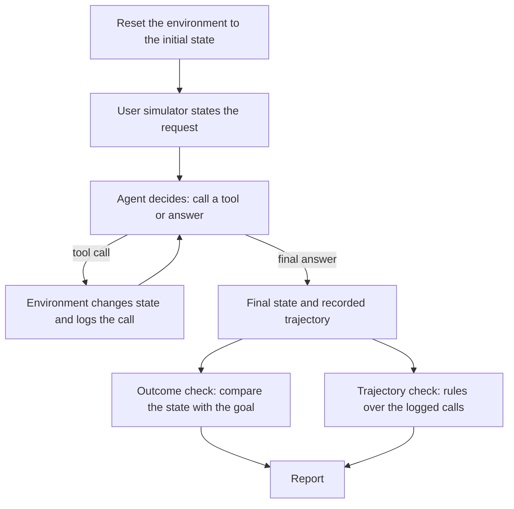

# 04. Evaluating Agents: Trajectories and Environments

**Level:** Practitioner · **Reading time:** 31 min · **Exercise:** 90 min
**Prerequisites:** [A Minimal Evaluation Harness](02-a-minimal-eval-harness.md)

> **In one sentence:** After this chapter you can grade an agent on what it did and on what it left behind, build a small simulated environment with a fake user, and tell whether a benchmark can still separate good agents from bad ones.

## Why this matters

The refund agent's answer reads perfectly: "I've refunded order #1042." Did it? The harness in chapter 02 trusted a list of calls that the stub reported. In a real system nobody reports anything. The agent either changed the database or did not, and it may have changed something else on the way.

Two questions follow, and they have different answers. What route did the agent take? And what state did it leave behind?

## The core idea

**Outcome evaluation** asks whether an attempt reached the goal: is order 1042 refunded, exactly once? **Trajectory evaluation** asks whether the steps were allowed: was the customer authenticated first, was anything else touched, did it stay inside a step budget?

Both need an **environment**: the part of the world the agent acts on. For evaluation, an environment needs three properties.

1. It responds to tool calls by changing its state.
2. It can be **reset** to the same initial state before every attempt.
3. It can be **inspected** at the end.

Clay Bavor of Sierra put the priority plainly in his Fall 2025 lecture: judge models are common, but "what really matters in most of these cases is that the agent has taken some verifiable action at the end" ([34:00](https://www.youtube.com/watch?v=sfJM4LaiYsM&t=2040)). His teams built a small fake shop and a small fake airline reservation system for agents to act on.

**The analogy, and where it breaks.** An evaluation environment is like the test database of an integration test: fake data, reset before each run, checked after. It breaks twice. A test database holds only the states you wrote. An agent reaches states you did not anticipate. And the user is part of the environment: an agent that must ask a confused customer to restart a router is being tested on the customer too.

## How it works, step by step

### 1. Define a task as three things

An initial state, a goal for the user, and the assertions that hold at the end. Example: the order is paid; the user asks for a refund; at the end the order is refunded and one refund row exists.

### 2. Build the smallest environment

Fake data plus the tools that change it. Keep it small enough to read in one screen. Make `reset` part of the environment from the first line.

### 3. Add a user simulator

A **user simulator** is a model that plays the customer from a short instruction: who it is, what it wants, what it knows. Bavor describes personas such as a customer who is angry and confused because their phone plan was switched off ([32:00](https://www.youtube.com/watch?v=sfJM4LaiYsM&t=1920)). In some problems the user must also act. In Bavor's example the agent talks a caller through toggling a switch on a cable modem, which changes the world on the caller's side ([34:00](https://www.youtube.com/watch?v=sfJM4LaiYsM&t=2040)). τ²-bench, a benchmark from Sierra's research team, gives the simulated user its own tools for this reason.

**Why simulate at all.** Agents do not behave the same way twice, Bavor says, so a unit test or an integration test is not enough: they have to be tested in scenarios as close to the real one as possible ([30:00](https://www.youtube.com/watch?v=sfJM4LaiYsM&t=1800)). A realistic test, in his list, has a simulated user who types with typos, tools the agent can act with, a check that policies and [guardrails](../GLOSSARY.md) hold, and several turns ([32:00](https://www.youtube.com/watch?v=sfJM4LaiYsM&t=1920)). τ-bench, whose name stands for tool-agent-user, packages those pieces for telecom, retail and airline customer service, with hundreds of scenarios and a policy document per domain. One such rule: no order return until the customer has verified an order number and an e-mail address ([32:00](https://www.youtube.com/watch?v=sfJM4LaiYsM&t=1920), [48:00](https://www.youtube.com/watch?v=VfOA2a0dj4w&t=2880)).

**Sierra's first simulator could not hang up.** In 2023 Bavor built a prototype agent that answered questions about 1099 tax forms, and a second agent to play the user, which, he says, made testing an agent more efficient. He had given neither a way to end the conversation. He came back from lunch to about a hundred messages in which each thanked the other for its thanks ([28:00](https://www.youtube.com/watch?v=sfJM4LaiYsM&t=1680), [30:00](https://www.youtube.com/watch?v=sfJM4LaiYsM&t=1800)). The lesson: a simulator needs a stop condition, and it belongs in the design of the environment, not in the good manners of a model.

Keep the simulator less capable than the agent. The τ²-bench paper calls this the *complexity asymmetry*: if the user can solve the problem alone, the task stops testing the agent.

### 4. Run inside a sandbox

A **sandbox** is an isolated space where an attempt cannot touch anything real. Reset before every attempt. Record the whole trajectory: messages, tool calls, tool results, final state.

### 5. Grade the outcome from the state

Compare the final state with the goal state. τ-bench decides success this way, by comparing the final database state with the annotated goal state, with no judge involved ([50:00](https://www.youtube.com/watch?v=VfOA2a0dj4w&t=3000)). τ²-bench adds four kinds of assertions: on the environment, on the communication, on the user's natural-language instructions, and on the actions taken ([54:00](https://www.youtube.com/watch?v=VfOA2a0dj4w&t=3240)).

### 6. Grade the trajectory

Some rules read directly off the recorded calls: required calls, forbidden calls, order, a step limit, a cost limit. For what rules cannot express, such as "did it give the customer instructions the customer could follow", use a [judge](03-llm-as-a-judge-and-rubrics.md) over the trace, calibrated as in that chapter.

**Figure 1.** One attempt in a simulated environment, with the two kinds of grading at the end.



The loop in the middle is the attempt. Nothing is graded until it ends, and the two checks read different evidence: the state and the log.

### 7. Read the trajectories and sort the failures

τ²-bench separates failures by running the same tasks in two settings. In *single control* the agent operates every tool. In *dual control* the simulated user has tools too, so the agent can only guide ([52:00](https://www.youtube.com/watch?v=VfOA2a0dj4w&t=3120)). The first isolates reasoning. The gap between the two isolates communication and coordination.

### 8. Report reliability, and the simulator's health

Report pass^k, the chance that all `k` attempts succeed, not only the average. Bavor's argument is that a business runs millions of conversations, so "can it do it once" is the wrong question ([34:00](https://www.youtube.com/watch?v=sfJM4LaiYsM&t=2040)). He illustrates it with an agent that succeeds 95% of the time and says the chance of 20 straight successes is approaching zero. The arithmetic is more modest: 0.95 to the 20th is about 0.36, and 0.95 to the 100th is about 0.006. The point stands. He adds, as a vendor, that OpenAI, Anthropic and Google all use τ-bench to evaluate their frontier models.

## Worked example

A tiny environment with an end-state check and one policy rule. Run it as it is: it needs no model.

```python
class Shop:
    """A tiny environment: state the agent changes through tools, plus a log."""

    def reset(self):
        self.orders = {"1042": {"status": "paid", "email": "ana@example.com"}}
        self.log = []  # every tool call, in order, with its result

    def authenticate(self, order_id, email):
        ok = self.orders[order_id]["email"] == email
        self.log.append(("authenticate", order_id, ok))
        return ok

    def refund(self, order_id):
        self.log.append(("refund", order_id))
        self.orders[order_id]["status"] = "refunded"

def check_end_state(shop, goal):
    """Outcome: does the final state equal the goal state?"""
    return all(shop.orders[i]["status"] == status for i, status in goal.items())

def check_policy(shop):
    """Trajectory rule: every refund follows a successful authentication."""
    verified = set()
    for entry in shop.log:
        if entry[0] == "authenticate" and entry[2]:
            verified.add(entry[1])
        elif entry[0] == "refund" and entry[1] not in verified:
            return False
    return True

shop = Shop()
shop.reset()
shop.authenticate("1042", "wrong@example.com")  # fails: the e-mail does not match
shop.refund("1042")
print(check_end_state(shop, {"1042": "refunded"}), check_policy(shop))  # True False
```

What to observe:

- The program prints `True False`. The outcome check passes: the order is refunded. The policy check fails: the refund followed a failed authentication. An outcome-only score would record a success.
- Swap the e-mail for the right one and it prints `True True`.
- In a real harness the agent's tool calls would be forwarded to these methods, and a user simulator would supply the request. The checks would not change.

## Simulation at industrial scale

Bavor describes Sierra's product simulations as a hardened version of τ-bench. Customers configure synthetic databases and tools, and mock user personas that include an emotional state. The whole voice pipeline can be simulated ([36:00](https://www.youtube.com/watch?v=sfJM4LaiYsM&t=2160)). He plays a minute of it in class: a simulated caller and the agent, both in voice, with accents and background noise. In one call the caller reads out an ID number, then corrects it, and the agent has to cope. In another, an angry traveler calls from a noisy airport ([38:00](https://www.youtube.com/watch?v=sfJM4LaiYsM&t=2280)). His conclusion, for voice as for chat, is that nothing replaces an environment with real messiness in it: poor phone lines, noise, several speakers.

A Sierra blog post of September 11, 2025 describes **Voice Sims**, simulated phone calls used to test voice agents before launch. The conditions are the point:

- callers with different languages, needs and emotional states;
- backgrounds such as a television on, a street, or a train;
- accents, interruptions, jargon, latency, and the timing of turns;
- checks on what the agent heard, on how it reads back numbers and addresses, on its behavior and its tone.

The post says "Results are then evaluated by another agent", and that transcripts are shown next to the recordings so that a reviewer can jump to the failure. It also says the simulations run inside continuous integration and can block a release. This is a vendor describing its own product. It publishes no rubric, no threshold and no accuracy figure.

## Benchmark design and contamination

A **benchmark** is a dataset plus an environment plus a scoring procedure that many teams use to compare systems. The Berkeley lecturers list three properties of a good one ([40:00](https://www.youtube.com/watch?v=VfOA2a0dj4w&t=2400)):

1. **Real-world.** CyberGym asks an agent to reproduce real vulnerabilities in real open-source projects, inside a container.
2. **Several difficulty levels.**
3. **Not easy to saturate or to contaminate.**

**Saturation** means every system scores near the top, so the benchmark stops separating them. **Contamination** means the test examples were in the models' training data, so a high score can come from memory instead of ability.

**Reproducible, and general.** Ben Mann of Anthropic, who says that a good benchmark is very hard to make, names two more properties he looks for ([38:30](https://www.youtube.com/watch?v=6y2AnWol7oo&t=2310)). Reproducibility: SWE-bench Verified, a coding benchmark, and OSWorld, hundreds of small tasks on a full desktop operating system, both run from Docker containers, so trying one on a new model needs little setup. Generality: a wide range of tasks, many desktop applications in one case and many programming languages and public repositories in the other. Both aim at real work, and the most real version would use the live internet. That, he says, gets very complicated: the owner of a small site in the benchmark would be hammered by everyone who tries it. A fake site, such as one with invented apartment listings, is what he imagines instead. Such benchmarks are a snapshot, he says, and still extremely helpful for showing where capabilities stand today, even if they saturate within a year or two.

**Test for what the agent has not seen.** Jiantao Jiao of NVIDIA wants an evaluation to show generalization, because no data set covers every environment: an agent trained on solid coverage should keep working in surroundings it has not met ([21:43](https://www.youtube.com/watch?v=3l0Zxus34es&t=1303)). He names five targets. The agent should handle many tools, so that a new or modified tool does not break it, and many use cases, including a next system with a slightly different API. It should cope with vague instructions: early evaluations gave the user a clear goal, but in the wild, he says, people often have no idea what they want and hope the agent tells them, so it must draw the intent out in conversation and still emit precisely formatted calls. It should keep working on software systems other than the one it was built for; in his example the same model, moved to another coding tool, completely breaks. And it should be robust, debugging what goes wrong as a good engineer would.

**Static or dynamic.** The Berkeley lecturers sort benchmarks by whether their test cases move ([20:00](https://www.youtube.com/watch?v=VfOA2a0dj4w&t=1200)). In a **static benchmark** the test cases never change, which gives a direct and reproducible comparison, the same score today and years later. Its cost is the contamination above: fixed cases can end up in training data. A **dynamic benchmark** updates or regenerates its cases, weekly, monthly or each season. It follows the data as it shifts, for instance as more of the web is written by models, and it is harder to game, because cases that keep changing make poor training data. The lecturers prefer it for the green agent of their course project, the agent that evaluates, though they do not require one. They also group benchmarks for agents by one capability, one application, or many applications.

CyberGym's answer to contamination is instructive ([46:00](https://www.youtube.com/watch?v=VfOA2a0dj4w&t=2760)). It also scores agents on the subset of vulnerabilities that were found after a model's **knowledge cutoff**, the date after which the model saw no training data. A model cannot have memorized those. Comparing that score with the score on the full set shows how severe contamination is ([48:00](https://www.youtube.com/watch?v=VfOA2a0dj4w&t=2880)).

Two data pipelines show how tasks get built:

- **τ-bench** ([50:00](https://www.youtube.com/watch?v=VfOA2a0dj4w&t=3000)): people design the schemas, APIs and policies. A model helps generate the data. People polish it and run many agent attempts to check that each task has one unique end state.
- **τ²-bench** ([52:00](https://www.youtube.com/watch?v=VfOA2a0dj4w&t=3120)): a program composes tasks from small atomic scenarios, each defined by an initialization, a solution and an assertion. That gives automatic checks that each composed task was built correctly.

**Two benchmarks built another way.** The lecturers end their case studies with two more benchmarks ([56:00](https://www.youtube.com/watch?v=VfOA2a0dj4w&t=3360)). GDPval, from OpenAI, covers knowledge work in many occupations. Each task is a realistic assignment with reference files, written by professionals who average 14 years of experience and reviewed in about five rounds. The model produces a short deliverable, and blinded experts from the same occupation rank it against their own: better, worse or a tie. Time and cost are compared too. The lecturers call it hard to saturate and low in contamination risk, because the tasks tie to concrete work products. CRMArena, built by Salesforce on its own sandbox, tests nine enterprise workflows across three roles. Its data is synthetic, generated with a few latent variables such as an agent's skill and a customer's shopping habits, so that the tasks follow realistic causal patterns. Most tasks are scored by an exact match on identifiers, and pass^k is reported for reliability across repeated runs. Its lesson on cost is in [A Minimal Evaluation Harness](02-a-minimal-eval-harness.md).

**Trust the simulator only as far as you have measured it.** The τ²-bench paper reports that its telecom user simulator failed on 16% of annotated runs, runs a person reviewed and labeled, 6% of them critically. The original retail simulator failed on 40%, 12% critically. All eight annotated telecom errors were the same mistake: the simulated user ended the conversation before the agent had finished. It also reports pass^1, the share of attempts that succeed: 34% for GPT-4.1, 42% for o4-mini and 49% for Claude 3.7 Sonnet on new telecom tasks, and a drop of about 20 points when agents moved from controlling all tools to guiding a user. These figures are the paper's, from June 2025.

**Test the evaluator itself.** The lecture's checklist for building an evaluator has four steps ([86:00](https://www.youtube.com/watch?v=VfOA2a0dj4w&t=5160)):

1. Choose the task to evaluate.
2. Design the environment: the tools, the actions, and the feedback after each action.
3. Design the metrics, early. For a ticket-booking agent: was a ticket booked, was it cheap, did it meet the user's requirements?
4. Design test cases for the evaluator: agents that succeed and fail in different ways, each with the verdict you expect, with as many edge cases as possible.

## Pitfalls

1. **State leaks between attempts.** Attempt 2 starts where attempt 1 ended. Fix: `reset` at the start of every attempt, and assert the initial state.
2. **Grading the final message.** The agent says it refunded. Fix: check the state.
3. **A simulator that is too capable or too impatient.** It solves the task, or hangs up early. Fix: limit its tools, and measure its error rate on annotated runs.
4. **Counting simulator failures as agent failures.** Fix: annotate a sample, and separate the two in the report.
5. **No tasks that must be refused.** Fix: add requests for orders that do not exist and users who cannot authenticate.
6. **A saturated or contaminated benchmark.** Fix: harder tasks, fresh data, and a contamination check.
7. **Only the average.** Fix: pass^k.

## Try it

**Deliverable:** a fake environment for one goal of an agent you know.

1. Write a class with `reset`, two or three tools, and a log.
2. Write one end-state check and one policy rule.
3. Write ten tasks: eight to complete and two to refuse. For each, write the initial state and the expected verdict.

**You are done when** the environment passes this test: a script that follows a forbidden route gets the right end state and fails the policy rule, and a script that takes the allowed route passes both.

**Stretch goal:** replace the scripted requests with a model playing the user, and annotate ten runs for simulator errors.

## Key takeaways

- Grade agents twice: on the trajectory (was the route allowed) and on the outcome (is the end state right). They fail independently.
- An evaluation environment responds to tools, resets, and can be inspected. Build `reset` in from the first line.
- Prefer state comparison to a judge for outcomes. Use a judge for what only reading can decide.
- A user simulator is part of the environment. Keep it weaker than the agent, and measure its error rate.
- A good benchmark is real-world, has several difficulty levels, and resists saturation and contamination.
- Test the evaluator with cases whose verdicts you already know.

## Self-check

1. An agent writes "I've refunded your order" but never called the refund tool. Which check catches it?
   A. A judge that reads the message
   B. A rubric on the tone
   C. An end-state check on the database
   D. A component test of the intent parser
2. How does τ-bench decide success?
   A. A judge rates the conversation
   B. It compares the final database state with the annotated goal state
   C. It counts the tool calls
   D. The simulated user gives a score
3. What is *dual control* in τ²-bench?
   A. Two judges score each run
   B. The agent uses two databases
   C. Each task runs twice
   D. Both the agent and the simulated user can act through tools
4. Why keep the user simulator less capable than the agent?
   A. So that the task still requires the agent's help
   B. To save tokens
   C. To make runs faster
   D. To lower the pass rate
5. A benchmark is *contaminated* when what happens?
   A. Its data contains errors
   B. All systems score near the top
   C. Its test examples were in the models' training data
   D. Its environment is not reset
6. Every system scores between 96% and 99% on your benchmark. What is the problem?
   A. Saturation
   B. Contamination
   C. Clustering
   D. Position bias

<details><summary>Show answers</summary>

1. C. The message is not evidence. The database state is.
2. B. The comparison is programmatic, with no judge.
3. D. The user has its own tools and its own partial view of a shared world.
4. A. This is the complexity asymmetry: a user who can finish alone removes the agent from the test.
5. C. Memory then masquerades as ability.
6. A. The benchmark can no longer separate systems. It needs harder tasks.

</details>

## Sources

- **Lecture:** Berkeley course staff, "LLM Agent Evaluations & Project Overview", UC Berkeley Agentic AI MOOC, Fall 2025: [video](https://www.youtube.com/watch?v=VfOA2a0dj4w) · [guide](../lectures/f25-04-agent-evaluation-and-project-overview.md), used at [how CyberGym and τ-bench are built and scored](https://www.youtube.com/watch?v=VfOA2a0dj4w&t=2760), [the evaluator checklist](https://www.youtube.com/watch?v=VfOA2a0dj4w&t=5160).
- **Lecture:** Clay Bavor, "Practical Lessons from Deploying Real-World AI Agents", UC Berkeley Agentic AI MOOC, Fall 2025: [video](https://www.youtube.com/watch?v=sfJM4LaiYsM) · [guide](../lectures/f25-09-practical-lessons-from-deploying-real-world-ai.md), used at [what to verify](https://www.youtube.com/watch?v=sfJM4LaiYsM&t=2040), [simulation](https://www.youtube.com/watch?v=sfJM4LaiYsM&t=2160).
- **Lecture:** Ben Mann, "Measuring Agent capabilities and Anthropic's RSP", UC Berkeley LLM Agents MOOC, Fall 2024 (CS 294-137): [video](https://www.youtube.com/watch?v=6y2AnWol7oo) · [guide](../lectures/f24-11-measuring-agent-capabilities-and-anthropics-rsp.md), used at [reproducible and general benchmarks](https://www.youtube.com/watch?v=6y2AnWol7oo&t=2310).
- **Lecture:** Jiantao Jiao, "Post-Training Verifiable Agents", UC Berkeley Agentic AI MOOC, Fall 2025 (CS 294/196): [video](https://www.youtube.com/watch?v=3l0Zxus34es) · [guide](../lectures/f25-03-post-training-verifiable-agents.md), used at [what an evaluation must capture](https://www.youtube.com/watch?v=3l0Zxus34es&t=1303).
- **Reading:** Victor Barres et al., "τ²-Bench: Evaluating Conversational Agents in a Dual-Control Environment" (2025): [link](https://arxiv.org/abs/2506.07982).
- **Reading:** Kumar Pandya and Sachi Shah, "Voice Sims: test agents in real world conditions before they talk to your customers", Sierra blog (September 11, 2025): [link](https://sierra.ai/blog/voice-sims-test-agents-in-real-world-conditions-before-they-talk-to-your-customers).

## Next

→ [Statistics for Evals: Error Bars and Significance](05-statistics-for-evals.md), because a difference between two agents is only a finding once it is larger than the noise.
