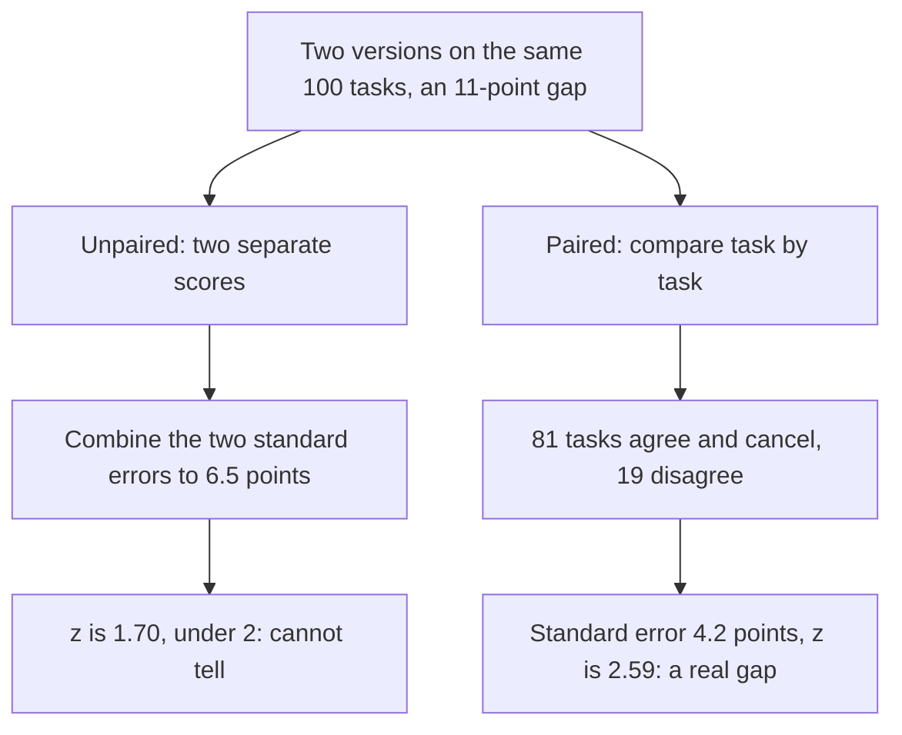

# 05. Statistics for Evals: Error Bars and Significance

**Level:** Practitioner · **Reading time:** 25 min · **Exercise:** 60 min
**Prerequisites:** [A Minimal Evaluation Harness](02-a-minimal-eval-harness.md)

> **In one sentence:** After this chapter you can compute a standard error and a paired comparison by hand and in code, and you can recognize when a difference between two scores is not evidence of anything.

## Why this matters

Version A of your agent scores 70% on your 100 tasks. Version B scores 73%. You ship B. Two weeks later you run both on a fresh 100 tasks: A gets 71%, B gets 70%.

Was the first result evidence? This chapter gives you the arithmetic to answer before you ship.

## The core idea

Your tasks are a sample. The **population** is every task your users could ever bring. Evan Miller, of Anthropic, calls it the *super-population*: the infinite set of questions your evaluation questions were drawn from. The score on your dataset is an **estimate** of the population value. The **standard error (SE)** is the typical distance between that estimate and the true value.

**The analogy, and where it breaks.** An exit poll asks 100 voters and reports a margin of error. Ask 400 and the margin halves. That is the whole idea. It breaks in one place. An exit poll picks voters at random. Your dataset is whatever you could collect. If all 100 tasks are about refunds, the standard error describes refund tasks, and no formula tells you how far the rest of the population is.

## The standard error, by hand

For pass-or-fail scores on independent tasks:

```text
SE = sqrt( p * (1 - p) / n )
```

`p` is the score and `n` the number of tasks. With p = 0.70 and n = 100: p(1 − p) = 0.21, divided by 100 is 0.0021, and the square root is 0.046. The estimate is 70% give or take about 4.6 points.

A **95% confidence interval** is a range built so that, if you repeated the whole evaluation many times, it would contain the true value in 95% of them. The usual shortcut is the score plus or minus 1.96 standard errors: 70% ± 9.0 points, or 61% to 79%.

| Tasks (n) | Standard error | 95% interval around 70% |
|---|---|---|
| 100 | 4.6 points | 61% to 79% |
| 1,000 | 1.4 points | 67% to 73% |
| 10,000 | 0.5 points | 69% to 71% |

Ten times the tasks shrink the error by a factor of about 3.2, the square root of ten.

**The rule of thumb.** A difference is **statistically significant** when it is larger than about two standard errors of the difference. The phrase means: unlikely to be caused by sampling noise alone.

## A difference between two versions, by hand

Version A answered 75 of 100 tasks correctly and version B answered 64. There are two ways to compare them.

### Unpaired: two separate measurements

Add the squared standard errors and take the square root.

- SE of A: sqrt(0.75 × 0.25 / 100) = 0.043
- SE of B: sqrt(0.64 × 0.36 / 100) = 0.048
- SE of the difference: sqrt(0.043² + 0.048²) = 0.065, or 6.5 points

The gap is 11 points. The **z-score**, the gap divided by its standard error, is 11 / 6.5 = 1.70. That is under 2, so the gap is not significant.

### Paired: the same tasks for both

Run both versions on the same tasks and look at each task on its own. Sort the 100 tasks into four groups:

| | B correct | B wrong |
|---|---|---|
| A correct | 60 | 15 |
| A wrong | 4 | 21 |

Each task now has a difference `d` of +1 (15 tasks), −1 (4 tasks) or 0 (81 tasks).

- Mean difference: (15 − 4) / 100 = 0.11, the same 11 points.
- Variance of `d`: add up `(d − 0.11)²` over all tasks and divide by 99. That gives 17.79 / 99 = 0.18.
- SE of the difference: sqrt(0.18 / 100) = 0.042, or 4.2 points.
- z-score: 0.11 / 0.042 = 2.59. Above 2, so the gap is significant.

**Why paired is tighter.** The 81 tasks where both versions agree cancel out. Only the 19 disagreements carry noise, and 15 of them favor A. A quick check agrees: if the versions were equal, each disagreement would be a coin flip, and 15 of 19 is rare.

**Figure 1.** The same 100 tasks and the same 11-point gap, compared two ways.



Only the paired route uses the fact that both versions met the same tasks, and that is where the extra certainty comes from.

## In code

The same three calculations, using only the standard library:

```python
import math


def bernoulli_se(p, n):
    """Standard error of an accuracy p estimated on n independent questions."""
    return math.sqrt(p * (1 - p) / n)


def unpaired_z(acc_a, acc_b, n):
    """z-score of the gap between two accuracies measured on separate samples of n questions."""
    se = math.sqrt(bernoulli_se(acc_a, n) ** 2 + bernoulli_se(acc_b, n) ** 2)
    return (acc_a - acc_b) / se


def paired_z(a, b):
    """(difference, standard error, z) when both models answered the SAME questions.
    a and b hold each model's 0/1 score, in the same question order."""
    n = len(a)
    d = [x - y for x, y in zip(a, b)]  # +1, 0 or -1 for each question
    diff = sum(d) / n
    se = math.sqrt(sum((x - diff) ** 2 for x in d) / (n - 1) / n)
    return diff, se, diff / se


for n in (100, 1000, 10000):
    print(f"n={n:>5}  SE = {bernoulli_se(0.70, n):.4f}")

print(f"unpaired: z = {unpaired_z(0.75, 0.64, 100):.2f}")

# 60 questions: both right. 15: only A right. 4: only B right. 21: both wrong.
pairs = [(1, 1)] * 60 + [(1, 0)] * 15 + [(0, 1)] * 4 + [(0, 0)] * 21
diff, se, z = paired_z(*zip(*pairs))
print(f"paired:   difference = {diff:.2f}, SE = {se:.4f}, z = {z:.2f}")
```

```text
n=  100  SE = 0.0458
n= 1000  SE = 0.0145
n=10000  SE = 0.0046
unpaired: z = 1.70
paired:   difference = 0.11, SE = 0.0424, z = 2.59
```

What to observe: the code prints the hand results. The same 11-point gap is 1.70 standard errors unpaired and 2.59 paired. One comparison says "cannot tell". The other says "A is better". The paired one is the right comparison whenever both versions ran on the same tasks, which is nearly always.

## Repeated attempts are not new tasks

The [harness](02-a-minimal-eval-harness.md) runs each of its 6 tasks 4 times. Pool those 24 attempts as 24 independent observations and the standard error comes out at 0.10 instead of 0.12. The pooled number is wrong, and it is wrong in the confident direction.

The attempts on one task all depend on the same task. They are a **cluster**. Two fixes work:

- Average the attempts of each task first, then treat the task means as the observations. This is what `summarize` does.
- Compute **clustered standard errors**, which treat each cluster as one source of evidence. Miller's paper gives the formula. In his example tables the clustered error is clearly larger: on MGSM, where the same 250 math problems appear in ten languages, there are 2,500 questions but only 250 clusters, and the standard error is 1.6 points instead of 0.9.

**What repeating a task buys.** Miller splits the variance into two parts: the variance between questions and the variance within one question. Running each question `k` times shrinks the second part to one `k`-th of its size. It leaves the first part alone. Only more questions shrink that one.

**Do not use the temperature to hide the noise.** **Temperature** is the setting that controls how randomly a model picks its next token. Lowering it makes runs more repeatable. Miller advises against doing this to shrink error bars, unless the purpose is to study the model at that temperature. It changes what the model does, and it moves the noise into a form you can no longer reduce.

## How many tasks do you need?

Decide before you run. Fix the smallest difference you care about, then work out the tasks needed to detect it.

For two versions near 70%, tested unpaired on `n` tasks each, the smallest detectable gap is about `1.96 * sqrt(2 * 0.21 / n)`:

| Tasks per version | Smallest gap that counts as evidence |
|---|---|
| 100 | 12.7 points |
| 1,000 | 4.0 points |
| 10,000 | 1.3 points |

So a 3-point gap on 100 tasks is never evidence, and a claim of a 1-point improvement needs about 16,000 tasks per version. A paired comparison needs fewer when the versions agree on most tasks.

## When a difference is not evidence

1. It is smaller than about two standard errors of the difference.
2. There are too few tasks. Sida Wang's slides list HumanEval, a coding benchmark, at 164 questions and SWE-bench Verified at 500, against 10,000 images for MNIST, the digit-recognition dataset.
3. You ran once. He recommends several runs with different seeds.
4. You pooled repeated attempts as if they were tasks.
5. You picked it after the fact, by comparing many metrics or slices and reporting the one that moved.
6. The dataset changed between runs, or you tuned the prompt on it.
7. The conditions differed: another model version, another temperature, a live tool answering differently.
8. The systems are inconsistent. Wang finds that the strongest models still fail easy questions and weak ones sometimes pass hard ones ([10:00](https://www.youtube.com/watch?v=HV8pugcFVO0&t=600)). Then a few lucky passes can look like progress.

## What the practitioners say

**Sida Wang (Meta), October 2025.** Benchmarks are getting harder and smaller, he says: from MNIST's 10,000 images to coding benchmarks in the hundreds ([2:00](https://www.youtube.com/watch?v=HV8pugcFVO0&t=120)). His slide's verdict is that 2.5% on HumanEval is not statistically significant. Looking at a table of models against questions sorted by difficulty, he concludes that "there's a lot of inconsistency" ([10:00](https://www.youtube.com/watch?v=HV8pugcFVO0&t=600)). A weak model that solves one very hard question is not evidence that it is strong: sampled a thousand times on the same question, some of the worst models still had a fair chance of getting it right ([12:00](https://www.youtube.com/watch?v=HV8pugcFVO0&t=720)). He also warns that multi-step tasks multiply errors: his own kitchen story is a model that identified his broken kettle as a robot vacuum, after which he trusted its later advice less ([14:00](https://www.youtube.com/watch?v=HV8pugcFVO0&t=840)).

On method, Wang keeps it simple ([28:00](https://www.youtube.com/watch?v=HV8pugcFVO0&t=1680)). Plain variance and mean estimates are enough. Bootstrapping, resampling your own results over and over, is fine in principle but often done wrong, and it gives about the same answer. A sign test, which only counts how often one version wins the disagreements, gives about the same answer too. His recommendations for reporting, in his order of increasing accuracy: read the noise level off a published table; share question-level results so others can check your claims; and be careful with your own tests, which he calls "fairly error prone" ([38:00](https://www.youtube.com/watch?v=HV8pugcFVO0&t=2280)).

Wang also measures **signal to noise**. His signal is the score gain from doubling a model's size. His noise is the standard error of a difference. On his slide, MMLU, a multiple-choice knowledge test, scores 13.2 and GSM8K, school math, 7.1, while HumanEval scores 1.1 ([42:00](https://www.youtube.com/watch?v=HV8pugcFVO0&t=2520)). His summary: below 2, a benchmark "cannot reliably measure the improvement from doubling model size", which he says is true of most code benchmarks. He tried to improve benchmarks by filtering and reweighting questions and reports that it did not help: the models, his slide on that attempt says, are a bigger source of inconsistency than the benchmarks are.

**Evan Miller (Anthropic), November 2024.** His paper opens with the idea that "fundamentally, evaluations are experiments". It makes five recommendations:

1. Compute standard errors from the central limit theorem, the result that averages of many independent observations follow a bell curve.
2. When questions come in related groups, compute clustered standard errors.
3. Reduce variance by sampling each question several times.
4. Compare models on the question-level paired differences, not on the summary scores.
5. Use power analysis, a calculation done before the run, to check that an evaluation can detect the effect you care about.

His example uses two fictional models. On MATH, with 5,000 questions, they score 65.5% (SE 0.7%) and 63.0% (SE 0.7%). On HumanEval, with 164 questions, they score 83.6% (SE 3.2%) and about 87%. By that unpaired arithmetic the 2.5-point gap on MATH is evidence and the larger gap on HumanEval is not, because its standard errors are above three points each. Pairing the two models question by question, as this chapter recommends, could only make the MATH gap look stronger.

**The Berkeley course staff, October 2025.** A judge or a model gives different output from run to run, so they advise repeating the run several times and averaging, or taking a majority vote ([18:00](https://www.youtube.com/watch?v=VfOA2a0dj4w&t=1080)). Repetition is how you see the noise in the first place.

## Pitfalls

1. **A score with no count and no error.** "78%" alone cannot be interpreted. Fix: print "0.58 (SE 0.12), 6 tasks", as the harness does.
2. **Comparing on different tasks.** Fix: the same tasks for both versions, compared pairwise.
3. **Pooling attempts.** Fix: task means first, or clustered standard errors.
4. **Slicing until something moves.** Fix: name the metric before the run. Treat slices as exploration that needs a fresh test.
5. **Trusting a small slice.** Ten tasks give a standard error near 15 points. Fix: do not rank versions on a slice that small.
6. **Freezing the temperature and calling it progress.** Fix: measure the noise instead, and sample more.
7. **Reading "not significant" as "no difference".** It means you cannot tell. Fix: more tasks, or a larger effect.

## Try it

**Deliverable:** a significance note for your last comparison between two versions.

1. Run both versions on the same 30 or more tasks, three attempts each. Count a task as passed when at least two of its three attempts pass.
2. Build the four-cell table of agreements and disagreements.
3. Compute the unpaired and the paired z-score, with the code above.

**You are done when** the note states the number of tasks, the standard error of each version, both z-scores, and one sentence on what you can and cannot conclude.

**Stretch goal:** double the dataset with new tasks from real use, and check whether the conclusion holds.

## Key takeaways

- An evaluation score is an estimate from a sample. Report it with the number of tasks and its standard error, the square root of p(1 − p)/n.
- Ten times the tasks shrink the error by about 3.2.
- Compare two versions pairwise, on the same tasks. The tasks where they agree drop out.
- Repeated attempts on one task are one cluster, not several observations.
- A difference under about two standard errors is not evidence, however welcome it looks.
- Decide the smallest difference you care about before you run, and size the dataset for it.

## Self-check

1. A system scores 70% on 100 independent tasks. What is its standard error?
   A. 0.5 points  B. 1.4 points  C. 4.6 points  D. 14.4 points
2. What halves the standard error?
   A. Twice the tasks  B. Four times the tasks  C. Ten times the tasks  D. Two attempts per task
3. Two versions agree on 81 of 100 tasks. A wins 15 and B wins 4. Why is the paired test tighter?
   A. It removes wrong answers
   B. It doubles the number of tasks
   C. It removes the mean
   D. The 81 agreements cancel, so only 19 disagreements carry noise
4. You ran each of 100 tasks five times and pooled 500 attempts. What is wrong?
   A. Attempts on one task are not independent, so the standard error is too small
   B. Nothing
   C. The mean is wrong
   D. pass@k no longer works
5. Which variance does repeating each task more times leave unchanged?
   A. Variance from the model's randomness
   B. The cost of the evaluation
   C. Variance from which questions were drawn
   D. Noise in a single sample
6. A gap of 1.5 points has a standard error of 2 points. What can you conclude?
   A. You cannot tell whether there is a difference
   B. The new version is better
   C. The new version is worse
   D. The versions are identical

<details><summary>Show answers</summary>

1. C. sqrt(0.7 × 0.3 / 100) = 0.046.
2. B. The error falls with the square root of n, so a factor of 2 needs a factor of 4.
3. D. Paired differences are 0 on those 81 tasks. Only the 15 against 4 remain.
4. A. Five attempts of one task are one cluster. Average per task first or use clustered errors.
5. C. Repeating shrinks the variance within a question. The variance between questions needs more questions.
6. A. The z-score is 0.75, far below 2. The result is compatible with no difference.

</details>

## Sources

- **Lecture:** Sida Wang, "Predictable Noise in LLM Benchmarks", UC Berkeley Agentic AI MOOC, Fall 2025: [video](https://www.youtube.com/watch?v=HV8pugcFVO0), used at [inconsistency between models and questions](https://www.youtube.com/watch?v=HV8pugcFVO0&t=600), [simple estimators](https://www.youtube.com/watch?v=HV8pugcFVO0&t=1680), [reporting advice](https://www.youtube.com/watch?v=HV8pugcFVO0&t=2280).
- **Lecture:** Berkeley course staff, "LLM Agent Evaluations & Project Overview", UC Berkeley Agentic AI MOOC, Fall 2025: [video](https://www.youtube.com/watch?v=VfOA2a0dj4w) · [guide](../lectures/f25-04-agent-evaluation-and-project-overview.md), used at [repeat and average](https://www.youtube.com/watch?v=VfOA2a0dj4w&t=1080).
- **Reading:** Evan Miller, "Adding Error Bars to Evals: A Statistical Approach to Language Model Evaluations" (2024): [link](https://arxiv.org/abs/2411.00640).

## Next

→ [Evaluating Capabilities and Risks](06-evaluating-capabilities-and-risks.md), for the case where the question is not "how often" but "could it ever".
