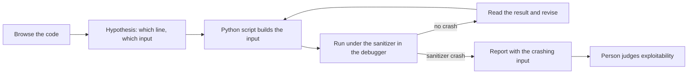

# 08. AI for Cyber Defense and Vulnerability Detection

**Level:** Practitioner · **Reading time:** 34 min · **Exercise:** 60 min
**Prerequisites:** [Tool Design and Function Calling](../02-building-agents/02-tool-design-and-function-calling.md)

> **In one sentence:** After this chapter you can explain how an agent finds a memory-safety bug with a code browser, a scripting tool, and a debugger, why a sanitizer makes the result trustworthy, and what it changes for a team that ships and patches software.

## Why this matters

Your issue tracker holds two thousand sanitizer reports. A library you depend on publishes a security fix. The same mistake probably sits in three other places in your code, and nobody has time to look.

The question of this chapter: can an agent do the work of a security researcher on your code, and what changes when attackers have the same agent?

## The core idea

A **software vulnerability** is a bug with security consequences. Charles Sutton, who is part of the Big Sleep team at Google DeepMind, gives the examples of out-of-bounds reads and writes and cross-site scripting ([62:00](https://www.youtube.com/watch?v=JCk6qJtaCSU&t=3720), Spring 2025).

Reading code is a poor way to find them. His reasons ([66:00](https://www.youtube.com/watch?v=JCk6qJtaCSU&t=3960), Spring 2025):

- There are many functions that look similar and are perfectly safe. It is a needle in a haystack.
- One function is not vulnerable or safe on its own. If the caller checked the size, the function is fine.

His answer is to let the model act, not only read. A **sanitizer** is a tool that adds checks to a running program and crashes it when it does something forbidden, such as writing past the end of a buffer. So there is a test with two outcomes: an input crashes the program under the sanitizer, or it does not. Sutton's summary at [76:00](https://www.youtube.com/watch?v=JCk6qJtaCSU&t=4560): "we have an Oracle".

**Naptime**, later called **Big Sleep**, is Google Project Zero's project built on that idea. Its goal, on Sutton's slide, is to "find vulnerabilities with language models that can think and act like a security researcher".

The analogy is a fuzzer, a program that feeds a target millions of random or mutated inputs and waits for a crash. Big Sleep is a fuzzer guided by reasoning. The analogy breaks on volume. A fuzzer needs no understanding and runs cheaply a million times. The agent runs a few dozen informed experiments per bug.

Sutton's definition of an agent fits the job ([4:00](https://www.youtube.com/watch?v=JCk6qJtaCSU&t=240)): a multi-turn model with tool use, which gains time to think, information from outside, and the ability to test hypotheses by acting.

## How it works, step by step

### The Big Sleep loop

The goal is one input that makes the target crash under a sanitizer. The agent has three tools (slide "Big Sleep design"; [78:00](https://www.youtube.com/watch?v=JCk6qJtaCSU&t=4680)).

| Tool | What it does | Why the agent needs it |
|------|--------------|------------------------|
| Code browser | Jump to a definition, follow cross-references | Navigate a code base the way an IDE does |
| Python interpreter | Run a script that builds the input | Forty bytes of padding are shorter to write as code than to type |
| Debugger | Run the target with breakpoints and expressions | Check what the program did with the input |

1. **Browse.** The agent asks for `main`, summarizes it, and follows each identifier it meets.
2. **Hypothesize.** It writes a report in plain language: which line has which bug, and what kind of input would trigger it.
3. **Build an input.** It writes a Python script that generates the input, instead of writing the input itself.
4. **Run.** The debugger runs the whole program. It reports which breakpoints were hit and the values of the requested expressions.
5. **Read the result.** If the program did not behave as predicted, the agent revises and tries again.
6. **Confirm with a person.** A sanitizer crash proves a bug. Whether it is exploitable, and how urgent it is, stays a human decision. That last step is an addition of this repository, and standard practice in security teams.

**Figure 1.** The Big Sleep loop: each run under the sanitizer either confirms the hypothesis or tells the agent what to change.



The branch is the point of the design. Without a run there is no signal, and the agent would be guessing like a reader of code.

In Sutton's example trajectory, the first attempt disappointed the agent: the program exited without crashing, because it failed earlier than the agent had expected. The agent wrote down why, updated the input, and ran the debugger again. At some point the program crashed, with an AddressSanitizer report for a heap buffer overflow ([80:00](https://www.youtube.com/watch?v=JCk6qJtaCSU&t=4800), [82:00](https://www.youtube.com/watch?v=JCk6qJtaCSU&t=4920); the report is on his slide).

### Variant analysis

A **variant** is a bug similar to one already found, in another place in the same project. Sutton's team put the description of a recently fixed SQLite bug into the context and asked the agent to find something similar. It found one ([84:00](https://www.youtube.com/watch?v=JCk6qJtaCSU&t=5040)). This is the method to copy after every security fix you apply.

### Capture the flag

A **capture the flag** competition is a security contest with small problems to solve. Sutton showed a coding agent adapted for it, with a debugger and server tools (EnIGMA). One design detail matters for any agent that runs commands: the command-line tool runs in a sandbox (slide 39).

### Why the obvious data sets disappoint

Public vulnerabilities are easy to collect: each comes with a description, an identifier and a link to its patch, and public databases hold thousands of them. The tempting step is to download all of them and train a classifier that says whether code is vulnerable. Many papers did. Sutton says he would have done the same, and he calls the problems fundamental ([68:00](https://www.youtube.com/watch?v=JCk6qJtaCSU&t=4080)):

- **How much code to include.** A patched function on its own may not show whether there is a problem.
- **A vulnerable line is not a meaningful label.** The line where a wrong memory access happens may itself be correct. The mistake sits upstream, and the patch can be far from the line that crashed.
- **How much context to give.** He calls it a difficult question.
- **Tangled commits.** A patch often does more than fix the vulnerability.
- **Judging a patch without running it.** A vulnerability can be fixed correctly in many ways, and the descriptions are vague and unreliable.

His advice is to work on something dynamic instead, an evaluation like SWE-bench in which the code really runs, on an input that triggers the bug ([70:00](https://www.youtube.com/watch?v=JCk6qJtaCSU&t=4200)).

## Worked example

A bug small enough to plant, and the two commands that prove it.

```c
/* overflow.c: a bug an agent should find.
   Build: cc -g -fsanitize=address overflow.c   */
#include <stdio.h>
#include <string.h>

void test_case(const char *content) {
    char buffer1[32];
    char buffer2[32];
    strcpy(buffer2, "BBBB");
    strcpy(buffer1, content);            /* no bounds check */
    printf("buffer2: %s\n", buffer2);
}

int main(int argc, char **argv) {
    char input[256];
    if (fgets(input, sizeof input, stdin))
        test_case(input);
    return 0;
}
```

```python
# make_input.py: what an agent writes instead of typing the padding by hand.
print("A" * 40, end="")  # 40 bytes into a buffer of 32
```

Build with `cc -g -fsanitize=address overflow.c`, then run `python3 make_input.py | ./a.out`. What to observe:

- AddressSanitizer stops the program with a stack-buffer-overflow report and the line that caused it. The report is the oracle. Nobody has to judge whether the output "looks wrong".
- The script, not the padding, is the artifact. With a script, the agent can produce binary data, lengths, and checksums the way it did in Sutton's trajectory.
- The agent has an advantage here that a fuzzer lacks. It reads `strcpy` on a 32-byte buffer and knows what to try first.

## What the practitioners say

- **Results as reported.** On Sutton's slide, the agent moved a benchmark result from 0.05 to 1.00 on buffer overflow tasks and from 0.24 to 0.76 on advanced memory corruption on the CyberSecEval 2 benchmark. It found a real vulnerability in SQLite through variant analysis. That bug was hard for general-purpose fuzzers: they did not find it in 150 hours ([84:00](https://www.youtube.com/watch?v=JCk6qJtaCSU&t=5040)).
- **His caveats.** The SQLite case was close to a best case, because the model has seen a great deal of SQL. The work focuses on memory-safety bugs. Network security and red teaming have only started (slide "Summary"; [86:00](https://www.youtube.com/watch?v=JCk6qJtaCSU&t=5160)).
- **Look at the trajectories.** His advice for anyone who builds agents: read what the agent did, find its mistakes, and add an instruction for each ([62:00](https://www.youtube.com/watch?v=JCk6qJtaCSU&t=3720)).
- **His summary.** Sutton calls security a wide-open area that has only just started, and a natural one for agents, because the work is to interact with servers and run debuggers. He also treats it as a good way to test whether a model understands code: finding a vulnerability means thinking through corner cases the developer may not have considered, and tracking data flows across stretches of a program, or, in network and system security, across several interacting programs. With agents of this kind now being scaled up, he finds it an exciting moment to join the field ([86:00](https://www.youtube.com/watch?v=JCk6qJtaCSU&t=5160)).
- **The lectures connect.** In Fall 2024 Dawn Song cited the Project Zero result, a stack buffer underflow in SQLite, as an example of AI finding bugs ([78:00](https://www.youtube.com/watch?v=QAgR4uQ15rc&t=4680)). In Fall 2025 she reported her group's own benchmark of close to 200 open-source projects with over 1,500 known vulnerabilities. Agents had to reproduce known bugs with a proof-of-concept input and to look for unknown ones. A recent frontier model found about 28% of the known vulnerabilities with a working input in a single trial ([102:00](https://www.youtube.com/watch?v=CvZDJxd4LKM&t=6120)). The lecturer also reports 35 zero-days found, meaning vulnerabilities that were previously unknown, each with a proof-of-concept input. A number of CVEs, public identifiers for known vulnerabilities, have been issued for them, and some are already patched. The model she names is Anthropic's Claude Sonnet 4.5. Her group's answer to the speed of this change is a Frontier AI Cybersecurity Observatory, to keep evaluating agent capabilities continuously ([104:00](https://www.youtube.com/watch?v=CvZDJxd4LKM&t=6240)).
- **Fall 2024: who gains more from frontier AI?** Song chose cybersecurity as her concrete example of misuse. AI is **dual-use**: it brings great benefits, and in the hands of attackers it enables scams, misinformation and other harm ([68:00](https://www.youtube.com/watch?v=QAgR4uQ15rc&t=4080)). In the traditional picture, attackers and defenders face each other over software that people wrote. Frontier AI can now help both sides, and the software under attack is a hybrid of symbolic programs and neural networks, as in [Threat Modeling LLM Applications and Agents](01-threat-modeling-llm-applications-and-agents.md) ([70:00](https://www.youtube.com/watch?v=QAgR4uQ15rc&t=4200)). Her question, which side AI helps more, takes three analyses: the impact on attacks, the impact on defenses, and the asymmetry between them. Her group produced some of the earliest papers that apply deep learning to program binary analysis, with state-of-the-art results in binary code similarity detection and in finding vulnerabilities in program binaries. Recent work shows language model agents breaking into websites on their own through simple web application vulnerabilities, and exploiting certain simple known vulnerabilities ([72:00](https://www.youtube.com/watch?v=QAgR4uQ15rc&t=4320)). Her recent work rates each stage of a cyberattack separately for the impact of frontier AI, at four levels: not affected yet, demonstrated in research papers, demonstrated in the real world, or already deployed at large scale.
- **Attacks on humans, and reactive defense.** Some attack stages already see large-scale use of AI in the real world; in others the capability is still too early to make a difference. Humans are the weakest link, she says: many intrusions start with social engineering, and phishing is the most common cyber threat to businesses and individuals. Generative AI has raised both the scale and the sophistication of such attacks. In one case in Hong Kong, a finance worker paid about 25 million dollars to attackers who had joined a video conference call as deepfakes of the company's chief financial officers; the worker took them for colleagues ([74:00](https://www.youtube.com/watch?v=QAgR4uQ15rc&t=4440)). In her analysis, frontier AI already makes attacking humans much easier, and scalable. Defense has three paradigms: reactive defense, which detects and blocks attacks; proactive defense through bug finding; and secure by construction ([76:00](https://www.youtube.com/watch?v=QAgR4uQ15rc&t=4560)). For reactive defense, AI improves detection, and attackers use it too, to make attacks harder to detect. Detection is only useful with few false alarms and few misses, and an attack may arrive too fast for an effective response. So here, she concludes, AI may benefit attackers more than it benefits defenders ([78:00](https://www.youtube.com/watch?v=QAgR4uQ15rc&t=4680)).

### What it means for defenders

This list applies the lectures. It is this repository's judgment.

1. **Run variant analysis after every fix.** Ask an agent for bugs of the same class in the same project.
2. **Work through the report backlog.** A crash oracle is cheap to check, so a sanitizer report is a good unit of work for an agent.
3. **Keep the person at the end.** Exploitability and priority need a judgment.
4. **Sandbox the agent.** It runs attacker-like inputs and arbitrary commands.

### What it means for risk

- **Attackers hold the same tools.** Song's asymmetry stands: an attacker needs one working bug, and a defender has to fix them all ([80:00](https://www.youtube.com/watch?v=QAgR4uQ15rc&t=4800), Fall 2024). Agents help with work that can be verified, and a crash is verifiable.
- **Patch delay matters more.** Attackers read public patches and look for variants in systems that have not patched.
- **The forecast is hers.** In Fall 2024 she stated, as her own belief, that in the near term AI helps attackers more than defenders ([94:00](https://www.youtube.com/watch?v=QAgR4uQ15rc&t=5640)).
- **Your coding agent is also a target.** It reads untrusted repositories and issues, which is the setting of [Agent-Specific Attacks](03-agent-specific-attacks.md).

## Pitfalls

- **Asking for bugs by reading alone.** Without running the code there is no oracle, and a report is an opinion.
- **Trusting a report without a crashing input.** The input is the proof. Ask for it.
- **No sandbox.** The agent runs inputs designed to break programs.
- **Fixing one instance.** The variant is the bug that gets exploited.
- **Testing on patched, public bugs only.** Public fixes are probably in the model's training data, so the result flatters the agent. Hold back recent bugs. This follows Sutton's point that every evaluation has a shelf life ([20:00](https://www.youtube.com/watch?v=JCk6qJtaCSU&t=1200)).
- **Scoring a detector on public vulnerability databases.** The label means little: the fault can sit upstream of the line that crashed, and a patch can be correct in many ways, so it is hard to judge without running the code. Sutton's advice is a dynamic evaluation, with an input that triggers the bug ([68:00](https://www.youtube.com/watch?v=JCk6qJtaCSU&t=4080)).
- **Expecting coverage beyond memory safety.** Treat other classes as unsolved.

## Try it

Build the smallest finding loop on your own machine.

1. Write five small C functions. Plant a memory-safety bug in three of them.
2. Give a coding agent three tools: read a file, run Python, and run the built binary. Run everything in a container or a throwaway virtual machine.
3. Ask it to produce an input that makes each program crash under AddressSanitizer.
4. Record for each program: found or not found, number of steps, and any report without a crashing input.

You are done when you have a table with five rows and those three columns, every "found" has an attached crashing input, and you have counted the reports without proof. Stretch goal: fix one planted bug and ask the agent for variants of it in the other four programs.

## Key takeaways

- Reading code is a weak way to find vulnerabilities. A sanitizer gives a yes-or-no test: the program crashes on an input or it does not.
- Big Sleep gives the model the tools of a security researcher: a code browser, a scripting tool, and a debugger. It hypothesizes in language and tests by running.
- Variant analysis, looking for bugs similar to one that was just fixed, is the method to copy after every security patch.
- Keep a person for exploitability, and a sandbox around the agent.
- Attackers hold the same tools, so fast patching and variant hunting matter more, not less.

## Self-check

1. Why is a function with no bounds check not necessarily vulnerable?
2. What is the oracle in Big Sleep, and what tool produces it?
3. Why does the agent write a Python script instead of the input itself?
4. What is variant analysis, and when should a team run it?
5. Why do results on old, publicly patched bugs overstate an agent's ability?

<details><summary>Show answers</summary>

1. Because a caller may have checked the size. Vulnerability depends on the whole program, not on one function.
2. A crash under a sanitizer, caused by an input the agent built. A sanitizer such as AddressSanitizer produces the report.
3. Because a script is a shorter and more precise way to produce padding, binary data, lengths, and structured input.
4. Searching for bugs similar to one that was just fixed, elsewhere in the same project. A team should run it after applying each security fix.
5. Because the public fix is probably in the model's training data, so the model may recall the bug instead of finding it.

</details>

## Sources

- **Lecture:** Charles Sutton, "Coding Agents and AI for Vulnerability Detection", UC Berkeley Advanced LLM Agents MOOC (Spring 2025): [video](https://www.youtube.com/watch?v=JCk6qJtaCSU) · [guide](../lectures/sp25-05-coding-agents-and-ai-for-vulnerability-detection.md), used at [definition of an agent](https://www.youtube.com/watch?v=JCk6qJtaCSU&t=240), [evaluations have a shelf life](https://www.youtube.com/watch?v=JCk6qJtaCSU&t=1200), [look at the trajectories](https://www.youtube.com/watch?v=JCk6qJtaCSU&t=3720), [why detection is hard](https://www.youtube.com/watch?v=JCk6qJtaCSU&t=3960), [public vulnerability databases](https://www.youtube.com/watch?v=JCk6qJtaCSU&t=4080), [dynamic evaluation](https://www.youtube.com/watch?v=JCk6qJtaCSU&t=4200), [the oracle](https://www.youtube.com/watch?v=JCk6qJtaCSU&t=4560), [tools](https://www.youtube.com/watch?v=JCk6qJtaCSU&t=4680), [SQLite variant](https://www.youtube.com/watch?v=JCk6qJtaCSU&t=5040), [his summary](https://www.youtube.com/watch?v=JCk6qJtaCSU&t=5160)
- **Lecture:** Dawn Song, "Agentic AI Safety & Security", UC Berkeley Agentic AI MOOC (Fall 2025): [video](https://www.youtube.com/watch?v=CvZDJxd4LKM) · [guide](../lectures/f25-12-agentic-ai-safety-and-security.md), used at [cybersecurity benchmark](https://www.youtube.com/watch?v=CvZDJxd4LKM&t=6120)
- **Lecture:** Dawn Song, "Towards Building Safe & Trustworthy AI Agents and A Path for Science- and Evidence-based AI Policy", UC Berkeley LLM Agents MOOC (Fall 2024): [video](https://www.youtube.com/watch?v=QAgR4uQ15rc) · [guide](../lectures/f24-12-towards-building-safe-and-trustworthy-ai-agents.md), used at [dual-use and impact levels](https://www.youtube.com/watch?v=QAgR4uQ15rc&t=4080), [agents attacking machines](https://www.youtube.com/watch?v=QAgR4uQ15rc&t=4320), [attacks on humans](https://www.youtube.com/watch?v=QAgR4uQ15rc&t=4440), [three defense paradigms](https://www.youtube.com/watch?v=QAgR4uQ15rc&t=4560), [Project Zero result](https://www.youtube.com/watch?v=QAgR4uQ15rc&t=4680), [reactive defense](https://www.youtube.com/watch?v=QAgR4uQ15rc&t=4680), [asymmetry](https://www.youtube.com/watch?v=QAgR4uQ15rc&t=4800)
- **Web:** Google Project Zero, "Project Naptime" (June 2024): [post](https://googleprojectzero.blogspot.com/2024/06/project-naptime.html), and "From Naptime to Big Sleep" (October 2024): [post](https://googleprojectzero.blogspot.com/2024/10/from-naptime-to-big-sleep.html). Links as given on the lecture slides; not opened for this chapter.
- **Reading:** Abramovich et al., "EnIGMA: Enhanced Interactive Generative Model Agent for CTF Challenges" (2024), and Bhatt et al., "CyberSecEval 2" (2024), as cited on the lecture slides

## Next

→ [Policy, Governance and Standards](09-policy-governance-and-standards.md), for how findings like these enter risk assessments and regulation.
