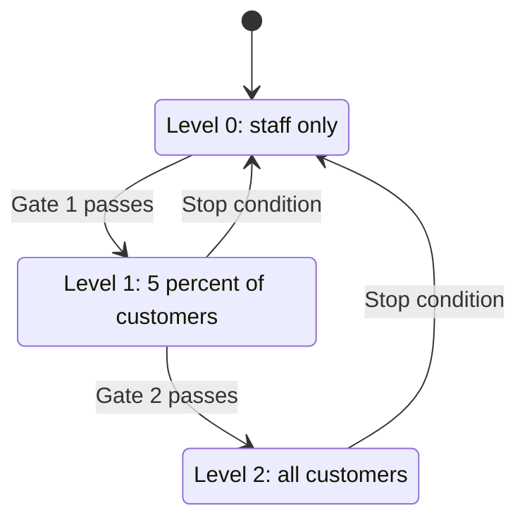

# 09. Policy, Governance and Standards

**Level:** Professional · **Reading time:** 20 min · **Exercise:** 45 min
**Prerequisites:** [Threat Modeling LLM Applications and Agents](01-threat-modeling-llm-applications-and-agents.md)

> **In one sentence:** After this chapter you can write a marginal-risk assessment for a feature you ship, turn it into a rollout policy with evidence gates, and place the main AI standards and laws on a dated map.

## Why this matters

A compliance lead asks you two questions: "Which standard do we certify against?" and "What do we tell a regulator about the risk of this agent?" Most engineers answer with a list of laws, without dates, and with no measurement behind the risk claim. The lecture behind this chapter offers a better procedure and a warning: regulation written without evidence produces bad rules.

## The core idea

**Evidence-based AI policy** is the position that rules about AI should rest on measured risk, and that measuring risk is a research job that has barely started. Dawn Song proposed a path for it with a group of researchers in 2024. Its unit of analysis is **marginal risk**: the risk a model adds on top of the risk that already exists.

The analogy is a drug trial. A new drug is judged against the current standard of care, not against perfect health. The analogy breaks in two ways. A model's effect changes after release, as other tools are built on it. And one model reaches every actor at once, including hostile ones.

## How it works, step by step

### 1. Assess one risk with six questions

Song's proposal, building on Kapoor et al. (ICML 2024, as cited on her slide), turns a marginal-risk analysis into six questions. The example column answers them for a public writing assistant.

| # | Question | Example answer |
|---|----------|----------------|
| 1 | Which specific risk, and from whom? | Personalized scam emails, written by fraudsters who lack the target language. |
| 2 | What is the existing risk without the model? | Scams already exist, written from templates, by translation tools, or by hired writers. |
| 3 | What defenses exist today? | Mail filters, sender authentication, warnings from banks, user training. |
| 4 | What does the model add? | Fluent, personalized text at near-zero cost, so volume rises and quality improves. |
| 5 | How hard is it to defend against that addition? | Hard: filters read text, not intent. |
| 6 | What is uncertain or assumed? | No measurement of how much success rates rise. Assumes the provider's abuse monitoring works. |

Question 2 is the one teams skip. Without it, every risk looks new and every mitigation looks worth its cost.

### 2. Follow the five priorities

The proposal names five priorities. The right column translates each into work for an engineering team. A risk register, named in the first row, is the list in which a team records each risk with an owner and a status.

| Priority in the proposal | What it means for a team |
|--------------------------|--------------------------|
| Understand AI risks better | Keep a risk register in the six-question form, with a number and a source for each risk. |
| Increase transparency | Write down the model version, the test results, the known limits, and the incidents, in a form others can compare. |
| Early warning | Test before release and monitor after it. Have a channel for adverse event reports, as aviation and cybersecurity do. |
| Mitigation and defense | Build the controls, and the social defenses, for the risks you identified. |
| Trust and less fragmentation | Agree on evidence with the people who disagree with you, before a dispute about one model. |

### 3. Adopt the pattern of a responsible scaling policy

A **responsible scaling policy** is a public commitment by a model developer. It names capability thresholds and the safety and security measures the company will meet before it trains or deploys a model above each one. Anthropic published the first in 2023, and OpenAI and Google DeepMind followed with similar frameworks in 2023 and 2024. All have been revised since.

You do not train frontier models, the most capable models from large labs, and the pattern still applies. It has three parts:

1. **Thresholds written before the capability arrives.** The rule is fixed while nobody has an incentive to bend it.
2. **Evidence gates.** A level opens when a measurement passes, not when a launch date arrives.
3. **A stop condition.** A named event sends the system back one level.

### 4. Know the landscape, with dates

The lecture is from December 2024. Regulation moves faster than any course. The table lists what could be verified as of November 2026. Check the current text before you rely on an entry.

| Instrument | Kind | Date | What it asks of a team |
|-----------|------|------|------------------------|
| NIST AI Risk Management Framework 1.0 and its Generative AI Profile | Voluntary framework, US | January 2023; profile July 2024 | Organizes the work in four functions: govern, map, measure, manage. |
| ISO/IEC 42001 | Certifiable management-system standard | 2023 | An auditor checks that you have documented roles, risk assessment, and reviews. It audits the process, not the model. |
| OWASP Top 10 for LLM Applications 2025 | Community risk list | 2025; a 2026 edition is listed as of November 2026 | Shared names for threats, for threat models and tests. |
| OWASP Top 10 for Agentic Applications 2026 | Community risk list | 2026 | Shared names for agent threats, from goal hijack to rogue agents. |
| EU AI Act (Regulation (EU) 2024/1689) | Binding law | In force August 2024, obligations in stages from February 2025 | Duties depend on the use's risk class and on whether you provide or deploy the system. |
| US Executive Order 14110 | Federal executive order | Signed October 2023, rescinded January 2025 | The lecture's example of a compute threshold. No longer in force. |

Two entries deserve a comment.

- The two OWASP lists are the ones most useful day to day. The 2025 LLM list runs from prompt injection and sensitive information disclosure through improper output handling and excessive agency to unbounded consumption. The 2026 agentic list adds agent goal hijack, tool misuse, identity and privilege abuse, memory and context poisoning, insecure inter-agent communication, cascading failures, and rogue agents. See [Threat Modeling](01-threat-modeling-llm-applications-and-agents.md).
- Song uses the EU Digital Services Act as her model for transparency. Before it, social media companies published voluntary reports. From 2023 the law set a common format, which made reports comparable. She asks the same four questions for AI: which entities are in scope, what information, to whom, and by which process. Her example for scope is a compute threshold, a limit on the computing power used to train a model, in the US executive order and the EU AI Act, as of December 2024.

## Worked example

A one-page rollout policy for an internal agent, following the pattern from step 3. All numbers are illustrative.

```text
Rollout policy: support agent with a refund tool
Owner: on-call lead for the support agent      Review: every 90 days, or after any incident

Scope: one model version, two tools: read an order, issue a refund of at most 200 US dollars.

Gates. The agent moves one level up only when the current level's tests pass.
  Level 0  staff only          Red-team suite run and recorded. A person approves every refund.
  Level 1  5% of customers     Attack success rate below 3% on 200 injection tasks.
                              No refund to a card different from the order's card in 14 days.
  Level 2  all customers       No bypass of the approval step in 10,000 logged runs.
                              Independent review of the audit trail.

Stop conditions. Any confirmed unauthorized refund. Any leak of another customer's data.
On stop: return to Level 0, file an incident report within 24 hours, pass both gates again.

Assumptions: image attachments are not tested. A new model version restarts at Level 0.
```

What to observe: every level is defined by a measurement that someone can repeat. The red-team suite from [Red-Teaming and Safety Evaluation](06-red-teaming-and-safety-evaluation.md) produces the attack success rate. The monitoring from [Runtime Monitoring and Detection](05-runtime-monitoring-and-detection.md) produces the logged runs.

**Figure 1.** A rollout policy as three levels: a measurement opens each gate upward, and a stop condition sends the agent back to Level 0.



A new model version also returns the agent to Level 0, so every level is always backed by a measurement of the model that is running.

## What the practitioners say

Dawn Song gave the policy part as the closing section of her Fall 2024 lecture.

- **Law arrived before evidence.** She counts about 120 AI bills in progress at the US federal level, and about 600 bills introduced in at least 45 states, and describes heated disagreement in the field, with California's SB 1047 as her example. The bill was vetoed. Her summary of the problem: "Technical solution alone is necessary but insufficient." ([96:00](https://www.youtube.com/watch?v=QAgR4uQ15rc&t=5760))
- **The proposal.** Policy for AI, her slide argues, has to rest on a scientific grasp of the risks and of ways to reduce them, and today that grasp is thin. She lists the five priorities at [100:00](https://www.youtube.com/watch?v=QAgR4uQ15rc&t=6000).
- **A blueprint written in advance.** She calls for a map from future conditions, such as a capability level or a demonstrated harm, to candidate policy responses, agreed before anyone knows which condition will occur. That, she argues, sidesteps arguments about when a risk will materialize. About 200 institutions volunteered to contribute after the launch, as she reports at [102:00](https://www.youtube.com/watch?v=QAgR4uQ15rc&t=6120).- **Marginal risk differs by domain.** Her slide from that lecture puts the marginal risk of AI for social engineering high, and for software exploits low, at the time. In the same lecture she states a forecast, as her own belief: in the near term AI will help attackers more than defenders ([94:00](https://www.youtube.com/watch?v=QAgR4uQ15rc&t=5640)). The findings in [AI for Cyber Defense](08-ai-for-cyber-defense-and-vulnerability-detection.md) are the other side of that forecast.

From Fall 2024 to Spring 2025 the framing stayed and the shared evidence base grew. In Spring 2025 she opens her lecture by citing an International AI Safety Report led by Yoshua Bengio and written with about 100 researchers from 30 countries ([0:00](https://www.youtube.com/watch?v=ti6yPE2VPZc&t=0)). Her outline still lists the policy path, and she runs out of time before it ([108:00](https://www.youtube.com/watch?v=ti6yPE2VPZc&t=6480)).

## Pitfalls

- **Quoting a law without a date.** A statement true in December 2024 can be void in 2026. Write the date next to every claim, as the table does.
- **Discussing absolute risk.** "Scams are harmful" is true and useless for policy. Ask what the model adds, and to whom.
- **Treating a certificate as safety.** A management-system audit shows that a process exists. It says nothing about the attack success rate of your agent.
- **Writing gates as launch dates.** "Full rollout in March" has no evidence in it. Tie each level to a measurement that another person can repeat.
- **Waiting for a rule or an incident.** Budget for defenses tends to follow damage. Monitoring and incident reporting are cheaper before the incident.
- **Letting a new model version inherit an old approval.** Every gate was passed by one specific model. A version change restarts the policy.

## Try it

Write a marginal-risk assessment and a rollout policy for one feature you are responsible for.

1. Pick one risk and answer the six questions of step 1 in writing. Each answer gets a number or the word "unmeasured".
2. Write a rollout policy on one page, with three levels, a measurement for each gate, two stop conditions, and an owner.
3. Add a row to your risk register that points to both documents.

You are done when a colleague who has never seen the feature can repeat each gate's measurement from your description, and when every row of the six-question table has either a source or the word "unmeasured". Stretch goal: answer Song's four transparency questions for the same feature: scope, information, audience, process.

## Key takeaways

- Evidence-based policy rests on marginal risk: what the model adds to a risk that already exists, and how hard that addition is to defend against.
- Six questions turn that idea into a one-page assessment. The existing risk and its defenses are the rows teams skip.
- A responsible scaling policy is thresholds written early, evidence gates, and a stop condition. The pattern works for a product as well as for a frontier model.
- Standards audit process, community lists supply vocabulary, and laws set duties. Know which is which, and date every claim.
- Her forecast, stated as her own view in December 2024: in the near term AI helps attackers more than defenders, which is an argument for monitoring before the incident.

## Self-check

1. Why does the marginal-risk framework need the risk that exists without the model?
2. What are the three parts of a scaling policy that a product team can copy?
3. Which kind of instrument audits your process, and which supplies shared names for threats?
4. What was vetoed, and what does Song say that episode shows about the state of the field?
5. What are the four questions she takes from the Digital Services Act for AI transparency?

<details><summary>Show answers</summary>

1. Without it, every harm is attributed to the model and no one can tell what the model added or how much a defense is worth.
2. Thresholds fixed before the capability arrives, gates opened by a measurement, and a stop condition that sends the system back a level.
3. A certifiable management-system standard such as ISO/IEC 42001 audits the process. A community risk list, such as the OWASP Top 10 lists, supplies the vocabulary.
4. California's SB 1047. She uses it as an example of a fragmented field that lacks agreement on which risks matter and who should address them.
5. Which entities are in scope, what information is shared, to whom, and by which process.

</details>

## Sources

- **Lecture:** Dawn Song, "Towards Building Safe & Trustworthy AI Agents and A Path for Science- and Evidence-based AI Policy", UC Berkeley LLM Agents MOOC (Fall 2024): [video](https://www.youtube.com/watch?v=QAgR4uQ15rc), used at [bills and fragmentation](https://www.youtube.com/watch?v=QAgR4uQ15rc&t=5760), [attackers and defenders](https://www.youtube.com/watch?v=QAgR4uQ15rc&t=5640), [five priorities](https://www.youtube.com/watch?v=QAgR4uQ15rc&t=6000), [the blueprint](https://www.youtube.com/watch?v=QAgR4uQ15rc&t=6120)
- **Lecture:** Dawn Song, "Towards building safe and secure agentic AI", UC Berkeley Advanced LLM Agents MOOC (Spring 2025): [video](https://www.youtube.com/watch?v=ti6yPE2VPZc), used at [international report](https://www.youtube.com/watch?v=ti6yPE2VPZc&t=0), [policy part skipped](https://www.youtube.com/watch?v=ti6yPE2VPZc&t=6480)
- **Reading:** Kapoor et al., "On the Societal Impact of Open Foundation Models" (ICML 2024), as cited on the lecture slides: marginal risk framework for open models
- **Web:** OWASP Gen AI Security Project, "OWASP Top 10 for LLM Applications 2025": [list](https://genai.owasp.org/llm-top-10/), opened 2026-11-24
- **Web:** OWASP Gen AI Security Project, "OWASP Top 10 For Agentic Applications 2026": [list](https://genai.owasp.org/top-10-for-agentic-applications-2026/), opened 2026-11-24; the [project site](https://genai.owasp.org/) lists a 2026 edition of the LLM list, not opened
- **Web:** the proposal's site is given on the lecture slides as understanding-ai-safety.org; not opened for this chapter

## Next

→ [Threat Modeling LLM Applications and Agents](01-threat-modeling-llm-applications-and-agents.md), to turn the risk statements of this chapter into a model of your own system. For the review habits that keep a rollout policy alive, see [checklists](../11-professional-practice/07-checklists.md).
