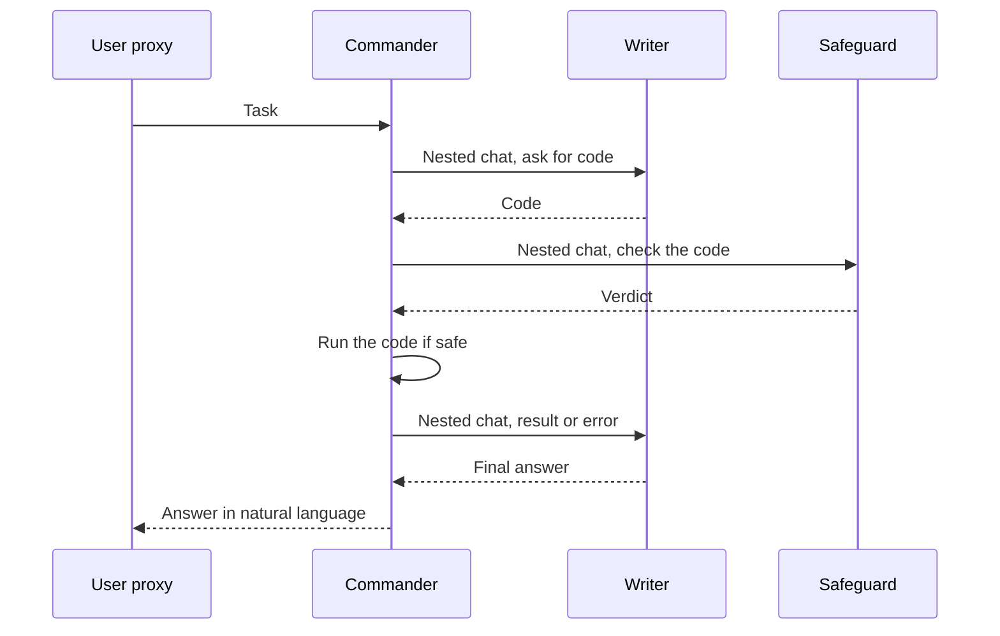

# 02. AutoGen: Conversation Programming

**Level:** Practitioner · **Reading time:** 14 min · **Exercise:** 60 min
**Prerequisites:** [The Agent Framework Landscape](01-the-agent-framework-landscape.md), [Tool Design and Function Calling](../02-building-agents/02-tool-design-and-function-calling.md)

> **In one sentence:** After this chapter you can describe an agent system as a conversation between peers (agents, a rule for who speaks next, and a stop condition) and build a small one in plain Python.

## Why this matters

You have two agents: a writer that drafts Python and a runner that executes it. When the code fails, the runner's error must go back to the writer. Now add a reviewer the writer consults before each draft, and a commander that coordinates everyone. Each new rule adds function calls that pass a growing history around. After three rules you cannot say who told whom what.

Chi Wang's Fall 2024 lecture proposes a different unit: the conversation. If the program *is* a conversation, the history is one list, each rule is "who speaks next", and debugging means reading the transcript.

## The core idea

**Conversation programming** treats each agent as a conversational peer and the program as a conversation among peers. It has three parts:

- **Agents.** Each agent has a role, usually a system prompt (the instructions that tell the model how to behave), and a way to answer. The answer can come from a model, from a tool or from a person. A **user proxy agent** speaks for the user: it carries the request in, and it may run code or ask the user when the others need something.
- **Chat patterns.** The rule for who speaks next and when the conversation ends. Two agents can alternate. A group can take turns under a manager. One conversation can hide inside another.
- **Shared history.** The list of messages. It is the program's whole state, so you can print it, replay it and test it.

Wang's stated goal is that a developer can reason about a very complex workflow in two steps: define the agents, and get them to talk. He names the two concepts a **conversable agent** and a conversation program. The agent is deliberately general: its backend can be a language model, a tool or human input, and an agent can contain other agents, run conversations inside itself and appear to the outside as one peer ([22:00](https://www.youtube.com/watch?v=OOdtmCMSOo4&t=1320)).

The analogy is the actor model, in which each actor has a mailbox and actors communicate only by messages. The analogy breaks on time. Actors run concurrently, while most agent conversations take turns, because one agent must speak at a time and every turn is a model call that costs money.

A second idea follows from the first: an agent need not run on a model. In the lecture a separate safeguard agent checks the writer's code, and the commander executes it only when the safeguard says it is safe. An execution error travels back as an ordinary message ([8:00](https://www.youtube.com/watch?v=OOdtmCMSOo4&t=480), [10:00](https://www.youtube.com/watch?v=OOdtmCMSOo4&t=600)).

## How it works, step by step

Wang describes the construction of a four-agent program in three steps ([10:00](https://www.youtube.com/watch?v=OOdtmCMSOo4&t=600)):

1. **Create the agents.** One line each: the user proxy, the commander, the writer and the safeguard.
2. **Define the interaction patterns.** He registers two nested chats on the commander. For each, the program names who sends, who receives, which agents take part, and how the result is summarized.
3. **Initiate the chat.** The user proxy sends the task to the commander. The framework runs every later step and returns the result.

**Figure 1.** Wang's four-agent program: the commander holds the chat with the user and starts a nested chat for each step.



The user proxy talks only to the commander; the writer and the safeguard take part in short nested chats and return a summary.

From those parts you get four chat patterns:

| Pattern | How it works | Use it when |
|---|---|---|
| Two-agent chat | Two peers alternate until a stop condition | One produces, the other checks or executes |
| Group chat | Several agents share one history; a manager picks the next speaker | The task needs several kinds of expertise and each must see what the others said |
| Nested chat | A message that matches a condition starts a private sub-conversation; its summary comes back as the reply | One step needs its own back-and-forth that should not flood the main history |
| Sequential chat | The result of one chat becomes the input of the next | The task has stages with a clear order |

Wang builds the patterns up with his own examples. The two-agent chat is enough for **reflection**, in which one agent drafts, another criticizes and they repeat: a writer drafts a blog post and a critic suggests improvements. The nested chat appears when one critic is not enough. From the writer's side it still talks to a single critic, but underneath that critic runs a sequential chat: an SEO (search engine optimization) reviewer, then a legal reviewer and an ethics reviewer, and finally a meta reviewer who summarizes their comments into one ([24:00](https://www.youtube.com/watch?v=OOdtmCMSOo4&t=1440)). His example for tool use is conversational chess. Asked to play directly, two language-model agents often make illegal moves, so he adds a third agent, the chess board. It is a tool-based agent: a Python library manages the board, and a player refines its move until the board agent accepts it ([24:00](https://www.youtube.com/watch?v=OOdtmCMSOo4&t=1440), [26:00](https://www.youtube.com/watch?v=OOdtmCMSOo4&t=1560)).

In a group chat, he says, the user only defines agents with different roles and puts them together. A **group chat manager** watches the progress and picks the next speaker. You can narrow that choice with rules, such as "after agent A speaks, only agent B and C can speak", and add transition logic that sends the conversation down one route or another. The logic can be written in natural language or in a programming language ([26:00](https://www.youtube.com/watch?v=OOdtmCMSOo4&t=1560)). That is the dial between a fixed order and the model's choice.

One more pattern belongs here: **StateFlow**, which the AutoGen team published in a later paper, one of the assigned readings of this lecture. Wang does not present it in the talk. It models a task as a finite state machine (a set of states and the allowed moves between them). Each step of the process becomes a state, for example: look up the database tables, write the query, verify. Entering a state runs a short sequence of actions, such as sending one instruction to a model, calling a tool or asking the user. The move to the next state is decided by a rule, such as matching a string in the output, or by the model. The paper calls the split **process grounding** (the states and their transitions) versus **sub-task solving** (the actions inside a state). With GPT-3.5 it reports higher success rates than ReAct (an agent loop that alternates reasoning and tool calls): 13% on InterCode SQL and 28% on ALFWorld, two benchmark tasks, with 5 and 3 times lower inference cost. It is the constrained end of the spectrum from chapter 01: the path is drawn first, and the model works inside a step.

All four patterns share the same engine, and it is small: a rule that picks the next speaker, and a rule that says the conversation is over. The next section builds it.

## Worked example

About 40 lines of plain Python, with no framework. The "model" is a stub, so the file runs without an API key. Everything else is real: the runner executes the writer's code with Python, and the real traceback flows back into the conversation.

```python
# conversation_runtime.py — conversation programming in plain Python.
import traceback

class Agent:
    """A conversational peer: a name, a role, and a function that speaks for it."""
    def __init__(self, name, role, brain):
        self.name, self.role, self.brain = name, role, brain

    def speak(self, log):
        message = {"speaker": self.name, "content": self.brain(self, log)}
        log.append(message)
        return message

def writer_brain(agent, log):
    drafts = sum(m["speaker"] == agent.name for m in log)
    if drafts == 0:
        return "import mathh\nprint(math.sqrt(16))"   # a typo, on purpose
    return "import math\nprint(math.sqrt(16))"

def runner_brain(agent, log):
    code = log[-1]["content"]                 # run the last code the writer sent
    try:
        exec(compile(code, "writer_code", "exec"), {})   # toy only; real code needs a sandbox
        return "OK"
    except Exception:
        return traceback.format_exc()

def converse(speakers, task, pick_next, is_done, max_turns=6):
    """Run one conversation. pick_next(log, previous) returns the next speaker."""
    log = [{"speaker": "user", "content": task}]
    current = speakers[0]
    for _ in range(max_turns):
        message = current.speak(log)
        if is_done(message):
            return log
        current = pick_next(log, current)
    log.append({"speaker": "system", "content": "stopped: turn limit"})
    return log

def alternate(log, previous):
    return runner if previous is writer else writer

def no_error(message):
    return message["speaker"] == "runner" and message["content"] == "OK"

writer = Agent("writer", "You write Python.", writer_brain)
runner = Agent("runner", "You run the writer's code.", runner_brain)

log = converse([writer, runner], "Print the square root of 16.", alternate, no_error)
for m in log:
    print(f"{m['speaker']:7} {m['content'].splitlines()[0]}")
```

Output (the `4.0` line is the writer's own code, printed while the runner executes it):

```
4.0
user    Print the square root of 16.
writer  import mathh
runner  Traceback (most recent call last):
writer  import math
runner  OK
```

Observe:

- The first draft fails. The runner does not fix anything; it reports. The failure reaches the writer as the last message in a shared list, and the writer's next draft changes because of it.
- `converse` knows nothing about writers or runners. Change `pick_next` and you have another chat pattern; change `is_done` and you have another stop condition.
- A nested chat is only a brain that calls `converse` on its own agents and returns a summary. A group chat is an `is_done` plus a `pick_next` that returns any of several agents.

To use a real model, replace the writer's brain with a model call that receives the log. To run code that a real model wrote, replace `exec` with a sandbox from [chapter 06](06-agent-infrastructure-sandboxes-browser-use-and-protocols.md). Never `exec` model-written code in your own process.

For comparison, here is the whole of the smallest program on AutoGen's documentation page, as of November 2026. It is one agent and one task:

```python
# pip install -U "autogen-agentchat" "autogen-ext[openai]"
import asyncio
from autogen_agentchat.agents import AssistantAgent
from autogen_ext.models.openai import OpenAIChatCompletionClient

async def main() -> None:
    agent = AssistantAgent("assistant", OpenAIChatCompletionClient(model="gpt-4o"))
    print(await agent.run(task="Say 'Hello World!'"))

asyncio.run(main())
```

This calls a paid API: one short request, well under one cent at the prices published for that model in 2025. The documentation page consulted for this edition did not show the group-chat names, so they are not given here. The package is also unmaintained: the same page says the project is archived. Use it to read the idea, not to start a product.

## What the practitioners say

Chi Wang opened the lecture of September 23, 2024 with two questions: what future AI applications will look like, and how to give every developer the means to build them. His bet, stated as a bet, is that future applications are agentic and that agents become a new way for people to interact with the digital world. He supports it with a Berkeley article on the shift from a lone model to **compound AI systems**: systems in which a model is one of several working parts ([0:00](https://www.youtube.com/watch?v=OOdtmCMSOo4&t=0)).

- **A demo, not a measurement.** He shows a startup's system building a website that lists models from Hugging Face. Agents with different roles analyze the task, look for information and install dependencies, then build and compile. He deletes one critical line of code. On the next run the system hits the error and, within a few steps, restores the line, which he reads as self-recovery ([2:00](https://www.youtube.com/watch?v=OOdtmCMSOo4&t=240), [6:00](https://www.youtube.com/watch?v=OOdtmCMSOo4&t=360)). He names three benefits of agent AI: a more natural interface, the ability to finish complex tasks with little supervision, and a software architecture in which several agents split a task ([6:00](https://www.youtube.com/watch?v=OOdtmCMSOo4&t=360)).
- **The user sees none of it.** In the four-agent program the end user asks a simple question and gets an answer in natural language, without knowing that several agents run ([10:00](https://www.youtube.com/watch?v=OOdtmCMSOo4&t=600)).
- **Why more than one agent.** Wang gives three reasons. Agents improve each other's work over turns. A complex task can be divided, so each agent handles a smaller job. And some agents need no language model: they do grounding (looking up facts in a source outside the model) or validation with knowledge outside the model. His slide compares a safeguard built as a separate agent with the same instructions packed into one agent: for GPT-4 the two-agent setup scores 20% higher, and for GPT-3.5 the gap is larger (he names no metric in the audio). His conclusion: the more complex the task and the weaker the model, the stronger the case for a multi-agent workflow ([12:00](https://www.youtube.com/watch?v=OOdtmCMSOo4&t=720)).
- **A software-engineering argument.** A modular design is easier to understand, maintain and extend, he says. To change the safeguard, switch its backend from a model to a tool or to a person and leave the other agents alone. Because a person can take over any agent, human participation needs no separate mechanism ([14:00](https://www.youtube.com/watch?v=OOdtmCMSOo4&t=840)).
- **The trade-offs a framework must cover.** Some developers want a static workflow, with every step and its order fixed. Others cannot foresee every situation and want agents to build the workflow as they go. Some instruct in natural language; others want the precise control of a programming language. He calls that a trade-off between flexibility and controllability, and lists more: share the context among agents or keep it separate, cooperate or compete, central or decentralized, automate or intervene ([16:00](https://www.youtube.com/watch?v=OOdtmCMSOo4&t=960)). His own starting point is, he says, a personal one: pick one pattern from which the others can be derived, and he picks the conversation ([18:00](https://www.youtube.com/watch?v=OOdtmCMSOo4&t=1080)).
- **Where the framework came from.** AutoGen began inside FLAML, a library for automated machine learning, became its own repository, and in 2024 moved to its own GitHub organization with open governance. He calls it comprehensive and flexible, able to combine with other design patterns and frameworks ([20:00](https://www.youtube.com/watch?v=OOdtmCMSOo4&t=1200)).
- **What people built.** The two largest categories among community applications are software development and agent platforms. Research and data processing follow, then games, and a long tail of web browsing, finance, healthcare, education and blockchain. He highlights teams that imitate a research group (collect data, propose hypotheses, run experiments, verify) and a system that reasons over a scientific knowledge graph with a team of role-based agents ([28:00](https://www.youtube.com/watch?v=OOdtmCMSOo4&t=1680)).
- **Building the team automatically.** He starts from the question of which agents to create for a task. His research direction AutoBuild is a first answer: the user describes the task, the system suggests agents with different roles, and they work in a group chat. An adaptive variant first splits a complex task into steps and picks a team for each step, creating new agents when the library has none and adding them back afterwards ([34:00](https://www.youtube.com/watch?v=OOdtmCMSOo4&t=2040)).
- **What is still open.** Designing the best workflow under quality, cost, latency and manual effort at once; reasoning, planning and learning ability; scale; ways for humans to guide the system; safety ([36:00](https://www.youtube.com/watch?v=OOdtmCMSOo4&t=2160)).

## Pitfalls

1. **No stop condition.** Two polite agents can agree forever, or argue forever. Fix: always pass an `is_done` rule and a turn limit, and make the limit a budget in tokens.
2. **Cost that grows with the cast.** Every speaker re-reads the history, so tokens grow with agents times turns. Fix: summarize old turns, keep groups small, and measure tokens per conversation.
3. **Role inflation.** A role is a system prompt. Names like "CEO" do not make an architecture. Fix: for each agent, write down its inputs, its outputs and its tools; delete any agent whose line you cannot fill.
4. **Hidden history.** Frameworks may trim what each agent sees. Fix: print the full log in a test whenever behavior surprises you.
5. **Agents with no source of truth.** A writer and a critic passing opinions can converge on a confident error. Fix: give at least one peer a tool that checks reality, such as running the code or the tests.
6. **A model choosing the speaker in a process that must be audited.** Fix: use a fixed order or a state machine in the style of StateFlow.
7. **Starting new work on an unmaintained package.** Fix: learn the ideas here, then find them in a maintained framework, after the procedure in [chapter 01](01-the-agent-framework-landscape.md).

## Try it

Extend the runtime above.

1. Add a `reviewer` agent to the conversation and write a new `pick_next` rule: writer, reviewer, runner.
2. Make the runner's failure start a nested chat: a private two-agent conversation between the writer and a critic, whose summary becomes the writer's next message.
3. Write a test that runs `converse` and asserts that the log ends with `OK` in eight messages or fewer.

You are done when the test passes and you can print the full log of the outer conversation, with the nested one shown only as a summary.

Stretch goal: replace the writer's stub with a small real model and give it a task that needs two or three corrections. A six-message conversation of short messages is a few thousand tokens: under two cents per run at the 2025 prices of small models.

## Key takeaways

- In conversation programming, agents are peers, the program is a conversation, and the message history is the whole state.
- Wang's construction has three steps: create the agents, define the interaction patterns, initiate the chat.
- Four patterns cover most needs: two-agent chat, group chat, nested chat, sequential chat. StateFlow draws the path first, as a state machine.
- An agent can run on a tool or a person instead of a model: the execution result and any error travel as messages, so the end user sees one conversation.
- The engine is small: a rule for the next speaker and a rule for stopping. Frameworks add plumbing around that.
- AutoGen was archived as of November 2026. The ideas transfer; the package does not have a future.

## Self-check

1. In Wang's three-step construction, where does the program say how a sub-conversation's result reaches the main one?
   A. In the agent's system prompt
   B. In the summary method of the registered chat
   C. In the model's temperature setting
   D. In the order in which agents were created
2. What makes StateFlow a constrained flow?
   A. Each state-agent uses a smaller model
   B. The turn order is fixed and the history is hidden
   C. The allowed moves are drawn in advance as state transitions
   D. The agents vote on the next speaker
3. A nested chat is useful mainly because it does what?
   A. It lowers the price of tokens
   B. It keeps a sub-discussion out of the main history
   C. It removes the need for a stop condition
   D. It lets agents run concurrently
4. In the lecture's four-agent program, what happens when the writer's code fails?
   A. The error returns as a message to the writer, who rewrites the code
   B. The framework forbids tool use by commanders
   C. Executing code is cheaper inside the model
   D. The safeguard would block it
5. In the toy runtime, what must change to turn a two-agent chat into a group chat?
   A. The `Agent` class
   B. Only `pick_next` and `is_done`
   C. The `exec` call
   D. The task string

<details><summary>Show answers</summary>

1. B. Each registered chat names sender, receiver, participants and a summary method.
2. C. The transitions are fixed by design; the model only works inside a state.
3. B. The main history receives a summary instead of every turn.
4. A. The commander returns the execution error to the writer as a message, and the writer rewrites the code.
5. B. The engine `converse` stays the same; the two rules define the pattern.

</details>

## Sources

- **Lecture:** Chi Wang, "Agentic AI Frameworks & AutoGen + Building a Multimodal Knowledge Assistant" (first half), UC Berkeley LLM Agents MOOC (Fall 2024): [video](https://www.youtube.com/watch?v=OOdtmCMSOo4), used at [framing](https://www.youtube.com/watch?v=OOdtmCMSOo4&t=0), [demo](https://www.youtube.com/watch?v=OOdtmCMSOo4&t=240), [self-recovery](https://www.youtube.com/watch?v=OOdtmCMSOo4&t=360), [benefits](https://www.youtube.com/watch?v=OOdtmCMSOo4&t=720), [modularity](https://www.youtube.com/watch?v=OOdtmCMSOo4&t=840), [trade-offs](https://www.youtube.com/watch?v=OOdtmCMSOo4&t=960), [design point](https://www.youtube.com/watch?v=OOdtmCMSOo4&t=1080), [three steps](https://www.youtube.com/watch?v=OOdtmCMSOo4&t=600), [history](https://www.youtube.com/watch?v=OOdtmCMSOo4&t=1200), [two concepts](https://www.youtube.com/watch?v=OOdtmCMSOo4&t=1320), [patterns](https://www.youtube.com/watch?v=OOdtmCMSOo4&t=1440), [group chat](https://www.youtube.com/watch?v=OOdtmCMSOo4&t=1560), [community applications](https://www.youtube.com/watch?v=OOdtmCMSOo4&t=1680), [AutoBuild](https://www.youtube.com/watch?v=OOdtmCMSOo4&t=2040), [open questions](https://www.youtube.com/watch?v=OOdtmCMSOo4&t=2160)
- **Reading:** Yiran Wu et al., "StateFlow: Enhancing LLM Task-Solving through State-Driven Workflows", COLM 2024 (the StateFlow description and the success-rate and cost figures).
- **Web:** Microsoft, AutoGen documentation (smallest AgentChat program, archive notice): [microsoft.github.io/autogen/stable](https://microsoft.github.io/autogen/stable/), opened November 24, 2026

## Next

→ [LlamaIndex: Building a Knowledge Assistant](03-llamaindex-knowledge-assistants.md), the second half of the same lecture: how to bring private, messy documents into the conversation.
