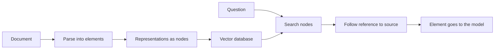

# 03. LlamaIndex: Building a Knowledge Assistant

**Level:** Practitioner · **Reading time:** 13 min · **Exercise:** 90 min
**Prerequisites:** [The Agent Framework Landscape](01-the-agent-framework-landscape.md) (constrained and unconstrained flows)

> **In one sentence:** After this chapter you can build the pipeline that turns messy private documents into a knowledge assistant: parse them, index several representations per element, retrieve the source, and add agent reasoning only where plain retrieval fails.

## Why this matters

You wired a plain **RAG** pipeline, short for retrieval-augmented generation: look up relevant passages and put them into the model's prompt. It covers 200 company PDFs, and pointed questions about body text work. Then an analyst asks: "Compare revenue by region in the 2023 and 2024 annual reports, tables included." The answer is confident and wrong. The tables left the PDFs as scrambled lines, the lookup returned five unrelated chunks, and the model filled the gap. A plain pipeline is also **stateless**: after each question it forgets the conversation.

Jerry Liu's half of the Fall 2024 lecture is about what to add.

## The core idea

A knowledge assistant has four ingredients, in Liu's list ([42:00](https://www.youtube.com/watch?v=OOdtmCMSOo4&t=2520)):

1. A high-quality retrieval pipeline that handles more than text.
2. Outputs beyond a chat reply: a research report, a data analysis, an action.
3. Agent reasoning over the inputs: break the question down, plan, use tools, reflect.
4. Deployment.

The first bounds the rest. In Liu's words, "any LLM or RAG or agent application is only as good as your data processing pipeline" ([44:00](https://www.youtube.com/watch?v=OOdtmCMSOo4&t=2640)).

The analogy is a library. Parsing catalogues the books. Indexing writes the cards. Retrieval fetches a book. The agent is a librarian who makes several trips when a question needs more than one book. The analogy breaks when a card is wrong. A librarian notices that the book is not what the card said. A model does not: it answers from whatever it receives.

Four terms carry the rest of the chapter:

- **Parse.** Turn a document into typed elements: text blocks, tables, figures.
- **Embedding.** A vector (a list of numbers) that a model assigns to a text, placed so that similar meanings get nearby vectors.
- **Vector database.** A store that finds the vectors nearest to a query's embedding.
- **Node.** The unit that gets embedded and indexed. A node can be a piece of a document, or a description that points at one.

## How it works, step by step

### 1. Parse into clean elements

Complex documents contain embedded tables, charts, images, irregular layouts, headers and footers. Off-the-shelf parsers often turn them into broken text, and the model then hallucinates (states things that are not in the source) ([44:00](https://www.youtube.com/watch?v=OOdtmCMSOo4&t=2640)). A parser must return text chunks, tables and diagrams as separate, consistent elements ([46:00](https://www.youtube.com/watch?v=OOdtmCMSOo4&t=2760)). Liu's examples of complex documents: an investor slide deck, an annual financial report, a spreadsheet, a form.

### 2. Create several representations per element

A standard pipeline embeds each element as it is. Liu describes a better way, which he calls hierarchical indexing and retrieval ([48:00](https://www.youtube.com/watch?v=OOdtmCMSOo4&t=2880)):

- For a table, extract several summaries that point at the table.
- For a picture, use a model to write descriptions that point at the picture. A text embedding model cannot read an image.
- For a large text block, extract smaller chunks that point at the block.

Each summary, description or chunk becomes a node.

### 3. Index the nodes

A vector database embeds the nodes and indexes them.

### 4. Retrieve, then dereference

At question time the system retrieves nodes, follows each node's reference back to its source element (a **dereference**, as with a pointer), and puts the element itself in front of the model. For figures this works because leading models are **multimodal**: they accept images as well as text. Text embeddings do the searching; the model sees the table or the picture ([48:00](https://www.youtube.com/watch?v=OOdtmCMSOo4&t=2880)). The other route for images is CLIP embeddings, from a model trained to place images and their captions in one vector space ([50:00](https://www.youtube.com/watch?v=OOdtmCMSOo4&t=3000)).

**Figure 1.** Hierarchical retrieval: the question matches small representations, and each one points back to its source element.



The node is only the way in; the element it points at is what the model answers from.

### 5. Add reasoning only where retrieval fails

Plain RAG returns a fixed number of chunks and never takes the question apart. It fails on four kinds of request: summarization, which needs the whole document; comparison, which needs two or more documents; multi-part questions; and high-level tasks ([52:00](https://www.youtube.com/watch?v=OOdtmCMSOo4&t=3120)).

**Agentic RAG** puts an agent layer above retrieval. The agent treats retrieval as one tool among several, decomposes the question and decides which tools to call ([54:00](https://www.youtube.com/watch?v=OOdtmCMSOo4&t=3240)). Liu sees a spectrum. At the general end: a ReAct-style loop (an agent that alternates reasoning and tool calls) or a system he calls LLM Compiler, which plans a graph of calls ahead of time and replans. Many teams instead compose narrower pieces: tool use, memory, structured output, calls to an existing API, and query decomposition ([54:00](https://www.youtube.com/watch?v=OOdtmCMSOo4&t=3240)).

### 6. Choose constrained or unconstrained on purpose

A constrained flow can be a router prompt (a prompt that picks one option out of several), a tool, a reflection step (a second prompt that checks the draft) and an answer, with no loops. It is less expressive and more reliable. A general agent can solve tasks you did not anticipate. It can also call tools you did not want, repeat itself, never converge and spend far more tokens ([56:00](https://www.youtube.com/watch?v=OOdtmCMSOo4&t=3360)). Liu's rule of thumb for a general agent with the models of the time: four or five tools, and fewer than ten ([58:00](https://www.youtube.com/watch?v=OOdtmCMSOo4&t=3480)).

LlamaIndex's abstraction for both ends is the **workflow**: event-driven steps that pass messages, where a step can be plain Python or a model call ([58:00](https://www.youtube.com/watch?v=OOdtmCMSOo4&t=3480)).

## Worked example

Steps 2 to 4 in plain Python, with no library and no API. The embedding is a stand-in, so the file runs as it is: a node scores higher the more words it shares with the question.

```python
# mini_multimodal_rag.py — index representations, retrieve them, send the source.
import math, re

# Step 1: what the parser hands you: typed elements, each with an ID.
elements = {
    "p7":  {"kind": "table",  "text": "Revenue by region 2024, USD m: North America 410, Europe 260, APAC 190"},
    "p9":  {"kind": "figure", "text": "[image: bar chart, quarterly revenue rising from Q1 to Q4]"},
    "p12": {"kind": "text",   "text": "Revenue recognition follows ASC 606; see the table on page 7."},
}

# Step 2: several small representations per element, each pointing at its source.
nodes = [
    {"id": "n1", "source": "p7",  "text": "2024 revenue split by region"},
    {"id": "n2", "source": "p7",  "text": "North America is the largest market by revenue"},
    {"id": "n3", "source": "p9",  "text": "quarterly revenue grew through 2024"},
    {"id": "n4", "source": "p12", "text": elements["p12"]["text"]},
]

def embed(text):                      # stand-in for a text embedding model
    return set(re.findall(r"[a-z]+", text.lower()))

def similarity(query, text):          # cosine similarity on word presence
    q, t = embed(query), embed(text)
    return len(q & t) / math.sqrt(len(q) * len(t))

def retrieve(question, k=2):          # rank nodes, then follow them to distinct sources
    ranked = sorted(nodes, key=lambda n: similarity(question, n["text"]), reverse=True)
    hits, seen = [], set()
    for node in ranked:
        if node["source"] not in seen:
            seen.add(node["source"])
            hits.append((node["id"], elements[node["source"]]))   # dereference here
        if len(hits) == k:
            return hits

for question in ["Which region earned the most revenue in 2024?",
                 "How did quarterly revenue trend?"]:
    print(question)
    for node_id, source in retrieve(question):
        print("  ", node_id, "->", source["kind"], ":", source["text"][:44])
```

Output:

```
Which region earned the most revenue in 2024?
   n1 -> table : Revenue by region 2024, USD m: North America
   n4 -> text : Revenue recognition follows ASC 606; see the
How did quarterly revenue trend?
   n3 -> figure : [image: bar chart, quarterly revenue rising
   n1 -> table : Revenue by region 2024, USD m: North America
```

Observe three things:

- The first question matched short descriptions (`n1` and `n2` both point at page 7), but what goes to the model is the full table. The description is for finding; the source is for answering.
- The second question reaches a figure through a sentence about it. In a real system you would send the image itself to a multimodal model, not the bracketed text.
- One element can have several entrances. That raises recall (the chance that the right element is found) without storing the element more than once.

In the lecture's terms, this file is still plain retrieval: no agent, no reasoning. Step 5 would wrap `retrieve` in a loop that lets a model call it several times.

## What the practitioners say

Jerry Liu leads LlamaIndex, which he describes as an open-source toolkit for building agents over your data. His half of the lecture is a use case his company works on: a multimodal knowledge assistant ([37:04](https://www.youtube.com/watch?v=OOdtmCMSOo4&t=2224), [38:00](https://www.youtube.com/watch?v=OOdtmCMSOo4&t=2280)).

- **What the assistant is for.** The setting he describes is a company with a million PDFs, slide decks and spreadsheets that wants an interface: a task goes in, an output comes back. A chatbot is the simplest case. The output can also be a structured answer, a research report or an action, such as sending an email, booking a meeting or writing code ([38:00](https://www.youtube.com/watch?v=OOdtmCMSOo4&t=2280)). LlamaIndex, he says, began as an open-source toolkit that helped people build RAG systems and moved on to multi-step reasoning; its enterprise product is a managed service that takes over data indexing and retrieval ([38:00](https://www.youtube.com/watch?v=OOdtmCMSOo4&t=2280)).
- **Why plain RAG is not enough.** It is stateless, and many questions need a memory layer. A chatbot that cannot answer most of what users ask adds little. The "80%" he mentions is a figure of speech, not a measurement ([42:00](https://www.youtube.com/watch?v=OOdtmCMSOo4&t=2520)).
- **Question types.** A bank of PDFs gets pointed questions, multi-document comparisons and longer research tasks, such as turning ten arXiv papers on quantization into a short survey ([46:00](https://www.youtube.com/watch?v=OOdtmCMSOo4&t=2760)).
- **The parser matters.** A bad PDF parser feeds the model text the parser invented, and no model recovers from that. He says their own AI-powered PDF parser had more than 30,000 users at the time, with a free allowance of 1,000 pages a day (as reported in the lecture, September 2024) ([46:00](https://www.youtube.com/watch?v=OOdtmCMSOo4&t=2760)).
- **Beyond the chat reply.** Consultants and other knowledge workers want whole artifacts: a report, a slide deck, code ([52:00](https://www.youtube.com/watch?v=OOdtmCMSOo4&t=3120)).
- **A report-generation architecture.** A researcher agent retrieves and fetches material and stores notes in a data cache. A writer agent turns the cache into interleaved text, image and table blocks. A reviewer may follow ([60:00](https://www.youtube.com/watch?v=OOdtmCMSOo4&t=3600)). [Chapter 05](05-multi-agent-systems-ii-the-llm-era.md) asks when such a division pays off.
- **Customer support.** In his view it is the most common external enterprise use of agents. The gain he names is a higher deflection rate (the share of requests resolved without a person), and a better experience than an automated phone menu ([60:00](https://www.youtube.com/watch?v=OOdtmCMSOo4&t=3600)).
- **From notebook to production.** Start in a notebook. Then give each agent an API, route communication through a central message queue, deploy on Kubernetes, and make human-in-the-loop a service: an agent that needs a person sends a message, waits and resumes. He cites the Devin coding agent, which stops and asks when it lacks clarity ([62:00](https://www.youtube.com/watch?v=OOdtmCMSOo4&t=3720), [64:00](https://www.youtube.com/watch?v=OOdtmCMSOo4&t=3840)).

## Pitfalls

1. **Parsing as an afterthought.** Fix: after parsing, open 20 random pages side by side with the originals before any model sees them.
2. **Embedding only the raw element.** Fix: add several representations per element, each pointing at its source.
3. **Sending the description of a figure instead of the figure.** Fix: dereference, and send the image to a multimodal model.
4. **Plain RAG for summarization or comparison.** Fix: pass the whole document when it fits; otherwise use an agent loop that plans several retrievals. The loop itself is the subject of [planning and search](../02-building-agents/03-planning-search-and-decision-making.md).
5. **A general agent for a fixed task.** Fix: build the constrained flow first and add freedom only for the questions it fails.
6. **Thirty tools on one agent.** Fix: four or five, per Liu's rule of thumb. Good [tool design](../02-building-agents/02-tool-design-and-function-calling.md) removes the need for the rest.
7. **No memory.** Fix: store what was asked and answered, and put the relevant part in the prompt.
8. **No measurement.** Fix: keep 20 questions with known answers, including table and figure questions, and run them after every change, as in [a minimal evaluation harness](../03-evaluation/02-a-minimal-eval-harness.md).

## Try it

Take three pages of a real PDF that include a table and a figure. Start from `mini_multimodal_rag.py`.

1. Parse them into typed elements. Typing them by hand is fine.
2. Write at least two nodes per element, as in the example.
3. Implement `retrieve` with dereferencing.

You are done when a question about the table returns the table element (not its summary), a question about the figure returns the figure element, and a test asserts both.

Stretch goal: add a router prompt that sends comparison questions to a path that retrieves from several documents, and pointed questions to the single-retrieval path. Record accuracy on 20 questions before and after. With a hosted parser and a small model this costs cents; done by hand, it costs nothing.

## Key takeaways

- A knowledge assistant is only as good as its data pipeline: parse, represent, index.
- Store several small representations per element and let each point at its source. Retrieve the representations; send the source.
- Leading models are multimodal, so a figure can be found through text and answered from the image.
- Plain RAG fails on summarization, comparison, multi-part and high-level requests. That is where agentic RAG starts.
- Constrained flows are more reliable and cheaper; general agents are more expressive. Liu's starting point for a general agent: four or five tools.

## Self-check

1. Why write several summaries of a table instead of embedding the table once?
   A. Summaries take less space in the database
   B. A question can match a summary, whose node then leads to the full table
   C. Vector databases cannot index tables
   D. Summaries make parsing unnecessary
2. A user asks about a chart. In Liu's pipeline, what reaches the model?
   A. The chart's text description
   B. The chart's embedding vector
   C. The chart image, found through a node that references it
   D. The five chunks nearest to the question's words
3. Which request is the weakest fit for plain RAG?
   A. A pointed question about one paragraph
   B. A comparison of two reports
   C. The definition of a term in a handbook
   D. The lookup of one policy clause
4. A flow with a router prompt, one tool and a reflection step, and no loops, is which kind in Liu's terms?
   A. Unconstrained
   B. Constrained
   C. A ReAct loop
   D. A compiler plan
5. What rule of thumb did Liu give for the number of tools on a general agent?
   A. As many as fit in the prompt
   B. About four or five, and fewer than ten
   C. Exactly one
   D. One agent per tool

<details><summary>Show answers</summary>

1. B. The summaries are entrances; the table is what the model answers from.
2. C. Text finds the node; the node references the image; the image goes to a multimodal model.
3. B. Comparison needs several documents and a plan, which a fixed number of chunks does not provide.
4. B. People wrote the control flow; the model only picks an option.
5. B. He said four or five tools, and fewer than ten, with the models available then.

</details>

## Sources

- **Lecture:** Jerry Liu, "Agentic AI Frameworks & AutoGen + Building a Multimodal Knowledge Assistant" (second half), UC Berkeley LLM Agents MOOC (Fall 2024): [video](https://www.youtube.com/watch?v=OOdtmCMSOo4), used at [the setting](https://www.youtube.com/watch?v=OOdtmCMSOo4&t=2280), [four ingredients](https://www.youtube.com/watch?v=OOdtmCMSOo4&t=2520), [data pipeline](https://www.youtube.com/watch?v=OOdtmCMSOo4&t=2640), [parsing](https://www.youtube.com/watch?v=OOdtmCMSOo4&t=2760), [representations and dereferencing](https://www.youtube.com/watch?v=OOdtmCMSOo4&t=2880), [multimodal RAG](https://www.youtube.com/watch?v=OOdtmCMSOo4&t=3000), [agentic RAG](https://www.youtube.com/watch?v=OOdtmCMSOo4&t=3120), [constrained flows](https://www.youtube.com/watch?v=OOdtmCMSOo4&t=3360), [tool rule of thumb](https://www.youtube.com/watch?v=OOdtmCMSOo4&t=3480), [report generation](https://www.youtube.com/watch?v=OOdtmCMSOo4&t=3600), [production](https://www.youtube.com/watch?v=OOdtmCMSOo4&t=3720)

## Next

→ [Multi-Agent Systems I: Games and Self-Play](04-multi-agent-systems-i-games-and-self-play.md), which steps back to ask what a population of agents can produce that one agent cannot.
