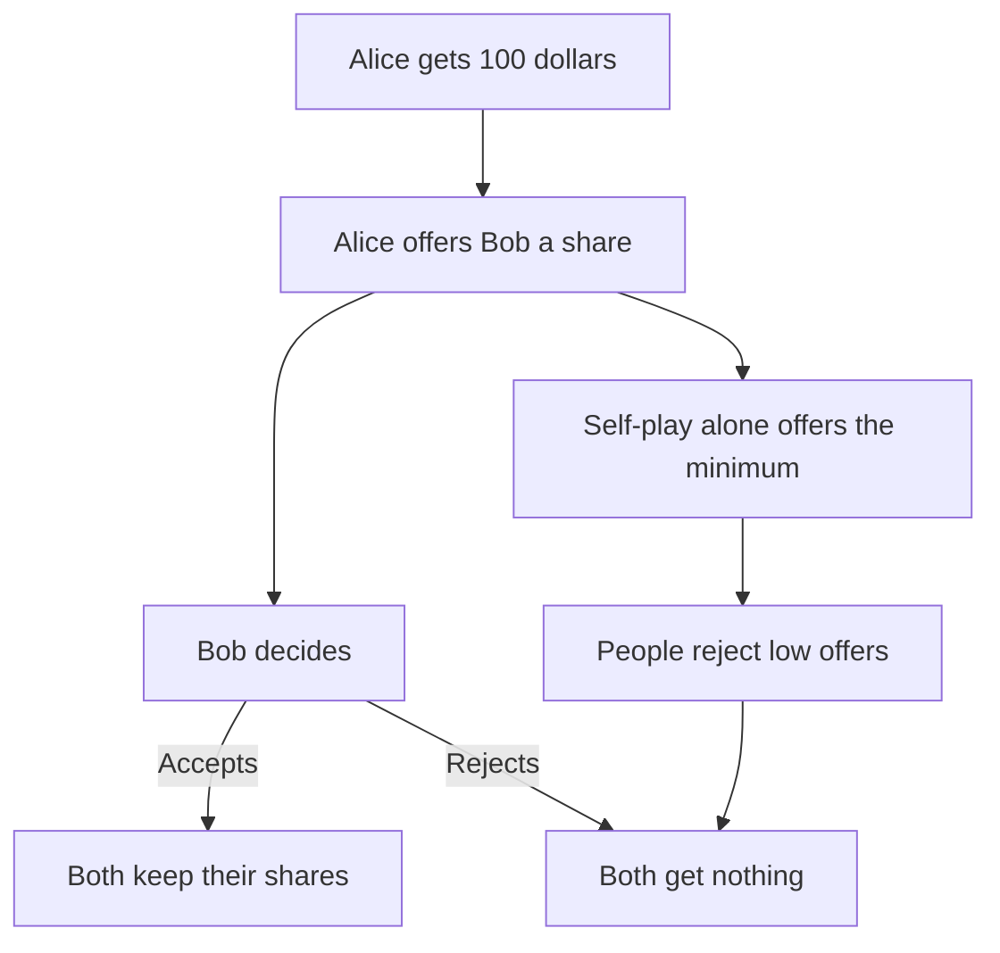

# 04. Multi-Agent Systems I: Games and Self-Play

**Level:** Practitioner · **Reading time:** 13 min · **Exercise:** 45 min
**Prerequisites:** [From Base Model to Assistant: Post-Training](../01-foundations/03-from-base-model-to-assistant-post-training.md) (the words pre-training, post-training and chain of thought)

> **In one sentence:** After this chapter you can say when a population of agents finds an unbeatable strategy on its own, when it cannot, and why human data is unavoidable when the goal is cooperation with people.

## Why this matters

You read that a lab trained a model by making it "play against itself". A vendor says its agents "debate each other and get better". Both claims rest on self-play. Does the trick that beat the world at Go and poker carry over to agents that must talk and cooperate?

Noam Brown's answer in his Fall 2025 lecture is narrow. It carries over exactly for two-player, zero-sum games, and very little beyond them.

## The core idea

**Self-play** is training in which an agent improves by playing against copies of itself. It can start from a completely random strategy ([8:00](https://www.youtube.com/watch?v=SrLcGdVOb9w&t=480)). In a two-player, **zero-sum** game (one player's gain is the other's loss), a self-play method that is **sound**, Brown's term for one that provably converges, is guaranteed to reach a **minimax equilibrium**: a set of strategies in which no player can profit by switching strategy alone. Playing it guarantees that you will not lose in expectation ([4:00](https://www.youtube.com/watch?v=SrLcGdVOb9w&t=240), [10:00](https://www.youtube.com/watch?v=SrLcGdVOb9w&t=600)).

The analogy is a ladder with one top rung. Whatever the opponent does, one place is best, and self-play climbs there without any human data. The analogy breaks as soon as the game is not two-player and zero-sum. Then the best strategy depends on who else is playing, and the ladder has many tops.

Three terms carry the argument. A **strategy** is a rule, possibly random, that picks actions. A **best response** is the strategy that scores highest against a given opponent strategy. **Exploitability** is how much you lose to a best response: zero at the equilibrium.

## How it works, step by step

Brown builds his argument in six steps.

### 1. "Who is the better poker player?" has two answers

One answer: the player who wins head-to-head against anyone over a large sample, the minimax equilibrium. The other: the player who earns the most money, which Brown calls a **population best response**, the best strategy against the mix of people actually playing. In chess and Go they coincide. In poker they can differ ([2:00](https://www.youtube.com/watch?v=SrLcGdVOb9w&t=120)).

### 2. Measure the distance from the top

If you always throw rock, the best response is always paper and your exploitability is 1. The measure assumes the opponent knows your strategy, but not the outcome of your random choices ([4:00](https://www.youtube.com/watch?v=SrLcGdVOb9w&t=240), [6:00](https://www.youtube.com/watch?v=SrLcGdVOb9w&t=360)).

### 3. Why self-play is almost free in two-player zero-sum games

Any sound self-play converges, so no human data is needed. Given enough memory and compute, any finite two-player zero-sum game can be solved that way ([10:00](https://www.youtube.com/watch?v=SrLcGdVOb9w&t=600)). In **perfect-information** games, where both players see everything, self-play looks much like ordinary **reinforcement learning** (learning by trial and reward). In practice a neural network only approximates the equilibrium, and finding an exploit is easier than defending against one ([12:00](https://www.youtube.com/watch?v=SrLcGdVOb9w&t=720)).

### 4. Hidden information changes the problem

In games with **imperfect information**, such as poker, the agent must learn with what probability to play each action, not only which action. Brown's example: change the payoffs of paper and scissors to +2 and −2, and PPO, a standard reinforcement-learning algorithm, stops converging to the equilibrium ([12:00](https://www.youtube.com/watch?v=SrLcGdVOb9w&t=720)). Older algorithms still work:

- **Fictitious play.** Each player picks a best response to the opponent's average play so far. The average of all iterations converges ([18:00](https://www.youtube.com/watch?v=SrLcGdVOb9w&t=1080)).
- **Regret matching and hedge.** They pick regularized best responses (not always the single best action: each action gets a probability in proportion to how well it scores) and converge faster ([20:00](https://www.youtube.com/watch?v=SrLcGdVOb9w&t=1200)).

Regret matching powered Libratus, Brown's poker agent, against four leading professionals at heads-up no-limit Texas Hold'em: 120,000 hands over 20 days in January 2017, trained from self-play, without deep neural networks (as reported on his slides).

### 5. Where language becomes useful

So far, no language model. There is a reason. In a two-player zero-sum equilibrium, **cheap talk** (communication that costs nothing and binds nobody) is useless. A message either raises the sender's expected value, in which case the opponent ignores it, or lowers it, in which case the sender keeps quiet ([22:33](https://www.youtube.com/watch?v=SrLcGdVOb9w&t=1353), [24:00](https://www.youtube.com/watch?v=SrLcGdVOb9w&t=1440)).

### 6. Cooperation needs human data

Brown's central claim, which he calls spicy: if the goal is to learn to cooperate with humans, avoiding human data is a dead end ([25:33](https://www.youtube.com/watch?v=SrLcGdVOb9w&t=1533)). He demonstrates it with the **ultimatum game**. Alice gets $100 and offers Bob any part of it. If Bob accepts, both keep their shares. If he rejects, both get nothing ([26:00](https://www.youtube.com/watch?v=SrLcGdVOb9w&t=1560)). People in the audience rejected low offers, and Brown says people commonly accept 20 to 30 percent. He adds that the threshold is cultural: in some groups 20 percent is fine, in others anything below half is refused ([28:00](https://www.youtube.com/watch?v=SrLcGdVOb9w&t=1680), [32:00](https://www.youtube.com/watch?v=SrLcGdVOb9w&t=1920)).

Brown answers the second question he put to the audience. The intuitive optimum, he says, is that Alice offers the smallest amount possible, a dollar or a fraction of a penny, and Bob accepts, because a small positive amount beats zero for anything that maximizes reward. Deployed among people, that would be a terrible strategy: few would accept a dollar. One response is to say that the humans are broken and the algorithm is fine. He rejects it: if what you care about is doing well in this game with humans, pure self-play is the wrong tool. He also warns against a rabbit hole he has watched researchers enter: change the game, for example into a repeated game with a reputation, until the offers look human. It may work here, he says, and fail in more complicated settings ([30:00](https://www.youtube.com/watch?v=SrLcGdVOb9w&t=1800), [32:00](https://www.youtube.com/watch?v=SrLcGdVOb9w&t=1920)).

**Figure 1.** The ultimatum game: self-play alone ends at the offer that people reject.



Self-play alone counts on Bob's taking any positive amount; with people he does not, so the agent needs human data to learn where the threshold lies.

### The Diplomacy experiment

Diplomacy is a seven-player game whose object is to control a majority of a map of Europe, introduced in the 1950s and, Brown notes, reportedly a favorite of John F. Kennedy and Henry Kissinger. Each turn has about 15 minutes of private natural-language negotiation, then simultaneous moves, which make trust and betrayal part of the game ([32:00](https://www.youtube.com/watch?v=SrLcGdVOb9w&t=1920), [34:00](https://www.youtube.com/watch?v=SrLcGdVOb9w&t=2040)). The tactics are simple; the difficulty is negotiation ([32:00](https://www.youtube.com/watch?v=SrLcGdVOb9w&t=1920)). A slide of his sums up the mechanics: one against one fails, two against one succeeds.

- **Self-play alone.** DORA, an earlier agent of his team, learned no-press Diplomacy (the game without messages) from scratch, much as Alpha Zero learned chess. In a two-player version of the game it was clearly superhuman; a slide reports an 86.5% ± 6.1% win rate against human experts. Among seven players it broke down. One SearchBot, a rival agent trained on human data, against six DORA copies won about 1% of the games. One DORA against six SearchBots won 11%. Seven equal players each win one game in seven, about 14%, so in each case the lone agent lost to the six others ([36:00](https://www.youtube.com/watch?v=SrLcGdVOb9w&t=2160)).
- **Why that matters.** Brown reads the result as two different equilibria. DORA found one that works among copies of itself. In a two-player zero-sum game this cannot happen: two agents that each reached the equilibrium do well against each other, however they were trained. Outside those games, he says, the minimax equilibrium is no longer useful, and the population best response is what remains. The question is then who the population is: copies of yourself, or humans. Either way you need data on that population. That is why, if you care about performance with humans, you need human data ([38:00](https://www.youtube.com/watch?v=SrLcGdVOb9w&t=2280)).
- **Brown's recipe**, which he recommends for games that are not two-player zero-sum ([40:02](https://www.youtube.com/watch?v=SrLcGdVOb9w&t=2402)):
  1. Gather plenty of human games and fit an **imitation model** to them, so that it plays as those humans would.
  2. Scale inference-time compute to model those humans better, not to beat them.
  3. Scale reinforcement learning with the imitation models in the environment.
- **Results.** In no-press Diplomacy, Diplodocus, trained this way, placed first in a 200-game human tournament with 50 games per bot. For the full game with language, CICERO entered an online league anonymously: top 10% of players, second among the 19 who played at least five games, and more than twice the average human score. Brown attributes the second place to the quality of language models in late 2022 ([40:00](https://www.youtube.com/watch?v=SrLcGdVOb9w&t=2400), [42:00](https://www.youtube.com/watch?v=SrLcGdVOb9w&t=2520)). In the no-press tournament DORA, he says, did poorly, below the average human. The same recipe was applied to Hanabi, a cooperative card game on which many papers try to achieve cooperation with humans: a 2022 paper of his group, he says, beat expert humans at cooperating with a wide range of human players ([42:00](https://www.youtube.com/watch?v=SrLcGdVOb9w&t=2520)).

Planning and reasoning about other minds enter here. Brown does not cover it, and his slides carry no architecture details. In the published CICERO design, a strategic planner represents what the other players seem to intend, and the language model writes messages consistent with those intentions. That is theory of mind in its plain sense: reasoning about what others believe and want.

## Worked example

Fictitious play on rock-paper-scissors, in about 25 lines. Two identical players, no human data, no model.

```python
# fictitious_play_rps.py — self-play that finds the minimax strategy.
WINS = {("R", "S"), ("P", "R"), ("S", "P")}    # (winner, loser) pairs
ACTIONS = "RPS"

def payoff(action, opponent):               # +1 win, -1 loss, 0 tie
    if (action, opponent) in WINS:
        return 1
    if (opponent, action) in WINS:
        return -1
    return 0

def best_response(counts):                  # against the opponent's average play so far
    return max(ACTIONS, key=lambda a: (sum(payoff(a, b) * n for b, n in counts.items()),
                                       -counts[a]))        # ties: least-played action

def exploitability(counts):                 # expected loss per round against a best response
    br = best_response(counts)
    return -sum(payoff(b, br) * n for b, n in counts.items()) / sum(counts.values())

counts = {a: 0 for a in ACTIONS}
for iteration in range(1, 2001):
    counts[best_response(counts)] += 1      # each player best-responds to the average so far
    if iteration in (1, 2, 3, 4, 10, 100, 2000):
        total = sum(counts.values())
        share = {a: round(n / total, 3) for a, n in counts.items()}
        print(f"{iteration:5} {share}  exploitability {exploitability(counts):.3f}")
```

Output:

```
    1 {'R': 1.0, 'P': 0.0, 'S': 0.0}  exploitability 1.000
    2 {'R': 0.5, 'P': 0.5, 'S': 0.0}  exploitability 0.500
    3 {'R': 0.333, 'P': 0.667, 'S': 0.0}  exploitability 0.333
    4 {'R': 0.25, 'P': 0.5, 'S': 0.25}  exploitability 0.250
   10 {'R': 0.4, 'P': 0.3, 'S': 0.3}  exploitability 0.100
  100 {'R': 0.34, 'P': 0.33, 'S': 0.33}  exploitability 0.010
 2000 {'R': 0.334, 'P': 0.334, 'S': 0.333}  exploitability 0.001
```

Observe:

- The first four rows are the ones on Brown's slide ([18:00](https://www.youtube.com/watch?v=SrLcGdVOb9w&t=1080)): all rock, then half rock, then a third rock, then a quarter rock.
- No single iteration's play is balanced. Only the *average* converges, and slowly, which is why Brown says it converges very, very slowly ([18:00](https://www.youtube.com/watch?v=SrLcGdVOb9w&t=1080)).
- Exploitability falls steadily. That is the "distance from the top rung" made into a number.

## What the practitioners say

Brown, at OpenAI, opens with the **AlphaGo analogy**. AlphaGo and language models followed the same first two steps: learn from high-quality human data, then spend more compute at inference time (a tree search for AlphaGo, chain of thought for models). The third step, recursive self-improvement through self-play, exists in the games and not yet in language models. His explanation, stated as his takeaway: people's intuitions about self-play are overfitted to Go and chess, two-player zero-sum games with perfect information ([0:00](https://www.youtube.com/watch?v=SrLcGdVOb9w&t=0)).

He is candid about the limits of the old algorithms. Fictitious play, regret matching and hedge perform poorly in single-agent settings, they start from an arbitrary strategy and they converge slowly. He points to newer algorithms, which his slides call last-iterate, that work well in both settings and converge quickly; he expects them to be the future and calls the area one of rapid development ([18:00](https://www.youtube.com/watch?v=SrLcGdVOb9w&t=1080), [22:00](https://www.youtube.com/watch?v=SrLcGdVOb9w&t=1320)).

Everything in the lecture is about training. The agents that talk, negotiate and exploit are training partners for one policy that later plays alone.

### What transfers to LLM systems, and what does not

The lecture does not say this; it is the authors' engineering judgment.

| Lesson from the lecture | What it means for an LLM system |
|---|---|
| A fixed opponent is a weak test: finding an exploit is easier than defending against it | Add an adaptive adversary to your tests, one that changes tactics after each failure |
| Self-play needs a signal that says who won | Without a verifier or a measurable reward, a "self-improving" agent loop has nothing to improve on |
| Cheap talk is useless in zero-sum equilibrium | Two of your own agents in a strictly opposed framing gain nothing from negotiating |
| Cooperation with people needs human data | Behavior that must match human norms (fairness, tone, culture) comes from examples of people, not from agents imitating each other |
| Everything here is training-time | None of it justifies several agents at run time. That question is [chapter 05](05-multi-agent-systems-ii-the-llm-era.md). |

## Pitfalls

1. **Assuming self-play generalizes.** It provably converges only in two-player zero-sum games. Fix: name the game before you trust the method.
2. **Reading minimax as "best against real people".** That is the population best response, which needs data about those people. Fix: test on the real population.
3. **Expecting talk to help in an opposed setting.** Fix: remove the conversation, or change the setting so that commitments can bind.
4. **Expecting agents that imitate each other to learn human norms.** Fix: put human examples in the loop.
5. **Confusing training-time with run-time multi-agent systems.** Fix: ask which one a claim refers to before you reuse the idea.
6. **No verifier.** Fix: build the automatic check first; see [evaluating capabilities and risks](../03-evaluation/06-evaluating-capabilities-and-risks.md).
7. **Testing only against fixed cases.** Fix: add an adversary, as in [threat modeling for agents](../04-safety-and-security/01-threat-modeling-llm-applications-and-agents.md).

## Try it

Run the script as it is. Then make two changes and keep a table of exploitability at iterations 1, 10, 100 and 2,000.

1. Add a fourth action `D` that beats rock, paper and scissors: add it to `ACTIONS` and add its three pairs to `WINS`.
2. Replace the second player with an opponent that always throws rock for the first 100 iterations and from then on best-responds to your average. Print your win rate and your exploitability at iterations 100, 200, 500 and 2,000.

You are done when the table covers all three runs and you can explain two things. In the second run, the current play is the dominant action from the third iteration on, yet exploitability at iteration 2,000 is still about 0.001. In the third run, the strategy that beat the fixed opponent is the most exploitable one once the opponent adapts.

Stretch goal: implement regret matching for the first game and compare the exploitability curves.

## Key takeaways

- In two-player zero-sum games, sound self-play converges to the minimax equilibrium with no human data. Nowhere else does that guarantee hold.
- Exploitability measures the distance to that equilibrium.
- Hidden information requires learning probabilities over actions; fictitious play and regret matching do it.
- Language is useless in a two-player zero-sum equilibrium. It matters where cooperation matters.
- To cooperate with people, Brown's recipe is human data, an imitation model, then reinforcement learning with those models in the environment.

## Self-check

1. In which setting does sound self-play provably converge to the minimax equilibrium?
   A. Any game with two agents
   B. Two-player zero-sum games
   C. Any cooperative game
   D. Any game with a language model in it
2. What does exploitability measure?
   A. How often the agent loses against its own copy
   B. The expected loss against a best response
   C. The number of actions that get positive probability
   D. The rating gap between two players
3. Why is cheap talk useless in a two-player zero-sum equilibrium?
   A. Messages would cost tokens
   B. A message that helps its sender is ignored; one that hurts is not sent
   C. Equilibria forbid communication by definition
   D. The players cannot see each other
4. What sets a population best response apart from a minimax equilibrium?
   A. It is the best strategy against the players actually present
   B. It needs no data about players
   C. The two are identical in poker
   D. It is always the weaker strategy
5. In Brown's Diplomacy recipe, what takes part in the environment during reinforcement learning?
   A. Copies of the final agent
   B. Frozen game engines only
   C. Human imitation models
   D. A larger language model

<details><summary>Show answers</summary>

1. B. The guarantee holds for two-player zero-sum games; Brown gives none beyond them.
2. B. It is zero at the equilibrium.
3. B. The opponent can ignore anything helpful to you.
4. A. It is defined against a population, so it requires data about that population.
5. C. Imitation models of people stand in for the human players.

</details>

## Sources

- **Lecture:** Noam Brown, "Multi-Agent AI", UC Berkeley Agentic AI MOOC (Fall 2025): [video](https://www.youtube.com/watch?v=SrLcGdVOb9w), used at [AlphaGo analogy](https://www.youtube.com/watch?v=SrLcGdVOb9w&t=0), [two answers](https://www.youtube.com/watch?v=SrLcGdVOb9w&t=120), [exploitability](https://www.youtube.com/watch?v=SrLcGdVOb9w&t=240), [self-play](https://www.youtube.com/watch?v=SrLcGdVOb9w&t=600), [imperfect information](https://www.youtube.com/watch?v=SrLcGdVOb9w&t=720), [fictitious play](https://www.youtube.com/watch?v=SrLcGdVOb9w&t=1080), [central claim](https://www.youtube.com/watch?v=SrLcGdVOb9w&t=1533), [ultimatum game](https://www.youtube.com/watch?v=SrLcGdVOb9w&t=1560), [self-play optimum](https://www.youtube.com/watch?v=SrLcGdVOb9w&t=1800), [Diplomacy](https://www.youtube.com/watch?v=SrLcGdVOb9w&t=1920), [DORA experiment](https://www.youtube.com/watch?v=SrLcGdVOb9w&t=2160), [why human data](https://www.youtube.com/watch?v=SrLcGdVOb9w&t=2280), [CICERO results](https://www.youtube.com/watch?v=SrLcGdVOb9w&t=2400), [Hanabi](https://www.youtube.com/watch?v=SrLcGdVOb9w&t=2520)
- **Reading:** Anton Bakhtin, David Wu, Adam Lerer, Noam Brown, "Mastering the Game of No-Press Diplomacy via Human-Regularized Reinforcement Learning and Search" (NeurIPS 2021): [arXiv](https://arxiv.org/abs/2210.05492). Allan Dafoe et al., "Cooperative AI: machines must learn to find common ground" (Nature comment, 2021), cited on the lecture's slides.

## Next

→ [Multi-Agent Systems II: The LLM Era](05-multi-agent-systems-ii-the-llm-era.md), which separates training-time from run-time multi-agent systems and answers when several LLM agents beat one.
