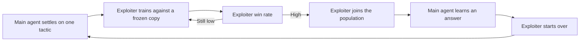

# 05. Multi-Agent Systems II: The LLM Era

**Level:** Practitioner · **Reading time:** 19 min · **Exercise:** 90 min
**Prerequisites:** [Multi-Agent Systems I: Games and Self-Play](04-multi-agent-systems-i-games-and-self-play.md)

> **In one sentence:** After this chapter you can decide, with a measured reason, whether a second LLM agent earns its cost for a given task.

## Why this matters

Your team proposes a three-agent design for a coding task: a planner, a coder and a reviewer, each a full model call per step. Early runs look better. The bill is about three times higher, each step takes about three times as long, and nobody can say whether the gain comes from the extra agents or from the better prompts that came with them.

The question of this chapter: when do several agents beat one?

## The core idea

Three different things are called "multi-agent". They have different costs and different evidence.

| Meaning | What happens | What you ship |
|---|---|---|
| Training-time | A population trains or selects one agent: self-play, a league of agents and exploiters | One agent |
| Test-time sampling | Several answers are sampled in parallel and one is kept: best-of-N, consensus | One agent, run N times |
| Run-time collaboration | Role-specialized agents exchange messages while doing the task | A system of agents |

Oriol Vinyals's lecture is about the first kind. Noam Brown's is about the first two, with a short look at the third. Product teams spend most of their money on the third, and the two lectures say least about it. Keep the three apart: evidence for one does not transfer to the others.

What run-time collaboration buys, in engineering terms, is **separate contexts**. Each agent has its own context window (the text a model can consider in one call) and its own instructions. That gives you:

1. Smaller, cleaner prompts. The coder does not carry the rubric the reviewer needs.
2. Different tools and permissions for each role.
3. A second look with different information. The reviewer can run the tests.
4. Parallelism. Workers read separate documents at once.

What it costs: tokens and latency grow with agents times turns. Information is lost at each handoff. Errors compound along a chain. Every hop is another place for an injection attack. Evaluation gets harder.

## How it works, step by step: a decision procedure

1. Build the single-agent baseline with the best tools and prompt you can write.
2. Measure it on at least 20 cases: success, tokens, latency.
3. Check the four reasons. Several agents can beat one when at least one holds:
   - The work splits into independent parts.
   - The contexts do not fit together, or the roles need different tools and permissions.
   - One agent can check another's output with information the other lacked.
   - A known, measurable failure mode can be attacked by an adversary you control.
4. Pick the smallest pattern that fits (table below).
5. Cap it: number of agents, number of turns, tokens.
6. Run the 20 cases again. Adopt the design only if the gain passes a rule you set beforehand.

| Pattern | Use it when | Avoid it when |
|---|---|---|
| Generator and critic | The critic brings new information: tests, a rubric, retrieval | The critic is the same model rereading the same context |
| Router with specialists | Tasks fall into a few types that need different tools; one path runs per task | Every task needs all the skills at once |
| Parallel workers and a synthesizer | The input splits: many files, many papers | The parts depend on each other |
| Handoffs | Skills or permissions differ, and one agent is active at a time | The handoff loses state the next agent needs |
| Debate with a judge | The answer can be checked, and disagreement surfaces reasons | The judge has no ground truth |
| Best-of-N with a checker | Correctness is cheap to check, as with code that passes tests | Judging is as hard as solving |

Neither lecture covers debate. From general engineering experience it helps where the judge can verify; the judge's weaknesses are the subject of [LLM as a judge](../03-evaluation/03-llm-as-a-judge-and-rubrics.md). The router is Liu's constrained flow from [chapter 03](03-llamaindex-knowledge-assistants.md), and the roles are the conversational peers of [chapter 02](02-autogen-conversation-programming.md).

## Worked example

Before any quality question, count. The harness below sends the same 50 tasks through one agent and through a planner-coder-reviewer trio. The model is a stub that counts calls and words.

```python
# bakeoff.py — what do a second and third agent cost? Count calls and time.
import time

class Meter:
    def __init__(self):
        self.calls, self.words, self.seconds = 0, 0, 0.0
    def llm(self, prompt):                       # stand-in for a real model call
        started = time.perf_counter()
        time.sleep(0.01)
        self.calls += 1
        self.words += len(prompt.split())
        self.seconds += time.perf_counter() - started
        return "answer"

def single(task, m):
    return m.llm(f"Solve: {task}")

def trio(task, m):                               # planner, coder, reviewer
    plan = m.llm(f"Plan: {task}")
    draft = m.llm(f"Code from plan: {plan}")
    return m.llm(f"Review and finalize: {draft}")

tasks = ["sort a list in Rust", "parse a date string"] * 25
for name, design in [("single", single), ("trio", trio)]:
    m = Meter()
    for task in tasks:
        design(task, m)
    print(f"{name:6} calls {m.calls:4}  words {m.words:5}  "
          f"{m.seconds / len(tasks):.2f} s per task")
```

Output on one machine (the seconds vary; the stand-in sleeps 10 ms per call):

```
single calls   50  words   275  0.01 s per task
trio   calls  150  words   675  0.04 s per task
```

Observe:

- Three agents made three times the calls, and the calls run one after another, so latency triples too.
- Words grew faster than calls: more than double. Each later prompt carries the previous agent's output.
- The harness says nothing about quality. That needs a checker on real cases, as in [a minimal evaluation harness](../03-evaluation/02-a-minimal-eval-harness.md).

The scaling is the same outside the toy. In a June 2025 engineering report on its multi-agent research system, Anthropic wrote that agentic search used about four times the tokens of a chat, and the multi-agent system about fifteen times. Cognition, the company behind Devin, published an engineering note the same month arguing against splitting a task across agents, because each agent makes decisions the others cannot see. Brown recommends both notes as worth reading ([52:00](https://www.youtube.com/watch?v=SrLcGdVOb9w&t=3120)). Those are practitioners' reports on their own systems, not measurements you can copy. They bracket the trade: separate contexts buy focus and parallelism, and they cost tokens and shared understanding.

## What the practitioners say

### Vinyals: why a population helps, at training time

- **Why games.** Reporters in the early days, he recalls, saw no use for game-playing in the real world. His answer is a timeline, which he says he maps fairly imperfectly. Games were a sandbox: a place to try ideas and to grow neural networks to a large scale. Each major project on the timeline passed algorithms or lessons to the next. StarCraft was followed by early work on coding, then the first DeepMind language models (Chinchilla among them), vision-language models (Flamingo, Gato) and AlphaFold, which drew, in his account, on transformers and on distilling data. Today, he says, research and resources are concentrated on a single very large project, Gemini; he co-leads it on the technical side, and the goal is a system as general as possible. A game is now one ability among many ([11:51](https://www.youtube.com/watch?v=ntjOxjZMaac&t=711)).
- **Why StarCraft was hard.** He describes it as chess in which you do not see the whole board: the game is partially observable, it runs in real time, and the action space mixes strategy with the control of single units. AlphaStar trained one neural network to issue every command and reached grandmaster status, which he puts at about the top 100 players per region ([6:00](https://www.youtube.com/watch?v=ntjOxjZMaac&t=360), [8:00](https://www.youtube.com/watch?v=ntjOxjZMaac&t=480)).
- **Imitation first.** Reinforcement learning alone did not get far. A random policy (a rule that picks actions) achieves little. It did find a way to beat the hardest built-in AI, by sending all its workers to attack, which works until an opponent defends it. So the team used human games: more than one million replays, which they released, plus metadata about what the players built, given to the network as a conditioning signal (an extra input that tells it which style to play). He calls that a little like cheating, because it uses information from the end of the game. He compares it to prompting: tell the agent which units to build, or to play like a professional or a novice. His listed differences from LLMs: about 5 billion training tokens against more than a trillion, and instructions encoded as vectors, not language ([20:00](https://www.youtube.com/watch?v=ntjOxjZMaac&t=1200), [22:00](https://www.youtube.com/watch?v=ntjOxjZMaac&t=1320), [24:00](https://www.youtube.com/watch?v=ntjOxjZMaac&t=1440)).
- **Non-transitivity.** Strength is one axis, measured by Elo (a rating in which a fixed gap means a fixed win chance) or by a leaderboard score. Within one slice of strength, agents can beat each other in cycles, as in rock-paper-scissors. Three models at the same score may each beat the next. Weak agents are highly non-transitive; at the very top a dominant strategy appears ([38:00](https://www.youtube.com/watch?v=ntjOxjZMaac&t=2280)).
- **A cycle from the game.** His concrete case is three StarCraft units. A Void Ray is an air unit. An Immortal is a strong ground unit that cannot attack air. A Stalker can attack air. Void Ray beats Immortal, Immortal beats Stalker and Stalker beats Void Ray. In early training, plain self-play started from human games and drifted until every policy built Void Rays. It played well against itself and, since its games held only Void Rays, no longer met Stalkers or any other strategy; he calls the agent delusional ([42:00](https://www.youtube.com/watch?v=ntjOxjZMaac&t=2520), [44:00](https://www.youtube.com/watch?v=ntjOxjZMaac&t=2640)). Naive self-play in rock-paper-scissors moves the same way, he says: it oscillates around the center and is at each moment strong on one pure strategy, which makes convergence hard ([40:00](https://www.youtube.com/watch?v=ntjOxjZMaac&t=2400)).
- **Kinds of attack.** An adversarial attack is specific to one network's weights. An **exploiter** is specific to one opponent. **Cheese**, a cheap trick that wins if the opponent is unprepared, tends to generalize. He suggests that weaknesses shared by many companies' models, such as miscounting letters in "strawberry", may be cheese ([36:00](https://www.youtube.com/watch?v=ntjOxjZMaac&t=2160)).
- **The AlphaStar League.** Main agents play against everyone. Main exploiters train in secret against frozen main agents and show themselves only once their win rate is high; then they start over. League exploiters try to beat the whole population. He reports the order of gains: main agents alone reach a certain strength, adding main exploiters made the system much stronger, and adding league exploiters gave the final system, robust against many strategies ([46:00](https://www.youtube.com/watch?v=ntjOxjZMaac&t=2760), [50:00](https://www.youtube.com/watch?v=ntjOxjZMaac&t=3000)). He warns that the gaps he showed were probably smaller than in reality.
- **Why the exploiter works.** The exploiter is the key idea of the league, he says, and the setup is asymmetric. If the main agent settles on Void Rays, a second agent is added whose only goal is to beat it. The exploiter learns from their games; the main agent at that point does not. The exploiter naturally starts building Stalkers, so the main agent must learn an answer, such as building Immortals ([44:00](https://www.youtube.com/watch?v=ntjOxjZMaac&t=2640)).
- **Matchmaking.** The main agent can play the opponent that beats it most, or the one near a 50% win rate; the second gave slightly lower variance. Telling exploiters to attack with a given unit type added robustness ([52:00](https://www.youtube.com/watch?v=ntjOxjZMaac&t=3120)).
- **Alone, a policy collapses.** Plain reinforcement learning on the imitated policy gave a small boost, and the variety of play tended to collapse. A penalty that keeps the policy close to the imitation policy lifted the rating by about 400 Elo, and conditioning on a desired style added almost 150 more (as stated in the lecture) ([28:00](https://www.youtube.com/watch?v=ntjOxjZMaac&t=1680)).
- **What differs for LLMs.** "users are in general collaborative", he says, not zero-sum, though adversarial users exist ([54:00](https://www.youtube.com/watch?v=ntjOxjZMaac&t=3240)). Rewards cannot be fully specified ([28:00](https://www.youtube.com/watch?v=ntjOxjZMaac&t=1680)); "write me a nice poem" is his example ([30:00](https://www.youtube.com/watch?v=ntjOxjZMaac&t=1800)), and prompts are unbounded ([56:00](https://www.youtube.com/watch?v=ntjOxjZMaac&t=3360)).
- **His forecast.** LLM post-training is in its infancy next to AlphaStar: thousands of training steps, he says, against 10 to the 10th in the AlphaStar League. He expects a scalability breakthrough in multi-agent reinforcement learning within a few years ([58:00](https://www.youtube.com/watch?v=ntjOxjZMaac&t=3480)).

**Figure 1.** The exploiter loop in the AlphaStar League: the exploiter trains in secret, then joins the population.



Each round leaves the main agent with an answer to one more tactic, which is how the league builds robustness.

### Brown: what parallel sampling buys

- **Why thinking time matters.** Brown's motivation is the rise of the reasoning models: the longer such a model thinks, the better it performs, and each newer version needs less thinking for the same performance ([42:55](https://www.youtube.com/watch?v=SrLcGdVOb9w&t=2575)). On his plot of competitive programming, a model from early 2022 sits below the fifth percentile of contestants and one from mid-2024 at the 10th. The reasoning models follow: above the median in September 2024, above the 90th percentile about three months later and above the 99th in April 2025, and he reports a first place among the human contestants in a leading contest. The models can probably think for about 15 or 20 minutes, he says, depending on the problem ([44:00](https://www.youtube.com/watch?v=SrLcGdVOb9w&t=2640)). He asks whether a model could think for hours, days or weeks ([46:00](https://www.youtube.com/watch?v=SrLcGdVOb9w&t=2760)).
- **Latency.** Chain of thought is serial, so latency eventually becomes a bottleneck. best-of-N (sample several answers and keep the one that passes a check) and consensus (keep the most common answer) are parallel: lower latency, less compute-efficient ([46:00](https://www.youtube.com/watch?v=SrLcGdVOb9w&t=2760), [48:00](https://www.youtube.com/watch?v=SrLcGdVOb9w&t=2880)).
- **Best-of-N needs a checker.** In many ways it works better than consensus, but it needs a problem whose solution is easy to verify ([48:00](https://www.youtube.com/watch?v=SrLcGdVOb9w&t=2880)).
- **Diversity.** Use the best model for the particular query. He argues that routing is already a form of multi-agent AI: a model looks at the query and hands it to the model best suited to it. His analogy: nobody multiplies 15-digit numbers by hand, so a model should use a calculator ([48:00](https://www.youtube.com/watch?v=SrLcGdVOb9w&t=2880), [50:00](https://www.youtube.com/watch?v=SrLcGdVOb9w&t=3000)).

### Brown: on run-time collaboration

From the Cognition note he reads a comparison he agrees with: when two engineers' changes conflict, they talk the differences out. Agents today, the quoted passage says, are not quite able to hold such long, proactive discourse with much more reliability than a single agent gives. He relays its closing view: the technology is moving fast, agents are close to it, and now is the right time to work on multi-agent systems ([52:00](https://www.youtube.com/watch?v=SrLcGdVOb9w&t=3120), [54:00](https://www.youtube.com/watch?v=SrLcGdVOb9w&t=3240)). His own assessment of LLM cooperation is that it is less impressive than it could be: many scaffolds, the hand-written code around the models, are heavily engineered and brittle ([50:00](https://www.youtube.com/watch?v=SrLcGdVOb9w&t=3000)).

### So, when do several agents beat one?

The lecturers show two things with evidence: a population of opponents builds a robust policy during training, and parallel sampling cuts latency when answers can be checked. They show nothing measured for agents that collaborate at run time, and Brown is skeptical about it ([50:00](https://www.youtube.com/watch?v=SrLcGdVOb9w&t=3000)).

The engineering judgment that follows. Several agents beat one when they add *information* or *parallelism*: a critic with tests, workers on separate documents, a specialist with its own tools. They lose when they only add opinions in sequence.

## Pitfalls

1. **No single-agent baseline.** Fix: build it first, with good [tools](../02-building-agents/02-tool-design-and-function-calling.md). One agent with the right tools beats a committee without them.
2. **A critic that knows what the generator knows.** Fix: give it new information (tests, retrieval, a rubric) or remove it.
3. **Long chains.** Each handoff loses state and compounds error. Fix: two hops is a warning sign; three is a redesign.
4. **Agents "negotiating" in a strictly opposed framing.** Brown's cheap-talk result applies: talk gains nothing ([chapter 04](04-multi-agent-systems-i-games-and-self-play.md)). Fix: change the reward so both gain, or remove the talk.
5. **Importing training-time lessons without a reward.** Exploiters need a signal for who won. Fix: build the checker before the adversary.
6. **Unbounded turns.** Fix: cap agents, turns and tokens.
7. **Forgetting the extra attack surface.** Every message between agents can carry injected text. See [jailbreaks and prompt injection](../04-safety-and-security/02-jailbreaks-and-prompt-injection.md).
8. **Judging multi-agent output as a whole.** Fix: evaluate each handoff and the final result, in the harness of part 03.

## Try it

Take one task from your work and at least 20 real cases.

1. Build the single-agent version and the smallest multi-agent pattern that fits one of the four reasons.
2. Record success, tokens and median latency for both.
3. Write your adoption rule before you look at the results, for example: adopt if success rises by at least 10 points and cost stays under three times the baseline.

You are done when you have a table with measured numbers for both designs and a one-paragraph decision that names the reason (parallelism, context, checking, adversary) or states that none applies.

Cost: 20 cases, two designs, a few thousand tokens each, on a small model: well under one dollar at 2025 prices.

Stretch goal: keep the multi-agent design but replace the critic's model with a deterministic checker (tests, a schema). Compare again.

## Key takeaways

- Separate training-time populations, test-time sampling and run-time collaboration. Evidence for one does not transfer to the others.
- Run-time collaboration buys separate contexts: cleaner prompts, different tools, a second look, parallelism. It costs tokens, latency and shared understanding.
- Several agents beat one when they add information or parallelism. They lose when they add opinions in sequence.
- Vinyals: a league of agents and exploiters builds robustness during training; that needs a reward signal.
- Brown: parallel sampling lowers latency but needs easy verification; agents do not yet hold long, reliable discourse.
- Decide with a measured comparison against a single-agent baseline, never with a demo.

## Self-check

1. Which of these is a training-time multi-agent method?
   A. A planner and a coder exchanging messages
   B. A league of exploiter agents
   C. A router that picks a specialist
   D. Best-of-N with a checker
2. What did Brown say about best-of-N?
   A. It is the most compute-efficient technique
   B. It often beats consensus but needs easy verification
   C. It has higher latency than chain of thought
   D. It requires several different models
3. In Vinyals's league, what does a main exploiter do?
   A. Plays randomly to add noise
   B. Trains against frozen main agents and shows itself only once it wins often
   C. Judges the other agents
   D. Chooses which agent to deploy
4. What is non-transitivity?
   A. Ratings that drift over time
   B. Agents of equal strength that beat each other in cycles
   C. Agents that refuse to cooperate
   D. Two agents that always tie
5. A reviewer agent uses the same model and the same context as the writer. What is the likely result?
   A. Lower cost
   B. A second opinion without new information
   C. Faster responses
   D. Automatic correctness
6. In Vinyals's comparison, what differs most between LLM use and StarCraft?
   A. The number of available actions
   B. Rewards cannot be fully specified for LLM tasks
   C. LLMs have smaller contexts
   D. LLM users are always adversarial

<details><summary>Show answers</summary>

1. B. The league trains one policy; the others are run-time or test-time designs.
2. B. Verification has to be cheap for the pick to be trustworthy.
3. B. It reveals itself only after its win rate is high, then restarts.
4. B. At equal strength, A beats B, B beats C, and C beats A.
5. B. Without new information the critic adds tokens, not accuracy.
6. B. StarCraft has win and loss; open-ended LLM tasks do not.

</details>

## Sources

- **Lecture:** Oriol Vinyals, "Multi-Agent Systems in the Era of LLMs", UC Berkeley Agentic AI MOOC (Fall 2025): [video](https://www.youtube.com/watch?v=ntjOxjZMaac) · [guide](../lectures/f25-10-multi-agent-systems-in-the-era-of-llms.md), used at [StarCraft](https://www.youtube.com/watch?v=ntjOxjZMaac&t=360), [grandmaster](https://www.youtube.com/watch?v=ntjOxjZMaac&t=480), [why games](https://www.youtube.com/watch?v=ntjOxjZMaac&t=711), [imitation first](https://www.youtube.com/watch?v=ntjOxjZMaac&t=1200), [policy collapse](https://www.youtube.com/watch?v=ntjOxjZMaac&t=1680), [kinds of attack](https://www.youtube.com/watch?v=ntjOxjZMaac&t=2160), [non-transitivity](https://www.youtube.com/watch?v=ntjOxjZMaac&t=2280), [unit cycle](https://www.youtube.com/watch?v=ntjOxjZMaac&t=2520), [the league](https://www.youtube.com/watch?v=ntjOxjZMaac&t=2760), [users](https://www.youtube.com/watch?v=ntjOxjZMaac&t=3240), [matchmaking](https://www.youtube.com/watch?v=ntjOxjZMaac&t=3120), [forecast](https://www.youtube.com/watch?v=ntjOxjZMaac&t=3480)
- **Lecture:** Noam Brown, "Multi-Agent AI", UC Berkeley Agentic AI MOOC (Fall 2025): [video](https://www.youtube.com/watch?v=SrLcGdVOb9w) · [guide](../lectures/f25-06-multi-agent-ai.md), used at [reasoning models](https://www.youtube.com/watch?v=SrLcGdVOb9w&t=2575), [competitive programming](https://www.youtube.com/watch?v=SrLcGdVOb9w&t=2640), [best-of-N](https://www.youtube.com/watch?v=SrLcGdVOb9w&t=2880), [scaffolds](https://www.youtube.com/watch?v=SrLcGdVOb9w&t=3000), [engineering notes](https://www.youtube.com/watch?v=SrLcGdVOb9w&t=3120), [run-time collaboration](https://www.youtube.com/watch?v=SrLcGdVOb9w&t=3240)

## Next

→ [Agent Infrastructure: Sandboxes, Browser Use and Protocols](06-agent-infrastructure-sandboxes-browser-use-and-protocols.md), about what sits between an agent and the systems it acts on.
