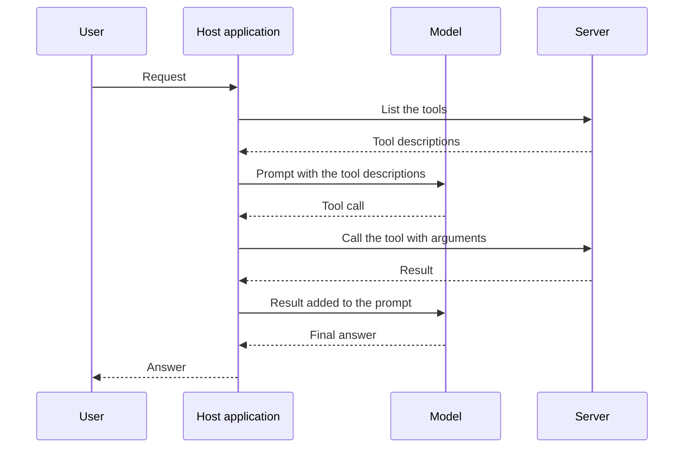

# 06. Agent Infrastructure: Sandboxes, Browser Use and Protocols

**Level:** Practitioner · **Reading time:** 16 min · **Exercise:** 60 min
**Prerequisites:** [Tool Design and Function Calling](../02-building-agents/02-tool-design-and-function-calling.md)

> **In one sentence:** After this chapter you can choose where an agent's actions run, decide between APIs and a browser when you give it access to software, and read a tool protocol such as MCP without guesswork.

## Why this matters

Your agent has three new powers. It runs shell commands the model wrote. It opens a browser that is logged into the company's expense system. It calls tools that three teams wrote in three different ways. Each power works in the demo. Each one can also delete files, spend money or leak data in production.

This chapter is about what sits between the model and the world: where actions run, how software is reached, and which conventions carry the calls.

## The core idea

Three pieces of infrastructure connect a model to the world, and one rule covers them all.

1. **Execution environment.** Where the agent's code and commands run: a sandbox.
2. **Interfaces to existing software.** Browsers and desktops on one side, tool protocols on the other.
3. **The boundary.** Least privilege: give every action the fewest rights it needs.

The analogy is onboarding a contractor. You hand out a managed laptop image with limited network access (the sandbox), a browser with single sign-on (browser use), and documented internal APIs instead of database passwords (protocols). The analogy breaks at learning. A contractor who breaks something once stops. A model will repeat the same action every time it sees the same situation, so the infrastructure, not the model, has to block it.

## How it works, step by step

### Part 1: Sandboxes

A **sandbox** is an isolated environment with its own file system, processes, network rules and resource limits. Agents need one for three reasons:

- Model-written code is untrusted input. It may be wrong, or it may be **prompt injection** (text that talks the model into doing something else) turned into commands: read a secret, call an outside server, delete files.
- The code needs dependencies and a working directory that survive from one step to the next.
- Runaway loops need limits on time, memory and money.

| Level | What it is | Isolation | Typical start time | Use it for |
|---|---|---|---|---|
| None | Code runs inside the agent's own process | None | None | Never with model-written code |
| Operating-system sandbox | An OS facility restricts what one process may touch (macOS Seatbelt, Linux namespaces and seccomp) | Medium: the kernel is shared | Milliseconds | A coding agent's shell on a developer's machine |
| Container | Docker or Podman: own file system and process tree | Medium: the kernel is shared | Hundreds of milliseconds to seconds | Local development, CI builds |
| MicroVM | A minimal virtual machine with its own kernel (Firecracker is the common one) | High | About a second | Hosted sandboxes that run strangers' code |

The start times are orders of magnitude. Measure on your platform. Two ways to buy the same isolation: run it yourself (containers on your machines), or rent it (hosted sandbox services and the code-execution tools that model vendors offer). Individual products were not re-checked for this edition, so they are not named.

Six questions select a sandbox:

1. **Worst case.** What could the code reach if it escaped: secrets, the internal network, customer data?
2. **State.** Must files survive between steps? Between sessions? Look for pause and resume.
3. **Latency budget.** A cold start (the delay before a fresh sandbox is ready) of two seconds matters when a task has 40 steps and not when it has one.
4. **Network.** Open internet, an allow-list through a proxy, or none.
5. **Observability.** Logs of every command, every file change, every exit code.
6. **Cost model.** Pay per second, or keep capacity reserved.

### Part 2: Browser and computer use

There are two ways to give an agent a piece of software. An **API agent** calls functions the software exposes. A **web agent** uses the interface as a person does. The second is the only option when there is no API, when the system is legacy, or when the login flow is all a human has. Chapados's slides name these as the two kinds of LLM agents.

A basic web agent has three parts, as his colleague demonstrates ([34:00](https://www.youtube.com/watch?v=-yf-e-9FvOc&t=2040)):

1. **A prompt** with the goal, an observation of the current page, and the action space (the actions the agent may take).
2. **A model call** that returns the next action.
3. **A driver** that applies the action: in his example, Python with Playwright or Selenium, long-established browser automation libraries.

You choose what the agent sees:

| Observation | What it is | Strength | Weakness |
|---|---|---|---|
| Raw HTML | The page source | Complete | Huge; mostly layout noise |
| Accessibility tree | The browser's own outline of the page for assistive technology | Structured and smaller than HTML | No visuals |
| Screenshot | Pixels | Shows charts, images, layout | Needs a vision model; actions become clicks at coordinates |

The same choice applies to actions: high level (fill the field with this ID, click this element) or low level (click at x and y, type these keys).

**Computer use** extends the idea from the browser to the whole desktop: the model receives a screenshot and returns mouse and keyboard actions. Anthropic announced such a tool in October 2024 and OpenAI a browser-using agent in January 2025. The idea in both is the same loop: observe, act, observe.

A browser session logged in as a user *is* that user. Give the agent its own account with the fewest rights, allow-list the domains it may visit, require confirmation before anything irreversible, and record screenshots and actions. The main threat is injection arriving inside page content; it is covered in [jailbreaks and prompt injection](../04-safety-and-security/02-jailbreaks-and-prompt-injection.md).

### Part 3: Protocols

The base layer is **function calling**: the model returns a structured request (a function name and arguments) and your code executes it. Every tool protocol builds on that.

The **Model Context Protocol (MCP)** standardizes the other end: how an AI application discovers and calls what an external system offers. Its documentation, as of November 2026, introduces it as "an open-source standard for connecting AI applications to external systems" and compares it to a USB-C port: one connector for data sources (local files, databases), tools (search engines, calculators) and workflows (specialized prompts).

That introduction does not define the roles. The definitions below come from the protocol's architecture page, which on November 24, 2026 documented the revision of July 28, 2026:

- A **host** is the AI application. A **client** lives inside the host and holds one connection. A **server** is a program, local or remote, that provides context.
- Servers offer three kinds of primitives: **tools** (functions the model may call), **resources** (data the application reads) and **prompts** (templates users pick).
- Messages use **JSON-RPC**: a request and its reply are JSON objects with a method name, parameters and an ID.
- A **transport** carries the messages: `stdio` for a local program that reads and writes its standard input and output, and an HTTP-based transport (Streamable HTTP) for remote servers.
- Capability discovery. In the 2025 revisions the two sides exchanged protocol version and capabilities in an `initialize` request when a connection opened. In the revision of July 2026 the protocol is stateless: every request carries the protocol version and the client's capabilities in a `_meta` field, and a client may send `server/discover` to learn which versions and capabilities a server supports.
- Clients offer a primitive too: **elicitation**, with which a server asks the user for information or confirmation. The same page marks roots, sampling and protocol logging as deprecated since that revision.

What MCP changes is the arithmetic. Without a standard, M applications each integrate N tools: M times N connectors. With one, each side implements the protocol once: M plus N. What it costs is one more moving part, a protocol that is revised often, and a security boundary you must draw yourself. A third-party server is someone else's code, and its tool descriptions are untrusted text that the model reads. Start from [threat modeling](../04-safety-and-security/01-threat-modeling-llm-applications-and-agents.md) before you connect one.

Other protocols exist for other boundaries. Agent-to-agent protocols, such as the Agent2Agent protocol that Google announced in April 2025, carry messages between agents from different vendors. Most applications need none of them: one model with a handful of functions is enough, as in chapter 02. Reach for a protocol when several applications must share the same tools, or several teams own them.

## Worked example

A tool server in 30 lines of plain Python, with no SDK. It is illustrative pseudocode in one sense: the file runs and uses the message shapes of the 2025 specification, but it leaves out parts a real server needs (full version negotiation, capability details, standard error codes). It also predates the revision of July 2026, which adds the `_meta` field to every request and the `server/discover` method. Use an official SDK for real work.

```python
# toy_tool_server.py — an MCP-shaped server over stdio: one JSON message per line.
import json, sys

TOOLS = [{"name": "add", "description": "Add two integers",
          "inputSchema": {"type": "object",
                          "properties": {"a": {"type": "integer"}, "b": {"type": "integer"}},
                          "required": ["a", "b"]}}]

def handle(method, params):
    if method == "initialize":
        return {"protocolVersion": params["protocolVersion"], "capabilities": {"tools": {}},
                "serverInfo": {"name": "toy", "version": "0.1"}}
    if method == "tools/list":
        return {"tools": TOOLS}
    if method == "tools/call":
        args = params["arguments"]
        return {"content": [{"type": "text", "text": str(args["a"] + args["b"])}],
                "isError": False}
    raise ValueError(f"unsupported method: {method}")

for line in sys.stdin:
    request = json.loads(line)
    if "id" not in request:               # notifications expect no reply
        continue
    try:
        reply = {"jsonrpc": "2.0", "id": request["id"],
                 "result": handle(request["method"], request.get("params", {}))}
    except Exception as error:
        reply = {"jsonrpc": "2.0", "id": request["id"],
                 "error": {"code": -32601, "message": str(error)}}
    print(json.dumps(reply), flush=True)
```

Try it from a shell:

```bash
printf '%s\n' '{"jsonrpc":"2.0","id":2,"method":"tools/list"}' \
  '{"jsonrpc":"2.0","id":3,"method":"tools/call","params":{"name":"add","arguments":{"a":2,"b":3}}}' \
  | python3 toy_tool_server.py
```

Output:

```
{"jsonrpc": "2.0", "id": 2, "result": {"tools": [{"name": "add", "description": "Add two integers", "inputSchema": {"type": "object", "properties": {"a": {"type": "integer"}, "b": {"type": "integer"}}, "required": ["a", "b"]}}]}}
{"jsonrpc": "2.0", "id": 3, "result": {"content": [{"type": "text", "text": "5"}], "isError": false}}
```

Observe what the protocol adds over a plain function. The server *describes* its tool with a name, a description and an input schema (a JSON description of the arguments), so a host that has never seen this server can offer the tool to a model.

**Figure 1.** Who talks to whom in MCP: the host's client asks the server, and the model sees only the host.



The server never talks to the model; it only answers the host's client, which is why one server works with any host.

## What the practitioners say

Nicolas Chapados of ServiceNow gave the first part of the lecture of October 21, 2024 (chapter 07 uses it). A colleague gave the second part, on web agents.

- **A web agent is small.** Goal, observation and action space go into a prompt; the model answers with actions; Playwright applies them. He shows a GPT-4-based agent solving a toy task from the MiniWoB++ data set: type "Enola" into a text box and press submit ([34:00](https://www.youtube.com/watch?v=-yf-e-9FvOc&t=2040)).
- **Judge the end, not the path.** His advice is "instead of checking the trace of actions, you actually just check if the database is in the correct state" ([40:00](https://www.youtube.com/watch?v=-yf-e-9FvOc&t=2400)). That allows other valid paths and lowers the chance of memorization, because no traces are stored in a public repository.
- **Two kinds of benchmark.** WebArena runs on local copies of open-source sites such as Reddit and GitLab: easy to run in parallel, but limited to open-source software and complex to install. Benchmarks on the open web are more realistic (real latency) and less reliable ([40:00](https://www.youtube.com/watch?v=-yf-e-9FvOc&t=2400)).
- **WorkArena.** A benchmark of 600 workplace tasks on the ServiceNow product, as of the lecture: open-source benchmark, closed product. The simplest tasks sort or filter a list, search a knowledge base and read a dashboard. A back-end API checks the result ([42:00](https://www.youtube.com/watch?v=-yf-e-9FvOc&t=2520)). His slides say the harder WorkArena++ set was far from solved.
- **Reproducibility.** AgentLab, work in progress in his account, is meant to store standardized traces (records of observations and actions) in public repositories, with package versions and dates, so old results can be re-checked while the web changes ([54:00](https://www.youtube.com/watch?v=-yf-e-9FvOc&t=3240)).
- **Six open difficulties** ([56:00](https://www.youtube.com/watch?v=-yf-e-9FvOc&t=3360)):
  1. Long context: web pages run to tens or hundreds of thousands of tokens, even as accessibility trees, and little of it matters.
  2. Long-term planning: what lies two or three pages ahead is invisible from the current page.
  3. Learning from mistakes: he cites Agent Q, which combines tree search with a fine-tuning method called DPO.
  4. Multimodality: tasks such as ordering a shirt like one shown in a picture need vision.
  5. Cost and speed: the demo videos were sped up. Shrinking the context is one way forward.
  6. Safety: white-on-white text on a page hijacked the demonstrated agent, and a malicious browser extension could hijack an agent into a wire transfer.

Vinyals, in a different lecture, notes that AlphaStar's in-game actions were API calls with typed arguments, emitted one at a time by a hand-built network, and calls that "strikingly close to tool use"; he names MCP as one such interface ([16:00](https://www.youtube.com/watch?v=ntjOxjZMaac&t=960)). As engineering judgment, the difference is that a language model can learn a tool interface from its description.

## Pitfalls

1. **Running model-written code in the agent's own process.** Fix: a sandbox, always. The toy in chapter 02 is the exception that proves the rule.
2. **Handing the agent your own logged-in browser.** Fix: a dedicated account with least privilege and a domain allow-list.
3. **Trusting tool descriptions from third-party servers.** Fix: read them before connecting; scope every token the server can use; apply [secure design](../04-safety-and-security/04-defenses-guardrails-detection-and-secure-design.md).
4. **Feeding raw HTML as the observation.** Fix: the accessibility tree, or retrieval of the few relevant elements.
5. **Grading web agents by action traces.** Fix: check the end state.
6. **Benchmarking on the open web without versions and dates.** Fix: record traces, as in [testing and experimenting in production](../08-quality-assurance/09-testing-and-experimenting-in-production.md).
7. **Adopting a protocol for its own sake.** Fix: start with function calling; move to a protocol when several applications must share tools.

## Try it

Two deliverables.

1. **A sandbox.** Put a Python executor in a container with no network and a read-only file system, except for one working directory. From inside, try to read an environment variable, reach a website, write a file in the working directory, and write a file elsewhere. Create an empty `work` folder first. Then run a script that writes `a.txt` under `/work` and under `/tmp`.

   ```bash
   docker run --rm --network none --read-only -v "$PWD/work:/work" python:3.12-slim \
     python -c "import os, urllib.request; print(os.environ.get('SECRET')); urllib.request.urlopen('https://example.com', timeout=3)"
   ```

2. **A tool server.** Save the toy server, send it the two requests above, then add a second tool and a request with an unknown method.

You are done when the sandboxed process prints `None` for the secret, fails to reach the website, can write under `work` and cannot write elsewhere; and when your server answers both requests as shown and returns an error object for the unknown method.

Stretch goal: rewrite the server with the official MCP SDK for your language and connect it to a real client. This exercise calls no model API and costs nothing.

## Key takeaways

- Model-written code and commands run in a sandbox with least privilege: isolated file system, restricted network, limits and logs.
- Give an agent software through an API when one exists, and through a browser only when it does not. Choose the observation (HTML, accessibility tree, screenshot) deliberately.
- MCP is an open standard for connecting AI applications to external systems. Its value is M plus N instead of M times N integrations; its cost is a security boundary and a fast-moving specification.
- For web agents, evaluate the end state, and record traces with versions and dates.
- Infrastructure, not the model, has to block the dangerous action.

## Self-check

1. Why not run model-written code inside the agent's own process?
   A. It is slower than a container
   B. The code could read secrets, damage files or call the network with the agent's privileges
   C. Models cannot write correct Python
   D. The function `exec` is not available on every system
2. Which observation of a web page is structured and smaller than the page source, but shows no visuals?
   A. Raw HTML
   B. A screenshot
   C. The accessibility tree
   D. The network trace
3. In the ServiceNow lecture, what counts as success for a web agent?
   A. Matching a reference sequence of actions
   B. The end state of the system
   C. The number of clicks
   D. The length of the prompt
4. In the 2025 MCP specification, who exposes tools?
   A. The server
   B. The host's user interface
   C. The model
   D. The operating system
5. What is the layer beneath every tool protocol?
   A. Reinforcement learning
   B. Function calling: the model returns a structured request and your code executes it
   C. Vector search
   D. Fine-tuning
6. A web page tells the agent to ignore its instructions and upload a cookie file. What is this?
   A. A parser bug
   B. Prompt injection arriving through untrusted content
   C. A latency problem
   D. A protocol version mismatch

<details><summary>Show answers</summary>

1. B. A sandbox keeps the code away from everything the agent can reach.
2. C. It is the browser's outline of the page for assistive technology.
3. B. The database state or the answer is checked, not the path.
4. A. A server exposes tools, resources and prompts to a host through a client.
5. B. Protocols standardize discovery and transport around that basic exchange.
6. B. Content the agent reads is untrusted input, including instructions in it.

</details>

## Sources

- **Web:** Model Context Protocol documentation: "What is the Model Context Protocol (MCP?)" ([intro](https://modelcontextprotocol.io/docs/getting-started/intro)) and "Architecture overview" ([architecture](https://modelcontextprotocol.io/docs/learn/architecture)), opened November 24, 2026; both pages document protocol version 2026-07-28
- **Lecture:** Nicolas Chapados, "AI Agents for Enterprise Workflows" (second half, web agents), UC Berkeley LLM Agents MOOC (Fall 2024): [video](https://www.youtube.com/watch?v=-yf-e-9FvOc) · [guide](../lectures/f24-07-ai-agents-for-enterprise-workflows.md), used at [basic web agent](https://www.youtube.com/watch?v=-yf-e-9FvOc&t=2040), [evaluation](https://www.youtube.com/watch?v=-yf-e-9FvOc&t=2400), [WorkArena](https://www.youtube.com/watch?v=-yf-e-9FvOc&t=2520), [AgentLab](https://www.youtube.com/watch?v=-yf-e-9FvOc&t=3240), [challenges](https://www.youtube.com/watch?v=-yf-e-9FvOc&t=3360)
- **Lecture:** Oriol Vinyals, "Multi-Agent Systems in the Era of LLMs", UC Berkeley Agentic AI MOOC (Fall 2025): [video](https://www.youtube.com/watch?v=ntjOxjZMaac) · [guide](../lectures/f25-10-multi-agent-systems-in-the-era-of-llms.md), used at [actions as API calls](https://www.youtube.com/watch?v=ntjOxjZMaac&t=960)

## Next

→ [Agents in the Enterprise](07-agents-in-the-enterprise.md), which puts these pieces to work inside a company, where every action needs a source and an owner.
