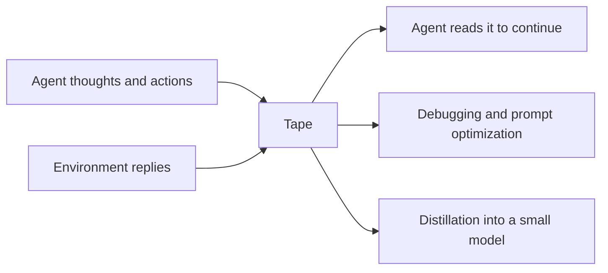

# 07. Agents in the Enterprise

**Level:** Practitioner · **Reading time:** 12 min · **Exercise:** 60 min
**Prerequisites:** [LlamaIndex: Building a Knowledge Assistant](03-llamaindex-knowledge-assistants.md) (retrieval over private documents), [Tool Design and Function Calling](../02-building-agents/02-tool-design-and-function-calling.md)

> **In one sentence:** After this chapter you can take an agent from a notebook to a company workflow, with a source on every claim, a human approval point, and the evaluation and model-cost decisions that a company needs.

## Why this matters

Your prototype answers questions about contracts, on your laptop. The compliance officer asks three things. Where does this answer come from? Who approved that action? What happens when the vendor changes the model? A demo answers none of them.

Two Fall 2024 lectures do. Burak Gokturk of Google describes what companies ask for. Nicolas Chapados of ServiceNow describes what it takes to put agents into real workflows.

## The core idea

An enterprise agent is a model plus five things around it, and the model is the replaceable part:

1. **Grounding.** Answers come from sources the model was not trained on, and each claim shows its source.
2. **Control points.** A person approves actions above a threshold, and every action is logged.
3. **Adaptation on a cost ladder.** Start with examples in the prompt. Tune the model only when the rungs below fail.
4. **Evaluation.** Automatic checks on every change.
5. **Managed prompts and model choice.** Prompts are versioned and portable across models.

Gokturk's summary, after conversations with many companies, matches: success now rests on access to a broad set of models, choice and flexibility at every level, and the ability to customize ([30:00](https://www.youtube.com/watch?v=Sy1psHS3w3I&t=1800)).

The analogy is a contractor on probation: sources are checked and the review is written down. It breaks at learning. A model improves only when you change its prompt, its data or the model itself.

Two terms carry the chapter. **Grounding** ties each statement to a source fetched at run time. **Attribution** is the share of statements that the cited sources actually support. Gokturk's slides show attribution as a user-experience metric, with an example answer whose supporting sources are counted, 4 out of 7.

## How it works, step by step: from notebook to workflow

1. **Pick the workflow.** High volume, rule-bound, and with a completion that software can check. Chapados's example: coffee spills on a laptop, an employee opens a help-desk ticket, and a person works through manual steps to ship a new one ([2:00](https://www.youtube.com/watch?v=-yf-e-9FvOc&t=120)).
2. **Pick the level of automation.** Draft only, then act after approval, then act alone within limits. Chapados describes the progression: scripting and robotic process automation (software that replays fixed steps), then classical AI workflows such as recommenders, then agent workflows, which need the most intelligence ([12:00](https://www.youtube.com/watch?v=-yf-e-9FvOc&t=720)).
3. **Prefer APIs.** The slides separate two kinds of agents. The second half of the lecture is about agents that drive a web interface ([8:00](https://www.youtube.com/watch?v=-yf-e-9FvOc&t=480)). Reach for those only when no API exists ([chapter 06](06-agent-infrastructure-sandboxes-browser-use-and-protocols.md)).
4. **Ground with attribution.** Gokturk calls search fundamental, even for making a model work well ([12:00](https://www.youtube.com/watch?v=Sy1psHS3w3I&t=720)), and describes what an application needs: "I'm saying this, because here is the exact blurb from exact this document that's saying this" ([30:00](https://www.youtube.com/watch?v=Sy1psHS3w3I&t=1800)). He names healthcare, finance and customer service, where a guess about a bill is not acceptable.
5. **Adapt the model on the ladder.** Gokturk's list, arranged here in the order to try them, cheapest first ([38:00](https://www.youtube.com/watch?v=Sy1psHS3w3I&t=2280), [40:00](https://www.youtube.com/watch?v=Sy1psHS3w3I&t=2400)):
   - **Prompt design.** Put one to ten examples in the prompt. Zero-shot means no example; one-shot means one. Most teams stop here, in his account.
   - **Prompt tuning.** Learn a vector to put in front of the prompt. He expected more use of it and sees little.
   - **Parameter-efficient fine-tuning (PEFT).** Update few parameters, or add a small layer. LoRA (low-rank adaptation) freezes the base model and learns an added low-rank component. Less compute, and probably less data.
   - **Full fine-tuning.** Update all the weights. It needs much data and compute, and he says few customers do it.
   - **Distillation.** A large **teacher** model labels the training data, even with soft labels (a probability per option instead of one answer), and a small **student** learns to reproduce them. That avoids manual labeling, and costs less latency and money ([44:00](https://www.youtube.com/watch?v=Sy1psHS3w3I&t=2640), [46:00](https://www.youtube.com/watch?v=Sy1psHS3w3I&t=2760)). Chapados's case study applies it.
6. **Add the control points.** Function calling lets the model act, not only answer. Each action needs permissions, an approval threshold and a log.
7. **Evaluate.** Gokturk points to automatic side-by-side evaluation (two answers to the same input, compared by a rater), with the largest model as the rater, because human raters are scarce ([58:00](https://www.youtube.com/watch?v=Sy1psHS3w3I&t=3480)). For workflow agents, check the end state, as the ServiceNow team does.
8. **Manage prompts and models.** Gokturk lists what teams ask for: a prompt management system with storage, revision history, and the ability to convert a prompt from one model to another ([58:00](https://www.youtube.com/watch?v=Sy1psHS3w3I&t=3480)).

## Worked example: two lecturers, one system

The two lectures describe the same system from two seats.

| Concern | Gokturk (Google: the platform) | Chapados (ServiceNow: the workflow) |
|---|---|---|
| Grounding | Search with the exact passage shown; attribution as a metric | Completion checked through back-end APIs on real tasks |
| Model cost | API cost "approaching 0", one of his trends | A student agent "330x cheaper" in a case study |
| Control | Function calling for developer control | Levels of automation; a human in the process |
| Record | Prompt management with history | The **tape**: a structured, granular, semantic-level log |
| Evaluation | Automatic side-by-side with a large model as rater | Benchmarks on real workplace tasks |

The tape deserves more. TapeAgents rests on one abstraction: the **tape**, a structured log of every agent's thoughts and actions and the environment's replies. It is data: agents can read tapes that other agents produced, for debugging and for optimization ([20:00](https://www.youtube.com/watch?v=-yf-e-9FvOc&t=1200), [24:00](https://www.youtube.com/watch?v=-yf-e-9FvOc&t=1440)).

**Figure 1.** The tape: one log that agents write to, read from and learn from.

The same record serves as the audit trail, the debugging log and the training data for a cheaper model.

## What the practitioners say

### Gokturk: what companies ask for

He reports six trends ([16:00](https://www.youtube.com/watch?v=Sy1psHS3w3I&t=960)):

1. **AI is moving much faster.** A new product used to find one or two enterprise pilots; now thousands ask to try.
2. **Model trends.** He expected one model per domain and was partly wrong: the next base model soon beats it. Models went from dense (every parameter runs on each call) to sparse (only a small part runs), which lowers latency and cost, and single-modality models are merging ([20:00](https://www.youtube.com/watch?v=Sy1psHS3w3I&t=1200), [22:00](https://www.youtube.com/watch?v=Sy1psHS3w3I&t=1320)).
3. **The platform, not the model.** New models appear every few weeks, and a production application must return results almost always ([24:00](https://www.youtube.com/watch?v=Sy1psHS3w3I&t=1440), [26:00](https://www.youtube.com/watch?v=Sy1psHS3w3I&t=1560)).
4. **API cost is approaching zero.** Running a paid small model cost his teams less than running an open-source model themselves ([26:00](https://www.youtube.com/watch?v=Sy1psHS3w3I&t=1560)).
5. **Search.** A model is trained in the past, hallucinates several percent of the time and cannot name its source. Search can cite ([28:00](https://www.youtube.com/watch?v=Sy1psHS3w3I&t=1680)).
6. **Assistants for employees' productivity.** He names Glean and ChatGPT Enterprise ([30:00](https://www.youtube.com/watch?v=Sy1psHS3w3I&t=1800)).

**Why grounding is needed.** His remedies: put the right context in the prompt, from private documents or web search, and check the citations afterwards; train more factual models, which costs some reasoning ability; show the user where each result comes from ([48:00](https://www.youtube.com/watch?v=Sy1psHS3w3I&t=2880), [50:00](https://www.youtube.com/watch?v=Sy1psHS3w3I&t=3000)).

He also tells a story from his PhD. Training on about 50 patients took 42 seconds, so he built intuition fast. Training a large model takes days, weeks or months, and he worries that intuition now arrives more slowly ([2:00](https://www.youtube.com/watch?v=Sy1psHS3w3I&t=120)). The lesson for agents: keep the feedback loop short enough to learn from.

### Chapados: what deployment looks like

He frames the question by people, not by models: who the users are, what role they have, what work they do, and in which context the agent should help ([0:00](https://www.youtube.com/watch?v=-yf-e-9FvOc&t=0)). ServiceNow, he says, has 25,000 employees and sells a platform for enterprise workflows in IT, human resources and customer support. He groups trustworthiness, governance, safety and security with deployment: all are needed for an agent to succeed in practice.

His lecture adds three points.

- **Two kinds of agents.** An API-calling agent uses tools with a formal specification. A web agent points and clicks as a person does ([8:00](https://www.youtube.com/watch?v=-yf-e-9FvOc&t=480)).
- **The long tail.** Big, predictable workflows were automated long ago, with scripting or robotic process automation. The opportunity for agents is tasks that never occur twice in the same way: tiny one by one, huge in aggregate ([12:00](https://www.youtube.com/watch?v=-yf-e-9FvOc&t=720), [14:00](https://www.youtube.com/watch?v=-yf-e-9FvOc&t=840)).
- **The case study.** An agent that helps users fill in complex forms, built on a 405-billion-parameter Llama model, recorded its tapes. From them the team fine-tuned an 8-billion-parameter model. The large agents cost about 30,000 to 40,000 dollars per million conversation turns; the small one matched their score at more than 300 times cheaper ([28:00](https://www.youtube.com/watch?v=-yf-e-9FvOc&t=1680), [30:00](https://www.youtube.com/watch?v=-yf-e-9FvOc&t=1800)).

## Pitfalls

1. **Fine-tuning to fix a knowledge gap.** Weights are the slowest way to teach this quarter's facts. Fix: ground the answer in retrieval first.
2. **Answers without a source.** Fix: retrieve, show the passage, and put attribution into the evaluation.
3. **Full autonomy on day one.** Fix: climb the ladder: draft, approve, then act within limits; see [planning for operations](../07-ml-in-production/10-planning-for-operations.md).
4. **A browser agent where an API exists.** Fix: the API, for reliability and for permissions.
5. **No evaluation before launch.** Fix: automatic side-by-side comparison and end-state checks, with the judge's biases in mind ([LLM as a judge](../03-evaluation/03-llm-as-a-judge-and-rubrics.md)).
6. **Prompts scattered in code.** Fix: a registry with history, and a test run whenever a prompt moves to another model, as in [testing generative components](../08-quality-assurance/05-testing-generative-and-llm-components.md).
7. **One vendor for everything.** Fix: keep the model behind an interface and run the evaluation when you swap it; [deploying a model](../07-ml-in-production/07-deploying-a-model.md) covers that change.
8. **No record.** Fix: log every step in a structured form, and treat the log as training data too.

## Try it

Choose one workflow in your company that people still do by hand.

1. Write a one-page proposal: volume per month, the check that proves completion, the proposed level of automation, the approval step, the fallback to a human, and three ways it could fail.
2. Prototype only the check, as code.

You are done when a colleague can run your check on a finished case and on a broken one, and it tells them apart. Before you hand the page over, walk it through the [professional-practice checklists](../11-professional-practice/07-checklists.md).

Stretch goal: run 20 past cases through a draft-only agent and measure how often a person accepts the draft unchanged. With a small model this costs cents.

## Key takeaways

- The model is the replaceable part. Grounding, control points, evaluation, managed prompts and model choice make an enterprise agent.
- Ground every claim in a source fetched at run time, show the source, and measure attribution.
- Adapt on the cost ladder: examples in the prompt, then LoRA or another light method, then distillation, and full fine-tuning last.
- Function calling turns answers into actions, so each action needs permissions, an approval threshold and a log.
- A structured log is both the audit trail and the data for the next improvement.
- Evaluate automatically: side-by-side comparison for answers, end state for workflows.

## Self-check

1. A company's agent gives outdated answers about this quarter's policy. What is the cheapest fix to try?
   A. Full fine-tuning on the policy documents
   B. Prompt tuning on a large corpus
   C. Retrieval that puts the current policy in the prompt, with the passage shown
   D. A larger model
2. What does attribution measure?
   A. How many tokens each answer costs
   B. The share of statements that the cited sources support
   C. The number of tools the agent called
   D. The latency of the retrieval step
3. In Gokturk's account, which adaptation did most teams use in practice?
   A. Prompt design with a few examples
   B. Prompt tuning
   C. Full fine-tuning
   D. LoRA
4. Why does Chapados's team check results through back-end APIs?
   A. It is faster than loading the page
   B. The end state proves completion, whatever path the agent took
   C. It avoids using a browser at all
   D. It removes the need for a benchmark
5. What is a student model, in the lectures' use of the word?
   A. A model trained by self-play
   B. A small model trained to reproduce a larger model's answers
   C. A model used only for evaluation
   D. A prompt with one example

Show answers

1. C. Grounding changes with the documents; weights do not.
2. B. It is shown as a user-experience metric on Gokturk's slides.
3. A. He says few customers fine-tune all weights and that prompt tuning surprised him by how little it was used.
4. B. The database state is checked, so other valid paths also pass.
5. B. In the ServiceNow form-filling case study the slides call the student 330 times cheaper.

## Sources

- **Lecture:** Burak Gokturk, "Enterprise trends for generative AI, and key components of building successful agents/applications", UC Berkeley LLM Agents MOOC (Fall 2024): [video](https://www.youtube.com/watch?v=Sy1psHS3w3I), used at [feedback-loop anecdote](https://www.youtube.com/watch?v=Sy1psHS3w3I&t=120), [search is fundamental](https://www.youtube.com/watch?v=Sy1psHS3w3I&t=720), [trends](https://www.youtube.com/watch?v=Sy1psHS3w3I&t=960), [success factors and grounding](https://www.youtube.com/watch?v=Sy1psHS3w3I&t=1800), [adaptation ladder](https://www.youtube.com/watch?v=Sy1psHS3w3I&t=2280), [distillation](https://www.youtube.com/watch?v=Sy1psHS3w3I&t=2640), [grounding remedies](https://www.youtube.com/watch?v=Sy1psHS3w3I&t=2880), [prompt management and evaluation](https://www.youtube.com/watch?v=Sy1psHS3w3I&t=3480)
- **Lecture:** Nicolas Chapados, "AI Agents for Enterprise Workflows", UC Berkeley LLM Agents MOOC (Fall 2024): [video](https://www.youtube.com/watch?v=-yf-e-9FvOc), used at [framing](https://www.youtube.com/watch?v=-yf-e-9FvOc&t=0), [help-desk example](https://www.youtube.com/watch?v=-yf-e-9FvOc&t=120), [agent types](https://www.youtube.com/watch?v=-yf-e-9FvOc&t=480), [automation levels](https://www.youtube.com/watch?v=-yf-e-9FvOc&t=720), [tapes](https://www.youtube.com/watch?v=-yf-e-9FvOc&t=1200), [case study](https://www.youtube.com/watch?v=-yf-e-9FvOc&t=1800), [end-state checks](https://www.youtube.com/watch?v=-yf-e-9FvOc&t=2400)

## Next

→ [Multi-Agent Systems I: Games and Self-Play](04-multi-agent-systems-i-games-and-self-play.md), if you came here for the enterprise chapters first, or back to [The Agent Framework Landscape](01-the-agent-framework-landscape.md) to choose what to build on.
