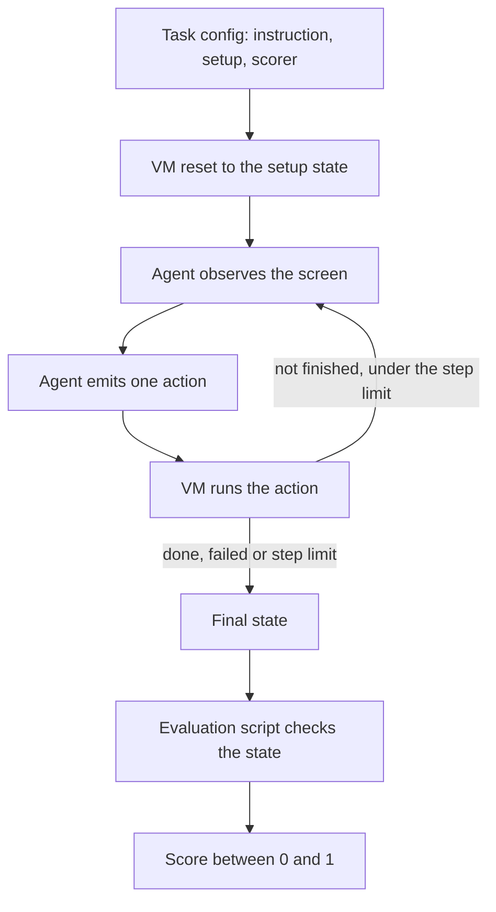

# 01. Multimodal Agents: Web and Computer Use

**Level:** Practitioner · **Reading time:** 19 min · **Exercise:** 45 min
**Prerequisites:** [The Anatomy of an Agent](../02-building-agents/01-the-anatomy-of-an-agent.md) (the observe, decide, act loop)

> **In one sentence:** After this chapter you can explain why agents that click through real web pages and desktop apps still fail, name the benchmarks that measure them, and choose an observation format and a scoring method for a computer-use task of your own.

## Why this matters

A stakeholder asks for an agent that buys the cheapest color photo printer and ships it to "the address on the photo". Three things break at once. A text-only agent cannot see that the photo is upside down. An agent that reads the page's source code drowns in markup. An agent that sees only pixels cannot tell which small gray box is the Add to cart button.

Ruslan Salakhutdinov demonstrates almost exactly this task, with the address in a photo that he shows upside down on purpose ([8:00](https://www.youtube.com/watch?v=RPINOYM12RU&t=480)).

## The core idea

A **multimodal agent** is an agent that reads more than text. Here it reads screenshots as well as page source, and it acts by clicking and typing. A **vision-language model (VLM)** is a language model that also accepts images. **Grounding** is linking a phrase in the instruction ("the cheapest printer") to the thing on screen it refers to. **Execution-based evaluation** scores a run by checking the final state of the environment, not by comparing the agent's steps with one reference path.

The analogy is a unit test: a fixture sets up the state, the code under test acts, an assertion checks the result. It breaks twice: the environment is slow and one click changes everything after it, and the assertion must accept every valid route to the same end state.

## How it works, step by step

### 1. Choose what the agent sees

| Observation | What it is | Strength | Weakness |
|---|---|---|---|
| HTML or DOM tree | The page source as text | Exact labels and attributes | Messy and long; layout is lost |
| Accessibility tree | The operating system's list of interface elements with roles and names | Short and structured | Differs per platform; misses purely visual content |
| Screenshot | Pixels | One format on every platform; keeps layout and images | Hard to map words to pixels; small text vanishes at low resolution |

Salakhutdinov lists three representations in use: the HTML source, **Set-of-Mark**, a bounding box with an ID around each clickable element, so the agent acts by naming an ID, and raw coordinates; he expects a combination ([16:00](https://www.youtube.com/watch?v=RPINOYM12RU&t=960), [18:00](https://www.youtube.com/watch?v=RPINOYM12RU&t=1080)). Xiong draws his from a screenshot plus labels from the accessibility tree ([16:00](https://www.youtube.com/watch?v=n__Tim8K2IY&t=960)).

### 2. Give every task a resettable start state

In OSWorld, the computer-use benchmark Xiong presents, each task has a configuration: an instruction, a setup file that puts files and apps into the starting state, and an evaluation part that says how to score it. OSWorld then starts a **virtual machine (VM)**, a simulated computer, from that setup, so a ruined state costs one reset and nothing real is at risk ([12:00](https://www.youtube.com/watch?v=n__Tim8K2IY&t=720), [14:00](https://www.youtube.com/watch?v=n__Tim8K2IY&t=840)).

### 3. Let the agent act

The agent emits actions as short code strings that move the mouse and keyboard. The loop stops when the task is done or has failed, or at a step limit, 15 in Xiong's experiments ([18:00](https://www.youtube.com/watch?v=n__Tim8K2IY&t=1080)).

### 4. Score by execution

A script inspects the final state. Salakhutdinov's verifiers look for an exact answer, a yes-or-no visual question or a price inside a range ([16:00](https://www.youtube.com/watch?v=RPINOYM12RU&t=960)). Xiong writes a custom script per task, 134 for 369 tasks, because no single metric fits all ([20:00](https://www.youtube.com/watch?v=n__Tim8K2IY&t=1200), [24:00](https://www.youtube.com/watch?v=n__Tim8K2IY&t=1440)); a partly finished task scores between 0 and 1 ([18:00](https://www.youtube.com/watch?v=n__Tim8K2IY&t=1080)).

**Figure 1.** One task run in an execution-based benchmark such as OSWorld.

The loop repeats until the agent stops or hits the step limit; the score comes only from the final state.

### 5. Spend more compute after a failure

Salakhutdinov describes two test-time methods. Search by repeated sampling runs several complete attempts and keeps one that passes, which he likens to rejection sampling ([34:00](https://www.youtube.com/watch?v=RPINOYM12RU&t=2040)). Tree search scores each intermediate state with a **value function**, a model that estimates how close the run is to success, here an LLM acting as judge; when the score drops, it backtracks and tries another action ([38:00](https://www.youtube.com/watch?v=RPINOYM12RU&t=2280)). Asked for a black polo shirt, his example agent lands on a page of blue ones and gives up; backtracking finds one ([42:00](https://www.youtube.com/watch?v=RPINOYM12RU&t=2520)). Repeated sampling needs the check from step 4 to know which attempt passed, and search is slow ([44:00](https://www.youtube.com/watch?v=RPINOYM12RU&t=2640)).

### The limits of search

Salakhutdinov is candid about the limits of his team's tree search. Its backtracking is naive: the agent stores every action it has taken in a queue and, to return to an earlier state, replays them from the start. He calls that a problem of infrastructure ([44:00](https://www.youtube.com/watch?v=RPINOYM12RU&t=2640)).

Two things make the same search hard when the agent runs on the real web. Some actions there are very hard to undo: an item can be ordered, but not unordered. And learning by trying is very hard there. He cannot book flight after flight to learn how, because the airline will block him or raise its prices.

Search can also improve the agent, not only one run. The successful traces it finds can serve as training data, for supervised fine-tuning or for reinforcement learning, and the value function itself can be trained rather than prompted, using Monte Carlo rollouts. In his view both sides have to improve, a stronger base model and a more efficient search, and one can be traded against the other.

### Benchmarks to know

| Benchmark | Year | Environment | Scoring |
|---|---|---|---|
| WebArena | 2023 | Self-hosted clones of a shopping site, Reddit and GitLab | Execution-based; HTML observations |
| Mind2Web | 2023 | 2,350 tasks on 137 real websites | Offline: compared with one recorded human demonstration |
| VisualWebArena | 2024 | The same style, with tasks that need images | Execution-based; screenshots allowed |
| OSWorld | 2024 | 369 tasks on a real desktop operating system | Execution-based scripts on a VM |

When you compare computer-use benchmarks, Xiong names five properties that set OSWorld apart: its environment is executable and can be controlled, it scales to new environments, it accepts multimodal observations, it includes tasks that cross applications, and a task may begin from an intermediate state. The tasks take longer as well, which he reads as a sign that they are more complex: by his account the median completion time is about 100 to 110 seconds, where WebArena's is 30 to 40, and some tasks need 900 seconds or more ([24:00](https://www.youtube.com/watch?v=n__Tim8K2IY&t=1440)).

## What the practitioners say

### Ruslan Salakhutdinov (March 2025): the gap, the failures, the fixes

- **The demos.** He opens with two runs of an agent a student of his built. One locates a well-reviewed Thai restaurant in Pittsburgh, reaches the point of booking a table and stops when it needs a confirmation code; the other searches Amazon for a shirt similar to one it is shown. He labels both heavily cherry-picked: of about 30 attempts, one succeeded. These systems do not really work at this point, he says, but each run shows the shape of an agent: a task, reasoning in a chain, and a single action at each step ([2:13](https://www.youtube.com/watch?v=RPINOYM12RU&t=133)).
- **The gap.** On WebArena, "the tasks are fairly easy for humans, about 78 success rate, but very difficult for language models", which reached about 14 percent at the time ([6:00](https://www.youtube.com/watch?v=RPINOYM12RU&t=360)). He puts part of the blame on format: pages arrive as HTML, which is messy and can run to 100,000 tokens. A **token** is the small chunk of text, roughly three quarters of a word, that a language model reads or writes at a time. In the performance part of his lecture he puts the best models at around 20 percent accuracy, as of March 2025 ([24:00](https://www.youtube.com/watch?v=RPINOYM12RU&t=1440)).
- **The failures.** Agents loop between two pages, keep no memory of what they have done, finish a subtask and then undo it, give up early, click the wrong element, and read layout poorly, for example questions about the prices in the first row of a listing ([26:00](https://www.youtube.com/watch?v=RPINOYM12RU&t=1560), [28:00](https://www.youtube.com/watch?v=RPINOYM12RU&t=1680)).
- **The fixes.** He lists long-horizon planning, running parallel instances as search, asking a person when uncertain, stronger VLMs, and the right abstraction level: "Do you rely on screenshots, what you're seeing visually? Do you rely on HTML or maybe you rely on APIs?" ([28:00](https://www.youtube.com/watch?v=RPINOYM12RU&t=1680)).
- **Data.** His slides call this a data problem: his team uses Llama models to generate and verify synthetic agent tasks, and filtered the web down to about 150,000 live websites ([50:00](https://www.youtube.com/watch?v=RPINOYM12RU&t=3000), [64:00](https://www.youtube.com/watch?v=RPINOYM12RU&t=3840)). He adds that human-only annotations "struggle with generalization" ([66:00](https://www.youtube.com/watch?v=RPINOYM12RU&t=3960)).
- **Safety.** A page state altered on purpose can push an agent into a wrong action, and he retells two Anthropic anecdotes in which Claude stopped a long screen recording and left a demo to browse photos of Yellowstone ([76:00](https://www.youtube.com/watch?v=RPINOYM12RU&t=4560)). His diagnosis: one wrong action is hard to undo without search.
- **His framing.** The benchmark tasks are low-stakes and were made simpler on purpose; the open question is whether economically valuable tasks can be automated ([26:00](https://www.youtube.com/watch?v=RPINOYM12RU&t=1560)).
- **The same design in a robot.** The pattern carries over to a physical agent, he says: sense an image together with depth, segment what is in the scene, form a high-level plan, then execute low-level actions. In Plan-Seq-Learn, a system of his lab, a language model produces the plan, a second module ties each step to the scene: segmentation gives the objects, inverse kinematics and a motion planner work out how to reach them, and a small policy trained by reinforcement learning moves the joints. He reports some 25 long-horizon tasks spread over four benchmarks, at about 85 percent success, and about 80 to 90 percent on a real robot, on objects it had not seen in training. Training in a simulator, he says, does carry over to the real world ([68:04](https://www.youtube.com/watch?v=RPINOYM12RU&t=4084)).

### Caiming Xiong (March 2025): the environment, the data, a vision-only agent

- **Why a new benchmark.** In his account, each Mind2Web task has one demonstration and no executable environment, so the benchmark assumes a single solution ([6:00](https://www.youtube.com/watch?v=n__Tim8K2IY&t=360)).
- **What OSWorld showed.** Humans score about 72 percent. Claude rose from roughly 15 percent to 22 percent between versions 3.5 and 3.7, and OpenAI's computer-use agent Operator reached 38 percent, but with up to 200 steps, where most tasks need 15 to 20; raising the limit from 15 to 50 also helps ([36:00](https://www.youtube.com/watch?v=n__Tim8K2IY&t=2160), [38:00](https://www.youtube.com/watch?v=n__Tim8K2IY&t=2280)).
- **Why the setting matters.** People score about the same from one observation setting to another, within three to five points ([30:00](https://www.youtube.com/watch?v=n__Tim8K2IY&t=1800)). The models do not: under Set-of-Mark two models from one company were ten points apart, on a score of about 20 percent. Raising the screenshot resolution helps the screenshot-only setting clearly and Set-of-Mark less, and more history helps Set-of-Mark but hurts the screenshot setting ([32:00](https://www.youtube.com/watch?v=n__Tim8K2IY&t=1920)). He gives one reason for both: Set-of-Mark carries text from the accessibility tree, and today's models handle text better than they handle pure images. The text route has a cost of its own: the accessibility tree runs to some 6,000 tokens at the 90th percentile, and that leaves little room for history. His ways out are a more concise tree, or a step that selects the relevant parts first, and the second adds latency ([34:00](https://www.youtube.com/watch?v=n__Tim8K2IY&t=2040)).
- **AgentTrek.** A **trajectory** is one full record of observations, actions and reasoning for a task. His team turns web tutorials into trajectories: collect tutorials; paraphrase each into a structured tutorial with prerequisites, step-by-step instructions and an expected outcome; let a VLM agent replay it; let a VLM evaluator score the recording and drop weak ones ([50:00](https://www.youtube.com/watch?v=n__Tim8K2IY&t=3000)).
- **TACO.** Xiong then asks whether training a model to act can also improve its understanding. His team's answer is TACO, short for multimodal action models with synthetic chains of thought and action ([60:00](https://www.youtube.com/watch?v=n__Tim8K2IY&t=3600)). The web does not carry such data, he says, so his team makes it in two ways ([62:00](https://www.youtube.com/watch?v=n__Tim8K2IY&t=3720)). Model-based generation hands a frontier model an image together with a question and its answer, and asks for reasoning with a call to an action from a given list, or with none when no action fits; the output is checked, and a failed one is kept as a plain question-answer pair. Programmatic generation starts from the image alone, with no question at all. Models of detection, depth and text reading annotate it, and hand-written templates turn the annotations into questions together with the actions that answer them. Three findings follow ([66:00](https://www.youtube.com/watch?v=n__Tim8K2IY&t=3960)). A model gains the capability only by fine-tuning; putting examples in the prompt did not work. Given actions, a model solved tasks it had failed before, so tools improve understanding as well. And what counted was the quality of the data, not how much of it: more data alone did not raise performance. The gains showed up on several benchmarks, not one.
- **AGUVIS.** Existing GUI agents use text representations that differ per platform, ground weakly and act without reasoning ([70:00](https://www.youtube.com/watch?v=n__Tim8K2IY&t=4200), [72:00](https://www.youtube.com/watch?v=n__Tim8K2IY&t=4320)). AGUVIS uses screenshots only, one action format, and an **inner monologue**, a short piece of reasoning written before each action. Training has two stages: one million grounding examples, then 35,000 multi-step trajectories with the monologue ([82:00](https://www.youtube.com/watch?v=n__Tim8K2IY&t=4920)), and his slide reports that the monologue helps most on harder tasks. He closes: improve grounding, not only reasoning ([88:00](https://www.youtube.com/watch?v=n__Tim8K2IY&t=5280)).

## Pitfalls

1. **Scoring by matching steps against one recording.** Fix: check the end state; see [a minimal eval harness](../03-evaluation/02-a-minimal-eval-harness.md).
2. **Feeding raw HTML.** Fix: pick one observation format on purpose and measure the others against it.
3. **Small screenshots.** Fix: raise the resolution and measure the token cost.
4. **Going vision-only and dropping the text history.** Fix: keep a compact text log of past actions.
5. **A step limit set too low.** Fix: raise it, and watch for loops.
6. **Reading a benchmark score as product readiness.** Fix: build the same fixture, action and assertion around your own environment.
7. **Letting the agent act on a real account.** Fix: run in a sandbox and confirm irreversible actions; see [prompt injection](../04-safety-and-security/02-jailbreaks-and-prompt-injection.md).

## Try it

Build a five-task harness for one web app you control.

- **Deliverable:** for each task, a setup script, a one-line instruction and a check function that inspects the final state. Run your agent three times per task.
- **Acceptance criteria:** you are done when every check passes on a hand-completed run and fails on an empty run, the report states success rate per task, and each failure is labeled loop, gave up early, wrong element or undone work. This is [slicing](../08-quality-assurance/03-slicing.md) by failure type.
- **Stretch:** rerun with two observation formats and two step limits, and report what changed.

## Key takeaways

- Execution-based evaluation checks the end state, which frees the agent to take any valid route.
- As of March 2025, Salakhutdinov reported the best web agents near 20 percent accuracy on VisualWebArena-style tasks, against 78 percent for humans on WebArena.
- The main failures are long-horizon: loops, no memory, undoing work, giving up.
- Grounding, the observation format and the step limit each move the score; so does reasoning before acting.
- Test-time search needs an automatic signal: the end-state check for repeated sampling, the value function for tree search.

## What this means for someone building agents

1. Write the check before the agent. An end-state check turns a vague demo into a number, and it powers retries and search; see [planning, search and decision making](../02-building-agents/03-planning-search-and-decision-making.md).
2. Treat the observation format as a design decision with a cost, and keep a text log of past actions even when the agent is vision-based.

## Self-check

1. An agent reaches the goal by a route nobody recorded. Which scoring method passes it?
   A. Step overlap with the reference demonstration
   B. Execution-based check of the final state
   C. Similarity to the reference reasoning text
   D. Trajectory length within reference bounds
2. In Xiong's OSWorld analyses, which change did not help?
   A. Higher screenshot resolution
   B. Longer text-based action history
   C. More screenshots instead of the text history
   D. Step limit raised from 15 to 50
3. What is the difference between search by repeated sampling and tree search?
4. Why does AGUVIS train an inner monologue before each action?
5. Name three long-horizon failure modes Salakhutdinov reports.
6. Xiong's team built TACO to test whether training a model to call actions also improves its understanding. What did they find?

Show answers

1. B. Execution-based evaluation looks only at the end state.
2. C. A longer text history helped; a screenshot-only history did not.
3. Repeated sampling runs whole attempts and keeps one that passes. Tree search branches inside a run and uses an LLM judge to rate intermediate states.
4. To carry the reasoning a language model already learned from text into action generation; Xiong's slide reports it helps most on harder tasks.
5. Any three of: looping between pages, no memory of progress, undoing completed work, giving up early, clicking the wrong element, weak spatial reasoning.
6. The capability came only by fine-tuning; examples in the prompt did not work. Given actions, a model solved tasks it had failed before, so tools improve understanding too. The quality of the data counted more than its quantity, and the gains held on several benchmarks.

## Sources

- **Lecture:** Ruslan Salakhutdinov, "Multimodal Autonomous AI Agents", UC Berkeley Advanced LLM Agents MOOC, Spring 2025 (March 10, 2025): [video](https://www.youtube.com/watch?v=RPINOYM12RU) · [guide](../lectures/sp25-06-multimodal-autonomous-ai-agents.md), used at [WebArena](https://www.youtube.com/watch?v=RPINOYM12RU&t=360), [failure modes](https://www.youtube.com/watch?v=RPINOYM12RU&t=1560), [what is missing](https://www.youtube.com/watch?v=RPINOYM12RU&t=1680), [data](https://www.youtube.com/watch?v=RPINOYM12RU&t=3960)
- **Lecture:** Caiming Xiong, "Multimodal Agents: From Perception to Action", UC Berkeley Advanced LLM Agents MOOC, Spring 2025 (March 17, 2025): [video](https://www.youtube.com/watch?v=n__Tim8K2IY) · [guide](../lectures/sp25-07-multimodal-agents-from-perception-to-action.md), used at [benchmark gap](https://www.youtube.com/watch?v=n__Tim8K2IY&t=360), [OSWorld loop](https://www.youtube.com/watch?v=n__Tim8K2IY&t=960), [AgentTrek](https://www.youtube.com/watch?v=n__Tim8K2IY&t=3000), [AGUVIS](https://www.youtube.com/watch?v=n__Tim8K2IY&t=4440)
- **Reading:** Zhou et al., "WebArena: A Realistic Web Environment for Building Autonomous Agents" (2023): [arXiv](https://arxiv.org/abs/2307.13854)
- **Reading:** Deng et al., "Mind2Web: Towards a Generalist Agent for the Web" (2023): [arXiv](https://arxiv.org/abs/2306.06070)
- **Reading:** Koh et al., "VisualWebArena: Evaluating Multimodal Agents on Realistic Visual Web Tasks" (2024): [arXiv](https://arxiv.org/abs/2401.13649)
- **Reading:** Xie et al., "OSWorld: Benchmarking Multimodal Agents for Open-Ended Tasks in Real Computer Environments" (2024): [arXiv](https://arxiv.org/abs/2404.07972)
- **Reading:** "AgentTrek: Agent Trajectory Synthesis via Guiding Replay with Web Tutorials" (2024): [arXiv](https://arxiv.org/abs/2412.09605)
- **Reading:** "AGUVIS: Unified Pure Vision Agents for Autonomous GUI Interaction" (2024): [arXiv](https://arxiv.org/abs/2412.04454)

## Next

→ [02. Embodied Agents and Robotics](02-embodied-agents-and-robotics.md), where the environment stops being a virtual machine and starts pushing back physically.
