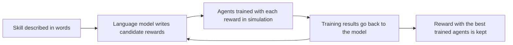

# 02. Embodied Agents and Robotics

**Level:** Practitioner · **Reading time:** 10 min · **Exercise:** 45 min

> **In one sentence:** After this chapter you can name the three ingredients behind robot agents that reached expert level, explain where language models fit into that recipe, and apply the same reward-design discipline to a software agent.

## Why this matters

A web agent that clicks the wrong button retries. A warehouse robot that grips the wrong way drops the crate, and the only feedback arrives when someone cleans the floor. Peter Stone's group and Jim Fan's team both hit that wall: real-world experience is scarce. Fan puts a number on it: real robot data is capped at 24 hours per robot per day ([10:00](https://www.youtube.com/watch?v=Qhxr0uVT2zs&t=600)). The question this chapter answers: how do you train an agent when experience is that expensive, and what does the answer have to do with agents that only touch software?

## The core idea

An **embodied agent** acts through a body, physical or simulated. Stone defines an agent as "an intelligent system that interacts with the environment through sensors and effectors" ([2:00](https://www.youtube.com/watch?v=iDhzzugMOLA&t=120)). Effectors are the parts that act: motors in a robot. Between raw sensors and motors he places three modules: perception (build a model of the situation), cognition (decide what to do), and action (turn the decision into commands) ([4:00](https://www.youtube.com/watch?v=iDhzzugMOLA&t=240)).

**Reinforcement learning (RL)** is trial-and-error learning. The agent acts, receives a **reward**, a number that scores how well it is doing, and changes its behavior to earn more. A **policy** is the function from what the agent senses to the action it takes. A **simulator** is a program that imitates an environment so that trials are cheap.

The analogy is a CI loop with a coverage score: run, measure, adjust, repeat. It breaks twice: a robot trial costs time and hardware, and a reward, unlike coverage, must be designed. Stone's racing agent shows both failure directions: without penalties it pushed rival cars off the track, and with too heavy a penalty it braked and let a human pass ([56:00](https://www.youtube.com/watch?v=iDhzzugMOLA&t=3360)).

## How it works, step by step

Fan's lecture (November 2024) reads as a recipe for one robot skill.

1. **Describe the skill in words.** His running example is spinning a pen with a robotic hand.
2. **Let a language model write candidate reward functions.** In Eureka (Ma et al., ICLR 2024) each candidate is tested by training agents against it in simulation: 10,000 copies on a single GPU, a loop of about 15 minutes. The results go back to the model, which reflects, debugs and rewrites ([44:00](https://www.youtube.com/watch?v=Qhxr0uVT2zs&t=2640)). Fan describes two loops: an outer one in which a large model reasons and an inner one that trains a small network for motor control ([50:00](https://www.youtube.com/watch?v=Qhxr0uVT2zs&t=3000)).
3. **Scale trial and error in simulation.** Fan's bet is that "it's easier to simulate a problem than to solve it" ([16:00](https://www.youtube.com/watch?v=Qhxr0uVT2zs&t=960)): the whole game of Go can be simulated in perhaps 500 lines of Python ([18:00](https://www.youtube.com/watch?v=Qhxr0uVT2zs&t=1080)). RoboCasa has models generate the objects, textures, layouts and task code of kitchen scenes, a hundred thousand of them ([30:00](https://www.youtube.com/watch?v=Qhxr0uVT2zs&t=1800)); MimicGen then replays one human demonstration, which takes a person minutes to give, across those scenes ([26:00](https://www.youtube.com/watch?v=Qhxr0uVT2zs&t=1560), [28:00](https://www.youtube.com/watch?v=Qhxr0uVT2zs&t=1680), [38:00](https://www.youtube.com/watch?v=Qhxr0uVT2zs&t=2280)). A **trajectory** is one full record of what the robot sensed and did.
4. **Randomize the physics.** Domain randomization varies gravity, friction, weight and size across simulated worlds, trading compute for physical accuracy, so the policy cannot depend on one world ([46:00](https://www.youtube.com/watch?v=Qhxr0uVT2zs&t=2760)). DrEureka has the same language model write those ranges, and the resulting policies moved to real hardware with no fine-tuning: a walking robot dog, a hand turning a cube, and a dog on a yoga ball ([48:00](https://www.youtube.com/watch?v=Qhxr0uVT2zs&t=2880)).
5. **Aim at one model for many bodies.** In Fan's blueprint the model takes a description of the body plus a natural-language instruction and returns actions ([52:00](https://www.youtube.com/watch?v=Qhxr0uVT2zs&t=3120)).

**Figure 1.** Eureka's two loops: the outer loop reasons, the inner loop trains.



The model never runs the simulation itself; it sees only the training results of the rewards it wrote, and rewrites them.

**Voyager-style open-ended agents.** Voyager (Wang et al., 2023), which Fan co-authored, plays Minecraft with no fixed goal: the model proposes the next task, saves each learned behavior as executable code in a skill library, and feeds errors back into the next prompt. Fan's example of a world that is simple to simulate and hard to master is Minecraft itself, a few hundred megabytes of program in which players have built a castle and a working CPU. From there he asks how to generate data in such a world ([18:00](https://www.youtube.com/watch?v=Qhxr0uVT2zs&t=1080)).

## What the practitioners say

### Peter Stone (December 2025): agents are older than the buzzword

- Agents have been studied for at least three decades, longer than "agentic AI" has been a buzzword ([2:00](https://www.youtube.com/watch?v=iDhzzugMOLA&t=120)).
- **Robot soccer.** RoboCup aims at a humanoid team that beats the world champions by 2050. In 2025 Stone played alongside the robots against people, who still win too easily; one robot kicked the ball between the RoboCup president's legs. Progress with physical systems, he says, is much harder than in software ([8:00](https://www.youtube.com/watch?v=iDhzzugMOLA&t=480), [10:00](https://www.youtube.com/watch?v=iDhzzugMOLA&t=600)).
- **Navigation.** Off-the-shelf navigation stacks have opaque parameters that a roboticist must tune for each place. His group treats the stack as a black box and learns only its settings, a **parameter policy**, from a demonstration a person steers by remote control, a person stepping in when the robot errs, or good-move and bad-move feedback ([24:00](https://www.youtube.com/watch?v=iDhzzugMOLA&t=1440)).
- **Rewards from people.** In TAMER a person says good move or bad move while an agent plays Tetris. Within two or three games it clears hundreds of lines, where plain reinforcement learning needs hundreds of thousands of games. It learns faster but ends up weaker, so a follow-up learns from both; Deep TAMER, with Garrett Warnell, adds images, and Stone calls it the first reinforcement learning from human feedback ([20:00](https://www.youtube.com/watch?v=iDhzzugMOLA&t=1200), [22:00](https://www.youtube.com/watch?v=iDhzzugMOLA&t=1320)).
- **Real-world RL.** A robot first explores a crude simulator with no reward and learns a small action space: one input each for base, arm and camera. The task is then learned on the real robot in about 40 minutes; four such skills each trained in under an hour, with fewer safety violations than methods that train in the raw action space ([34:00](https://www.youtube.com/watch?v=iDhzzugMOLA&t=2040), [40:00](https://www.youtube.com/watch?v=iDhzzugMOLA&t=2400), [42:00](https://www.youtube.com/watch?v=iDhzzugMOLA&t=2520)).
- **GT Sophy**, a racing agent trained end to end with RL inside the driving game Gran Turismo, rewarded for going fast:
  - *Training:* after about a day on a bank of PlayStations it beat the best human lap times on an empty track, after about a week in races ([14:00](https://www.youtube.com/watch?v=iDhzzugMOLA&t=840)). The ingredients include experience replay (store each step and reuse it), n-step returns (score an action by several later rewards, not one) and a critic that learns how likely very good and very bad outcomes are; that last algorithm cut almost a second off a lap ([48:00](https://www.youtube.com/watch?v=iDhzzugMOLA&t=2880), [50:00](https://www.youtube.com/watch?v=iDhzzugMOLA&t=3000)). On one track its lap times were compared with the hundred best reported by people worldwide; after 24 hours it beat almost all of them ([50:00](https://www.youtube.com/watch?v=iDhzzugMOLA&t=3000)).
  - *Data curation:* being faster was not enough. The team put twenty cars on the track and staged one car behind one, two, three or seven others, so that the agent met traffic, and mixed scenarios into each training batch by hand, later by an automated method. The slipstream pass, a defensive line and a double crossover pass emerged; none was programmed or rewarded on its own ([52:00](https://www.youtube.com/watch?v=iDhzzugMOLA&t=3120), [54:00](https://www.youtube.com/watch?v=iDhzzugMOLA&t=3240)).
  - *Result, as he recounts it:* humans won in July 2021. After months of fixes, the agents beat four top drivers that October and finished first and second in an eight-car race against four humans. They are now a permanent opponent in the game, with an adjustable skill level. Driver Emily Jones said she learned from watching them ([14:00](https://www.youtube.com/watch?v=iDhzzugMOLA&t=840), [56:00](https://www.youtube.com/watch?v=iDhzzugMOLA&t=3360), [58:00](https://www.youtube.com/watch?v=iDhzzugMOLA&t=3480)).

### Jim Fan (November 2024): data is the bottleneck

- **Two kittens.** In Held and Hein's 1963 experiment, two kittens got the same visual experience, but only the one that moved itself developed normal vision. His punchline: today's "passive kitten" is ChatGPT ([0:00](https://www.youtube.com/watch?v=Qhxr0uVT2zs&t=0)). His stated belief is that the future belongs to embodied AI ([2:00](https://www.youtube.com/watch?v=Qhxr0uVT2zs&t=120)).
- **Why humanoids**, in his argument: the human shape already does the valuable physical work, coworkers can predict it, and the world is built for it ([2:00](https://www.youtube.com/watch?v=Qhxr0uVT2zs&t=120)).
- **The diagnosis.** He names data as the culprit ([10:00](https://www.youtube.com/watch?v=Qhxr0uVT2zs&t=600)), and he makes the bet: "It's easier to simulate a problem than to solve it" ([16:00](https://www.youtube.com/watch?v=Qhxr0uVT2zs&t=960)).
- **MimicGen.** Vary the object positions, keep the motion, and each replay is still a success: machines teach machines, in his phrasing ([32:00](https://www.youtube.com/watch?v=Qhxr0uVT2zs&t=1920)).
- **Sim to real.** A model that masters many randomized worlds "may very well generalize to the 10,000 and first reality, which is the physical world that we live in" ([46:00](https://www.youtube.com/watch?v=Qhxr0uVT2zs&t=2760)).
- **Three computers.** One generates data (OVX), one trains the model (DGX), one runs it on the robot (AGX) ([52:00](https://www.youtube.com/watch?v=Qhxr0uVT2zs&t=3120)).

## Pitfalls

1. **A reward with no guardrails.** Fix: penalize the behavior you do not want, as Stone's team did for at-fault collisions.
2. **Guardrails that are too strong.** Fix: test both directions on purpose, aggression and timidity.
3. **One fixed simulator.** Fix: randomize what you cannot model exactly.
4. **Collecting every example by hand.** Fix: take a few good demonstrations and generate variations.
5. **Trusting a model-written reward because the code reads well.** Fix: keep the candidate whose trained agent performs best.

## Try it

Run a miniature Eureka: let a model write reward functions, and judge them by measurement.

```python
# Illustrative, standard library only: score one candidate reward by rollouts.
import random

def rollout(reward, steps=50):
    x, total = 0, 0.0                     # robot starts at position 0
    for _ in range(steps):
        action = random.choice([-1, 1])   # fixed policy: random walk
        nxt = max(-5, min(5, x + action)) # walls at -5 and +5
        total += reward(x, action, nxt)
        x = nxt
    return total

def reward_a(state, action, next_state):  # candidate a model wrote for you
    return 1.0 if next_state == 5 else -0.01
```

- **Deliverable:** five candidate `reward(state, action, next_state)` functions for "reach position 5, do not bump walls", each scored as the mean of 200 rollouts: `sum(rollout(reward) for _ in range(200)) / 200`.
- **Acceptance criteria:** you are done when the table shows the measured score of every candidate, names the best by score, and records one guardrail you added after seeing behavior you did not want.
- **Stretch:** replace the random walk with a small learner and check whether the ranking changes. A real Eureka loop trains an agent per candidate.

## Key takeaways

- Trial and error in a faithful simulator works: GT Sophy went from random driving to lap times better than the best humans' on an empty track in about a day.
- Real-world data is the bottleneck, so teams generate data in simulation and randomize it.
- Language models help most where the bottleneck is language: writing rewards, curricula and variations of demonstrations.
- The reward is a specification. Both aggression and timidity in GT Sophy were reward-design problems.

## What this means for someone building agents

1. Treat every metric as a reward. Agents exploit it, so test both failure directions; see [LLM-as-a-judge and rubrics](../03-evaluation/03-llm-as-a-judge-and-rubrics.md).
2. When feedback is slow, build a fast stand-in with the same check: a test suite for a software agent, a simulator for a robot. See [agent infrastructure](../05-frameworks-and-multi-agent/06-agent-infrastructure-sandboxes-browser-use-and-protocols.md).
3. Let the model propose and let a measurement decide, as Eureka does with rewards; see [planning, search and decision making](../02-building-agents/03-planning-search-and-decision-making.md).

## Self-check

1. In Eureka, what decides which candidate reward function is kept?
   A. A roboticist reads each function and picks one
   B. Agents are trained with each, and training results decide
   C. The language model ranks its own candidates
   D. The function with the fewest lines is kept
2. What is domain randomization, and which problem does it address?
3. GT Sophy was first too aggressive, then too timid. What changed in between?
4. What did the two kittens in Held and Hein's experiment share, and what differed?
5. What does Voyager store in its skill library?

<details><summary>Show answers</summary>

1. B. Each candidate is scored by training an agent against it.
2. Varying physical parameters such as gravity and friction across simulated worlds, so a policy does not depend on one imperfect simulation and still works in reality.
3. The reward signals: penalties for avoidable and at-fault collisions were added, then balanced.
4. The same visual experience. Only the active kitten controlled its own motion.
5. Each learned behavior as executable code, retrieved by a description of what it does.

</details>

## Sources

- **Lecture:** Peter Stone, "Autonomous Agents: Embodiment, Interaction, and Learning", UC Berkeley Agentic AI MOOC, Fall 2025 (December 1, 2025): [video](https://www.youtube.com/watch?v=iDhzzugMOLA), used at [agent definition](https://www.youtube.com/watch?v=iDhzzugMOLA&t=120), [reward from people](https://www.youtube.com/watch?v=iDhzzugMOLA&t=1200), [GT Sophy](https://www.youtube.com/watch?v=iDhzzugMOLA&t=3360)
- **Lecture:** Jim Fan, "Project GR00T: A Blueprint for Generalist Robotics", UC Berkeley LLM Agents MOOC, Fall 2024 (November 4, 2024): [video](https://www.youtube.com/watch?v=Qhxr0uVT2zs), used at [two kittens](https://www.youtube.com/watch?v=Qhxr0uVT2zs&t=0), [MimicGen](https://www.youtube.com/watch?v=Qhxr0uVT2zs&t=1920), [Eureka and sim to real](https://www.youtube.com/watch?v=Qhxr0uVT2zs&t=2760)
- **Reading:** Ma et al., "Eureka: Human-Level Reward Design via Coding Large Language Models" (ICLR 2024): [arXiv](https://arxiv.org/abs/2310.12931)
- **Reading:** Wang et al., "Voyager: An Open-Ended Embodied Agent with Large Language Models" (2023): [arXiv](https://arxiv.org/abs/2305.16291)
- **Reading:** Wurman et al., "Outracing champion Gran Turismo drivers with deep reinforcement learning", *Nature* (2022): [DOI](https://doi.org/10.1038/s41586-021-04357-7)
- **Reading:** Held and Hein, "Movement-produced stimulation in the development of visually guided behavior" (1963): [DOI](https://doi.org/10.1037/h0040546)

## Next

→ [03. Agents for Scientific Discovery](03-agents-for-scientific-discovery.md), where the environment is a laboratory and the verifier is a human reading the references.
