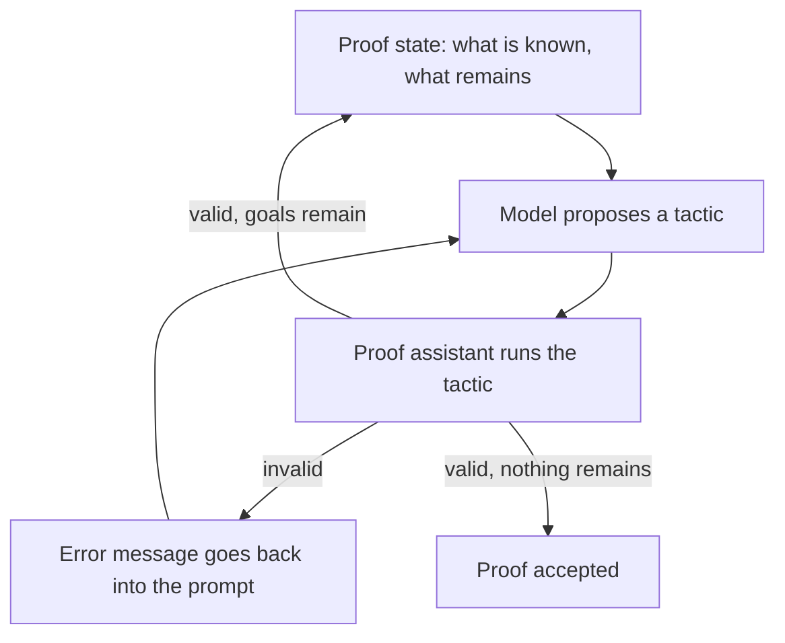

# 04. Agents for Formal Mathematics

**Level:** Professional · **Reading time:** 12 min · **Exercise:** 60 min

> **In one sentence:** After this chapter you can explain why a proof assistant gives an agent a perfect verifier, describe the AlphaProof recipe and where it stopped, and decide when a checker you fully trust is worth its cost.

## Why this matters

Sean Welleck shows a language model solving a math problem. The final answer is right. Intermediate steps contain subtle mistakes ([2:00](https://www.youtube.com/watch?v=Gy5Nm17l9oo&t=120)). For a homework hint that is fine. For a proof that other proofs will build on, a person has to check every line, which cancels the gain.

## The core idea

**Formal mathematics** is mathematics written as source code. The language is a **proof assistant**, also called an interactive theorem prover; Lean, Coq and Isabelle are examples. A theorem becomes a specification and a proof becomes code. If the code compiles, the proof is correct ([2:00](https://www.youtube.com/watch?v=Gy5Nm17l9oo&t=120)). **Informal mathematics** is everything else: prose, LaTeX, papers.

A **tactic** is one small proof step, such as applying a known **lemma**, a smaller theorem already proved. **Mathlib** is the open-source Lean library of formalized mathematics. **Autoformalization** translates a statement or a proof from prose into formal code.

For a programmer the analogy is a type checker, except that a proof assistant checks the whole argument. It still says only that the proof matches the formal statement: a proof of a mistranslated statement compiles without complaint.

| | Informal | Formal |
|---|---|---|
| Form | Prose, LaTeX, papers | Source code in Lean |
| Who checks | A person | The proof assistant |
| Guarantee | None | Correct if it compiles |
| Coverage | All of mathematics | What the library supports |
| Cost to write | Low | Every step spelled out |

## How it works, step by step

### Why agents benefit

Thomas Hubert names three ingredients behind systems that beat experts: scaled-up trial and error, grounded feedback, and a **curriculum**, a graded sequence of problems ([32:00](https://www.youtube.com/watch?v=3gaEMscOMAU&t=1920)). Lean supplies the first two: it is "the environment to explore mathematics completely in silico", that is, on a computer, and it reports what is proved and what remains. Kaiyu Yang adds the other half: current training leans on abundant data and checkable answers, and advanced mathematics has neither, so formal tools must supply the feedback ([14:00](https://www.youtube.com/watch?v=cLhWEyMQ4mQ&t=840)).

### The AlphaProof recipe

Hubert describes two models, a formaliser and a prover, and four steps ([60:00](https://www.youtube.com/watch?v=3gaEMscOMAU&t=3600)):

1. **Autoformalize.** The formaliser model turns natural-language problems into Lean statements. His team ran about a million problems through it and kept roughly a hundred translations each ([64:00](https://www.youtube.com/watch?v=3gaEMscOMAU&t=3840)).
2. **Imitate.** The prover model, pre-trained on code, trains on Mathlib, about 200,000 theorems, to propose the next tactic for the current **proof state**, the list of what is known and what remains to be shown. Alone it solves close to 0 percent of IMO-type problems ([64:00](https://www.youtube.com/watch?v=3gaEMscOMAU&t=3840), [66:00](https://www.youtube.com/watch?v=3gaEMscOMAU&t=3960)).
3. **Reinforce.** The prover trains by **reinforcement learning (RL)**, trial and error against a reward, inside an AlphaZero-style search: each action is one line of proof and Lean verifies it, so the model climbs from easy problems to IMO difficulty ([62:00](https://www.youtube.com/watch?v=3gaEMscOMAU&t=3720), [66:00](https://www.youtube.com/watch?v=3gaEMscOMAU&t=3960)).
4. **Train at test time.** On a problem it cannot yet solve, the system generates easier variants, solves one that is within reach, learns from that proof, and repeats until it reaches the target ([68:00](https://www.youtube.com/watch?v=3gaEMscOMAU&t=4080), [70:00](https://www.youtube.com/watch?v=3gaEMscOMAU&t=4200)).

### Demonstrated, and expected

- **Demonstrated.** At the International Mathematical Olympiad (IMO) 2024, AlphaProof fully solved problems 1, 2 and 6, and AlphaGeometry, a separate geometry system, solved problem 4. Problem 3 yielded progress but no partial point, and the system reached silver-medal score, one point below gold, with more time and compute than the human contestants; only 5 of 609 students solved problem 6 in full ([56:00](https://www.youtube.com/watch?v=3gaEMscOMAU&t=3360)). Human experts failed to formalize problem 5 in Lean ([52:00](https://www.youtube.com/watch?v=3gaEMscOMAU&t=3120)).
- **Expected.** Hubert's stated bet is that "perfect verification will, in the long run, be the most important property for mathematics" ([38:00](https://www.youtube.com/watch?v=3gaEMscOMAU&t=2280)). He also wants a method not tuned to the IMO ([68:00](https://www.youtube.com/watch?v=3gaEMscOMAU&t=4080)).
- **Not yet.** Mathlib covers about 80 percent of undergraduate curricula in his estimate ([10:00](https://www.youtube.com/watch?v=3gaEMscOMAU&t=600)), has gaps such as geometry, and research mathematics needs new objects and theories ([70:00](https://www.youtube.com/watch?v=3gaEMscOMAU&t=4200)). On his slide, 0.1 to 1 percent of mathematicians use Lean ([11:06](https://www.youtube.com/watch?v=3gaEMscOMAU&t=666)).

## What the practitioners say

Four lectures, four ways to use the same checker:

| System | Lecturer | Model proposes | Checker | Idea |
|---|---|---|---|---|
| AlphaProof | Hubert | Tactics, after RL | Lean | RL at scale, then RL on one problem |
| ReProver | Yang | Tactics, after retrieving useful lemmas | Lean | Retrieval narrows the search |
| LIPS | Yang | Inequality steps | Symbolic reasoning | Restrict the action space |
| Lean-STaR | Welleck | A thought, then a tactic | Lean | Think in prose before each step |
| Draft-Sketch-Prove | Welleck | An informal proof, then a formal sketch | Automated provers | Separate high-level and low-level work |
| Copra | Chaudhuri | Tactics, with optional informal hints | Lean | No training, all in context |

- **Yang on search.** Go has a 19 by 19 board, so the legal moves are finite; proving allows countless tactics, which makes it a harder search ([26:00](https://www.youtube.com/watch?v=cLhWEyMQ4mQ&t=1560)). LIPS sorts the steps of an inequality proof into two types: scaling, applying an existing lemma, a finite set that a symbolic algorithm can enumerate; and rewriting the formula, an infinite space left to the language model ([28:00](https://www.youtube.com/watch?v=cLhWEyMQ4mQ&t=1680), [30:00](https://www.youtube.com/watch?v=cLhWEyMQ4mQ&t=1800)). On 20 olympiad inequalities o3-mini proved 3, DeepSeek-R1 4, a gold medalist at least 15 and LIPS 16, including one the US team's IMO coach had said could not be solved with AM-GM, a standard inequality ([32:00](https://www.youtube.com/watch?v=cLhWEyMQ4mQ&t=1920)).
- **Yang on autoformalization.** Statements have no reliable automatic evaluation, and human proofs leave holes, some marked as left to the reader ([36:00](https://www.youtube.com/watch?v=cLhWEyMQ4mQ&t=2160)). His answer is to restrict the domain: "problems intractable in general can be made tractable in a specific domain" ([44:00](https://www.youtube.com/watch?v=cLhWEyMQ4mQ&t=2640)). On LeanEuclid, his benchmark of 48 problems from Book I of Euclid's Elements, the team checks a translated statement by proving that it and the reference statement imply each other, with an **SMT solver**, a program that decides whether a formula follows from given facts ([36:00](https://www.youtube.com/watch?v=cLhWEyMQ4mQ&t=2160)). Prompted with up to five demonstrations and no training, GPT-4 still translated only just over 20 percent correctly ([50:00](https://www.youtube.com/watch?v=cLhWEyMQ4mQ&t=3000)).
- **Welleck on the gap.** Each formal step must be spelled out, which is the gap between how people reason and what Lean accepts ([12:00](https://www.youtube.com/watch?v=Gy5Nm17l9oo&t=720)). Lean-STaR trains a model to write a thought before each tactic: because no Lean proof comes with such thoughts, a model first writes them in hindsight for Mathlib steps, then learns from full proofs that Lean accepts or rejects ([18:00](https://www.youtube.com/watch?v=Gy5Nm17l9oo&t=1080), [20:00](https://www.youtube.com/watch?v=Gy5Nm17l9oo&t=1200)). Tree search struggled to score thoughts, so proofs are sampled in parallel and the successful ones kept for retraining, which reached the state of the art at the time on miniF2F, a benchmark of competition problems stated in Lean ([22:00](https://www.youtube.com/watch?v=Gy5Nm17l9oo&t=1320), [24:00](https://www.youtube.com/watch?v=Gy5Nm17l9oo&t=1440)). Draft-Sketch-Prove splits the work another way: draft an informal proof, translate it into a formal sketch with gaps, and let automated provers, good at small gaps and lost on whole olympiad problems, close them ([30:00](https://www.youtube.com/watch?v=Gy5Nm17l9oo&t=1800), [32:00](https://www.youtube.com/watch?v=Gy5Nm17l9oo&t=1920)). For research mathematics, theorems depend on long, cross-file context. On miniF2F extra context makes no difference; on his miniCTX benchmark, built from real Lean projects, it opens a dramatic gap ([66:00](https://www.youtube.com/watch?v=Gy5Nm17l9oo&t=3960)).
- **Chaudhuri on in-context agents.** Proof trees are wide and deep, harder than any game solved so far ([24:00](https://www.youtube.com/watch?v=IHc0TEMrEdY&t=1440)). Copra, published at COLM 2024, trains nothing: inside a depth-first search a frontier model proposes a tactic for each proof state, as in Figure 1 ([26:00](https://www.youtube.com/watch?v=IHc0TEMrEdY&t=1560), [30:00](https://www.youtube.com/watch?v=IHc0TEMrEdY&t=1800), [32:00](https://www.youtube.com/watch?v=IHc0TEMrEdY&t=1920)). The absolute numbers are modest, about 29 to 30 percent on miniF2F with 60 queries per attempt, and he calls the Lean feedback essential, because o3-mini hallucinated lemmas ([38:00](https://www.youtube.com/watch?v=IHc0TEMrEdY&t=2280), [46:00](https://www.youtube.com/watch?v=IHc0TEMrEdY&t=2760)). In one demo the agent splits a theorem into three helper lemmas, proves each, and then the whole; given the theorem as one block, it fails ([42:00](https://www.youtube.com/watch?v=IHc0TEMrEdY&t=2520), [44:00](https://www.youtube.com/watch?v=IHc0TEMrEdY&t=2640)). His other theme is abstraction: LaSR evolves equations that fit data and names the concepts behind them in a library, its addition to DeepMind's FunSearch; it beat plain genetic programming, which recombines formulas without concepts, even with models run locally ([74:00](https://www.youtube.com/watch?v=IHc0TEMrEdY&t=4440), [76:00](https://www.youtube.com/watch?v=IHc0TEMrEdY&t=4560)).

**Figure 1.** The loop behind most rows of the table: the model proposes a tactic, the proof assistant rules.



A wrong step costs one error message, returned to the model at once, so nobody grades each step.

## Pitfalls

1. **Trusting a compiled proof as trust in the theorem.** Fix: review the formal statement; check equivalence with the intended one where a solver can.
2. **Searching an unrestricted action space.** Fix: define the allowed step types and prune with a symbolic tool.
3. **Reading an olympiad score as research-level ability.** Fix: evaluate with long-context benchmarks such as miniCTX.
4. **Tuning everything to one competition.** Fix: hold out problem types, as Hubert says he wants to.
5. **Expecting coverage.** Fix: check that the library supports the area before promising automation.
6. **Assuming your own domain has a perfect checker.** Most software requirements are not formal; the next best thing is a test suite, which checks examples, not all cases.

## Try it

Feel the checker accept and reject.

```lean
-- Minimal Lean 4, no library needed. Illustrative; check it in a Lean 4 web editor.
theorem add_flip (a b : Nat) : a + b = b + a := Nat.add_comm a b

theorem wrong (a b : Nat) : a + b = b - a := by rfl   -- rejected: not true
```

- **Deliverable:** ask a model to translate five one-line statements into Lean. Record for each one: rejected by Lean, accepted but meaning something else, or accepted and right. To judge meaning, have a model restate each accepted statement in plain words and compare it with what you meant.
- **Acceptance criteria:** you are done when the table has five verdicts with a one-line reason each, and you found at least one statement that compiles yet says the wrong thing, or can explain why none did.
- **Stretch:** take one accepted proof, change a hypothesis, and see which tactics still succeed.

## Key takeaways

- A proof assistant is a verifier that cannot pass a wrong proof of a formal statement.
- AlphaProof combined autoformalization, imitation of Mathlib, RL and RL at test time; at IMO 2024 it solved three of six problems.
- The statement itself is the weak point: autoformalization can be wrong and still compile.
- Search is hard because the action space is unbounded; retrieval, restricted step types and sketches all narrow it.
- Competition results do not transfer automatically to research mathematics.

## What this means for someone building agents

1. Where a true checker exists, make it the reward and the evaluation, and design the curriculum of problems; see [evaluation is the product](../03-evaluation/01-evaluation-is-the-product.md).
2. Separate what language does well, such as plans and sketches, from what symbolic tools do well, such as exact gaps; see [tool design and function calling](../02-building-agents/02-tool-design-and-function-calling.md).
3. Verify the specification, not only the solution, and when a case is too hard, solve an easier neighbor and carry the lesson back; see [testing generative and LLM components](../08-quality-assurance/05-testing-generative-and-llm-components.md).

## Self-check

1. A proof compiles in Lean. What exactly is now guaranteed?
   A. The theorem is true as the author intended it
   B. The proof is correct for the formal statement
   C. The statement was translated faithfully
   D. The proof is the shortest possible one
2. Put the four AlphaProof steps in order.
3. Why is proof search harder than searching moves in Go, in Yang's argument?
4. In Draft-Sketch-Prove, what fills the gaps of the formal sketch?
5. What does test-time RL do with a problem that is too hard, in Hubert's account?

<details><summary>Show answers</summary>

1. B. Only the proof of the formal statement. The statement itself still needs review.
2. Autoformalization, supervised training on Mathlib, reinforcement learning, then RL at test time on the target problem.
3. Go has finitely many legal moves on its board; proving allows countless tactics and lemmas, so the action space is unbounded.
4. Automated theorem provers, called by tools such as a hammer.
5. It generates easier variants, solves one that is within reach, learns from that proof, and repeats until the original is solved.

</details>

## Sources

- **Lecture:** Thomas Hubert, "AlphaProof: when reinforcement learning meets formal mathematics", UC Berkeley Advanced LLM Agents MOOC, Spring 2025 (March 31, 2025): [video](https://www.youtube.com/watch?v=3gaEMscOMAU) · [guide](../lectures/sp25-08-alphaproof-when-reinforcement-learning-meets.md), used at [Lean and Mathlib](https://www.youtube.com/watch?v=3gaEMscOMAU&t=480), [three ingredients](https://www.youtube.com/watch?v=3gaEMscOMAU&t=1920), [test-time RL](https://www.youtube.com/watch?v=3gaEMscOMAU&t=4200)
- **Lecture:** Kaiyu Yang, "Language models for autoformalization and theorem proving", UC Berkeley Advanced LLM Agents MOOC, Spring 2025 (April 7, 2025): [video](https://www.youtube.com/watch?v=cLhWEyMQ4mQ) · [guide](../lectures/sp25-09-language-models-for-autoformalization-and.md), used at [why formal](https://www.youtube.com/watch?v=cLhWEyMQ4mQ&t=840), [search](https://www.youtube.com/watch?v=cLhWEyMQ4mQ&t=1560), [autoformalization](https://www.youtube.com/watch?v=cLhWEyMQ4mQ&t=2160)
- **Lecture:** Sean Welleck, "Bridging Informal and Formal Mathematical Reasoning with AI", UC Berkeley Advanced LLM Agents MOOC, Spring 2025 (April 14, 2025): [video](https://www.youtube.com/watch?v=Gy5Nm17l9oo) · [guide](../lectures/sp25-10-bridging-informal-and-formal-mathematical.md), used at [informal and formal](https://www.youtube.com/watch?v=Gy5Nm17l9oo&t=120), [the gap](https://www.youtube.com/watch?v=Gy5Nm17l9oo&t=720), [miniCTX](https://www.youtube.com/watch?v=Gy5Nm17l9oo&t=3840)
- **Lecture:** Swarat Chaudhuri, "Abstraction and Discovery with Large Language Model Agents", UC Berkeley Advanced LLM Agents MOOC, Spring 2025 (April 21, 2025): [video](https://www.youtube.com/watch?v=IHc0TEMrEdY) · [guide](../lectures/sp25-11-abstraction-and-discovery-with-large-language.md), used at [proof search](https://www.youtube.com/watch?v=IHc0TEMrEdY&t=1440)
- **Reading:** Yang et al., "Formal Mathematical Reasoning: A New Frontier in AI" (2024): [arXiv](https://arxiv.org/abs/2412.16075)
- **Reading:** DeepMind, "AI solves IMO problems at silver-medal level" (July 2024): [post](https://deepmind.google/discover/blog/ai-solves-imo-problems-at-silver-medal-level/)

## Next

→ [05. What Frontier Domains Teach About Agents](05-what-frontier-domains-teach-about-agents.md), which compares all four domains on environments, verifiers, search, tools and evaluation.
