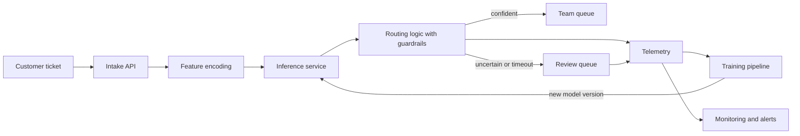

# 05. Architecture for ML Systems

**Level:** Practitioner · **Reading time:** 20 min · **Exercise:** 60 min
**Prerequisites:** [Planning for Mistakes](04-planning-for-mistakes.md). The guardrails and fallbacks from that chapter become components here.

> **In one sentence:** After this chapter you can draw the architecture of a feature that contains a model: components, responsibilities, interfaces, where each part runs, and the decisions behind the layout.

## Why this matters

The second version of the triage feature had a rough month.

- The data scientist called the model from a script. The backend wrote its own copy of the text cleanup.
- A model update changed the confidence scale from 0 to 1 to 0 to 100. The routing rule silently sent everything to the review queue.
- Adding an urgency model meant rewriting the backend.
- During an incident, nobody could tell which model version had produced a wrong route.

Nobody had drawn the system. Nobody had written down which team owned which boundary. This chapter is about doing both.

## The core idea

**Software architecture**, in Kästner's definition (chapter 8), is the part of design that handles the early decisions which matter most for a system's quality requirements. Those decisions are expensive to reverse.

Three words carry the chapter:

- A **component** is a part of the system with one responsibility.
- An **interface** is the contract for using a component: what goes in, what comes out, and what happens when it fails.
- An **architecturally significant requirement** is a quality requirement you can meet only by planning the whole system, such as "retrain weekly without releasing the app" or "work offline".

### Quality requirements drive the structure

A feature can be added almost anywhere. Qualities cannot. Latency, privacy, offline use and update speed all depend on how the parts are arranged. So you list the qualities first and let them choose the shape.

Kästner shows how far this goes with four systems that share almost nothing else ([chapter 8](https://mlip-cmu.github.io/book/08-thinking-like-a-software-architect.html)):

| System | What shapes the design |
|---|---|
| Music recommendations | Answers must be fast and serve millions, and the team experiments constantly. Reliability matters less, because cached or non-personalized recommendations can stand in. |
| Audio transcription | No real-time answers, but demand comes in bursts and inference needs specialized hardware. A cloud work queue fits, and rare updates can pass through manual checks. |
| Autonomous train | Dozens of models run in real time on hardware aboard the train. Mistakes can be fatal, so non-ML components carry most of the safety logic. |
| Privacy-focused smart keyboard | The phone trains the model as well as running it, on a battery. Even what telemetry to collect becomes a design decision. |

### Divide and conquer

Split the system into components, each with one job, so that teams can work in parallel and test parts in isolation. For ML systems, Kästner returns to one split again in chapter 10: keep the model apart from the business logic, and keep the training and telemetry infrastructure apart from both (telemetry is the data a running system reports about itself). The model then has one place to live, one owner and one interface to guard.

Kästner calls an interface the place where teams negotiate. It is rarely fully specified, and some responsibilities have to be written into it. His example is data quality. Does the component that provides the data answer for it, or does the pipeline that consumes it? He also recommends hiding whatever is likely to change inside one component, so that the change stays local. That is **information hiding**.

### Reason with views

You cannot hold a whole system in one picture. An **architectural view** shows one concern and hides the rest. Kästner compares this to city maps: a street map, a cycling map, a tourist map and a flood-zone map all describe the same city, each keeping the details that serve one purpose. The comparison fails in one place. City maps describe a place that exists. Architecture views describe a system that nobody has built yet, so two views can contradict each other until someone reconciles them.

### Use what others have learned

Architects do not start from scratch. **Architectural styles** are common overall structures. Kästner names six ([chapter 8](https://mlip-cmu.github.io/book/08-thinking-like-a-software-architect.html)):

- **Client-server.** One server serves many simpler clients over a network.
- **Multi-tier.** Requests travel down through layers and never back up. The usual form has three tiers: a presentation tier for the user interface, a logic tier for business rules and a data tier for storage.
- **Service-oriented and microservices.** Self-contained services call each other remotely. Each owns its data, so each deploys and scales on its own.
- **Event-based.** Components publish messages without knowing who listens. Robotics works this way.
- **Data-flow**, or pipe-and-filter. One component's output is the next one's input, like shell commands joined with `|`. Training pipelines take this shape.
- **Monolith.** One unit with interwoven internals. Simple to start, hard to grow.

**Design patterns** are named solutions to smaller design problems, with their known benefits and pitfalls recorded. A pattern states its name, the problem, the solution, the alternatives and the trade-offs. ML has no stable catalog yet, Kästner warns: the proposed patterns are scattered and poorly named. Two of his examples matter here. A **heartbeat** lets a component signal at fixed intervals, so a monitor can read silence as failure; faster signals mean quicker detection and more network traffic. A **feature store** keeps the feature-engineering code in one place for training and serving, so the two cannot compute an input differently, at the price of extra infrastructure.

### Architecture against speed

Kästner acknowledges the tension. Planning avoids expensive mistakes. It also slows the race to a first product, when a team may be investing in qualities that matter only if the product succeeds. His guidance: settle the key qualities early and leave room to change the rest.

## How it works, step by step

This procedure takes a feature from requirements to a reviewed architecture. Expect a few hours for a small feature.

1. **List the architecturally significant requirements.** Take the quality requirements from [chapter 03](03-goals-and-requirements.md) and mark the ones that need whole-system planning.
2. **Choose a decomposition.** Name each component and its single responsibility. Put the model in its own component.
3. **Define every interface that crosses an ML component.** For each one, write the happy path and the failure behavior: timeout, unavailable, output outside the allowed values. [Chapter 04](04-planning-for-mistakes.md) supplies the failures.
4. **Draw two views.** A component view shows what talks to what. A deployment view shows what runs where: server, phone, third-party API.
5. **Record each decision** with the alternatives you rejected and the quality it serves. The worked example shows the format.
6. **Prototype the uncertain parts.** When a quality depends on facts you do not have, measure them before committing. [Chapter 07](07-deploying-a-model.md) shows how Kästner does this for smart glasses.
7. **Plan for change.** Ask how the model gets updated without touching the rest, and how you roll a bad update back.

### A reference decomposition

Here is a decomposition for the triage feature that follows the book's advice to separate models, business logic and infrastructure.

| Component | One responsibility | Contains ML? |
|---|---|---|
| Intake API | Receive tickets and validate their shape | No |
| Feature encoding | Turn ticket text into the model's input | No, plain code shared with training |
| Inference service | Return a category, a confidence and a model version | Yes |
| Routing logic | Turn predictions into routes; hold the guardrails and the fallback | No |
| Review queue | Let a person handle uncertain tickets | No |
| Telemetry | Record predictions, routes and later corrections | No |
| Training pipeline | Turn collected data into a new model | Yes |
| Monitoring | Watch inputs, outputs and outcomes; raise alerts | No |

Each row has one owner. A model update touches three rows: encoding, inference and pipeline. It leaves the other five alone.

**Figure 1.** A component view of the triage feature: what talks to what.



The model has one caller. A new model enters only through the inference service, and routing logic never talks to the training pipeline.

## Worked example

An **architecture decision record** (ADR) is a short file that keeps one decision together with its context and its alternatives. Teams keep them in the repository, next to the code. The layout is the one Kästner describes for a design pattern: problem, solution, alternatives and trade-offs. This one settles where the triage model runs.

```markdown
# ADR 014: Run the triage model as its own service

Status: accepted, 2026-11

## Context
Routing must answer within 300 ms for 95 of 100 tickets (illustrative target).
The model is retrained weekly. Backend owns routing; data science owns the model.

## Decision
Deploy the model as an internal HTTP service. Routing rules, guardrails and the
fallback stay in the backend. The contract covers failure too: after 150 ms
without an answer, the backend routes to the general queue and logs a fallback.

## Alternatives considered
- Embed the model as a library in the backend: faster, but every model update
  becomes a backend release, and the model's owners cannot ship alone.
- Precompute predictions in a batch job: cheap, but a new ticket has no
  prediction until the next run.

## Consequences
+ Model and backend deploy, scale and fail independently.
- One more service to operate, and one network hop.
- The contract must cover failure, not only the happy path.

## Revisit when
Daily traffic stays below a few thousand tickets, or the model must run offline.
```

What to observe:

- **The decision names the quality that drives it.** Weekly retraining and separate ownership, not a preference for services.
- **The interface contract includes failure.** The 150 ms timeout turns the fallback from chapter 04 into a number that two teams can test.
- **The rejected alternatives have reasons.** In six months, the record answers the question "why not a library?" without a meeting.
- **The last line makes the decision reversible on purpose.** It states the evidence that would reopen it.

### What changes for LLM and agent systems

For most teams, the LLM is a component that someone else operates. You never deploy the model. That moves the architectural decisions to what surrounds it.

- **The prompt is a component.** Prompts, model names and settings belong in version control as artifacts with owners, not as strings inside application code.
- **Retrieval is a component.** A system that lets the model consult your documents needs an indexing step, a store and a search step. Each has an interface and each can fail. Kästner records this as the **retrieval-augmented generation** pattern, with its costs: extra infrastructure, extra inference cost and latency, and the risk that the model repeats proprietary text from what it retrieved. [Evaluation Is the Product](../03-evaluation/01-evaluation-is-the-product.md) explains how to test the result.
- **The text that reaches the model is an input surface.** A support ticket can carry instructions as easily as a web page can. The architecture view to add is a data-flow view: every source of text, and what the model can do after reading it: [Threat Modeling LLM Applications and Agents](../04-safety-and-security/01-threat-modeling-llm-applications-and-agents.md).
- **Cost becomes an architecturally significant requirement.** Price and latency scale with the number of tokens, the pieces of text a model reads and writes. Whether a component calls the model once per request or once per day is an architecture decision.

An **agent** changes who controls the flow. In a normal system, your code decides which component runs next. In an agent, the model decides which tool to call. An unreliable component now sits in the controller's seat. The stable part of the architecture is the tool layer: an allow-list of tools, credentials scoped to one task, and a sandbox. Design that layer as carefully as you would a public API. Start with [The Anatomy of an Agent](../02-building-agents/01-the-anatomy-of-an-agent.md) and [Agent Infrastructure, Sandboxes, Browser Use and Protocols](../05-frameworks-and-multi-agent/06-agent-infrastructure-sandboxes-browser-use-and-protocols.md).

## What the practitioners say

- **Architecture is about the decisions that are hard to undo.** Kästner defines it as the early decisions that most influence whether a system meets its quality requirements ([chapter 8](https://mlip-cmu.github.io/book/08-thinking-like-a-software-architect.html)). Qualities such as scalability, security and changeability cannot be added later without a rewrite.
- **Make trade-offs on purpose.** You will not meet every requirement. Considering alternatives at design time turns trade-offs into deliberate choices instead of side effects of the first implementation.
- **ML adds qualities to plan for.** Beyond the usual ones, he lists accuracy, training and inference cost, training and inference latency, reproducibility, data provenance, fairness and explainability.
- **The Twitter redesign.** As a non-ML illustration, he recounts how Twitter began as a single Ruby on Rails application with one database, built by three friends. As it grew, it became slow, patches made it harder to maintain, and hardware spending became unsustainable. After 2010 the company rewrote the system, which Kästner calls a rare last resort, with four quality goals: lower latency and operating cost, reliability through isolating failures, maintainability through clearer module boundaries, and modifiability so small teams could ship features quickly. The rewrite split the monolith into microservices, replaced Ruby with Scala, and removed the single bottleneck for writing tweets. His last remark is that the original design suited its time: for a prototype chasing early users, scalability mattered less than speed.

## Pitfalls

1. **Designing for features, not qualities.** Fix: start every design discussion with the quality requirements that constrain the shape.
2. **Model code inside business logic.** Fix: one component for inference, one for the rules that act on predictions.
3. **Interfaces that describe only the happy path.** Fix: for each interface, write the timeout, the fallback and the invalid-output case.
4. **Committing before measuring.** Fix: prototype the uncertain quality on real hardware or real traffic.
5. **Decisions kept in people's heads.** Fix: one short record per significant decision, stored with the code.
6. **Designing for a scale you do not have.** Fix: settle the qualities that could force a rewrite, and leave the rest until the product succeeds.

## Try it

Produce the architecture for one feature that contains a model.

Include:

1. A list of architecturally significant requirements, each with a number.
2. A component table with one responsibility and one owner per row.
3. Two views, hand-drawn is fine: components, and deployment.
4. Every interface that crosses an ML component, with its failure behavior.
5. Two decision records.

**You are done when** you can point to the component that fails for each architecturally significant requirement, and a new colleague can see where the model lives and what depends on it in under five minutes.

**Stretch goal:** write the decision record for an alternative you rejected, as a supporter of that alternative would write it.

## Key takeaways

- Architecture is the set of early decisions that decide whether the system can meet its quality requirements. They are expensive to reverse.
- Qualities drive the shape. Features do not.
- Split into components with one job each. Keep the model away from the business logic and from the infrastructure.
- Reason through views, one concern per picture, and check that the views agree.
- Write each significant decision down with its alternatives and the evidence that would reopen it.

## Self-check

1. Define an architecturally significant requirement and give one example for a feature you know.
2. Which change is an architecture decision rather than a feature?
   - A. Adding a fourth category to the ticket classifier.
   - B. Moving the model from a server to the user's phone.
   - C. Rewording the prompt that asks the model for a category.
   - D. Raising the confidence threshold for automatic routing.
3. Why do maps work as an analogy for architectural views, and where does the analogy fail?
4. A team puts model inference on the same code path as payment refunds. Which quality is most at risk?
   - A. The accuracy of the model on held-out data.
   - B. The throughput of the model's inference service.
   - C. Containment of a wrong prediction.
   - D. The size of the model file on disk.
5. What four quality goals does the book report for Twitter's redesign?
6. What must an interface contract for an ML component state, beyond inputs and outputs?

<details><summary>Show answers</summary>

1. A quality requirement that can be met only by planning the whole system. Example: the model must be retrained weekly without releasing a new version of the app.
2. B. It changes where computation runs, which affects offline use, privacy, latency, update speed and cost, and it is expensive to reverse. The other three are local changes.
3. Both show one concern at a time and hide the rest, so a reader can reason about a single question. Maps describe a city that exists. Views describe a system that does not exist yet, so they can contradict each other.
4. C. A wrong prediction sits one step from an irreversible action, so a model mistake becomes a system failure.
5. Lower latency and operating cost; reliability by isolating failures; maintainability through clearer module boundaries; modifiability so small teams can release features quickly.
6. The failure behavior: timeouts, unavailability, output outside the allowed values, what a confidence score means, and which model version produced the output.

</details>

## Sources

- **Book:** Christian Kästner, *Machine Learning in Production: From Models to Products* (MIT Press, 2025), chapter 8: [Thinking like a Software Architect](https://mlip-cmu.github.io/book/08-thinking-like-a-software-architect.html)
- **Book:** Christian Kästner, *Machine Learning in Production: From Models to Products* (MIT Press, 2025), chapter 10, for separating models from business logic: [Deploying a Model](https://mlip-cmu.github.io/book/10-deploying-a-model.html)
- **Reading:** Len Bass, Paul Clements and Rick Kazman, *Software Architecture in Practice*, 3rd edition (Addison-Wesley, 2012), recommended in chapter 8.

## Next

→ [Quality Attributes of ML Components](06-quality-attributes-of-ml-components.md), which puts numbers on the qualities that drive the decisions you just recorded.
