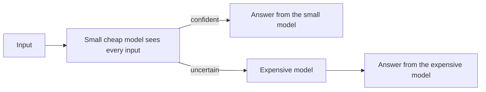

# 07. Deploying a Model

**Level:** Practitioner · **Reading time:** 30 min · **Exercise:** 60 min
**Prerequisites:** [Quality Attributes of ML Components](06-quality-attributes-of-ml-components.md), for the latency and cost targets that drive deployment.

> **In one sentence:** After this chapter you can choose how a model is served, where it runs and how it is updated, and you can wrap a model in an inference service whose failures the rest of the system survives.

## Why this matters

The triage model scored 92 percent in the notebook and 83 percent in production. Nobody had changed the model.

The notebook lowercased the text and cut it to 2,000 characters before predicting. The service did not. Two teams had written the same cleanup code twice, differently. Kästner's name for this failure is **training–serving skew**.

That was the first problem. The others were questions nobody had answered:

- Does the model run inside the backend process, or as its own service?
- Does it run on your servers or on the user's device?
- How does a new model version reach users?

## The core idea

**Model inference**, or just inference, is using a trained model to compute a prediction for one input. In its simplest form it is a pure function. A **feature vector**, a sequence of numbers that represents the input, goes in. A prediction comes out. Nothing is remembered between calls. Models are stored as files, called **serialized** models, and loaded into memory when a process starts.

Because inference has no state, many copies of it can run in parallel without coordination. Kästner calls the problem "embarrassingly parallel". Scaling is then a matter of running more copies.

Inference is like a hash function: the same input gives the same output, and any part of the system can call it safely. The comparison breaks twice. A hash has an exact definition and a model does not ([chapter 01](01-from-models-to-systems-and-products.md)). And a model that generates text is not even deterministic.

Around the simple function sit four decisions:

1. **How is it served?** As a library, a service, a batch job or a precomputed table.
2. **Where does it run?** On a server, on the user's device, or split between them.
3. **What crosses the boundary?** The raw input or the feature vector.
4. **How is it updated?**

### Four ways to serve a model

| Form | What it is | Use it when |
|---|---|---|
| Library | The model file ships with the application. Inference is a local function call | The model is small enough for the target and no network is needed |
| Service | A dedicated process answers requests over a network API. Many copies run behind a **load balancer**, which spreads requests across them | The model is large, needs special hardware, or must change without touching clients |
| Batch | The model travels to where the data is and scores it in bulk | There is much data, nobody waits for each answer, and moving the model is cheaper than moving the data |
| Precomputed | Predictions for common inputs are computed once and looked up | Predictions are expensive and the distinct inputs are few |

Kästner's example of a library is Tesseract, a text-recognition engine, and tools that put models into phone apps and browsers. His example of precomputed predictions is a table of translations for common words.

A **microservice** is a small, independently deployable process that other parts of the system call over the network. An inference service for one model fits that idea exactly. **Serverless** computing goes one step further: the cloud runs the service only when a request arrives and bills per request.

### Feature encoding and skew

**Feature encoding** turns the raw input, such as ticket text, an image or a database row, into the feature vector the model expects.

Encoding can live inside the inference service or with the client that calls it. Kästner lists what decides it: how expensive the encoding is, how often it changes, how many models share it, and how large the raw input is compared with the feature vector.

Whatever you choose, the training code and the serving code must run the same encoding. His advice is to write it once as a function, import that function in both places, and version it together with the model.

When many teams reuse the same encodings, a **feature store** helps. It catalogs feature-encoding code and can precompute and cache feature vectors.

### Server or device?

| Concern | Server-side | Client-side, on the user's device |
|---|---|---|
| Operating cost | The provider pays for every request | The user's hardware and battery do the work |
| Offline use | None | Works |
| Latency | Inference time plus a network round trip. Large inputs make it worse | No network hop, often slower hardware |
| Privacy | Data leaves the device | Data can stay on the device |
| Hardware | You choose it | Heterogeneous, with limited memory |
| Updates | Swap the model behind the API. Every user has the same version | An app update or a separate download. Users lag behind |
| Experiments and telemetry | Easy | Hard to roll back. Telemetry arrives late and coarser |
| Model exposure | None | Users can extract the model |

Hybrid designs take from both columns. A small model runs on the device and a large one on the server. Or the device holds only a precomputed table and asks the server for everything else.

### Combining several models

| Pattern | How it works | Example |
|---|---|---|
| Ensemble | Several models answer the same question in parallel. Combine them by average or majority vote | A random forest averages many decision trees |
| Metamodel, or stacking | A second model learns which model to trust in which situation | Which text-recognition model to trust in low light |
| Sequential decomposition | Models run in a chain, each doing one step, often with plain code between them | Recognize the text, then translate it |
| Cascade, or two-phase prediction | A small model decides whether to call an expensive one | A speaker detects its wake word locally. Only then does audio go to the cloud |

The cascade exists to save cost. Most inputs never reach the expensive model.

**Figure 1.** A cascade: the small model decides whether the expensive model runs at all.



The expensive model runs only on the inputs the small model is unsure about, so its cost is paid on a fraction of the traffic.

## How it works, step by step

Kästner's smart-glasses analysis, retold below, follows this path.

1. **Write the quality requirements that constrain deployment.** Latency budget, offline use, privacy, update frequency, cost, telemetry.
2. **Choose the serving form** from the first table.
3. **Choose where it runs** from the second table.
4. **Decide what crosses the boundary**: the raw input or the feature vector.
5. **Share the encoding code** between training and serving, and version it with the model.
6. **Plan the update path.** For a device, decide between an application update and a separate model download. Make sure the application and the model are tested together.
7. **Measure before committing.** Prototype on the real hardware and networks.
8. **Document the interface** for the team that calls it.

## Worked example

A minimal inference service, with the shared encoding from step 5. It needs Python 3.10 or newer and nothing else.

```python
# serve.py — a minimal inference service. Standard library only.
import json
from http.server import BaseHTTPRequestHandler, HTTPServer

def encode(subject: str, body: str = "") -> dict:
    """Turn a ticket into the model's input. The training code imports this too."""
    text = (subject + " " + body).lower().strip()
    return {"text": text[:2000]}

def predict(features: dict) -> dict:
    """Stand-in for a real model, loaded once when the process starts."""
    billing = "invoice" in features["text"]
    return {"category": "billing" if billing else "other",
            "confidence": 0.9 if billing else 0.3}

class Handler(BaseHTTPRequestHandler):
    def do_POST(self):
        if self.path != "/predict":
            return self.send_error(404)
        length = int(self.headers.get("Content-Length", 0))
        try:
            ticket = json.loads(self.rfile.read(length))
            result = predict(encode(ticket["subject"], ticket.get("body", "")))
        except (ValueError, KeyError, TypeError, AttributeError):
            return self.send_error(400, 'expected JSON like {"subject": "..."}')
        body = json.dumps({"category": result["category"],
                           "confidence": result["confidence"],
                           "model_version": "triage-2026-11-03"}).encode()
        self.send_response(200)
        self.send_header("Content-Type", "application/json")
        self.send_header("Content-Length", str(len(body)))
        self.end_headers()
        self.wfile.write(body)

if __name__ == "__main__":
    HTTPServer(("127.0.0.1", 8080), Handler).serve_forever()
```

Start it with `python serve.py`. In a second terminal:

```
curl -s -X POST http://127.0.0.1:8080/predict \
  -H 'Content-Type: application/json' \
  -d '{"subject": "Please resend my invoice"}'
```

The reply:

```
{"category": "billing", "confidence": 0.9, "model_version": "triage-2026-11-03"}
```

What to observe:

- **Encoding is one function.** `encode` is the only place that prepares input. The training script imports the same function, so the skew from the opening scene cannot happen.
- **The model is loaded once.** `predict` stands where a real service loads the serialized model at start. Loading per request would multiply the latency.
- **Bad input returns an error code.** A malformed request gets a 400. It does not crash the service or return a guess.
- **Every answer carries the model version.** When a wrong route reaches a customer, the log says which model produced it.
- **A caller needs a timeout.** Nothing here protects the backend from a slow model. The timeout and the fallback from [chapter 05](05-architecture-for-ml-systems.md) belong on the calling side.

The standard library's server is for learning. A production service runs several worker processes in a container, an isolated package of code and dependencies that runs the same way on every machine. Kästner shows the same three ingredients: an inference function, code that answers requests, and a container description with every dependency pinned to a version.

### What changes for LLM and agent systems

For most teams the first two decisions are already made. The LLM runs on the provider's servers. What remains is still a set of decisions.

- **Latency splits in two.** With streaming, the service sends the answer as it is generated. Users wait for the first token, the piece of text a model reads or writes, not for the last one. Design the interface around time to first token.
- **Cost is per token.** The precomputed pattern pays off quickly: cache answers for questions that repeat. Some providers also charge less for a prefix that recurs across requests (as of 2026-11; check the current terms).
- **The cascade is the standard cost lever.** Send routine tickets to a small, cheap model. Escalate the uncertain ones to a large one.
- **Small open models can run on your own servers or on devices** once they are shrunk: [Quantization](../09-efficient-deep-learning/04-quantization.md) and [Efficient LLM Inference and Deployment](../09-efficient-deep-learning/08-efficient-llm-inference-and-deployment.md).
- **Someone else updates your model.** A provider can replace the model behind a name you call. Pin the version where the API allows it, and re-run your evaluation set on every change: [Testing Generative and LLM Components](../08-quality-assurance/05-testing-generative-and-llm-components.md).

For an **agent**, the model is remote, but the loop that calls it, the tools it uses and the sandbox it runs in are yours to deploy. Keep credentials out of the model's reach and run untrusted code in isolation: [Agent Infrastructure, Sandboxes, Browser Use and Protocols](../05-frameworks-and-multi-agent/06-agent-infrastructure-sandboxes-browser-use-and-protocols.md).

## What the practitioners say

**A deployment decision is an architecture decision.** Chapter 10 of Kästner's book works through smart glasses that translate signs. The glasses can talk to a phone over Bluetooth, and the phone to a cloud.

He starts with the quality requirements: accurate translations, very fast updates of the displayed text to avoid motion artifacts and cybersickness, acceptable use offline or on slow connections, no constant upload of video for privacy, little battery, and many different phones. Cloud cost was not a concern, updates would be monthly or fewer, and telemetry was optional.

Those requirements rule out sending every frame to the cloud. He then lists the measurements to make before designing:

- A 2014 model of the glasses had a 5-megapixel camera, 1 GB of memory and 16 GB of storage.
- A 200 ms delay is noticeable as a pause in speech, and 20 ms is visible as video delay.
- A Bluetooth round trip takes 40 to 200 ms.
- Bluetooth carries up to 3 megabits per second. Video needs 4 to 10.

The design he explores is a hybrid, and he stops short of a final recommendation until the models run on the real hardware. Image stabilization runs on the glasses, so the text stays glued to the sign without a network trip. Translation runs only when new text appears, which makes caching effective, and it goes to the server. A smaller model on the device covers offline use ([chapter 10](https://mlip-cmu.github.io/book/10-deploying-a-model.html)).

**Updates are the hidden constraint.** On the server, you replace the model behind the API and every user has it. On a device, the book lists three designs: never update, which suits cheap toys and leaves you no feedback; ship the model inside the application, so only tested pairs of app and model exist; or download models separately, which saves data but lets app and model drift apart. He reports that Facebook settled on updating its mobile apps once every two weeks while its server-side models changed far more often.

**Document the model for the team that calls it.** Kästner finds that inference interfaces are usually documented by data types only. He recommends also stating the intended use, the inputs the model supports (the **target distribution**, which plays the part a precondition plays in ordinary code), the expected accuracy and how it was measured, including results by group, and the ethical considerations. Two templates exist: **model cards** (Mitchell et al., 2019), one or two pages per model, and fact sheets (Arnold et al., 2019). He observes that both are rarely used in practice.

## Pitfalls

1. **Writing the input preparation twice.** Fix: one encoding function, imported by training and serving, versioned with the model.
2. **Loading the model on every request.** Fix: load once at start.
3. **Server by default.** Fix: ask about offline use, privacy and input size before choosing.
4. **On-device without testing the slowest supported device.** Fix: measure on the weakest hardware you promise to support.
5. **Updating app and model separately without testing the pair.** Fix: a compatibility test for every combination you allow.
6. **No timeout on the caller.** Fix: a timeout and a fallback in the calling code, whatever the service promises.
7. **An interface documented by types alone.** Fix: a model card with supported inputs, accuracy and limits.

## Try it

Write a deployment note for one model.

Include:

1. The quality requirements that constrain deployment, with numbers.
2. The serving form and the location, each with the reason.
3. The encoding function and where training and serving import it.
4. The update path, and how a bad update is rolled back.
5. A six-line model card: intended use, supported inputs, expected accuracy, known limits.

**You are done when** a backend developer can call the model from your note alone, knows what happens when the model is slow or down, and knows which inputs not to send.

**Stretch goal:** run the service, wrap the call in a client with a 150 ms timeout and a fallback, and test what happens when the service is stopped.

## Key takeaways

- Inference is a pure function, so it scales by running more copies.
- Four ways to serve: library, service, batch, precomputed. Two places to run: server or device. Quality requirements choose.
- Training and serving must share one encoding function. Otherwise the model sees inputs it never learned from.
- Updates are easy on a server and hard on a device. Decide early.
- Measure on real hardware before committing. Combine models in a cascade when cost matters.

## Self-check

1. Name the four ways to serve a model and one condition that favors each.
2. What is training–serving skew?
   - A. The model was trained on older data than it meets in production.
   - B. The code that prepares inputs for training differs from the code used at prediction time.
   - C. The model is served from a different region than the one where it was trained.
   - D. The evaluation set is much smaller than the set used for training.
3. A translation app for glasses must work offline, protect privacy and update rarely. Which deployment fits, and what do you give up?
4. A speaker runs a tiny model to detect its wake word and sends audio to the cloud only afterward. Which pattern is this, and what is it for?
   - A. Ensemble: it improves accuracy by voting among several models.
   - B. Sequential decomposition: it splits one task into a chain of steps.
   - C. Cascade: it avoids paying for the large model on every input.
   - D. Precomputed serving: it replaces inference with a table lookup.
5. Why is inference easy to scale by running more copies?
6. What does a model card say that an ordinary API reference does not?

<details><summary>Show answers</summary>

1. Library, when the model is small and no network is needed. Service, when the model is large, needs special hardware or must change without touching clients. Batch, when much data must be scored and nobody waits per answer. Precomputed, when predictions are expensive and the distinct inputs are few.
2. B. The same encoding must run in both places. A difference changes the inputs the model receives at prediction time.
3. Client-side, or a hybrid with a small model on the device. You give up model size and accuracy, fast updates and easy telemetry.
4. C. The small model acts as a gate, so the expensive model runs only when it is needed.
5. Inference keeps no state between calls, so copies need no coordination. More copies serve more requests in parallel.
6. The intended use, the inputs the model supports, the expected accuracy with the evaluation it rests on, results by group, the known limits and the ethical considerations.

</details>

## Sources

- **Book:** Christian Kästner, *Machine Learning in Production: From Models to Products* (MIT Press, 2025), chapter 10: [Deploying a Model](https://mlip-cmu.github.io/book/10-deploying-a-model.html)
- **Reading:** Margaret Mitchell et al., "Model Cards for Model Reporting" (2019), the documentation template cited in chapter 10.
- **Reading:** Matthew Arnold et al., "FactSheets: Increasing Trust in AI Services through Supplier's Declarations of Conformity" (2019), cited in chapter 10.

## Next

→ [Automating the Pipeline](08-automating-the-pipeline.md), because a deployed model has to be replaced regularly, and that should never be a manual job.
