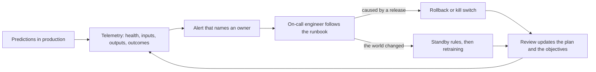

# 10. Planning for Operations

**Level:** Practitioner · **Reading time:** 30 min · **Exercise:** 90 min
**Prerequisites:** [Planning for Mistakes](04-planning-for-mistakes.md), whose failure modes become incidents here, and [Automating the Pipeline](08-automating-the-pipeline.md).

> **In one sentence:** After this chapter you can prepare an ML feature for launch: objectives that define "healthy", monitoring that watches the model and not only the server, a rehearsed rollback, and an incident plan that says who does what.

## Why this matters

Saturday, 03:10. The support lead writes in the channel of the engineer on duty: "Tickets are piling up unrouted."

The on-call backend engineer opens the dashboard. CPU, memory, uptime: all green. The inference service answers in 12 ms.

It is answering "other" for every ticket. A model update went out on Friday afternoon. Nobody had defined what a healthy model looks like, so no alert fired. Nobody knew who to call about a model. Nobody had checked how to switch the model off. The engineer alerts the data scientist, who is on a hike.

Operating the servers was under control. Operating the model had never been planned.

## The core idea

**Operations**, in Kästner's definition (chapter 13), covers every task, piece of infrastructure and process for deploying, running and updating a system in production. His warning to designers: a system that resists scaling, updates and observation at design time will torment whoever has to operate it. You plan for operations during design, not after launch.

Four pieces make up that plan:

| Piece | The question it answers | Where it comes from |
|---|---|---|
| Service-level objectives | What does "healthy" mean, in numbers? | [Chapter 03](03-goals-and-requirements.md) |
| Observability | How will we see that it stopped being healthy? | This chapter |
| Automated, reversible deployment | How do we change it without breaking it? | [Chapter 08](08-automating-the-pipeline.md) |
| Incident response | What do we do when it breaks? | [Chapter 04](04-planning-for-mistakes.md) |

An ML feature has two properties that ordinary services lack:

- **It can go bad without a deployment.** The world changes: a new product, a new kind of spam. That is **drift**.
- **Its failures look like normal output.** A server that is down returns errors. A model that is wrong returns confident wrong answers with a success status.

Inspecting an ordinary service is like inspecting a bridge. You check it on a schedule, and it changes only when someone works on it. Operating a model is like tending a garden, which changes by itself. The comparison breaks on speed. A garden changes slowly and in sight. A model's behavior can change overnight.

## How it works, step by step

### Step 1: Write service-level objectives

A **service-level objective (SLO)** is a target for an operational quality of the system or of one component. Typical targets cover latency, throughput, availability, error rate and the time to deploy an update.

| Objective for the triage feature | Target | Measured from |
|---|---|---|
| Every ticket gets a route | 99.9 percent within five minutes | Routing log |
| Routing latency | p95 under 300 ms | Inference service telemetry |
| First-time-right rate | At least 85 percent | Corrections log, weekly |
| Time to detect a bad model | Under 24 hours | Alert log |
| Time to roll back | Under 10 minutes | Rehearsal |

Kästner's running example in chapter 13 is a blogging platform with fifty thousand authors and a spam filter powered by a fine-tuned large language model, one trained further on the site's own data, of fifty billion parameters. Three of his points:

- **Write SLOs for the system and for each component.** They are not the same. His blogging platform keeps meeting its SLO while its spam filter is down, because comments wait in a queue.
- **Negotiate the numbers.** Raising availability from 99.9 to 99.99 percent cuts the allowed downtime from about nine hours a year to fifty-two minutes. For many products the extra infrastructure is not worth it. He describes operations as risk management, not the avoidance of all risk.
- **An SLO can become a contract**, called a service-level agreement, with consequences for missing it.

### Step 2: Make it observable

**Observability** is how well you can tell what a system is doing from what it reports about itself. The reports are **telemetry**: log lines, counts and measurements. Kästner splits the work in three:

1. **Instrument**: add the code that produces telemetry, with logging or a metrics library. Much arrives without effort: web servers log every request, and libraries for calls between services record who called whom and how slowly. Kästner names Prometheus and OpenTelemetry for counting requests and tracking latency.
2. **Collect**: gather the telemetry from every instance into one place. Prometheus pulls metrics on a schedule, statsd receives pushed ones, and Flume and LogStash gather logs from many sources.
3. **Analyze**: show trends on a dashboard and raise **alerts** when a value crosses a threshold. Grafana is his example for both. One of his alerts calls a developer's phone if the whole service is unreachable for more than three minutes.

His design advice is to pick infrastructure with observability built in from the start, because retrofitting it later is a large project.

A server dashboard is not enough for a model. Watch four signals:

| Signal | What it tells you | Example for triage | How fast |
|---|---|---|---|
| System health | Is the service up and quick? | Error rate, p95 latency | Seconds |
| Inputs | Has the world changed? | Ticket length, language, subject words | Minutes |
| Outputs | Is the model behaving as usual? | Share routed to each category, confidence spread | Minutes |
| Outcomes | Is the model still right? | Re-route rate, corrections, complaints | Days |

Only outcomes measure correctness, and they are the slowest. Inputs and outputs arrive in minutes, but they are indirect: a change in them does not say whether the model got worse.

One rule holds the signals together: every alert names a person and an action.

### Step 3: Make change routine and reversible

- **Continuous integration** builds and tests every change automatically.
- **Continuous deployment** releases what passes.
- A **canary release** shows the new model to a few users first, and watches telemetry to decide whether to continue or to revert.
- **Rollback** returns to the previous version. With containers, an isolated package of code and dependencies, it is a switch to the previous package.
- A **kill switch** is a flag that turns the model's action off while the rest of the system keeps running. The fallback from [chapter 04](04-planning-for-mistakes.md) takes over: tickets go to the general queue.
- **Infrastructure as code** keeps server and network configuration in scripts under version control, with tools such as Ansible, Puppet or Terraform. In Kästner's example, replacing the model's API key must not leave half the spam-filter instances failing on an outdated one.
- **Orchestration** decides how many copies of each container to run and where. Kubernetes, his main example, restarts containers that stop answering and scales them with load. He advises adopting it only when you truly need many machines, while designing from the start so that machines can be added.

### Step 4: Write the incident response plan

An **incident response plan** is a written plan for the kinds of trouble you can anticipate. Kästner names seven parts to prepare. Here they are with a triage example for each.

| Part | What to prepare | Triage example |
|---|---|---|
| Reporting channels | A way for problems to reach someone who can act | The "wrong team?" button opens a ticket. So does an alert |
| People on call | Who answers, and who else to call | Backend on-call first, the data scientist as escalation |
| Procedures and switches | What to do first, and the means to do it | A rollback script, the kill switch, a standby rule |
| Recovery | How to restore the earlier state | Keep the previous model. Re-route the affected tickets |
| Telemetry in advance | Data that shows the scope and origin later | Every prediction logged with its model version |
| Investigation | A review after each incident | A written review within a week, with changes assigned |
| Public communication | Who speaks to users and to the public | The support lead writes to affected customers |

**On-call** is the rotation of people who answer alerts outside working hours. A **runbook** is the short page that says what to do when a specific alert fires. Kästner adds that automation speeds up a response, and that mistakes in that automation can cause the incident in the first place.

**Figure 1.** From a prediction in production to an alert, an action and a review that improves the plan.



Telemetry opens the loop and the review closes it: what the team learns goes back into the alerts, the runbook and the objectives.

### Step 5: Run a launch review

Use this checklist before any feature with a model goes live.

- [ ] SLOs exist for the system and for the ML component.
- [ ] Every prediction is logged with its model version, a summary of the input, the output and the latency.
- [ ] A dashboard shows all four signals: health, inputs, outputs, outcomes.
- [ ] Each alert has an owner and a runbook entry.
- [ ] Each alert was triggered once on purpose and reached a person.
- [ ] Rollback was rehearsed, and its duration was measured.
- [ ] The kill switch and the fallback were tested.
- [ ] The incident plan has one row per high-severity failure mode from [chapter 04](04-planning-for-mistakes.md).
- [ ] On-call knows whom to call about a model.
- [ ] Cost per day is on the dashboard.

## Worked example

The smallest useful model monitor: one that notices when the model's output distribution moves. It needs Python 3.10 or newer and nothing else.

```python
# monitor.py — is the model sending unusually much traffic to "other"?
from collections import Counter
from datetime import datetime, timedelta

BASELINE_SHARE, TOLERANCE = 0.20, 0.10   # from the last 30 days of routing logs
MIN_EVENTS = 200                          # never judge on a tiny sample

def check(predictions, now):
    """Return an alert message, or None when the signal looks normal."""
    recent = [p for p in predictions
              if now - datetime.fromisoformat(p["at"]) <= timedelta(hours=1)]
    if len(recent) < MIN_EVENTS:
        return None
    share = Counter(p["category"] for p in recent)["other"] / len(recent)
    if abs(share - BASELINE_SHARE) > TOLERANCE:
        return f"alert: {share:.0%} of routes go to 'other' (baseline {BASELINE_SHARE:.0%})"
    return None

if __name__ == "__main__":
    def hour(category_of):
        return [{"category": category_of(i), "at": "2026-11-24T10:00:00"}
                for i in range(1000)]
    now = datetime.fromisoformat("2026-11-24T10:30:00")
    print(check(hour(lambda i: "other" if i % 5 == 0 else "billing"), now))
    print(check(hour(lambda i: "other" if i % 5 != 0 else "billing"), now))
```

Run `python monitor.py`. The output:

```
None
alert: 80% of routes go to 'other' (baseline 20%)
```

What to observe:

- **This is an output monitor.** It would have caught the Saturday incident within an hour.
- **It cannot say why the share moved.** The model may have broken. Or a new product may have launched, and the extra "other" tickets are legitimate. So it alerts a person. It does not roll back by itself.
- **It refuses to judge small samples.** Twenty tickets in a quiet hour prove nothing.
- **The baseline is itself a guess that ages.** Recompute it from recent logs, and write down when.
- **It needs a partner.** Pair it with the slow outcome signal, the first-time-right rate, which is the only one that measures correctness. That is the proxy problem from [chapter 03](03-goals-and-requirements.md) again.

Here is the incident plan for this feature, one row per class:

| Class of incident | Detected by | First action | Owner |
|---|---|---|---|
| Inference service down or slow | Error rate, latency | Traffic falls back to the general queue | Backend on-call |
| Model routes badly after a release | Output monitor, re-route rate | Roll back to the previous model | Backend, then data science |
| The world changed | Input monitor, outcome rate | Standby rules now, retraining next | Data science |
| The model provider fails | Error rate, throttled requests | Switch to the fallback model, or queue | Backend on-call |
| A customer is harmed by an output | Complaints | Kill switch for that action, then answer the customer | Support lead and on-call |

### What changes for LLM and agent systems

The model becomes a dependency that you do not operate.

- **Watch the provider as your users see it.** Write SLOs for error rate and for the time to the first token. Test a fallback model, or a queue, before you need it.
- **Log enough to reproduce an answer**: model name and version, settings, prompt version, output, token counts and cost. These logs hold user text, so give them access control and a retention period.
- **Put cost on the dashboard, with an alert.** A prompt change can double the tokens.
- **Logs cannot grade quality.** Sample answers every day and grade them against a rubric: [LLM as a Judge and Rubrics](../03-evaluation/03-llm-as-a-judge-and-rubrics.md). Thumbs-down counts are biased proxies, as in chapter 03.
- **One incident class is new**: harmful output, or a wave of injected instructions. Track how often the guardrails stop something: [Defenses: Guardrails, Detection and Secure Design](../04-safety-and-security/04-defenses-guardrails-detection-and-secure-design.md).

For an **agent**, record a trace of every tool call: what was called, with which arguments, and what happened. Caps on steps and on spending are the kill switches. Running and judging experiments on live traffic is covered in [Testing and Experimenting in Production](../08-quality-assurance/09-testing-and-experimenting-in-production.md).

## What the practitioners say

Kästner presents DevOps and MLOps as a set of principles rather than a tool list (chapter 13). Paraphrased:

1. Consider the whole process, from idea to operation, not single tools.
2. "Automation, automation, automation" ([chapter 13](https://mlip-cmu.github.io/book/13-planning-for-operations.html)).
3. Use infrastructure that can grow: loosely coupled components, scaled independently.
4. Document, test and version everything, including scripts, configurations, data and models.
5. Iterate and release often, for fast feedback.
6. Emphasize observability.
7. Share goals and responsibilities across developers, operators and data scientists.

He cites an interview study of MLOps practitioners (Shankar and colleagues, 2022) that names three goals: **velocity**, fast iteration through automation; **validation**, automated testing, monitoring and quick feedback; and **versioning**, keeping several versions of models and data to recover from problems.

He also surveys the tool market ([chapter 13](https://mlip-cmu.github.io/book/13-planning-for-operations.html)). Airflow, Luigi, Kubeflow and DVC automate pipelines. Great Expectations and DeepChecks validate data, and Alibi Detect looks for drift. MLflow, Neptune and Weights and Biases track experiments and model versions. Fiddler, Aporia and Arize watch models in production. Data engineers, he writes, deserve a place on the team. Their tools catch problems such as a small change to cleaning code that silently discards 90 percent of a spam detector's test data.

Two of his cautions apply to every team. The tools are secondary to the collaboration they support. And MLOps practice fits some projects better than others: it suits web systems that change quickly and depend on experiments, and it fits autonomous trains or models inside phone apps poorly. At a certain scale, his advice is to bring in specialists, such as site reliability engineers, data engineers and MLOps engineers.

## Pitfalls

1. **Monitoring only the servers.** Fix: the four signals, including inputs, outputs and outcomes.
2. **Alerts without an action.** Fix: no alert without an owner and a runbook entry.
3. **Only one kind of signal.** Outcomes alone are too slow. Outputs alone cannot tell a broken model from a changed world.
4. **A rollback nobody has tried.** Fix: rehearse it and time it.
5. **No way to switch the model off.** Fix: a kill switch, tested, with a fallback behind it.
6. **Buying tooling instead of setting objectives.** Fix: SLOs first. Tools follow.
7. **No review after an incident.** Fix: a written review with assigned changes, within a week.

## Try it

Run a launch review for one feature that contains a model.

Include:

1. Three SLOs, with where each is measured.
2. One log line design: the fields recorded for every prediction.
3. Four signals on one dashboard, and one alert for each.
4. A rehearsed rollback and a tested kill switch, with timings.
5. An incident plan with one row per high-severity failure mode.

**You are done when** you can break the feature in two ways, by stopping the model and by making it wrong, and in both cases an alert reaches a person within an hour who knows the first action to take.

**Stretch goal:** run a game day with the on-call rotation: inject a bad model into a canary and measure time to detect and time to recover.

## Key takeaways

- Plan operations during design. SLOs define healthy, observability shows when it stops, and an incident plan says what to do.
- Write SLOs for the system and for each component. They are not the same, and their numbers are a negotiation.
- Watch four signals: system health, inputs, outputs and outcomes. Each one is fast or honest, never both.
- Every alert needs a person and an action. Every deployment needs a rehearsed rollback and a kill switch.
- Models go bad without a deployment, and their failures look like success. That is why servers alone are not enough to monitor.

## Self-check

1. Define an SLO and write one for a model, not for a server.
2. The spam filter is down for an hour, and the blogging platform still meets its SLO. How?
   - A. The SLO was measured on the wrong component of the system.
   - B. The platform queued the comments and filtered them later.
   - C. The filter kept running on a backup server without anyone noticing.
   - D. The SLO left out the periods when the system was under maintenance.
3. Name the three steps of observability.
4. A monitor shows that the share of tickets routed to "other" rose from 20 to 70 percent. What is the right first move?
   - A. Roll back the model automatically, because the change is large.
   - B. Retrain the model at once on the most recent tickets.
   - C. Raise the alert threshold so that the monitor stops firing.
   - D. Alert a person, who checks for a release or a real-world change.
5. Raising availability from 99.9 to 99.99 percent changes the allowed downtime per year from what to what?
6. Name five parts of an incident response plan.

<details><summary>Show answers</summary>

1. An SLO is a target for an operational quality of the system or a component. Example for a model: the share of tickets routed to "other" stays between 15 and 25 percent, measured hourly from the routing log.
2. B. The system SLO covers showing blogs. The spam filter has its own SLO. Comments wait in a queue until the filter returns.
3. Instrument the system to produce telemetry, collect the telemetry in one place, and analyze it with dashboards and alerts.
4. D. The output distribution moved, and the monitor cannot tell a broken model from a changed world. A person checks for a recent release and for a real change in the tickets.
5. From about nine hours to fifty-two minutes.
6. Any five of: reporting channels, people on call, prepared procedures and switches, recovery, telemetry kept in advance, investigation after the incident, planned public communication.

</details>

## Sources

- **Book:** Christian Kästner, *Machine Learning in Production: From Models to Products* (MIT Press, 2025), chapter 13: [Planning for Operations](https://mlip-cmu.github.io/book/13-planning-for-operations.html)
- **Reading:** Betsy Beyer, Chris Jones, Jennifer Petoff and Niall Richard Murphy, *Site Reliability Engineering: How Google Runs Production Systems* (O'Reilly, 2016), recommended in chapter 13.
- **Reading:** Shreya Shankar, Rolando Garcia, Joseph M. Hellerstein and Aditya G. Parameswaran, "Operationalizing Machine Learning: An Interview Study" (2022), the source of velocity, validation and versioning.

## Next

→ You have finished this part. To go deeper into the model itself, continue with [Efficient LLM Inference and Deployment](../09-efficient-deep-learning/08-efficient-llm-inference-and-deployment.md), or return to [Planning for Mistakes](04-planning-for-mistakes.md) and run its analysis on a feature you own.
