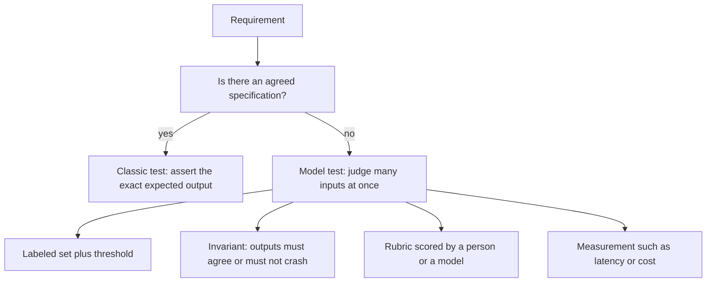

# 01. Quality Assurance Basics and the Oracle Problem

**Level:** Foundation · **Reading time:** 22 min · **Exercise:** 45 min
**Prerequisites:** none. If the word *model* is new to you, read [Machine Learning in a Nutshell](../01-foundations/01-machine-learning-in-a-nutshell.md) first.

> **In one sentence:** After this chapter you can name the oracle behind any test you write, and you know why a learned model needs a different kind of test from the code you are used to.

## Why this matters

Your team adds a triage feature to its support system. Each incoming ticket is routed to one of four queues: billing, technical, account, or other. The routing comes from a **model**, a function whose rules were learned from examples instead of written by hand.

You already know how to test ordinary code. For a function that returns the next business day, a test is three lines: give it an input, compare the result with the answer, fail if they differ. The expected answer comes from a specification that everyone accepts.

Now look at the triage feature and try to write the same test. What is the correct queue for "Charged twice and the app won't start"? Billing and technical are both defensible. Suppose the model routes 92 percent of a set of old tickets correctly. Is the test green? Which ticket do you point to when it is red?

This chapter answers two questions: what is a test when you cannot say what the right answer is, and which of your existing testing habits still work.

## The core idea

A **test oracle** is whatever tells you the expected output for a given input. In classic unit tests the oracle is the specification, written as a comparison in the test itself. Other oracles exist: a slower reference implementation, a human expert, or a rule such as "the program must not crash". The **oracle problem** is the difficulty of finding such an expected output, especially for inputs you generated automatically.

Machine learning is what you reach for when no specification exists, because the task is too complex to write down as rules. That is exactly why the usual oracle is missing. You asked a model to do the job *because* you could not write the test.

The fix is a change of question. For ordinary code you ask "is the output correct?". For a model you ask "how often is the output good enough, where is it bad, and can we live with that?".

| Term | Question it answers | Triage example |
|---|---|---|
| **Testing** | Does the software behave as expected on these inputs, in a controlled setting? | Run 500 old tickets through the model and compare with the queue an agent chose. |
| **Debugging** | Why does it misbehave? | "It sends password resets to technical when the customer mentions the app." |
| **Verification** | Did we build the software correctly, per its specification? | The model file loads, and the API returns one of the four labels. |
| **Validation** | Did we build what the customer needs? | Agents agree that the routing saves them time. |

Testing and debugging feed each other: a test shows that a problem exists and how often, debugging finds the cause. With models the line is blurry, and the same measurements serve both.

An analogy: a model is like a new hire on probation. You do not check every reply against an answer key. You sample their work, look for patterns in the mistakes, and decide whether the quality is acceptable for the desk they sit at. The analogy breaks at scale and consistency: a model gives the same answer to the same input every time, so one carefully chosen failure can be replayed forever, which makes systematic probing more productive than it is with a person.

## How it works, step by step

Assurance for a model-based feature is the same procedure as for any software, with one step changed.

### 1. Name the quality you are assuring

Correctness is only one target. Latency, cost per ticket, robustness to typos, and usability all need their own checks.

### 2. Choose the level

| Level | What runs | Triage example |
|---|---|---|
| Unit | One function or one model | The model returns a valid label for an empty string. |
| Integration | Several parts together | Model output feeds the queue router, which calls the ticket database. |
| System | The whole product, end to end | A ticket arrives by email and lands in the right queue with the right priority. |
| Acceptance | The whole product, judged by users | Support agents try it for a week on real mail. |

### 3. Choose the approach

Kästner groups assurance techniques into three families, and all three apply to ML systems: **dynamic** techniques execute the code (testing, dynamic program analysis), **static** techniques read it without running it (code review, linting, static data-flow analysis, formal verification), and **process evaluation** looks at how the work was done (are requirements written down, are known bugs tracked).

### 4. Name the oracle

This is the step that changes. Pick one of four oracles for each requirement:

| Requirement | Oracle | Needs labels? |
|---|---|---|
| Routing quality overall | A labeled set and a threshold ("at least 85 percent agree with agents") | Yes |
| Routing must not change for trivial edits of the text | An invariant: two outputs must match | No |
| The summary must be polite and short | A rubric scored by a person or by another model | Partly |
| The endpoint answers in under 800 ms | A stopwatch | No |

**Figure 1.** The branch that turns a classic test into a model test: with no specification, the oracle comes from one of four other sources.



A classic test checks one output against a specification; a model test needs a different oracle and usually judges a rate over many inputs.

### 5. Automate, then enforce

Automated tests only help if they run. **Continuous integration (CI)** runs the test suite on every change, in a clean environment, and can refuse to merge a change that breaks a test.

### 6. Check the tests themselves

**Coverage** reports which lines and branches the tests executed. **Mutation testing** goes further: a tool injects small artificial bugs, such as turning `<` into `>`, and counts how many the suite catches.

### 7. Plan it in

Write the test idea next to each requirement, and treat a feature as done only when its tests exist and pass. Kästner pairs each design activity with a matching test activity, following the **V-model** from software engineering.

## Worked example

A small `pytest` suite for the triage feature. The classifier is a keyword rule standing in for a real model, so the file runs with no model and no cost. It is illustrative, written against the standard `pytest` style of plain functions with `assert`.

```python
# triage.py -- a stand-in for a learned model, so the tests run anywhere.
KEYWORDS = {
    "billing": ("invoice", "refund", "charged"),
    "technical": ("error", "crash", "bug"),
    "account": ("password", "login", "lock"),
}

def triage(ticket: str) -> str:
    """Return the queue a ticket is routed to."""
    text = ticket.lower()
    for label, words in KEYWORDS.items():
        if any(word in text for word in words):
            return label
    return "other"
```

```python
# test_triage.py
from triage import triage

# 1. Classic unit test: one input, one exact expected output.
def test_refund_goes_to_billing():
    assert triage("I want a refund for my last order") == "billing"

# 2. A statistical oracle: a labeled set and a threshold.
LABELED = [
    ("Please refund my order", "billing"),
    ("The app crashes on start", "technical"),
    ("I can't log in, reset my password", "account"),
    ("Do you ship to Iceland?", "other"),
    ("Charged twice, please fix my invoice", "billing"),
    ("My password does not work", "account"),
    ("How do I update my credit card?", "billing"),  # the stand-in gets this wrong
]

def test_accuracy_on_labeled_tickets():
    misses = [t for t, label in LABELED if triage(t) != label]
    accuracy = 1 - len(misses) / len(LABELED)
    assert accuracy >= 0.8, f"accuracy {accuracy:.2f}; misrouted: {misses}"

# 3. No oracle at all: the answer must not depend on a polite greeting.
def test_routing_ignores_greetings():
    for text, _ in LABELED:
        assert triage("Hi team! " + text) == triage(text)
```

What to observe:

- Test 2 **passes** at six of seven, although one ticket is routed wrong. A model test passes at a rate. No single example fails the suite.
- Raise the threshold to `0.9` and test 2 fails, naming the misrouted ticket. The failure message is where debugging starts.
- Test 3 needs no labels. It compares two outputs of the same model, so it works on any text you have, labeled or not.

## What the practitioners say

Christian Kästner's *Machine Learning in Production* is the source for this chapter.

- **All classic techniques still apply.** He presents testing, code review, and static analysis as well-established in software engineering, and argues they transfer to ML systems when they are planned, automated, and integrated into the development process ([chapter 14](https://mlip-cmu.github.io/book/14-quality-assurance-basics.html)).
- **Most ML testing stops at the unit level.** In his observation, ML teams test a single model in isolation far more often than they test how it is integrated into a system (chapter 14). Chapters [08](08-system-quality-end-to-end-tests-and-guardrails.md) and [09](09-testing-and-experimenting-in-production.md) of this part cover the levels above it.
- **Review finds more than bugs.** Studies of today's lightweight code review find it only moderately effective at catching defects. It does surface readability and design problems, and it spreads knowledge through the team. He suggests reviewing ML artifacts the same way: data code, training code, evaluation reports, and monitoring plans (chapter 14).
- **A single wrong prediction is not a bug.** He argues against writing per-example unit tests for models and against failing a suite over one mistake. Most models are deterministic at inference, so this is not about noise: in his words, "the issue is the lack of a specification, not statistical noise" ([chapter 15](https://mlip-cmu.github.io/book/15-model-quality.html)).
- **Evaluation is validation, not verification.** Without a specification you cannot check an implementation against one. You check whether the model fits the user's needs, which makes evaluating a model closer to requirements engineering than to testing code (chapter 15).
- **Tooling beats good intentions.** His examples of enforced practice include CI that refuses to merge a change that breaks a test, a version control setup that refuses merges that add no unit tests, and Google's decision to show static-analysis warnings inside code review, where reviewers create social pressure to fix them (chapter 14).

## Pitfalls

1. **Testing a model with per-example unit tests.** One disagreement fails the suite, and the suite never goes green. Fix: assert a rate over a labeled set, and print the misses.
2. **Reporting one accuracy number as "tested".** An overall rate hides the group where the model fails. Fix: add slices (see [Slicing](03-slicing.md)) and oracle-free invariants (see [Testing Without Oracles](04-testing-without-oracles.md)).
3. **Treating the model as the only risky part.** Engineering judgment: expect many defects in the ordinary code around the model, such as parsing, routing, and retries. Fix: keep conventional unit and integration tests for that code.
4. **Skipping tests because a model is "non-deterministic".** Most deployed models return the same output for the same input. If yours samples text, meaning it picks each next word with some randomness, set the sampling to its most deterministic setting or allow a rate. Don't use randomness as a reason to test nothing.
5. **Letting the test set leak into the model.** If you tuned prompts or training on the same tickets you test with, the score is inflated. Fix: hold out a set, meaning examples kept aside from all training and tuning, and touch it rarely. [Measuring Model Quality](02-measuring-model-quality.md) covers this.
6. **Writing tests that nobody runs.** Fix: put them in CI and block merges on failure.

## Try it

Take a small labeled sample: 30 support tickets with the queue an agent chose, or 30 short texts of any kind.

1. Write one classic unit test for a helper function in the project.
2. Write one rate-based test with a threshold you can defend.
3. Write one invariant test that needs no labels.
4. For each test, write a comment starting with `# oracle:` that names what decides pass or fail.

You are done when the suite runs with one command, when the rate-based test's failure message lists the failing examples, and when each `# oracle:` comment names a specification, a labeled set, a rubric, or an invariant. **Stretch goal:** lower the threshold until a test fails, then use only the failure message to form a hypothesis about why the model fails on those examples.

## Key takeaways

- A test oracle is whatever tells you the expected output. Learned models usually lack one, because you used learning precisely where no specification exists.
- So models are evaluated for fit, not correctness: a rate, a pattern of mistakes, and a judgment about whether they are acceptable.
- Verification asks whether you built the software right; validation asks whether you built the right software. Model evaluation is validation.
- Four oracles cover most needs: a labeled set with a threshold, an invariant, a rubric scored by a person or a model, and a measurement such as latency.
- Classic assurance techniques still apply: levels of testing, CI, coverage, review, and planning tests alongside requirements.

## Self-check

1. A test for `next_business_day` fails. What decided that the output was wrong?
2. A triage model agrees with agents on 91 percent of held-out tickets. Which change makes this a verification activity rather than validation?
3. Why does one per-example unit test per ticket fail as a design for a model?
4. Which oracle needs no labels at all?
5. What does mutation testing measure?

<details><summary>Show answers</summary>

1. The specification of the function, expressed as the expected value in the `assert`. That is the oracle.
2. None. Checking results against labeled examples judges whether the model fits the need, which is validation. Verification would compare an implementation with a specification, for example checking that the API returns one of the four allowed labels.
3. A model is accepted at some rate of mistakes. A suite of per-example tests fails on the first disagreement and can never pass, and it says nothing about how often or where the model fails.
4. An invariant. It compares two outputs of the same model, or checks a property such as "does not crash", so it needs no expected answer.
5. The quality of the test suite: how many small, artificially injected bugs the existing tests detect.

</details>

## Sources

- **Book:** Christian Kästner, *Machine Learning in Production: From Models to Products* (MIT Press, 2025), chapter 14: [link](https://mlip-cmu.github.io/book/14-quality-assurance-basics.html)
- **Book:** Christian Kästner, *Machine Learning in Production: From Models to Products* (MIT Press, 2025), chapter 15, for verification versus validation, fit instead of correctness, and the definition of the oracle problem: [link](https://mlip-cmu.github.io/book/15-model-quality.html)

## Next

→ [Measuring Model Quality](02-measuring-model-quality.md), because the first oracle most teams build is an accuracy number, and it is easy to get that number wrong in six well-known ways.
