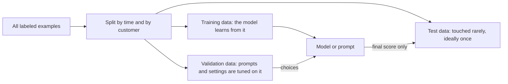

# 02. Measuring Model Quality

**Level:** Practitioner · **Reading time:** 25 min · **Exercise:** 60 min
**Prerequisites:** [Quality Assurance Basics and the Oracle Problem](01-quality-assurance-basics-and-the-oracle-problem.md)

> **In one sentence:** After this chapter you can report a quality number for a model-based feature with its baseline and its split, and you can audit someone else's number for the six classic ways it gets inflated.

## Why this matters

The triage model from the previous chapter scores 93 percent on your test set. Your lead asks two questions. "Is 93 good?" It depends: on the baseline, on which mistakes cost what, and on whether the test tickets look like tomorrow's tickets. "Will it stay at 93 in production?" Probably not. Offline numbers are often optimistic, and usually for avoidable reasons.

This chapter gives you a procedure that produces a number you can defend, and a checklist that explains why the next person's number may not hold.

## The core idea

A model is never *correct*. It is more or less **useful** for a task. The statistician George Box made the point about scientific models generally, in a line Kästner borrows: "All models are wrong, but some are useful" ([chapter 15](https://mlip-cmu.github.io/book/15-model-quality.html)). Box's second point matters as much: be alert to what is *importantly* wrong. A model that fails on rare tickets is fine. A model that fails on every ticket from your largest customer is not.

So the question shifts from "does it pass?" to four smaller ones:

1. Which measure matches the cost of our mistakes?
2. What is the comparison point?
3. Which data was the number computed on?
4. Can we trust the number at all?

**Prediction accuracy** is how well a model does on test data, under whatever measure you chose. The word is deliberate. Data scientists say "performance" for this, while software engineers mean speed, so this part says *accuracy* for quality and *latency* for time.

## How it works, step by step

### 1. Pick a measure that reflects the cost of mistakes

For a **classification** model, which picks one label from a fixed set, start with plain **accuracy**: the share of predictions that match the label. Then break it down.

| Measure | Question it answers | When you care |
|---|---|---|
| Accuracy | What share of all predictions is right? | Mistakes cost about the same everywhere |
| Precision | Of the cases the model flagged, how many were real? | False alarms are expensive (a customer gets a wrong refund email) |
| Recall | Of all the real cases, how many did the model flag? | Misses are expensive (an angry customer is missed) |
| Confusion matrix | Which label gets confused with which? | Always. It is where debugging starts |

A **confusion matrix** (also called an error matrix) is a table with the true label on one axis and the predicted label on the other. The diagonal holds the hits. Each off-diagonal cell is one kind of mistake.

Precision and recall pull against each other. Suppose the model returns a **score** between 0 and 1 for "urgent", and you apply a **threshold**: at or above it, the ticket is flagged. Lower the threshold and you catch more urgent tickets while raising more false alarms. The right threshold is a business decision about two costs.

For a **regression** model, which predicts a number such as the time until a ticket is resolved, use the mean absolute error (average distance from the truth) or the mean squared error (which punishes large misses more). For a **ranking** model, which orders results, measure where the good results land, for example in the top ten.

### 2. For generative output, stop looking for one right answer

A **generative model** produces text, not a label. Your summarizer can write a hundred good summaries of the same thread, so exact match against one reference fails good outputs. Kästner lists three strategies (chapter 15):

| Strategy | How it works | Where it breaks |
|---|---|---|
| Similarity | Compare the output with a reference answer by word overlap (BLEU, ROUGE) or by meaning, using an embedding | A different but correct summary scores badly |
| Human judgment | People rate outputs against stated criteria | Expensive, and needed again after every change |
| Property checks | Test measurable properties: length, format, presence of a required fact, fluency | Passing every property still does not prove the output is good |

An **embedding** is a list of numbers that represents the meaning of a text, so that similar texts get similar lists. Chapter [05](05-testing-generative-and-llm-components.md) turns human criteria into automated tests.

One practical trick from outside the book: when a task allows it, constrain the output. If the summarizer must end with a category from a fixed list, ask for that list in a fixed format. The tail of the output becomes a classification problem, and classification has cheap oracles.

### 3. Compare against a baseline

An accuracy number means little alone. Ninety-nine percent can be excellent for one problem and useless for another. Always report a **baseline**, a simple alternative:

- the most common label, or the average value;
- a random guess;
- the last observed value, for a quantity recorded over time;
- a few hand-written rules;
- the existing production model or prompt.

Then report the **reduction in error**: how much of the baseline's mistake rate you removed.

```
reduction in error = ((1 − baseline accuracy) − (1 − model accuracy)) / (1 − baseline accuracy)
```

Going from 50 to 75 percent accuracy halves the error. Moving from 99.9 percent to 99.99 percent removes 90 percent of it, although the two numbers look almost identical (chapter 15).

### 4. Decide which data the number comes from

- **Training data** is what the model learned from.
- **Validation data** is what you use to make choices: prompts, few-shot examples, meaning examples placed inside the prompt, and settings.
- **Test data** is held out, meaning kept aside, and used rarely, ideally once, for the number you report.

Every time you tune on a data set and then score on it, the score drifts upward. **Overfitting** is when a model, or a prompt, fits the quirks of the examples it was tuned on instead of the general pattern. **Generalization** is how well it does on new data.

The standard split assumes the **i.i.d.** property: training and test examples are independent draws from the same distribution, and that distribution is the one you will meet in production. Data from a different distribution is **out-of-distribution**. A triage model evaluated on last year's email tickets is not evaluated on this year's chat widgets.

**Figure 1.** The three splits of the data and what each one is allowed to influence.



The test split is the only one that must not shape any choice; every look at it that changes the model or prompt makes the final score less honest.

### 5. Audit the number against six pitfalls

Kästner names six reasons offline accuracy comes out too high (chapter 15). They are usually honest mistakes. Each has a fix.

| Pitfall | What happens | Fix |
|---|---|---|
| Unrepresentative test data | The test set differs from production traffic | Sample from real traffic, per channel and per customer |
| Misleading measure | One number hides costly mistakes; small sets are noisy | Choose by cost of mistakes; report slices |
| Training on test data | Examples overlap, or preprocessing saw the test set | Split first, process after; keep an untouched set |
| Repeated evaluation | Every look at the test set leaks a little | Look rarely; refresh the set |
| Dependent examples | The same customer or conversation is on both sides | Split by time and by customer |
| Label leakage | The model uses a shortcut that will not exist in production | Be suspicious of scores that look too good |

**Label leakage** deserves an example. A much-retold story tells of an early military image classifier that learned to tell tanks from weather: the tank photos were taken on sunny days. The story is probably apocryphal, as Kästner notes, but the pattern is real. In a support queue, a template footer that only the billing team's tool prints would let a model "predict" billing without reading the ticket.

## Worked example

Precision, recall, and why accuracy flatters a do-nothing model, in plain Python. Ten tickets, three of them urgent. The list holds a 1 for each urgent ticket.

```python
def scores(truth, predicted):
    """Both lists hold 1 (urgent) or 0 (not urgent) for each ticket."""
    tp = sum(t == 1 and p == 1 for t, p in zip(truth, predicted))  # found
    fp = sum(t == 0 and p == 1 for t, p in zip(truth, predicted))  # false alarm
    fn = sum(t == 1 and p == 0 for t, p in zip(truth, predicted))  # missed
    accuracy = sum(t == p for t, p in zip(truth, predicted)) / len(truth)
    precision = tp / (tp + fp) if tp + fp else 0.0
    recall = tp / (tp + fn) if tp + fn else 0.0
    return accuracy, precision, recall

urgent  = [1, 0, 0, 1, 0, 0, 0, 0, 1, 0]  # 3 of 10 tickets are urgent
model_a = [1, 1, 0, 1, 0, 0, 1, 0, 0, 0]
never   = [0] * 10                        # baseline: flag nothing

print(scores(urgent, model_a))  # (0.7, 0.5, 0.667) rounded
print(scores(urgent, never))    # (0.7, 0.0, 0.0)
```

What to observe:

- Model A finds two of three urgent tickets and raises two false alarms.
- The baseline, which does nothing, has the *same accuracy*: seven of ten. On a measure dominated by the common label, doing nothing looks as good as working.
- The gap widens with rarity. If only one ticket in fifty is urgent, flagging nothing is right 98 percent of the time.

Accuracy alone cannot rank these two systems. Recall can.

## What the practitioners say

- **Talk about fit, not bugs.** Kästner recommends dropping "model bug" and "correctness" for models, because both import expectations from classic testing: that any single wrong output is a defect. He prefers *fit* and *prediction accuracy* (chapter 15).
- **The difference is not randomness.** Most models give the same output for the same input. The problem is that no specification exists to check against. He traces this to reasoning: classic software is deductive (rules applied to cases), machine learning is inductive (rules inferred from cases), and induction can suggest a rule without guaranteeing it (chapter 15).
- **Curve measures can hide the decision.** The area under a precision-recall curve, or under an ROC curve (a plot of hit rate against false-alarm rate), summarizes a classifier over *all* thresholds. Kästner finds it popular in research and less useful in practice, where some recall or precision ranges are simply unacceptable (chapter 15). Pick your threshold and report the two numbers.
- **Leakage is measurable.** He cites a study of data leakage in notebooks (Yang et al., 2022) in which feature selection ran before the split on random data with no real signal. The expected accuracy was about 0.5. The reported accuracy was 0.76 (chapter 15).
- **Test sets wear out collectively.** When a whole research community tunes against one benchmark, the benchmark degrades like a validation set, he argues. Published models then score higher on that benchmark than on fresh data (chapter 15).
- **Small groups vanish in the average.** He cites a study finding 35 percent more misidentified words in a speech system for Black speakers, a gap an overall accuracy figure barely registers (Koenecke et al., 2020, as cited in chapter 15).

## Pitfalls

1. **Reporting accuracy without a baseline.** Fix: always add the majority-label or do-nothing baseline and the reduction in error.
2. **Scoring a generative component by exact match.** Fix: use property checks for hard requirements and a rubric for quality.
3. **Tuning the prompt on the test set.** Each iteration makes the score less honest. Fix: a tuning set for iteration, a held-out set for the reported number.
4. **Splitting a conversation across sets.** Two tickets from the same customer problem are not independent. Fix: split by customer and by time.
5. **Trusting a tiny test set.** A score from thirty examples swings widely by chance. Fix: treat small-set scores as a rough check only and collect more. [Statistics for Evals in part 03](../03-evaluation/05-statistics-for-evals.md) covers how much data a claim needs.
6. **Accepting a surprising score without asking why.** A jump after a one-line change usually means leakage. Fix: inspect the examples that flipped.

## Try it

Pick one model-based component you can run: the triage model, a summarizer, or a retrieval feature.

1. Collect 100 real inputs with the expected output.
2. Split them by time: the older 70 for tuning, the newer 30 for a first score. Thirty is too few to trust, as pitfall 5 says, so report it as a rough estimate and grow the scoring set as more inputs arrive.
3. Compute the measure that fits your mistake costs, plus a baseline and the reduction in error.
4. Write two sentences on each of the six pitfalls: how you checked it, or why it does not apply.

You are done when the report states the measure, the baseline, the split rule, and all six checks, and when another engineer can reproduce the number from the same files. **Stretch goal:** score the same component on inputs from a different channel (email versus chat) and record the drop.

## Key takeaways

- Models are judged by fit and usefulness, never by correctness. The question is which mistakes matter and how many you can afford.
- Choose the measure from the cost of mistakes. With rare positive cases, accuracy flatters a model that does nothing.
- Generative output has no single right answer: use similarity, human criteria, or measurable properties.
- An accuracy number without a baseline is uninterpretable. Report the reduction in error.
- Hold out test data, look at it rarely, and split by time and by customer.
- Offline numbers are optimistic for six known reasons. Audit for all six before you trust one.

## Self-check

1. Two systems tie at 98 percent accuracy on a ticket set. What extra measure separates them?
2. A baseline is 60 percent accurate and a model is 75 percent accurate. What is the reduction in error?
3. Why does exact match fail as a measure for a summarizer?
4. You improve a prompt eleven times against the same 50 examples. Why is the final score unreliable?
5. A model scores 97 percent on a ticket set, and the score barely changes when you delete the ticket text. What is the likely cause?

<details><summary>Show answers</summary>

1. Recall and precision on the rare class, computed from the confusion matrix. A do-nothing system and a working one can share the same accuracy.
2. 37.5 percent. The baseline error is 40 percent, the model error is 25 percent, and 15 of the 40 points of error are removed.
3. Many different summaries are correct and useful, so comparing with one reference punishes valid variation. Properties and judged criteria fit better.
4. Each iteration was a choice informed by those 50 examples, so the prompt now fits their quirks. The set became a tuning set, not a test set.
5. Label leakage: the model is reading a shortcut present in the data, such as a template or a queue field, rather than the content.

</details>

## Sources

- **Book:** Christian Kästner, *Machine Learning in Production: From Models to Products* (MIT Press, 2025), chapter 15: [link](https://mlip-cmu.github.io/book/15-model-quality.html)

## Next

→ [Slicing: Finding Where the Model Fails](03-slicing.md), because an honest overall number still hides the groups where the model breaks.
