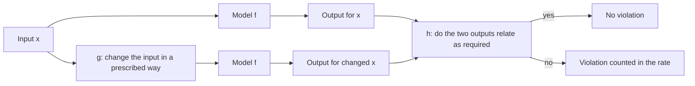

# 04. Testing Without Oracles

**Level:** Practitioner · **Reading time:** 26 min · **Exercise:** 60 min
**Prerequisites:** [Quality Assurance Basics and the Oracle Problem](01-quality-assurance-basics-and-the-oracle-problem.md)

> **In one sentence:** After this chapter you can write tests for a model-based feature that need no labeled answers, by describing how outputs must relate to each other and how inputs may change without changing the answer.

## Why this matters

Labeling tickets is slow. Suppose an agent labels about two hundred tickets per hour. A test set of ten thousand then costs fifty hours. It is stale in three months.

Meanwhile you have a pile of unlabeled tickets and four requirements that no label can check:

- A greeting at the top of a message must not change the routing.
- A boilerplate footer must not change it either.
- Quoting the previous conversation must not confuse the summarizer.
- The routing of a German ticket and its English translation should agree.

None of these asks "what is the correct queue?". Each asks whether two answers are consistent. This chapter covers the tests that answer such questions, plus four related strategies: behavioral testing, differential testing, simulation, and exploratory audits.

## The core idea

Chapter 01 defined a **test oracle** as whatever tells you the expected output. Many requirements do not need one, because they describe a relationship between outputs instead of the output itself.

An **invariant** is a rule that must hold for a model's outputs without saying what those outputs are. It is a *partial* specification. The useful form for models is a **metamorphic relation**: take an input, change it in a prescribed way, and state how the two outputs must relate.

```
for every input x:   h(f(x)) = f(g(x))
```

Here `f` is the model, `g` changes the input, and `h` says how the two outputs relate. For "a footer must not change the routing", `g` appends the footer and `h` is "unchanged". For "negation flips sentiment", `g` inserts a negation and `h` flips the score.

**Figure 1.** One metamorphic relation: the same model sees the original input and the changed one, and only the two outputs are compared.



No expected answer is needed anywhere on this path: the test compares two outputs of the same model with each other.

The analogy is property-based testing and fuzzing in ordinary software, where the most common invariant is "does not crash". Fuzzing means feeding the program random inputs to find crashes. The analogy breaks on strictness. For software, one violation is a bug. For a model, you usually measure how *often* the relation is violated and compare that rate with a threshold.

## How it works, step by step

### Strategy 1: Behavioral testing

**Behavioral testing** builds test data for one **behavior** at a time. A behavior is a capability you expect the model to have, such as "recognizes a refund request however it is phrased". Kästner calls behaviors partial specifications and describes this as unit testing for models (chapter 15).

1. **List behaviors.** Work top-down from requirements and domain knowledge, or bottom-up from mistakes you have seen. For the triage model: handles typos, ignores signatures, separates two requests in one message, handles mixed German and English.
2. **Build data for each behavior.** Four ways, cheapest first:
   - **Templates.** Fill a pattern such as "I was charged twice for {product}, please {action}".
   - **Transformations.** Take an existing input and change one thing: swap a word for a synonym, add a greeting.
   - **Slicing.** If your test set is large, filter out the inputs that need the behavior.
   - **Hand-written examples.** Slow, but best for rare and difficult cases. An LLM can draft them. Review every draft.
3. **Assert a rate per behavior.** A behavior is learned to a degree, not as a yes or no.

### Strategy 2: Invariants on unlabeled data

Kästner sorts the useful invariants into three families (chapter 15):

| Family | The model should | Examples |
|---|---|---|
| Robustness | Give the same answer after irrelevant noise | Typos, added whitespace, a footer, a re-encoded image |
| Independence | Not use a specific signal | Gender, a scanner ID, a template only one team uses |
| Domain expectation | Follow a rule of the field | More income never means less credit. Negation flips sentiment. |

Where do the inputs come from?

- **Production data.** Realistic, abundant, and unlabeled. Violation rates measured here can be monitored without labels.
- **Generated data.** Random inputs are mostly unrealistic. Templates and LLM-generated examples give you realistic inputs and deliberate outliers.
- **Adversarial search.** Instead of waiting to stumble on a violation, search for the smallest change that breaks the relation. The results are great for debugging and poor as a quality score, since the count depends on how hard you searched.

### Strategy 3: Differential testing

**Differential testing** compares the model's output with a **reference**: an implementation known to be good, or a majority vote among several models. Kästner finds this most useful when the reference is accurate but too slow or expensive to run in production (chapter 15). A strong model becomes the reference for a small, cheap one trained to replace it. The limit is shared mistakes: models trained on the same data learn the same shortcuts, so they can agree and still be wrong.

### Strategy 4: Simulation

A **simulator** builds the input from a known answer, which reverses the oracle problem. A self-driving system is tested on rendered scenes where the testers placed every pedestrian, so they know where each one should be detected. For agents, a sandboxed environment with a known goal state plays the same role (see [agent infrastructure](../05-frameworks-and-multi-agent/06-agent-infrastructure-sandboxes-browser-use-and-protocols.md)). Simulators are expensive to build and never fully realistic, so they pay off only for high-stakes or hard-to-reproduce situations.

### Strategy 5: Exploratory audits

**Red teaming** puts experts to work attacking the system on purpose. End-user audits do the same with real users from minority groups. Kästner reports the critics' view, that such audits can look like theater, and argues for a narrower use: they are a good way to discover requirements you missed. Each finding becomes a slice, a behavioral test, or an invariant (chapter 15).

## Worked example

Invariant tests for the triage feature. A stand-in model keeps the file runnable with no API calls and no cost. The `pytest` code is illustrative: it uses `pytest.mark.parametrize` in its long-standing form and was not re-checked against the documentation for this chapter.

```python
# triage_stub.py -- stands in for the real model. It has one bad habit.
import re

class StubTriage:
    RULES = {"refund": "billing", "password": "account", "crash": "technical"}

    def route(self, ticket: str) -> str:
        if "unsubscribe" in ticket.lower():  # bad habit: it reads the footer
            return "other"
        for word, label in self.RULES.items():
            if word in ticket.lower():
                return label
        return "other"

def tidy(text: str) -> str:
    """Lower-case, drop punctuation, collapse whitespace. Meaning unchanged."""
    no_punct = re.sub(r"[^a-z0-9 ]", "", text.lower())
    return re.sub(r"\s+", " ", no_punct).strip()
```

```python
# test_invariants.py
import pytest
from triage_stub import StubTriage, tidy

model = StubTriage()
UNLABELED = [  # no labels anywhere: these are raw tickets
    "I want a refund for order 42",
    "How do I reset my password?",
    "The app crashes every time I open settings",
    "Do you ship to Iceland?",
]
FOOTER = "\n\nTo unsubscribe from these emails, click here."

# Strict invariant: for every input, the answer is stable under clean-up.
@pytest.mark.parametrize("text", UNLABELED)
def test_punctuation_does_not_change_routing(text):
    assert model.route(tidy(text)) == model.route(text)

# Strict invariant that the stub fails on its first ticket.
@pytest.mark.parametrize("text", UNLABELED)
def test_footer_does_not_change_routing(text):
    assert model.route(text + FOOTER) == model.route(text)

# Rate-based invariant: most real models are only mostly stable.
def test_typos_rarely_change_routing():
    flips = sum(model.route(tidy(t)) != model.route(t) for t in UNLABELED)
    assert flips / len(UNLABELED) < 0.05
```

What to observe:

- The first test passes four times. The stub ignores case and punctuation.
- The second test fails three times: `assert 'other' == 'billing'`, then `'other' == 'account'`, then `'other' == 'technical'`. The ticket that was already routed to *other* passes by accident, which is why a single input proves little.
- No label was consulted. The failures say "the footer changes the answer", which is a usable bug report.
- To use this with a real LLM component, replace the stub with your prompt call, and compare a parsed field rather than raw text.

## What the practitioners say

- **Invariants are partial specifications.** They do not say how inputs map to outputs. They state an expectation that holds across inputs, which is enough to test without labels (chapter 15).
- **Soft, not strict.** Most model invariants are not meant to reject a model over one violation. Kästner recommends evaluating violation frequency as an accuracy measure (chapter 15).
- **Software testing solved the same problem.** He traces the **oracle problem**, the difficulty of naming expected outputs for generated inputs, to traditional testing, where invariants, fuzzing, and property-based testing (QuickCheck) were invented to get around it. A date function, for example, must always return day 1 or the next day (chapter 15).
- **Fairness invariants are narrow.** Swapping gender in an input shows only that the model does not use the attribute directly. Correlated features can still stand in for it (chapter 15). [Explainability, Fairness and Safety](13-explainability-fairness-and-safety.md) returns to this.
- **Formal verification is possible in narrow cases.** It is straightforward to prove that a decision tree never reads the age feature. For deep networks it remains an active research area (chapter 15).
- **Differential testing has a strong record outside ML.** He cites CSmith, which found hundreds of bugs in C compilers by compiling the same generated program with different compilers and comparing behavior (chapter 15).
- **No agreed stopping rule.** There are no established criteria for when model tests are adequate, he writes. The closest parallel is specification coverage, the share of requirements that have a test, and it is rarely measured (chapter 15).

## Pitfalls

1. **Writing a false invariant.** "Adding text must not change the routing" is wrong when the added text is a second request. Fix: make the change provably irrelevant, and review relations with a domain expert.
2. **Asserting strictly over a model that is only mostly stable.** The suite goes red permanently and gets ignored. Fix: strict for hard requirements, a rate for learned behavior.
3. **Comparing raw generated text.** Two valid summaries always differ in wording. Fix: compare a parsed field or a specific property.
4. **Testing only clean inputs.** Invariants pass on tidy data and fail on pasted logs and HTML. Fix: pull inputs from real traffic.
5. **Reading agreement between two models as correctness.** Fix: treat disagreement as a list of inputs to inspect, not as a verdict.
6. **Counting adversarial findings as a quality score.** The number depends on search effort. Fix: use the findings to debug, and measure the violation rate on realistic data.

## Try it

Choose one component and write five metamorphic relations for it.

1. For each relation, write down `g` (the input change) and `h` (the expected relation between outputs).
2. Collect 200 unlabeled real inputs.
3. Run all five relations over all inputs and record the violation rate for each.
4. For every violation, decide: the model failed, or the relation was wrong.

You are done when you have a table with five rates, and a written verdict for each violation. **Stretch goal:** write a small search that changes one input at a time until a relation breaks, and report the smallest change that did it.

## Key takeaways

- Many requirements need no oracle. They relate two outputs, or two inputs, to each other.
- A metamorphic relation states how to change an input and how the outputs must then relate.
- Behavioral testing builds data for one capability at a time, with templates, transformations, slicing, or hand-written examples.
- For models, invariants are usually rates. Use strict assertions only for hard requirements.
- Differential testing works when a good reference exists. Simulation works when inputs can be built from known answers.
- Exploratory audits do not give a score. They give you requirements you missed, which then become tests.

## Self-check

1. Write the footer requirement in the form `h(f(x)) = f(g(x))`. What are `g` and `h`?
2. Why does random noise make poor test input for most real systems?
3. A cheap model agrees with an expensive one on 99 percent of inputs. What does that not tell you?
4. When is a strict assertion the wrong choice for an invariant test?
5. A red team finds one serious failure mode. What is the durable output of that finding?

<details><summary>Show answers</summary>

1. `g` appends the footer to the ticket. `h` is the identity: the routing is unchanged.
2. Random inputs are mostly unlike production traffic. The system rejects them or treats them trivially, so violations on them say little about real use. Templates and generators produce realistic inputs and outliers.
3. It does not tell you the answers are correct. Models trained on similar data can share the same mistake and agree on it.
4. When the behavior is only mostly stable. A strict assertion then fails forever on a rare, tolerable violation, and the suite stops being informative. Use a rate against a threshold.
5. A new requirement, expressed as a slice, a behavioral test, or an invariant, that runs from then on.

</details>

## Sources

- **Book:** Christian Kästner, *Machine Learning in Production: From Models to Products* (MIT Press, 2025), chapter 15: [link](https://mlip-cmu.github.io/book/15-model-quality.html)

## Next

→ [Testing Generative and LLM Components](05-testing-generative-and-llm-components.md), because when the requirement is about the quality of generated text, the oracle has to be a rubric.
