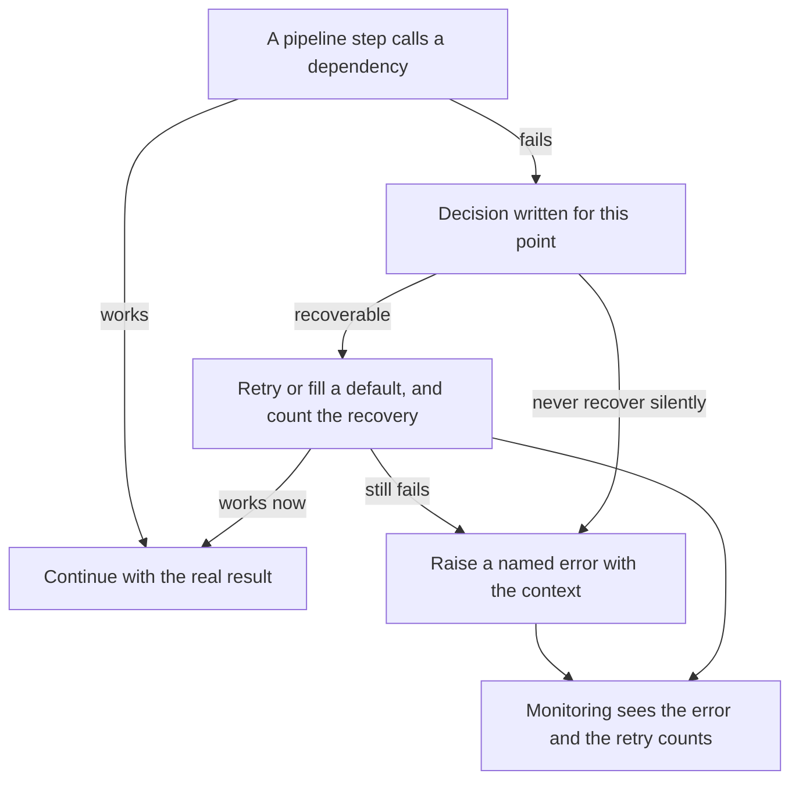

# 07. Pipeline Quality

**Level:** Practitioner · **Reading time:** 28 min · **Exercise:** 60 min
**Prerequisites:** none, though [Quality Assurance Basics and the Oracle Problem](01-quality-assurance-basics-and-the-oracle-problem.md) covers the CI, coverage, and code review used below. [Data Quality](06-data-quality.md) covers the data these pipelines move.

> **In one sentence:** After this chapter you can turn a notebook script into pipeline code that is tested, makes its failures loud, and cannot break for a week without anyone noticing.

## Why this matters

A nightly job indexes resolved tickets so that agents can search past answers. Its dashboard has been green for nine days. The index has not changed for nine days.

An upgrade of the HTTP client broke the export call. A broad `except` caught the error and logged it at a level nobody reads. The job then "successfully" indexed zero new tickets, every night.

No test failed, because there was no test. Nobody was paged, because nothing crashed. This chapter is about code whose failures look like success.

## The core idea

A **pipeline** is the code that moves and transforms data, calls models, and stores or deploys the results. Training jobs, evaluation jobs, indexing jobs, and the glue around an LLM call are all pipelines.

Kästner's position is that this code is ordinary code (chapter 17). It reads files, calls libraries, and talks to databases and networks, so the usual techniques apply: testing, code review, and static analysis.

Two habits matter more here than elsewhere:

1. **Make it testable.** Small functions, with data and external services passed in as arguments.
2. **Make failures loud.** At every point where something can go wrong, decide whether to recover or to raise an error. Then test that decision.

Kästner gives three reasons pipeline failures stay quiet (chapter 17):

1. **Learning algorithms are built to be robust.** They still produce a model when the data was not cleaned, normalized, or updated as intended. It is a weaker model, and nothing says so.
2. **The seams are untested.** A pipeline talks to data collection, storage, labeling, training infrastructure, and deployment. Those interactions are rarely specified or tested well.
3. **Scripts limp along.** A pipeline is often a chain of steps, and it can appear to work when one step fails and the next one works with incomplete results, or with leftovers from the previous run.

The analogy is a shell pipeline without `set -o pipefail`. A command in the middle fails, the next one reads an empty stream, and the last one exits with status zero. The analogy breaks on evidence: a shell pipeline at least has an exit status to inspect. A broken ML pipeline emits a plausible number or a model file, and the only symptom is worse quality weeks later.

## How it works, step by step

### 1. Split notebooks into functions

Kästner gives three reasons notebook code is hard to test (chapter 17): you cannot easily run it on different inputs, you cannot test its parts separately, and its results are only printed. A function that takes data as an argument and returns a result fixes all three.

### 2. Inject what is outside the code

Pass the model call, the database connection, or the file contents as arguments. Tests then supply a **stub**, a stand-in that returns fixed answers or fails on purpose. Testing against a live API makes tests slow and flaky, and it costs money on every run.

### 3. Decide the error handling, point by point

Kästner recommends being explicit about every failure scenario a pipeline can meet (chapter 17). His own questions: what if the training data misses some values, if a whole column is absent during feature engineering, the step that turns raw data into model inputs, if an external inference service times out, if uploading the trained model does not succeed? There is no single right answer. For each, choose to recover or to raise, then document and test the decision.

| Situation | Recover | Or raise |
|---|---|---|
| A few values are missing | Fill with a default and count how often | Raise if the column is mostly empty |
| An entire column is missing | Never | Raise |
| The model service times out | Retry twice, then raise | Raise at once |
| The model reply cannot be parsed | Never return an empty result silently | Raise with the raw reply attached |
| Uploading the result fails | Retry once | Raise if it still fails |

Whatever you choose, Kästner advises monitoring how often recoveries and exceptions are triggered (chapter 17). A retry that fires on every run is a broken dependency wearing a disguise. His warning example is a training pipeline that filled gaps from a weather service with default values, to ride out short outages. When the payment for that service expired, every request was rejected, the defaults replaced the weather entirely, and the pipeline kept producing a weaker model that nobody questioned (chapter 17).

**Figure 1.** The decision at each point where a pipeline step can fail: recover and count it, or raise.



A silent default is the failure to avoid: whichever branch the step takes, someone can later see that it was taken.

### 4. Test the failure paths with stubs

Pass a stub that times out. Pass a reply with the wrong shape. Pass an empty input. Assert the behavior you decided on. The book's pattern is a connection stub that fails a set number of times: with no failures the call succeeds, with a few it recovers through retries, and after the third failed attempt it raises (chapter 17).

### 5. Test your code, not the libraries

You can assume that pandas and scikit-learn compute a mean correctly (chapter 17). Test your own transformations, your glue, and your parsing. His example is code from a data competition that turns download counts such as "10k" and "100M" into numbers. One version went wrong on an uppercase "K"; another was not written for a decimal point, as in "100.5M". Both failed silently, and a test with three values would have caught the first. Training code deserves a run on a tiny data set, which exposes most misuse of the library and most mismatched tensor shapes, the dimensions of the arrays a neural network multiplies (chapter 17).

### 6. Put data checks at the boundaries, and test the checks

Every piece of code that takes in data ought to validate it, and the validation is code too (chapter 17). **Detection** usually returns true or false, so test it with valid and invalid examples. **Repair** returns corrected data, so test that broken input comes out as intended. If repair is impossible, or problems become frequent, the pipeline should raise.

### 7. Wire it into the process

Review changes, run the tests in CI on every commit, report coverage, and show linter warnings in review. Pipeline code that runs on a schedule deserves the same process as any other production code (chapter 17).

## Worked example

A step that asks a model for action items in a conversation. The model call is injected, so the tests run offline and cost nothing. Plain Python and `pytest`.

```python
# action_items.py
import json

SYSTEM_PROMPT = "List the action items of the conversation as JSON."

class ModelOutputError(ValueError):
    """The model returned something this step cannot use."""

def parse_action_items(raw: str) -> list[dict]:
    """Turn a model reply into a list of {owner, task}, or raise."""
    try:
        items = json.loads(raw)["action_items"]
        return [{"owner": str(i["owner"]), "task": str(i["task"])} for i in items]
    except (KeyError, TypeError, ValueError) as e:
        raise ModelOutputError(f"unusable model reply: {raw[:200]!r}") from e

def action_items(transcript: str, ask, retries: int = 2) -> list[dict]:
    """ask(system, user) -> reply. Injected so tests can stub it."""
    if not transcript.strip():
        return []                       # nothing to do: skip the paid call
    last_error = None
    for _ in range(retries + 1):
        try:
            return parse_action_items(ask(SYSTEM_PROMPT, transcript))
        except TimeoutError as e:       # recoverable: try again
            last_error = e
    raise last_error                    # not recovered: make it loud
```

```python
# test_action_items.py
import pytest
from action_items import ModelOutputError, action_items, parse_action_items

def test_parses_a_well_formed_reply():
    raw = '{"action_items": [{"owner": "Ana", "task": "Refund order 42"}]}'
    assert parse_action_items(raw) == [{"owner": "Ana", "task": "Refund order 42"}]

def test_empty_transcript_skips_the_model():
    def forbidden(*args):
        raise AssertionError("the model must not be called")
    assert action_items("   \n", forbidden) == []

def test_refuses_a_reply_without_the_expected_key():
    with pytest.raises(ModelOutputError):
        parse_action_items('{"summary": "Nothing to do"}')

def test_retries_a_timing_out_model_then_succeeds():
    calls = []
    def flaky(system, user):
        calls.append(1)
        if len(calls) < 3:
            raise TimeoutError("model gateway timed out")
        return '{"action_items": []}'
    assert action_items("Customer: hello", flaky) == []
    assert len(calls) == 3
```

What to observe:

- The tempting shortcut is `except Exception: return []`. It would make every test pass and hide every failure. An empty transcript and a broken model would look identical downstream.
- The code makes two different decisions. A timeout is recoverable, so it retries. An unusable reply is not, so it raises a named error with the raw reply attached.
- `test_empty_transcript_skips_the_model` proves the shortcut path never calls the model, so it never costs money.
- No test touches a network. The suite runs in milliseconds.

## What the practitioners say

- **Failures are silent.** Kästner opens the chapter with two stories from a delivery business that retrains daily. In one, the training data outgrew its virtual machine, training failed, and an aging model stayed in production for weeks until customers complained. In the other, an extraction job crashed after a connector update, and the model retrained every day on the same stale data while operators saw successful runs and stable offline accuracy (chapter 17).
- **Review finds more than tests can.** He names what review surfaces in data code: problematic data transformations, features encoded wastefully, data-quality problems handled poorly, and suggestions for better modeling (chapter 17).
- **Review less while exploring, more when shipping.** Reviewing every change in an exploratory notebook is not worth it. Once the pipeline is production-bound, review the whole thing once and every change after that (chapter 17).
- **Modularity is the precondition for testing.** Each `if` can double the paths through a program, so small units with few decisions and few external interactions are the ones that can be tested (chapter 17).
- **Isolate tests from dependencies.** A database that is sometimes slow makes tests flaky although the code is fine (chapter 17).
- **Tooling for data code is thin.** At the time of writing, he found few ready-to-use static-analysis tools aimed at data-science code, and points to generic ones such as Flake8 for style issues and simple bug patterns. The academic tools he lists each target one problem: Pythia checks tensor shapes in TensorFlow programs, Leakage Analysis finds places where test data is not kept strictly apart from training data, PySmell detects code smells in data-science code, and mlint checks that a project uses version control, dependency management, and tests (chapter 17).
- **A maturity score exists.** A group at Google proposed an ML test score: twenty-eight concerns around a pipeline, grouped under feature tests, model tests, infrastructure tests, and production monitoring. A team earns a point for each concern it tests and a second point when that test is automated. Examples are whether a feature benefits the model, canary releases, meaning releases shown first to a small share of users, and monitoring for training-serving skew, a difference between the data used for training and the data seen in production (chapter 17). Kästner cautions that the list may not fit every project, and sees it as a starting point for agreeing what a team must track.
- **Plan the effort.** Quality assurance belongs in the milestone that releases a model, and it is a prerequisite for letting a pipeline run and deploy on a schedule without a developer in the loop. Managers should allocate time and name who delivers it (chapter 17).

## Pitfalls

1. **A broad `except` that returns a default.** Fix: catch the specific error, and raise a named one when there is no safe recovery.
2. **Hard-coded data sources.** Fix: pass data in as arguments.
3. **Testing against live services.** Fix: stubs, with a few integration tests in a separate tier.
4. **Printing instead of returning.** Fix: return values; print in a thin script that calls the function.
5. **Retrying without counting.** Fix: log and chart every retry. A constant rate means a broken dependency.
6. **Skipping review in exploration and never starting.** Fix: agree on a date or a milestone when the pipeline gets its first full review.
7. **Trusting a model's structured output.** Fix: parse, validate, and raise on anything unexpected.

## Try it

Find one script or notebook cell that feeds a model-based feature.

1. Move its logic into a function that takes its data and its external calls as arguments.
2. List every point where it can fail.
3. For each, write whether it recovers or raises.
4. Write six tests: four for normal behavior and two for failure paths, using stubs.
5. Run a coverage report on the function.

You are done when the tests run offline in under a second, when every failure point has a tested behavior, and when an unusable dependency produces a named exception instead of a default value. **Stretch goal:** add a counter for each recovery path and chart it on a dashboard for a week.

## Key takeaways

- Pipeline code is ordinary code. Test it, review it, and lint it like the rest of the system.
- Its failures are silent, so the goal is loud failures: a named exception, not a default value.
- Small functions with injected dependencies are testable. Notebooks with hard-coded sources are not.
- Decide error handling point by point, then test each decision with a stub that fails on purpose.
- Monitor how often recoveries happen. A retry that always fires hides a broken dependency.

## Self-check

1. A job reports success every night while indexing nothing. Which two habits would have caught it?
2. Why pass the model call into a function instead of calling it inside?
3. A stub that times out twice and then answers is used in a test. What does the test prove?
4. Why is `except Exception: return []` a poor default?
5. Which code deserves tests: your own transformation, or the library's mean function?

<details><summary>Show answers</summary>

1. Loud failures (the swallowed error would have raised) and tests, including one that checks the job fails when a dependency fails.
2. So tests can replace it with a stub. The tests then run offline, instantly, deterministically, and for free.
3. That the retry policy works and that the step succeeds after a transient failure. A second test should show that it raises when every attempt times out.
4. It erases the difference between "there was nothing to find" and "everything broke". Downstream code cannot tell an empty result from a failed one.
5. Your own transformation. The library is tested by its maintainers, and testing it again spends effort where defects are unlikely.

</details>

## Sources

- **Book:** Christian Kästner, *Machine Learning in Production: From Models to Products* (MIT Press, 2025), chapter 17: [link](https://mlip-cmu.github.io/book/17-pipeline-quality.html)
- **Reading:** Eric Breck, Shanqing Cai, Eric Nielsen, Michael Salib, and D. Sculley, "The ML Test Score: A Rubric for ML Production Readiness and Technical Debt Reduction" (2017), listed in the chapter's further readings: [link](https://research.google.com/pubs/archive/46555.pdf)

## Next

→ [System Quality: End-to-End Tests and Guardrails](08-system-quality-end-to-end-tests-and-guardrails.md), because every part can pass its own tests and the product can still fail when they are put together.
