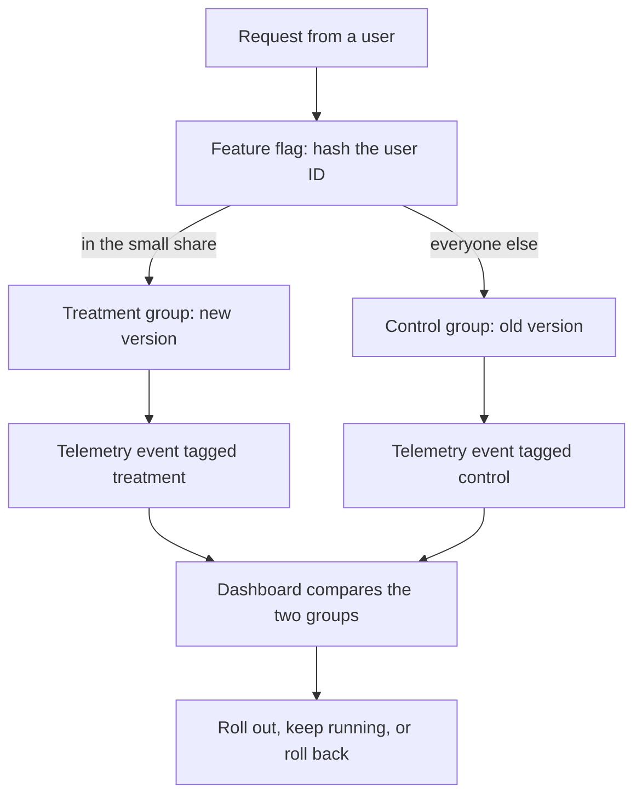

# 09. Testing and Experimenting in Production

**Level:** Practitioner · **Reading time:** 28 min · **Exercise:** 90 min
**Prerequisites:** [System Quality: End-to-End Tests and Guardrails](08-system-quality-end-to-end-tests-and-guardrails.md)

> **In one sentence:** After this chapter you can design telemetry that shows whether a model-based feature works for real users, release a change to a small share of traffic, read the result with basic statistics, and get back to safety in one step.

## Why this matters

A new triage prompt scores 94 percent offline, against 91 percent for the current one. Should you ship it?

The offline score cannot tell you how agents will behave with the new routing. It cannot tell you that chat tickets on the night shift look different from last year's test set. And shipping to everyone means that every mistake reaches every user on its first day.

This chapter answers one question: how do you learn from real traffic without betting the product on it?

## The core idea

**Testing in production** evaluates a running system in real conditions, on real users and real data. It is older than machine learning, and Kästner expects most systems with ML components to do it at some point (chapter 19). It has two halves.

- **Observing.** **Telemetry** is the data a running system records about its own behavior. It answers "how well is the feature doing?".
- **Intervening.** An **experiment** shows a change to a small, randomly chosen group of users, the **treatment group**, and compares them with the **control group**, which keeps the old version. It answers "is the change better?".

Kästner's case for it is that production data is the ultimate unseen test set. It is representative by definition, it was not available at training time, and so it avoids several pitfalls of offline evaluation (chapter 19). His case against relying on it alone is that quality problems reach users directly.

The four standard patterns differ in who sees the change and what question they answer:

| Pattern | Who sees the new version | Question | Risk to users |
|---|---|---|---|
| **Shadow release** | Nobody. Both versions run. | Is the new version stable, fast, and in agreement with the old? | None from the output. Some cost. |
| **Canary release** | A small share, growing step by step | Is this release safe to roll out? | Limited to the share |
| **A/B experiment** | A fixed share for a fixed time | Which version gives better results? | Limited to the share |
| **Blue/green deployment** | Everyone, at once | None. It is a fast switch. | Total |

The canary takes its name from the birds miners once carried underground, which reacted to gas before the miners did (chapter 19). The analogy holds for early warning. It breaks on remedy: a dead canary told miners to leave. A bad canary release tells you to roll back, which works only if you built the way back in advance.

From practice outside the book: one more pattern is common in search and recommendation. In an **interleaving experiment**, each user sees one list that mixes results from two ranking models, instead of seeing only one model's list. The model whose results get clicked more wins. It needs far fewer users than an A/B test, and it applies only where the output is a ranking.

## How it works, step by step

### 1. Decide what success means

Write down the system-level goals, such as retention or revenue, and the feature-level signals, such as how many agents accept a suggested queue. Coarse measures take weeks to move. Granular ones respond within minutes (chapter 19).

A system-level number says whether users like the product, not whether your feature helped, and offline evaluation cannot measure them well. So design feature-level measures on purpose, such as how many users switch the feature on and how many still open its output after the first try (chapter 19).

### 2. Design telemetry that can tell right from wrong

The hard problem is that production data has no labels. Kästner describes seven ways around it (chapter 19):

| Pattern | How it works | Support-product example | Main cost |
|---|---|---|---|
| Wait and see | The true answer arrives later | Whether the customer reopened the ticket | Delay |
| Label a sample | People label a random slice of traffic | Agents label one ticket in a hundred | Money, privacy |
| Prompt users | Ask whether the output was right | "Was this routing correct?" | Intrusion |
| Let users complain | Offer a one-click report | "Wrong queue" button | Only negative signal |
| Record corrections | Log every edit of the output | An agent moves the ticket | Edits are ambiguous |
| Observe reactions | Infer quality from behavior | Agents stop reading the suggestion | Indirect |
| Shadow execution | The model predicts, nobody sees it | New prompt runs silently next to the old | Infrastructure |

Each design trades accuracy, reliability, cost, and latency against the others (chapter 19). Track several of them. A proxy, an indirect stand-in for quality, such as a correction rate is not comparable with an offline accuracy score, but it shows trends and ranks two versions against each other.

### 3. Define each measure in three parts

Kästner follows a three-step pattern for every measure (chapter 19):

1. **The measure.** "The share of suggested queues that an agent overrides within one minute."
2. **Data collection.** What is logged, and whether it is anonymized, sampled, or aggregated.
3. **Operationalization.** The exact computation, including which edits count. An agent who adds a tag has not corrected the routing.

### 4. Put the change behind a feature flag

A **feature flag** is a boolean option that switches between two code paths. Assign users with a stable hash of the user ID, a number computed from the ID that always comes out the same, so the same agent always sees the same version. Tag every telemetry event with the variant.

**Figure 1.** How one request lands in a group and how the result comes back: the feature flag assigns the user, and every telemetry event carries the group name.



Because the same ID always hashes to the same group, each user sees one version for the whole experiment, which keeps the two groups clean.

### 5. Choose the pattern and the exposure

Start new versions as shadow releases. Release through a canary. Use an A/B experiment when you need to know which of two versions is better.

### 6. Read the result with statistics

Kästner's example makes the point (chapter 19). In the control group, 2,158 users saw the old model and 15 percent corrected their meeting minutes; in the treatment group, twenty users saw the new one and 10 percent did. That looks like a large improvement and proves nothing.

### 7. Build the way back before you need it

Automate the **rollback**, the switch back to the previous version. Kästner warns against relying on on-call operators who must work out which shell script to run, and may create a larger mess by changing or deleting the wrong files (chapter 19).

### 8. Experiment responsibly

You are experimenting on people. Kästner advises keeping the treatment group as small as the question allows, testing offline first, and measuring a diverse set of outcomes, including user goals (chapter 19). An experiment on engagement alone will happily confirm an addictive design. He points to the Belmont Report's principles for research on humans: respect for persons, beneficence, meaning do good and avoid harm, and justice.

Telemetry has its own privacy cost. Logs of user edits contain user content. The book cites the backlash over voice recordings kept by a voice assistant and a video-conferencing company that withdrew terms allowing training on customer data (chapter 19). Collect the minimum, and sample or aggregate where you can.

### 9. Debug with production data

Production is also your best source of bugs.

- **Harvest failures.** Every corrected output is a candidate for a labeled test set. Feed it back into [slicing](03-slicing.md) and the test suite.
- **Replay.** Log inputs, with consent, and run a new version against them offline before any release.
- **Run fire drills.** Inject a problem and check that monitoring alerts the right people (chapter 18).
- **Ask chaos questions.** Kästner suggests extending chaos engineering to ML: would we notice a stale model, or one that is 10 percent less accurate or 15 percent slower? (chapter 19).

## Worked example

Stable assignment and a simple significance check, in plain Python. The numbers are Kästner's, extended with a larger treatment group.

```python
import hashlib

def bucket(user_id: str) -> str:
    """Stable and random-looking: the same user always lands in the same group."""
    h = int(hashlib.sha256(user_id.encode()).hexdigest(), 16) % 10_000
    return "treatment" if h < 1_000 else "control"      # 10 percent

def z_score(x_t, n_t, x_c, n_c):
    """z for the difference between two proportions (normal approximation)."""
    p_t, p_c = x_t / n_t, x_c / n_c
    p = (x_t + x_c) / (n_t + n_c)
    se = (p * (1 - p) * (1 / n_t + 1 / n_c)) ** 0.5
    return (p_t - p_c) / se

CONTROL = (324, 2158)          # 324 of 2158 users corrected: about 15 percent

print(bucket("agent-42") == bucket("agent-42"))                  # True
print(round(z_score(200, 2000, *CONTROL), 3))   # -4.867: a real drop
print(round(z_score(2, 20, *CONTROL), 3))       # -0.626: could be noise
```

What to observe:

- `bucket` gives the same answer every time for the same ID. An agent is never switched between versions.
- Both experiments show the same correction rate in the treatment group: 10 percent, against about 15 percent in the control group.
- With two thousand treated users, the difference is about five standard errors from zero. With twenty, it is well inside the range that chance produces. As a rough rule, a `z` beyond about positive or negative 1.96 is unlikely to be chance at the 5 percent level.
- A lower correction rate is good here. The sign of `z` tells you which group did better only if you remember which group you listed first.
- This test is an approximation and ignores run time, repeated looks at the data, and many comparisons. [Statistics for Evals in part 03](../03-evaluation/05-statistics-for-evals.md) treats experiment design properly.

## What the practitioners say

- **Production answers what offline cannot.** Real users try inputs testers never thought of, such as unusual dialects or extreme file sizes (chapter 18). Other situations are too costly to rebuild in a test environment, such as a service recovering from a server crash under heavy load. Kästner's answer for both is testing in production (chapter 14).
- **Telemetry feeds the flywheel.** Labeled production data trains the next model, which improves the product, which attracts users, who produce more data. Weak supervision tools such as Snorkel learn from partial labels (chapter 19).
- **Experiments beat intuition.** Kohavi and colleagues at Microsoft describe a change to how Bing showed ads, with more text in the link. It raised ad revenue by 12 percent, about 100 million dollars a year, without hurting other engagement measures. Nobody expected it, and the change sat unimplemented for months. It was one of thousands of experiments that year (chapter 19, as reported there).
- **Run for at least a week.** Usage cycles through the day and week, and novelty effects fade slowly: users poke at a new feature because it is new (chapter 19).
- **Keep exposure small.** Practitioners commonly assign 0.5 to 10 percent of users to a treatment. Large companies run hundreds of experiments without exposing more than one percent of users to any one of them (chapter 19).
- **A canary grows in steps.** Internal users, then beta users, then under 1 percent of ordinary users, then 5 percent, then 20 percent, then everyone. The process can be fully automated (chapter 19).
- **The interface decides the telemetry.** A summary emailed as plain text yields almost no signal. A summary shown in an editor that links each fragment to the recording invites corrections (chapter 19).
- **The ethics are unsettled.** Companies rarely seek consent for experiments and face nothing like academic review boards. Kästner calls the practice very common and its ethics debated (chapter 19).

## Pitfalls

1. **Releasing to everyone at once.** Fix: shadow, then canary, then full rollout.
2. **Telemetry that cannot tell right from wrong.** Clicks and uptime are not correctness. Fix: add at least one of the seven patterns.
3. **Unstable assignment.** Users flip between versions and pollute both groups. Fix: hash a stable identifier.
4. **Stopping at the first good number.** Peek often enough and any change looks significant. Fix: fix the duration in advance and run at least a week.
5. **Reading a small sample as a result.** Fix: compute a confidence measure before acting.
6. **Optimizing one metric.** Fix: add guardrail metrics and at least one measure of the user's own goal.
7. **Logging everything.** Fix: sample, aggregate, and collect the minimum that answers the question.

## Try it

Take one change to a model-based feature.

1. Define one measure in three parts: the measure, the data collection, and the operationalization.
2. Implement a feature flag with hash-based assignment that sends 10 percent of users to the new version.
3. Tag telemetry events with the variant and put both groups on one dashboard.
4. Write and rehearse the rollback on a staging system.

You are done when the same user lands in the same group on every request, when the dashboard shows the measure for both groups, and when a rollback returns everyone to the old version in under a minute. **Stretch goal:** run the experiment for a week on staging data, compute a `z` score, and write one paragraph on whether you would roll out and why.

## Key takeaways

- Production is the most honest test set and the riskiest one. Use it after offline tests, never instead of them.
- Telemetry needs a way to tell right from wrong. Seven patterns exist, and each trades accuracy, reliability, cost, and latency.
- Define every measure in three parts, including the exact computation.
- Shadow to check stability, canary to release safely, A/B to compare.
- Small samples are noise. Read experiments with statistics and run them long enough to outlast novelty.
- Keep exposure small, automate the rollback, and measure outcomes that serve users, not only the business.

## Self-check

1. Which pattern runs the new version on live traffic while no user sees its output, and what does it tell you?
2. Agents move one ticket in ten to a different queue. Why is that not an accuracy score?
3. Two groups show the same correction rates. When is the difference believable?
4. Why hash a user ID instead of flipping a coin on each request?
5. Why run an experiment for a week when the numbers look clear after a day?

<details><summary>Show answers</summary>

1. A shadow release. It shows whether the new version is stable, how fast it is, and how often it agrees with the old one, without exposing users to its mistakes.
2. It is a proxy. Some edits correct a mistake and others add information, and an untouched output is not necessarily right. It shows trends and compares versions, but it is not comparable with an offline accuracy score.
3. When the groups are large enough that the gap is unlikely to arise by chance. With thousands per group, a five-point gap can be solid. With twenty users, it proves nothing.
4. So that each user stays in one group. Random assignment per request mixes the versions for every user and blurs the comparison between groups.
5. Usage differs by day of the week, and users engage with a change because it is new. A short run measures the novelty and one slice of the weekly cycle.

</details>

## Sources

- **Book:** Christian Kästner, *Machine Learning in Production: From Models to Products* (MIT Press, 2025), chapter 19: [link](https://mlip-cmu.github.io/book/19-testing-and-experimenting-in-production.html)
- **Book:** Christian Kästner, *Machine Learning in Production: From Models to Products* (MIT Press, 2025), chapter 18, for fire drills: [link](https://mlip-cmu.github.io/book/18-system-quality.html)
- **Book:** Christian Kästner, *Machine Learning in Production: From Models to Products* (MIT Press, 2025), chapter 14, on testing in production: [link](https://mlip-cmu.github.io/book/14-quality-assurance-basics.html)

## Next

→ [Process Models: Planning and Iteration](10-process-models-planning-and-iteration.md), because everything in this part so far takes time, and someone has to plan for it under uncertainty.
