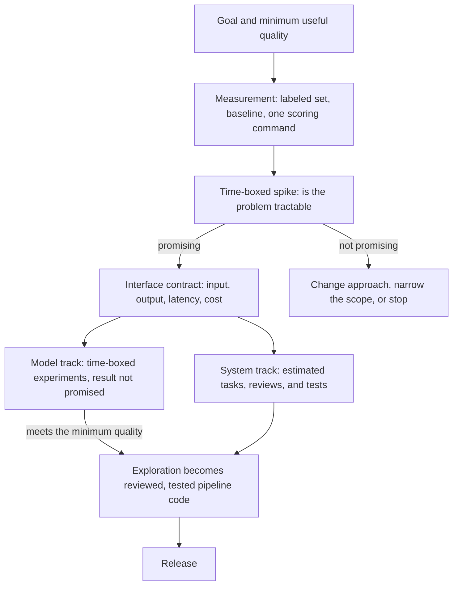

# 10. Process Models: Planning and Iteration

**Level:** Practitioner · **Reading time:** 22 min · **Exercise:** 45 min
**Prerequisites:** none. [Measuring Model Quality](02-measuring-model-quality.md) helps for the baseline step.

> **In one sentence:** After this chapter you can plan a model-based feature so that the uncertain model work and the predictable engineering work are scheduled separately, with decision points agreed in advance.

## Why this matters

Your manager asks for an estimate. The triage feature needs a model, a pipeline, an interface, and monitoring. You give six weeks, because that is what a feature of this size usually takes.

Week four arrives. The prompt is at 84 percent and nobody knows whether 90 is reachable. The pipeline is built, the interface is designed, and both wait on the model. The team works weekends and ships something nobody has measured against a baseline.

The plan treated research as if it were construction. This chapter is about planning work whose outcome you cannot know in advance.

## The core idea

Two professions with different habits build every ML product. Data scientists work by **exploration**: try a model, measure it, change something, measure again. Software engineers work by **process**: gather requirements, design, implement, test, deploy, maintain. Kästner's point is that both are reasonable and that they clash when nobody names the difference (chapter 20).

Software engineering has named its trade-offs. The **waterfall model**, from Royce's 1970 paper, orders development as requirements, design, implementation, and testing. Even its first version allowed a loop back from design to requirements and a pass through the whole sequence to build a prototype. The **spiral model** repeats those steps to build increasingly complete prototypes, starting with the riskiest parts. **Agile methods** work in short sprints, typically two weeks or thirty days, with daily stand-up meetings and replanning after each sprint. All of them trade up-front planning against iteration: aerospace software leans toward waterfall, a social network or a start-up toward agile, and Kästner expects many, though not all, ML products to fall on the agile side (chapter 20).

The difference is what an iteration produces. Kästner contrasts model work with two of these models, line by line (chapter 20):

| | Iteration in software | Iteration in model work |
|---|---|---|
| What one loop yields | Working functionality | An answer: better, worse, or no change |
| Can it be scheduled? | Mostly, for known work | The time can be capped. The result cannot be promised. |
| How progress looks | Steady, roughly linear | Long flat stretches, then a jump |
| When you are done | The requirement is met | When quality is good enough, or time runs out |
| Why loop back, in the spiral model | To prove the riskiest part first | Work does not split neatly into risky and safe parts, and nobody can say whether a target accuracy is reachable |
| Why loop back, in agile work | To clarify vague requirements and react to change | The goal is usually clear. The open question is whether a model can meet it |
| Splitting work | Design supports divide and conquer, so people work in parallel | Model work is hard to decompose into independent pieces |
| Dead ends | Rare, outside highly experimental projects | Common: many iterations change nothing |

Kästner describes data-science work as a science mindset and notes that it is nearly impossible to say up front how long model development will take or what accuracy it will reach (chapter 20).

The analogy is a walk versus a search. Building a known feature is a walk: you know the route and can estimate the time. Finding a model that works is a search: you can decide how long you will look, not what you will find. The analogy breaks on the map: a search through model designs gives partial results along the way, which often turn out to be good enough to ship.

## What the practitioners say

- **Model work is exploratory.** A pipeline diagram looks sequential. In practice a data scientist loops back to collect different data, clean it, engineer features, try other models, or tune prompts and hyperparameters, the settings of the training itself, and discards what does not help (chapter 20).
- **Progress is uneven.** The book cites a study in which several participants built a handwritten-digit model over four hours. All produced weak models quickly, then improved in uneven steps with long gaps, and they ended at very different accuracies (Patel et al., 2008, as described in chapter 20).
- **Notebooks suit exploration.** Software engineers criticize them for global variables, missing abstraction, no tests, and inconsistent state from running cells out of order. Kästner's view is that they support exploration well, in the tradition of literate programming, where code and explanation sit together (chapter 20).
- **Projects take different trajectories.** Some start from a goal and then collect data for it. Others start from data they already have and look for a use, as a hotel-booking company might when mining its records (chapter 20, citing Martínez-Plumed and colleagues).
- **Software engineers plan for a reason.** Decades of evidence show that fixing requirements and design late is very expensive, so time for design, quality assurance, and maintenance belongs in the plan (chapter 20).
- **No integrated best practice exists.** Kästner knows of no accepted workflow that combines the two. His sketch is to decompose the system into components with their own requirements, give each the process that suits it, and let iteration happen at the component level and at the system level (chapter 20).
- **Three predictable conflicts.** Engineers object to notebook code, but Kästner notes that abstraction and documentation add little value while code is still exploratory. Estimates: data scientists can rarely say how long a quality target will take, or whether it is reachable at all. And managers or engineers with a superficial grasp of the work ask for impossible things, such as a model with no false positives. In one study he cites, engineers without data-science training skipped data exploration when a first model disappointed and jumped straight to more data or to deep learning (chapter 20).
- **Model-first or system-first.** In model-first projects, data scientists establish what a model can do before anyone designs the system around it. Kästner sees this often where the model is the core of the product, as in a transcription service or a demand forecast that produces daily reports. Its strength is that it avoids heavy engineering on a project that may be infeasible. Its reported weakness is that the model then fails the product: latency is unacceptable, users do not trust it, or explainability and safety were never considered. In system-first projects, about half of those he has seen, the product is planned up front and the model receives concrete requirements for latency, fairness, and explainability. This is common when a model is added to an existing product, such as an audit-risk score in tax software, and advisable in regulated or safety-critical domains such as banking, hiring, drones, and medical software. Here the risk is the opposite: requirements that no model can meet (chapter 20).
- **Neither extreme works.** His advice is to mix them: some thought about how the model will be used, even in a model-first project, and some early experimentation by the data scientists during system planning. Fully parallel development of system and model is realistic only in a small team that can renegotiate interfaces constantly (chapter 20).
- **Choose by stakes.** His examples: a transcription start-up goes model-first. A hotel site explores its logs before building a recommendation feature. A notes app built on off-the-shelf language models goes system-first, with prompts prototyped alongside. A recidivism tool for judges, one that estimates whether a person will offend again, calls for a system-first, waterfall-like approach, because fairness and explainability rules constrain everything downstream (chapter 20).

## How to plan under uncertainty

A procedure that respects both mindsets:

### 1. Write the goal and the minimum useful quality

State what the feature must achieve and the worst quality you would still ship. Without that number, iteration has no end.

### 2. Build the measurement before the model

Collect a labeled set, compute a baseline, and make scoring one command. No measurement, no iteration.

### 3. Run a time-boxed spike

Give the simplest approach a fixed short time: a few rules, a small model, or a plain prompt. The spike answers one question: is this problem tractable at all?

### 4. Split the work into two tracks

| Track | Contains | How to plan it |
|---|---|---|
| Model track | Prompts, model choice, training data, tuning | Time-boxed experiments with a log of what was tried |
| System track | Pipelines, interface, guardrails, telemetry, operations | Like ordinary software: tasks, estimates, reviews, tests |

### 5. Agree on the interface between the tracks

Fix the model's input, output, latency, and cost limits as a contract. The system track then builds against a stub, a stand-in that returns fixed answers, and the model track can change freely underneath.

### 6. Set decision points in advance

At each gate, decide with criteria written before the work started: continue, change approach, narrow the scope, or stop. An example: "If the spike is not above the baseline by Friday, we route these tickets by rules."

**Figure 1.** A plan in two tracks: the measurement and the time-boxed spike come first, the interface contract joins the tracks, and each track is planned its own way.

The two tracks can run at the same time only because the contract fixes what the model will hand over, whatever the model track finds.

### 7. Decide when exploration becomes engineering

Name the moment when notebooks turn into reviewed, tested pipeline code. Kästner suggests reviewing every change from the point where a pipeline is bound for production (chapter 17).

## Pitfalls

1. **Estimating model work like feature work.** Fix: cap the time, never promise the result.
2. **Improving a model with nothing to measure against.** Fix: build the evaluation first.
3. **Iterating with no stopping rule.** Fix: a minimum useful quality and a deadline, agreed up front.
4. **Letting one track block the other.** Fix: an interface contract and a stub.
5. **Shipping the notebook.** Fix: a named gate where exploration becomes pipeline code.
6. **Skipping planning because the work is research.** Fix: plan the system track fully and the model track as experiments.
7. **Planning the demo, not the product.** Fix: put latency, cost, safety, and monitoring on the plan from the start.

## Try it

Write a one-page plan for one model-based feature.

1. State the goal and the minimum useful quality.
2. Describe the baseline and how you will score it.
3. Define a time-boxed spike with a duration.
4. List the model track and the system track.
5. Write the interface contract.
6. Write two decision points with their criteria.

You are done when every uncertain task has a time box and every predictable task has an estimate, when the two tracks can proceed against a stub, and when each decision point names who decides and on what evidence. **Stretch goal:** run the spike and record, in five lines, what you learned that you could not have planned.

## Key takeaways

- Model work is exploration. You can cap its time and cannot promise its result.
- Software work follows a process, and late fixes are expensive. Plan it as usual.
- Build the measurement before the model, and set a minimum useful quality before you iterate.
- Split the work into a model track and a system track, joined by an interface contract.
- Set decision points and their criteria before the work starts.
- Name the point where exploration becomes tested, reviewed engineering.

## Self-check

1. What does one iteration produce in model work, as opposed to software work?
2. Why can you cap the time of a model task but not promise its outcome?
3. What must exist before any model iteration is worth doing?
4. How can the system track proceed while the model is still changing?
5. When should the criteria for a decision point be written?

Show answers

1. An answer about quality: better, worse, or no change. In software, one iteration yields working functionality.
2. Because whether a better model exists is unknown until it is found. The search can be given a deadline, while its result depends on what the data and the problem allow.
3. A measurement: a labeled set, a baseline, and a way to score a candidate against both.
4. Against a stub that honors the interface contract: fixed inputs, outputs, latency, and cost limits.
5. Before the work starts. Criteria written afterward bend toward whatever result appeared.

## Sources

- **Book:** Christian Kästner, *Machine Learning in Production: From Models to Products* (MIT Press, 2025), chapter 20: [link](https://mlip-cmu.github.io/book/20-data-science-and-software-engineering-process-models.html)
- **Book:** Christian Kästner, *Machine Learning in Production: From Models to Products* (MIT Press, 2025), chapter 17, for the review gate: [link](https://mlip-cmu.github.io/book/17-pipeline-quality.html)

## Next

→ [Teams and Technical Debt](11-teams-and-technical-debt.md), because the two tracks from this chapter are usually owned by different people, and the shortcuts taken under deadline become the debt they inherit.
