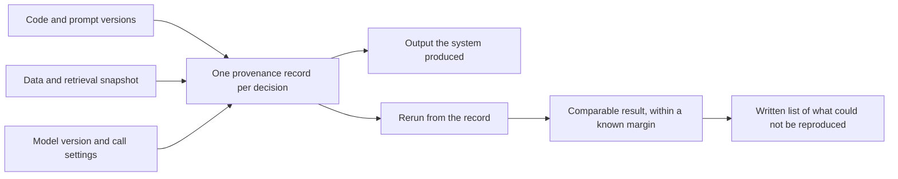

# 12. Responsible Engineering, Versioning and Reproducibility

**Level:** Practitioner · **Reading time:** 26 min · **Exercise:** 60 min
**Prerequisites:** [Pipeline Quality](07-pipeline-quality.md) and [Data Quality](06-data-quality.md)

> **In one sentence:** After this chapter you can record, for any output your system produced, exactly which code, data, prompt, and model version produced it, and you can say which parts of that result you can reproduce and which you cannot.

## Why this matters

An auditor asks two questions about ticket 48211, which the triage feature routed to "other" last month. Why was it routed there? And why did the model suggest a refund the customer never asked for?

Since then the prompt changed twice, the model was updated, and the retrieval index was rebuilt. Nobody can answer. Nobody can reproduce last month's 91 percent either.

Responsible engineering begins with a modest ability: being able to account for what your system did.

## The core idea

### Responsibility

Kästner's argument has three steps (chapter 23).

1. **Small decisions scale.** A loss function, the number training minimizes, a data filter, or the way a result is displayed is a local choice made by one engineer. Deployed widely, it can affect many people.
2. **Legal is not the same as ethical.** Software licenses have largely shielded developers from liability. That leaves a wide space of actions that are lawful and still wrong.
3. **Do not wait.** Regulation is partial and slow. Engineers should learn the likely harms and prevent them regardless.

Kästner opens chapter 24 with a case modeled on the 2019 launch of a credit card: an applicant with a large following publicly accuses the lender of discrimination, and the developers must reconstruct which of several interacting models and data sources produced that one decision, while A/B tests and canary releases keep changing the system (chapter 24).

- **Versioning** gives every input to a result an identifier: the code, the data, the model, the prompt, the configuration. The book distinguishes **revisions**, which succeed each other in time, from **variants**, which exist side by side, such as the two models of an A/B test (chapter 24).
- **Provenance** tracks the origin of a value and who modified it. Kästner credits it with building trust in data and helping debugging (chapter 16). In his usage, provenance tends to mean edits to individual rows, also across organizations, while **lineage** tends to mean data flows between files and processes inside a system (chapter 24).
- **Replicability** is the ability to rerun exactly the same steps and get exactly the same result. **Reproducibility** is the ability to repeat a procedure with small differences and get a comparable result (chapter 24).

The analogy is a recipe. Versioning is the ingredient list with brands and batch numbers. Provenance is the cook's log of what was actually done. Replicating is cooking it again and getting the same dish. Reproducing is another cook following the recipe and getting a dish that tastes the same.

The analogy breaks for LLM systems at the third step. Sampling and provider-side changes mean that the same prompt and model version can give different text. That is tolerable. Kästner's guidance is to remove the accidental nondeterminism that missing versions cause, accept the kind that is inherent to a method, and record the outputs of those steps, because strict bit-for-bit replication of a trained model is rarely a practical goal (chapter 24).

## What the practitioners say

- **Software alone can do harm.** Before ML, Kästner lists radiation overdoses from the Therac-25, the Ariane 5 crash, a trading firm losing 460 million dollars, and an accounting system behind the wrongful accusation of 540 UK postal workers (chapter 23).
- **Lawful and still wrong.** His example is a drug whose price was raised from 13 to 750 dollars per pill, a legal move that the public widely condemned (chapter 23).
- **Local choices, distant effects.** He gives the case of a model tuned for ad clicks that may end up promoting content that deepens teenage depression, and a review filter that may disadvantage minority-owned restaurants (chapter 23).
- **Safety is not only about lives.** He cites smart home devices that shut off heating in freezing weather and a delivery robot that blocked a wheelchair user at a crossing (chapter 23).
- **Engagement against the user.** Tuned for time on site, a system learns to exploit weaknesses in human reasoning, as conspiracy-video recommendations showed (chapter 23).
- **Feeds that polarize.** Extreme, provocative content holds attention, so interaction-trained models recommend more of it, and personalization can trap users in filter bubbles (chapter 23).
- **Automation can deskill.** Some fear most people would follow a machine's instructions while a few maintain them, a matter of inequality and human dignity (chapter 23).
- **Dual use.** The same model can rescue and attack, so innovations are hard to contain. Surveillance models err and can be used against a population, not only under authoritarian rule ([chapter 23](https://mlip-cmu.github.io/book/23-responsible-engineering.html)).
- **Principle lists converge.** Microsoft lists fairness, reliability and safety, privacy and security, inclusiveness, transparency, and accountability. Google lists being socially beneficial, avoiding unfair bias, safety, accountability, privacy, scientific excellence, and responsible deployment (chapter 23). Self-regulation has no enforcement mechanism outside the organization that writes the principles, he adds.
- **The book's structure is itself an argument.** He groups the rest of his book around two pieces of technical infrastructure, versioning with provenance and reproducibility, and explainability, and four concerns that cut across the whole life cycle: fairness, safety, security and privacy, transparency and accountability (chapter 23).
- **Regulation was still pending as he wrote.** With the book finalized in late 2023, the closest to binding rules was the EU's AI Act, then expected to become law in 2024. It bans some uses outright, such as social scoring, and treats use in eight areas, including education, hiring, and law enforcement, as high-risk (chapter 23). Check its current status before relying on this.
- **Critics see "ethics washing".** In their view, corporate principles and funded ethics research serve to hold off regulation (chapter 23).
- **One early signal.** He notes that in April 2021 the US Federal Trade Commission said it read its prohibition on unfair and deceptive practices as covering racially biased algorithms (chapter 23).

## How it works, step by step

Kästner's summary of the chapter is to version everything and then connect the versions: which version of the application uses which version of the model, which was trained by which version of the pipeline on which version of the data (chapter 24). The checklist below applies that to an LLM feature.

### 1. Code, including prompts

Keep prompt templates in the repository, reviewed like code. A prompt edited in a dashboard has no history. Kästner notes that data scientists version their work less rigorously than software engineers, because exploratory work has no obvious milestones, and that versioning matters most when a model moves toward production and notebook code becomes pipeline code. Pin library versions, and build in CI so that undeclared dependencies surface (chapter 24).

### 2. Data and evaluation sets

Never overwrite an evaluation set in place. Give each snapshot a name and a hash, a fingerprint of the content. For large data, do not copy it: record the query or snapshot identifier and a manifest of the rows used. The book lists five strategies for large data sets (chapter 24): store a full copy of each version, simple but space hungry; store only the differences between versions, cheap to keep but costly to rebuild; record an **offset**, which works for data that is only ever appended, such as logs; version each record on its own; or version the pipeline and recreate a derived data set by rerunning it, which works only if every step is deterministic. Which one fits is a trade-off of storage space against the effort of retrieving an old version.

### 3. Models and experiments

Record, for every experiment, what was tried and what it scored. For a hosted model, record the provider's version identifier, not only the model's name. Kästner explains why models are usually stored as whole copies: a small change in data or settings alters many parameters, so there are no useful differences to store. Experiment-tracking tools such as MLflow, ModelDB, and Weights & Biases keep each model version with its metadata: data and code versions, hyperparameters, and evaluation results (chapter 24). He also describes an inference API with an optional version in its address, so that a client decides when to move to a new model version (chapter 24).

### 4. The inference call

Log the settings that can change the output: temperature, the seed if there is one, the maximum length, and the tools made available.

### 5. Provenance within pipelines

Each artifact should record the run that produced it and the identifiers of its inputs. The book describes four ways to get there (chapter 24). Manual diagrams go stale and say nothing about a specific file. Custom logging of file paths and hashes works but depends on discipline. A pipeline framework such as DVC, Pachyderm, or Flyte records provenance automatically when all data is accessed through it. Some hosted platforms track everything run on them without configuration. Kästner also suggests row-level records beyond the pipeline, such as who added a label, so that bad or malicious data, or data a user has a right to have deleted, can be found (chapter 24).

### 6. Provenance beyond the pipeline

For a production decision, store one record that ties everything together:

```json
{
  "decision_id": "triage-48211",
  "input_ref": "tickets/2026-11-02/ticket-48211.json",
  "code": {"repo": "support", "commit": "9f2c41e"},
  "prompt": {"template": "triage_v6", "hash": "sha256:b71d..."},
  "model": {"name": "<provider model>", "version": "<snapshot id>", "temperature": 0.0},
  "retrieval": {"index": "resolved-tickets", "snapshot": "2026-11-01",
                "doc_ids": ["k-2210", "k-0877"]},
  "output": {"queue": "billing", "score": 0.93},
  "schema_version": 2
}
```

With this record, the two questions at the start of the chapter have answers. The ticket can be reloaded, the prompt can be found by hash, and the exact documents the model saw are known.

**Figure 1.** Versioned inputs, one record, and the rerun it makes possible.



A decision can be audited only as far as its record goes: every missing field is a question left unanswered.

### 7. Reproducibility

Aim for one command that rebuilds a result from its record: a locked environment, the same commits, the same data snapshot. Then write down what cannot be reproduced and why. Stating the limit is part of the record.

Store references, not copies of user content, wherever you can. A provenance log full of customer text is a privacy problem (see [chapter 14](14-security-privacy-transparency-and-accountability.md)).

## Pitfalls

1. **Prompts edited in a dashboard.** Fix: templates in Git, with review and tests.
2. **A model name treated as a version.** Fix: record the provider's version identifier for every call.
3. **Evaluation sets overwritten in place.** Fix: immutable snapshots. Scores become comparable only across fixed sets.
4. **Logging outputs without inputs or versions.** Fix: one record per decision, with references.
5. **Logging everything.** Fix: store references and identifiers, and redact personal data.
6. **Hiding behind a license.** A disclaimer of liability is not a justification. Fix: judge the work by its effects on the people who use it.
7. **Waiting for a law.** Fix: adopt a published checklist now. [Checklists](../11-professional-practice/07-checklists.md) covers how to make one stick.

## Try it

1. Pick one real output from a model-based feature.
2. Write its record in the format above, filling in every field you can.
3. Mark each field you cannot fill, and find where that information was lost.
4. Take an evaluation score from a month ago and try to reproduce it from stored identifiers only.

You are done when one record is complete, when every missing field has a named cause, and when you have a written list of what you could not reproduce and why. **Stretch goal:** delete the dashboard edit from your process and make the prompt change through a reviewed pull request with a test.

## Key takeaways

- Responsible engineering means weighing the effects of small, local decisions that scale, and not waiting for regulation to tell you what is harmful.
- Version every input to a result: code, prompts, data, models, and settings.
- Provenance ties a production decision to the exact inputs and versions that produced it.
- For LLM systems, reproducible means re-runnable within a known margin, not identical.
- Record references rather than user content. Provenance must not become a privacy leak.
- Write down what you cannot reproduce. The limit is part of the record.

## Self-check

1. What is the difference between provenance and versioning?
2. Why is a model's name not enough to reproduce a result?
3. Why should evaluation sets never be overwritten in place?
4. What does "reproducible" mean for a system that samples its output?
5. What is the "ethics washing" criticism?

<details><summary>Show answers</summary>

1. Versioning gives each input an identifier. Provenance records which versions of which inputs produced a particular value, and who changed it along the way.
2. Providers update models under the same name. Without the version identifier of the call, the behavior at that time cannot be recovered.
3. Because scores are only comparable across a fixed set. An overwritten set makes an old number meaningless and hides regressions.
4. That the result can be produced again from the recorded code, data, prompt, and model version, with a known margin of variation.
5. The claim that principles, boards, and funded research announced by companies serve chiefly to hold off binding regulation.

</details>

## Sources

- **Book:** Christian Kästner, *Machine Learning in Production: From Models to Products* (MIT Press, 2025), chapter 23: [link](https://mlip-cmu.github.io/book/23-responsible-engineering.html)
- **Book:** Christian Kästner, *Machine Learning in Production: From Models to Products* (MIT Press, 2025), chapter 24: [link](https://mlip-cmu.github.io/book/24-versioning-provenance-and-reproducibility.html)
- **Book:** Christian Kästner, *Machine Learning in Production: From Models to Products* (MIT Press, 2025), chapter 16, for the definition of provenance: [link](https://mlip-cmu.github.io/book/16-data-quality.html)

## Next

→ [Explainability, Fairness and Safety](13-explainability-fairness-and-safety.md), because a versioned system can be audited, and the next three questions are what the model relied on, who it treats worse, and what happens when it fails.
