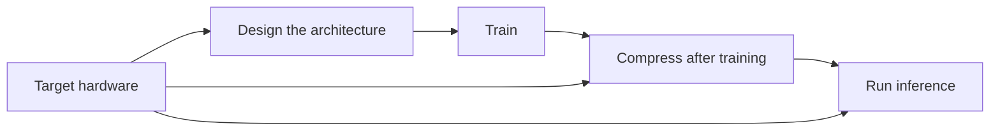

# 01. Why Efficiency Matters

**Level:** Foundation · **Reading time:** 10 min · **Exercise:** 30 min
**Prerequisites:** [How large language models are trained](../01-foundations/02-how-large-language-models-are-trained.md), for the big picture only

> **In one sentence:** After this chapter you can name the four resources a model burns, estimate each one with a one-line calculation, and say which lever in this part reduces it.

## Why this matters

Your team wants an AI feature: classify a support ticket, transcribe a meeting, answer questions about a product manual. You pick a capable model. Then the questions start. Will it fit on a phone? How many requests per second can one server handle? What does that cost per month? Will the feature drain the battery?

Here is the first surprise for a software engineer. Take a model with 7 billion parameters (a **parameter** is one learned number inside the model). Store each number in 16-bit floating point, 2 bytes. The weights alone need 7,000,000,000 × 2 = 14 GB of memory, before the model processes a single input. Many laptops have less total memory than that.

This chapter answers: where does that cost come from, and where can you cut it?

## The core idea

A trained model costs four resources every time you run it:

| Resource | What it is | What it limits | Main unit |
|---|---|---|---|
| Storage | Bytes on disk or in an app package | Download size, app-store limits | megabytes |
| Memory | Bytes held in RAM or GPU memory while running: weights plus intermediate results | Whether the model fits on the device at all | gigabytes |
| Compute | Arithmetic operations per input | How fast one request finishes | operations per second |
| Energy | Joules burned, mostly for moving data around | Battery life, electricity bill, heat | joules per request |

**Latency** is the delay for one request, and it is what the user feels. It is not a fifth resource: it is the time the other four take to do their job.

The analogy: a model is like a JavaScript bundle. You build it (training), then you minify and strip it (compression), then you ship the small file. The analogy breaks in one important way. Minifying code does not change what the program does. Compressing a model is usually *lossy*: it changes the numbers, so the model can give slightly different answers. Every technique in this part trades a little quality for a lot of size or speed, and you have to measure both sides of that trade.

### The gap that keeps widening

In his Fall 2024 introduction to MIT 6.5940, Song Han shows a chart with two curves: the size of the largest language models and the memory of the largest accelerator chips ([3:00](https://www.youtube.com/watch?v=U7EPZv8Kh9w&t=180)). His slides list models growing from the 0.05B-parameter Transformer to GPT-3 at 175B and MT-NLG at 530B, while chip memory moved from 16 GB and 32 GB parts to 40 GB and 80 GB parts. Models grew by a factor of thousands. Memory grew by a factor of five.

His conclusion: the gap "is getting larger actually with recent years", and it drives up the price of training and serving ([4:00](https://www.youtube.com/watch?v=U7EPZv8Kh9w&t=240)).

## How it works: where efficiency is won

Han's pipeline has three steps: train a model, compress it, then run the compressed model ([4:00](https://www.youtube.com/watch?v=U7EPZv8Kh9w&t=240)). Stretched over a real product, there are five places to save:

1. **Design the architecture.** Pick a model family built for the job, or search for one. Fewer operations for the same quality.
2. **Train efficiently.** Lower precision during training, training split across many machines, or training on the device itself.
3. **Compress after training.** Remove weights, store them in fewer bits, or shrink a big model into a small one.
4. **Run it efficiently.** Better kernels, less memory traffic, smarter batching and caching at inference time.
5. **Match the hardware to the job.** A data-center GPU, a laptop, a phone and a [microcontroller](../GLOSSARY.md) each need a different model.

**Figure 1.** The life of a model, and where the hardware choice enters.

The four steps run in order, and the hardware you are targeting, the fifth place, shapes the design, the compression and the inference code.

Each lever trades something. Here is the map for this part:

| Lever | What it shrinks | What you pay | Where it is explained |
|---|---|---|---|
| Pruning | Number of weights | Usually only helps speed when whole structures are removed | [Pruning and sparsity](03-pruning-and-sparsity.md) |
| Quantization | Bits per weight, memory traffic, energy | Small accuracy loss, sometimes on hard tasks | [Quantization](04-quantization.md) |
| Architecture search | Operations per input | A costly search | [Neural architecture search](05-neural-architecture-search.md) |
| Distillation | Model size | Training a student; quality can drop on hard cases | [Knowledge distillation](06-knowledge-distillation.md) |
| Efficient inference | Latency, memory per request, cost per token | Engineering effort | [Efficient LLM inference](08-efficient-llm-inference-and-deployment.md) |
| Efficient training | Training time, memory, cost | Complexity | [On-device training](09-llm-post-training-and-on-device-training.md) |

## Worked example: a one-line budget

You do not need to run a model to get a first estimate. Two formulas carry most of the weight (the next chapter derives them).

**Weight memory** = number of parameters × bytes per parameter.

| Model | Bits per weight | Weight memory |
|---|---|---|
| 7B parameters | 16 | 7 × 10⁹ × 2 = 14 GB |
| 7B parameters | 8 | 7 GB |
| 7B parameters | 4 | 3.5 GB |

**Time to read the weights once** = weight memory ÷ memory bandwidth. A language model that generates text one token at a time (a **token** is a chunk of text, roughly a short word) has to read all its weights for every token it produces when it serves one user. With a bandwidth of 50 GB/s, typical of a laptop:

- 16-bit: 14 GB ÷ 50 GB/s = 0.28 s per token, about 3.6 tokens per second. Slow to read.
- 4-bit: 3.5 GB ÷ 50 GB/s = 0.07 s per token, about 14 tokens per second. Usable.

Same model, same chip, four times faster. Nothing was computed faster. Fewer bytes were moved. This is what **quantization** buys, and it is why Han's students quantize a 7-billion-parameter model down to 4-bit and run it on a laptop; his own demo runs one on a MacBook M1 ([34:00](https://www.youtube.com/watch?v=U7EPZv8Kh9w&t=2040)).

### Budgets to keep in mind

These are rules of thumb from engineering practice, not course content:

| Situation | Budget |
|---|---|
| Video at 30 frames per second | 33 ms of processing per frame |
| A tap that should feel instant | About 100 ms end to end |
| Streaming a chat answer | First token within 1–2 s, then 10 or more tokens per second |
| Phone battery | Roughly 15–20 Wh; a sustained load of a few watts drains it in hours |
| Coin-cell sensor battery | Under 1 Wh; the processor must average milliwatts or less |

Energy follows memory. Moving a number from main memory costs far more energy than multiplying two numbers; chip-design measurements commonly put the gap at two orders of magnitude or more. So "fewer bytes moved" is the same lever for battery life as for speed.

## What the practitioners say

Han frames the whole course as **algorithm and system co-design** ([62:00](https://www.youtube.com/watch?v=U7EPZv8Kh9w&t=3720)): change the algorithm and the software or hardware together, instead of tuning either one alone. He splits the field into three sections ([60:00](https://www.youtube.com/watch?v=U7EPZv8Kh9w&t=3600)):

- **Efficient inference:** pruning to reduce the number of parameters, quantization to reduce the precision of each parameter, architecture search, and distillation from a teacher model.
- **Efficient training:** compressing gradients, training on the device, and parallelism across machines.
- **Application-specific work:** transformers and language models, diffusion models, video and 3D point clouds.

The examples on his slides show how large the wins are (all as reported in the lecture, each on its own hardware and data set):

| Task | Before | After | Technique |
|---|---|---|---|
| Image segmentation (EfficientViT-SAM, A100 GPU) | 11 images/s | 182 images/s (16.5× on the slide's chart, which also claims a 48.9× speedup over SAM-ViT-H at matched zero-shot accuracy) | efficient attention |
| Image-to-image translation (GAN Compression) | 56.8 G MACs, 12.1 FPS | 3.50 G MACs, 40.0 FPS | pruning |
| Image editing (SIGE) | 369 ms | 95 ms | skipping unchanged regions |
| On-device training on a microcontroller (MCUNetV3) | 652 MB | 0.1 MB | quantized training, sparse updates |

A **MAC** is one multiply-accumulate: a × b + c. It is the unit used to count a model's arithmetic.

Two more of Han's points are worth keeping. First, accuracy costs computation: his ImageNet chart shows the top-5 error rate falling from 28.2% in 2010 to 2.3% in 2017, and the next slide shows the more accurate models needing more MACs. Second, Han warns at [56:00](https://www.youtube.com/watch?v=U7EPZv8Kh9w&t=3360) against judging hardware by peak performance alone: two chips can advertise higher peak numbers without being faster in practice, because "doesn't directly translate to measured speed"; moving activations and weights, memory bandwidth and utilization all matter. The same block gives the gap in devices: tens of gigabytes of memory in the cloud against a few hundred kilobytes of SRAM, the working memory on a microcontroller chip. At [58:00](https://www.youtube.com/watch?v=U7EPZv8Kh9w&t=3480) he names three pillars of deep learning, hardware, data and algorithm, and states TinyML's goal for each: less computation, less carbon, fewer engineers, less data.

He also mentions that SmoothQuant, a quantization method you will meet in [Chapter 04](04-quantization.md), started as a course project two years earlier, and sketches the course's route to 4-bit: 16-bit to 8-bit with SmoothQuant, then 4-bit with AWQ, an activation-aware, weight-only method. SmoothQuant's key idea, as he puts it, is that activations, the values that pass between layers, hold a few very large values (outliers), so you scale the weights and the activations until the two are equalized and smoothed, which matrix multiplication allows because it is linear ([34:00](https://www.youtube.com/watch?v=U7EPZv8Kh9w&t=2040)).

## Pitfalls

1. **Counting parameters when memory for intermediate results is the real limit.** Fix: measure peak memory at run time, not model size. Chapter 02 shows the difference.
2. **Reporting throughput when the user cares about latency.** Batching, which processes several requests together, raises requests per second and can raise the delay for each request. Decide which one you need before you measure.
3. **Optimizing before profiling.** If 90% of a request's time is the network round trip, a faster model changes little. Fix: time the whole request first.
4. **Trusting peak numbers.** A chip's advertised operations per second is a ceiling almost no model reaches. Fix: measure your model on your hardware.
5. **Skipping evaluation after compression.** Compression is lossy. Fix: run your evaluation set before and after; see [a minimal eval harness](../03-evaluation/02-a-minimal-eval-harness.md).
6. **Rebuilding what a smaller model already does.** Pick the smallest model that passes evaluation first, then compress it.

## Try it

Write a budget for one model. Find a model card or an announcement that states the parameter count, for example a model's page on Hugging Face. Compute:

1. Weight memory at 16-bit and at 4-bit.
2. Time to read the weights once at 50 GB/s (laptop) and at 1,000 GB/s (data-center GPU).
3. The best-case tokens per second in each case, assuming memory is the limit.

**You are done when** you have a four-row table with the formula shown next to every number, and one sentence on which device you would pick.

**Stretch:** repeat the calculation for a 70B-parameter model and say what changes: the device, the precision, or both.

## Key takeaways

- A model costs storage, memory, compute and energy. Latency is how long those take for one request.
- Models grew by thousands of times while chip memory grew about five times, as Han's Fall 2024 chart shows.
- Weight memory is parameters × bytes per parameter. Halving the bytes halves the memory and the time spent moving it.
- Efficiency is won in five places: architecture, training, compression, inference, and hardware choice.
- Every lever is a trade. Measure quality before and after.
- Fewer bytes moved is the same lever for speed and for battery life.

## Self-check

1. A model has 3 billion parameters stored in 8-bit. How much memory do the weights need?
2. Two models have the same parameter count. Which one is faster to read from memory?
3. Serving one user at a time, a language model reads all of its weights for every token it generates. What happens to time per token if you quantize it from 16-bit to 4-bit?
4. Which of these is a reason compression can change a model's answers?
   (a) The weights are rounded or left out when stored in fewer bits.
   (b) The model loads from disk faster.
   (c) Each request uses less memory.
5. Your profiling shows 80% of request time is network latency. What is the first thing to fix?

Show answers

1. 3 × 10⁹ × 1 byte = 3 GB.
2. The one stored with fewer bytes per parameter, assuming the same layout and hardware.
3. It drops by about four times, because memory traffic drops by four times, as long as reading the weights remains the bottleneck.
4. (a). Compression is usually lossy: the stored numbers are changed, rounded or removed, so outputs can shift.
5. The network path (fewer round trips, a closer deployment), not the model.

## Sources

- **Lecture:** Song Han, "Lecture 1: Introduction", MIT 6.5940 TinyML and Efficient Deep Learning Computing (Fall 2024): [video](https://www.youtube.com/watch?v=U7EPZv8Kh9w) · [guide](../lectures/mit-01-introduction.md), used at [supply and demand](https://www.youtube.com/watch?v=U7EPZv8Kh9w&t=180), [training cost and pipeline](https://www.youtube.com/watch?v=U7EPZv8Kh9w&t=240), [running a model on a laptop](https://www.youtube.com/watch?v=U7EPZv8Kh9w&t=2040), [course map](https://www.youtube.com/watch?v=U7EPZv8Kh9w&t=3600), [algorithm and system co-design](https://www.youtube.com/watch?v=U7EPZv8Kh9w&t=3720)
- **Reading:** Song Han, Huizi Mao, William J. Dally, "Deep Compression: Compressing Deep Neural Networks with Pruning, Trained Quantization and Huffman Coding" (ICLR 2016): [arXiv](https://arxiv.org/abs/1510.00149)
- **Reading:** Song Han et al., "EfficientML.ai" course site, slides and labs: [efficientml.ai](https://efficientml.ai)

## Next

→ [Neural Network Basics for Efficiency](02-neural-network-basics-for-efficiency.md), where you learn to count parameters, operations and memory yourself instead of trusting a model card.
