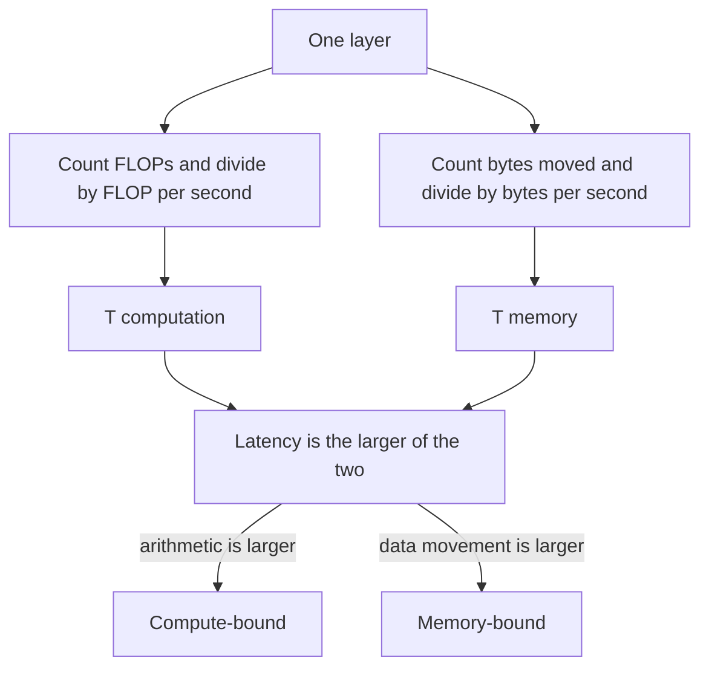

# 02. Neural Network Basics for Efficiency

**Level:** Foundation · **Reading time:** 18 min · **Exercise:** 45 min
**Prerequisites:** [Why efficiency matters](01-why-efficiency-matters.md)

> **In one sentence:** After this chapter you can take the shape of a layer and compute its parameter count, weight memory and operation count by hand, then say whether running it is limited by arithmetic or by moving data.

## Why this matters

Imagine two models. Both have about 4 million parameters. One runs in 2 ms on your phone. The other takes 40 ms and needs eight times more peak memory. Parameter count did not predict either number.

The profiler tells you where the time goes, but you cannot read a profiler until you know what a network computes and what it moves. This chapter gives you that vocabulary: five minutes of arithmetic that explains most efficiency results.

## The core idea

A **neural network** is a stack of simple functions. Each one reads a big block of numbers, multiplies them by small learned tables, and writes another block of numbers.

Four words cover almost everything, and Song Han uses them in pairs ([2:00](https://www.youtube.com/watch?v=I0nKjPpZmMU&t=120)):

| Word | Also called | Meaning |
|---|---|---|
| weight | synapse, parameter | one learned number that multiplies an input |
| activation | feature, neuron | one number produced by a layer |

A **layer** applies the same rule to a whole block of activations at once, and a **tensor** is that block: an array with a shape. Han stresses that tensor dimensions are the thing to track, because every count in this chapter follows from them ([6:00](https://www.youtube.com/watch?v=I0nKjPpZmMU&t=360)).

The analogy: a network is a pipeline of `map` operations over huge arrays, with a small lookup table of weights at each stage. The analogy breaks on reuse. Weights are read again for every input, so hardware keeps them close. Activations are written once and read once or twice. That difference is why weights and activations behave so differently in memory.

## How it works, step by step

### 1. The fully connected layer

A **fully connected layer** (also *linear layer*) gives every output its own weight for every input:

```
y = xW + b
```

- `x`: the input, a vector of `Ci` activations.
- `W`: the weights, a table with `Ci` rows and `Co` columns.
- `b`: the **bias**, one extra learned number per output, added after the multiply.
- `y`: the output, a vector of `Co` activations.

For a batch of `N` inputs (several inputs processed together), `x` becomes `N × Ci` and `y` becomes `N × Co`. The weight table does not change (Han's example at [6:00](https://www.youtube.com/watch?v=I0nKjPpZmMU&t=360) uses a batch of two).

```
parameters = Ci × Co + Co
MACs       = Ci × Co        (per input vector)
```

A **MAC** is one multiply-accumulate: one multiplication and one addition, `a × b + c`.

Worked numbers for a layer from 1,024 inputs to 4,096 outputs:

- Parameters: 1,024 × 4,096 + 4,096 = 4,198,400.
- Weight memory at 2 bytes each: 8.4 MB.
- MACs per input vector: 1,024 × 4,096 = 4,194,304, about 4.2 million.

Language models are mostly these layers, with widths in the thousands, stacked dozens deep.

### 2. The convolution layer

A **convolution** connects each output only to a small window of inputs, not to all of them (Han's slide 12). The window is the **receptive field**, `kh × kw` inputs wide.

- **Stride** is how far the window moves per step. Stride 2 halves the output size.
- **Padding** adds zeros around the input border so the output keeps its size.
- **Grouped convolution** splits the channels into `G` independent groups, each with narrower filters. Weights drop by a factor of `G` ([18:00](https://www.youtube.com/watch?v=I0nKjPpZmMU&t=1080)).
- **Depthwise convolution** is the extreme case: `G = Ci = Co`, one filter per channel.
- **Pooling** shrinks the output by taking the maximum or average of each small block. It has no learnable parameters ([20:00](https://www.youtube.com/watch?v=I0nKjPpZmMU&t=1200)).

For an input of `Ci` channels and size `H × W`, a square kernel (the weight table) of size `K`, stride `S` and padding `P`:

```
H_out      = (H + 2P − K) / S + 1
parameters = K × K × (Ci / G) × Co + Co
MACs       = K × K × (Ci / G) × Co × H_out × W_out
```

Worked numbers: 3 input channels, 16 output channels, `K = 3`, `P = 1`, `S = 1`, input 224 × 224.

- Output size: (224 + 2 − 3) / 1 + 1 = 224, so 16 × 224 × 224.
- Parameters: 3 × 3 × 3 × 16 + 16 = 448. At 2 bytes: 896 bytes of weights.
- MACs: 3 × 3 × 3 × 16 × 224 × 224 = 21,676,032, about 21.7 million.
- Output activations: 16 × 224 × 224 = 802,816 values. At 2 bytes: 1.6 MB.

The output block is about 1,800 times larger than the weights that produced it. That is Han's point: when a network is trained, the activation count, not the parameter count, is the memory bottleneck, because a batch multiplies them ([44:00](https://www.youtube.com/watch?v=I0nKjPpZmMU&t=2640)). Step 5 explains why training must also keep every one of them.

Two more layer types appear in every modern network. A **normalization layer** rescales activations so training converges faster. An **activation function** is a simple nonlinearity applied to each value, such as `max(0, x)`.

### 3. Attention, in one paragraph

A **transformer** is the architecture behind modern language models. Its key step, **attention**, has every token compare itself with every other token. Han describes it as a [softmax](../GLOSSARY.md) over all pairs, giving an `M × N` attention map ([30:00](https://www.youtube.com/watch?v=I0nKjPpZmMU&t=1800)). The efficiency consequence: work grows with the square of the sequence length, and with the square of the resolution for images. He previews two answers: sparse attention, since not all tokens need to attend to each other, and FlashAttention, which cuts the memory movement and brings memory down to almost constant but leaves the FLOPs unchanged ([30:00](https://www.youtube.com/watch?v=I0nKjPpZmMU&t=1800)). [Chapter 08](08-efficient-llm-inference-and-deployment.md) covers what to do about it; the architecture itself is explained in [transformer architectures](../10-llm-internals/03-transformer-architectures-and-hyperparameters.md).

### 4. Counting operations

| Term | Meaning | Speed or work? |
|---|---|---|
| MAC | one multiply and one add | work |
| FLOP | one floating-point operation; a MAC counts as 2 FLOPs (Han's slide 74) | work |
| FLOPS | FLOPs per second | speed |
| OP | any operation: floating-point, integer, binary, bitwise ([50:00](https://www.youtube.com/watch?v=I0nKjPpZmMU&t=3000)) | work |
| OPS | operations per second | speed |

Han's example: AlexNet, an image classifier, needs 724 million MACs, which he restates as 1.4 billion OPs ([50:00](https://www.youtube.com/watch?v=I0nKjPpZmMU&t=3000)). He introduces OP because quantized networks do integer arithmetic, which the word floating-point does not describe. One MAC is `a = a + b × c`, and he notes it usually comes as a single instruction on a GPU ([44:00](https://www.youtube.com/watch?v=I0nKjPpZmMU&t=2640)); one MAC is two FLOPs only when the operands are floating-point numbers ([48:00](https://www.youtube.com/watch?v=I0nKjPpZmMU&t=2880)).

The capital S matters, and so does the factor of two. Always check whether a paper counted MACs or FLOPs.

### 5. Counting memory

- **Model size** is the storage for the weights (Han's slide 58): `parameters × bits per weight / 8`.
- **Activation memory** is the intermediate results. The **peak activation size** is the largest set alive at the same moment, and it sets the RAM you need. Han's first-order estimate is simply a layer's input block plus its output block; an activation block has `C × H × W` values. He also notes that the split between the two kinds of memory is U-shaped through a vision network: early layers have few weights but large activations because the resolution is high, late layers the reverse because the channel count is large ([44:00](https://www.youtube.com/watch?v=I0nKjPpZmMU&t=2640)).
- Training needs more than inference. **Backpropagation**, the algorithm that works out how each weight should change, reads every intermediate result again. So all of them are kept. Han: "we have to store those intermediate activations" (Lecture 1, [8:00](https://www.youtube.com/watch?v=U7EPZv8Kh9w&t=480)).

### 6. Latency and throughput

**Latency** is the delay for one task. Han's example is 45 to 46 ms to segment one video frame. **Throughput** is the rate: 6 videos per second against 77 in his second example ([32:00](https://www.youtube.com/watch?v=I0nKjPpZmMU&t=1920)).

His slide 45 asks whether higher throughput means lower latency. It does not, and his slide 46 gives the reason:

```
latency ≈ max(T_computation, T_memory)
```

- `T_computation`: time to do the arithmetic.
- `T_memory`: time to read the data the arithmetic needs.

A layer is **compute-bound** when arithmetic dominates and **memory-bound** when moving data dominates. Which one you are on depends on the ratio of FLOPs to bytes, the **arithmetic intensity**.

**Figure 1.** Han's first-order latency rule: two timers, and the slower one sets the latency.



A layer is compute-bound when the arithmetic timer wins and memory-bound when the data timer wins; batching adds only to the arithmetic timer.

Worked numbers for a 7-billion-parameter language model generating one token for one user. Suppose the chip does 200 trillion FLOP/s and moves 1 trillion bytes/s.

- Arithmetic: 2 × 7 × 10⁹ = 14 billion FLOPs per token, so `T_computation` = 0.07 ms.
- Memory: all weights read once, 14 GB at 2 bytes, so `T_memory` = 14 ms.

The layer is memory-bound by a factor of 200. Now serve a batch of `B` users at once. The weights are still read once, but the arithmetic is multiplied by `B`:

| Batch | T_computation | T_memory | Latency per token | Tokens per second |
|---|---|---|---|---|
| 1 | 0.07 ms | 14 ms | 14 ms | 71 |
| 32 | 2.2 ms | 14 ms | 14 ms | 2,286 |
| 200 | 14 ms | 14 ms | 14 ms | 14,286 |
| 512 | 35.8 ms | 14 ms | 35.8 ms | 14,286 |

Batching raised throughput 200 times without touching latency. Past batch 200 the model becomes compute-bound: latency grows and throughput stops improving.

### 7. Energy

Han's slides 47 and 48 make one point: data movement means more memory references, and more references mean more energy. A processor has a memory hierarchy: small fast storage on the chip, larger slower memory next to it, main memory further away. Each step out costs more energy per byte. The design rule that follows is to keep data close and reuse it while it is there.

### 8. Hardware-aware design

Han names **algorithm and system co-design** as the key concept of his course (Lecture 1, [62:00](https://www.youtube.com/watch?v=U7EPZv8Kh9w&t=3720)). Two consequences:

- **Fewer MACs does not always mean faster.** A depthwise convolution has very few MACs and very little weight reuse, so real hardware often waits on memory for it. A dense convolution with more MACs can run just as fast.
- **Sparsity has to match the hardware.** Randomly scattered zeros still occupy regular chips. Lecture 1's slide 5 notes that NVIDIA Ampere tensor cores support **2:4 sparsity**, where every group of four weights has exactly two zeros. A regular pattern is something hardware can skip.

## Worked example

Pure Python, no libraries. It counts a layer and estimates its latency with Han's `max` rule. Real latency is higher: this ignores activation traffic and kernel launch overhead.

```python
def linear(cin, cout):
    """One fully connected layer, applied to one input vector."""
    return {"params": cin * cout + cout, "macs": cin * cout}

def conv2d(cin, cout, k, h, w, stride=1, pad=0, groups=1):
    """Square-kernel convolution on one image of shape (channels, h, w)."""
    h_out = (h + 2 * pad - k) // stride + 1
    w_out = (w + 2 * pad - k) // stride + 1
    weights = k * k * (cin // groups) * cout
    return {"params": weights + cout, "macs": weights * h_out * w_out}

def describe(name, layer, tflops=200, tb_per_s=1.0):
    flops = 2 * layer["macs"]                     # one MAC = two FLOPs
    weight_bytes = 2 * layer["params"]            # 16-bit weights
    t_compute = flops / (tflops * 1e12)           # seconds
    t_memory = weight_bytes / (tb_per_s * 1e12)   # seconds
    bound = "compute" if t_compute > t_memory else "memory"
    print(f"{name:10s} params={layer['params']:>9,} MACs={layer['macs']:>13,} "
          f"weights={weight_bytes / 2**20:7.2f} MiB "
          f"latency~{max(t_compute, t_memory) * 1e6:7.2f} us {bound}-bound")

describe("conv 3>16", conv2d(3, 16, 3, 224, 224, pad=1))
describe("conv 16>16", conv2d(16, 16, 3, 224, 224, pad=1))
describe("depthwise", conv2d(16, 16, 3, 224, 224, pad=1, groups=16))
describe("linear", linear(1024, 4096))

def decode_ms(params, bits, batch, tflops=200, tb_per_s=1.0):
    """One decoding step: every user in the batch gets one token."""
    t_compute = 2 * params * batch / (tflops * 1e12)
    t_memory = params * bits / 8 / (tb_per_s * 1e12)   # weights read once per step
    return max(t_compute, t_memory) * 1e3

for batch in (1, 32, 200, 512):
    ms = decode_ms(params=7_000_000_000, bits=16, batch=batch)
    print(f"batch={batch:4d}  {ms:6.2f} ms/token  {batch / (ms / 1e3):9,.0f} tokens/s")
```

What to observe:

- The conv 16 to 16 layer needs 115,605,504 MACs. Depthwise needs 16 times fewer, and is compute-bound either way.
- The linear layer needs 27 times fewer MACs than the conv 16 to 16 layer, yet its estimate is about seven times slower. It moves 8 MB of weights per input; the convolution moves 4.6 KB.
- The last four lines reproduce the batch table above.

## What the practitioners say

- Han opens with the numbers behind this part: Moore's law doubles hardware capability every two years, while deep learning models grow more than four times every two years (slide 3; [0:00](https://www.youtube.com/watch?v=I0nKjPpZmMU&t=0)).
- He groups the goals in three: a **smaller** model for storage, a **faster** model for real-time predictions, and a **greener** model that takes less battery. Memory, he says, determines all three ([32:00](https://www.youtube.com/watch?v=I0nKjPpZmMU&t=1920)).
- In the example he discusses at [44:00](https://www.youtube.com/watch?v=I0nKjPpZmMU&t=2640), activations outnumber parameters about seven to one during training. Going from ResNet-50 to MobileNetV2 at about the same accuracy cut the parameters four times, but the activation memory, his main bottleneck, improved only 1.1 times, about 10%. His conclusion: optimizing the activation is hard.
- Grouped convolution divides the MAC count by `G`, the number of groups ([48:00](https://www.youtube.com/watch?v=I0nKjPpZmMU&t=2880)).

## Pitfalls

1. **Mixing MACs and FLOPs.** Fix: state the unit and the convention in every table.
2. **Judging a layer by MACs alone.** Fix: also compute weight bytes, then apply `max(T_computation, T_memory)`.
3. **Batching for throughput and being surprised by latency.** Fix: find the batch where the model turns compute-bound and stay below it for interactive use.
4. **Sizing memory from the model file.** Fix: add peak activation memory, which for vision models is often the larger term.
5. **Sizing a training job like an inference job.** Fix: budget memory for every intermediate activation plus gradients.
6. **Expecting scattered pruned weights to run faster.** Fix: use a sparsity pattern your hardware can skip, or accept a smaller file with the same speed. See [pruning and sparsity](03-pruning-and-sparsity.md).
7. **Using the peak FLOP/s of one precision to predict another.** Fix: measure with the precision you will actually ship.

## Try it

Extend the script:

1. Add a grouped convolution with `groups=4` and confirm the MACs fall to 28,901,376, a quarter of the ungrouped conv 16 to 16 layer.
2. Add a three-layer network (for example 1,024 → 4,096 → 4,096 → 10) and print total parameters and total MACs.
3. Add `peak_activation_bytes(layer)`: the input block plus the output block, at 2 bytes each. First make `conv2d` return `cin`, `cout`, `h`, `w`, `h_out` and `w_out` in its dictionary, because the peak depends on shapes.

**You are done when** your output shows 2,320 parameters and 115,605,504 MACs for the conv 16 to 16 layer, 4,198,400 parameters for the linear layer, 21,020,682 parameters for the three-layer network, and 3,211,264 bytes of peak activations for the conv 16 to 16 layer.

**Stretch:** for each layer, print the arithmetic intensity in FLOPs per byte and the batch size at which it turns compute-bound.

## Key takeaways

- Weights (parameters) multiply activations. Every count follows from tensor shapes.
- A fully connected layer has `Ci × Co` weights; a convolution has `K × K × Ci × Co` weights reused across every output position.
- Model size is parameters times bits. Peak activation memory often dominates at run time.
- Latency is about `max(T_computation, T_memory)`. Know which term wins.
- Batching raises throughput on a memory-bound model and leaves latency flat until compute takes over.
- Fewer MACs is not the same as faster. The hardware decides.

## Self-check

1. A fully connected layer has 512 inputs and 1,024 outputs. How many parameters, including biases?
2. A report says a model needs 2 GFLOPs. How many MACs is that, if one MAC is two FLOPs?
3. Layer A needs 100 million MACs and has 4 KB of weights. Layer B needs 5 million MACs and has 200 MB of weights. Which is likely to be memory-bound on a large GPU?
4. A memory-bound model serves 32 requests in one batch instead of one. What happens to latency per request and to throughput?
5. Why does training the same model need more memory than running it?
6. Why can removing 90% of the weights, scattered at random, leave the speed unchanged?

<details><summary>Show answers</summary>

1. 512 × 1,024 + 1,024 = 525,312.
2. 1 × 10⁹ MACs, one billion.
3. Layer B: it moves 200 MB for only 10 million FLOPs.
4. Latency stays about the same, because the weights are still read once per step. Throughput rises by up to 32 times, until arithmetic becomes the limit.
5. Backpropagation needs every intermediate activation, so they are all kept until the backward pass finishes.
6. Regular hardware still stores and processes every slot, zeros included. Only a pattern the hardware can skip saves time or memory.

</details>

## Sources

- **Lecture:** Song Han, "Lecture 2: Basics of Neural Networks", MIT 6.5940 TinyML and Efficient Deep Learning Computing (Fall 2024): [video](https://www.youtube.com/watch?v=I0nKjPpZmMU), used at [Moore's law versus model size](https://www.youtube.com/watch?v=I0nKjPpZmMU&t=0), [terms](https://www.youtube.com/watch?v=I0nKjPpZmMU&t=120), [tensor dimensions](https://www.youtube.com/watch?v=I0nKjPpZmMU&t=360), [grouped convolution](https://www.youtube.com/watch?v=I0nKjPpZmMU&t=1080), [activations versus parameters](https://www.youtube.com/watch?v=I0nKjPpZmMU&t=2640), [one MAC, two FLOPs](https://www.youtube.com/watch?v=I0nKjPpZmMU&t=2880), [latency and throughput](https://www.youtube.com/watch?v=I0nKjPpZmMU&t=1920), [MAC, FLOP and OP](https://www.youtube.com/watch?v=I0nKjPpZmMU&t=3000)
- **Lecture:** Song Han, "Lecture 1: Introduction", MIT 6.5940 (Fall 2024): [training versus inference memory](https://www.youtube.com/watch?v=U7EPZv8Kh9w&t=480), [algorithm and system co-design](https://www.youtube.com/watch?v=U7EPZv8Kh9w&t=3720)
- **Reading:** Vincent Dumoulin, Francesco Visin, "A Guide to Convolution Arithmetic for Deep Learning" (2016): [arXiv](https://arxiv.org/abs/1603.07285)

## Next

→ [Pruning and Sparsity](03-pruning-and-sparsity.md), the first technique that uses these counts: delete the weights that contribute least, and learn why deleting them is easier than making them count.
