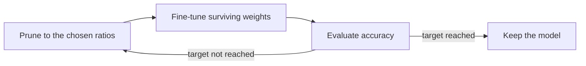

# 03. Pruning and Sparsity

**Level:** Practitioner · **Reading time:** 22 min · **Exercise:** 60 min
**Prerequisites:** [Neural Network Basics for Efficiency](02-neural-network-basics-for-efficiency.md)

> **In one sentence:** After this chapter you can remove a chosen share of a network's weights with a method you can justify, recover the accuracy with [fine-tuning](../GLOSSARY.md), and predict whether the result will run faster on your hardware.

## Why this matters

Your model file is too large for a phone app. A blog post says 90% of the weights are redundant. You zero out the 90% with the smallest values and save the file. Two problems: the file is the same size, and inference is just as slow.

Zeros stored as ordinary floating-point numbers take the same bytes as any other number, and a regular matrix-multiply kernel multiplies every one of them. Pruning worked as an idea and did nothing as an engineering change. This chapter is about closing that gap: which weights to remove, how to keep the quality, and how to remove them so the hardware notices.

## The core idea

**Pruning** sets weights to zero and stops storing or computing them. **Sparsity** is the fraction of zeros. A **dense** model has few zeros; a **sparse** model has many.

Song Han formulates it as an optimization (Lecture 3, [4:00](https://www.youtube.com/watch?v=EjsB0WgIfUM&t=240)): minimize the loss of the pruned model, subject to keeping no more than a target number of non-zero weights.

The analogy is dead-code elimination in a compiler: find what makes no difference and delete it. The analogy breaks on importance. A line of code either runs or it does not. A weight's importance is a matter of degree, and many small weights can matter together, which is why aggressive pruning always needs retraining afterwards.

Four decisions make up a pruning method:

1. **Granularity:** what unit you remove.
2. **Criterion:** which units count as unimportant.
3. **Ratio:** how much to remove from each layer.
4. **Fine-tuning:** how to recover.

## How it works, step by step

### Step 1: Choose the granularity

| Granularity | What is removed | Effect on commodity hardware | Quality at equal sparsity |
|---|---|---|---|
| Fine-grained (unstructured) | single weights, anywhere | none by default: needs sparse kernels and indices | best |
| Pattern-based (for example 2:4) | at most 2 non-zeros in every block of 4 | speeds up on hardware that supports the pattern | good |
| Vector or kernel | a row of one filter, or a whole filter | some: smaller tensors | medium |
| Channel or neuron (structural) | a whole output channel or neuron | always: matrices get smaller | lower |
| Layer | whole layers | always: fewer sequential steps | depends on the layer |

Han's summary of the trade: fine-grained pruning is the most flexible because it can remove any weight in any location, and it is the most irregular, so it is hard to accelerate (Lecture 4, [2:00](https://www.youtube.com/watch?v=upaZrpXkELc&t=120)).

Worked numbers for a 4,096 × 4,096 weight block in 16-bit, which is 16.8 million weights and 33.6 MB:

- Remove half the output channels: a 2,048 × 4,096 block, 16.8 MB, half the MACs. Every matrix operation gets cheaper.
- Remove half the weights, scattered: 8.4 million survivors, each stored as a 2-byte value plus a 2-byte position, so 33.6 MB again. No saving at all.
- Remove 95% of the weights, scattered: 0.84 million survivors at 4 bytes each, 3.4 MB instead of 33.6 MB. Worth it, but only with software that reads this format.

The lesson: scattered pruning pays off at high sparsity or on special hardware. Structural pruning pays off immediately.

### Step 2: Choose the criterion

- **Magnitude-based.** Rank weights by absolute value and remove the smallest. Han calls it a simple heuristic that turned out to work well (Lecture 4, [2:00](https://www.youtube.com/watch?v=upaZrpXkELc&t=120)).
- **Second-order.** Estimate how much the loss rises when a weight is removed. Han walks through Optimal Brain Damage (Lecture 3, [32:00](https://www.youtube.com/watch?v=EjsB0WgIfUM&t=1920)): expand the loss change with a Taylor series, drop the first-order term because gradients are near zero in a trained model, drop cross terms by assuming weights are independent. What remains depends on the **Hessian**, the matrix of second derivatives, which is expensive to compute, so it has to be approximated ([34:00](https://www.youtube.com/watch?v=EjsB0WgIfUM&t=2040)).
- **Scaling-based**, for whole filters. Use the scale factor of each channel in the batch-normalization layer as its importance score (Lecture 3, [30:00](https://www.youtube.com/watch?v=EjsB0WgIfUM&t=1800)).
- **Percentage-of-zero**, for neurons. A `max(0, x)` activation outputs many zeros. Count the average share of zeros per channel over a batch of inputs and remove the channels that are mostly zero (Lecture 3, [34:00](https://www.youtube.com/watch?v=EjsB0WgIfUM&t=2040)).
- **Regression-based.** Remove neurons so that the layer's output changes as little as possible.

Han's own position on which is best: it depends on the data set and the network, and it has to be tried experimentally (Lecture 3, [32:00](https://www.youtube.com/watch?v=EjsB0WgIfUM&t=1920)).

Removing a neuron is a coarse version of weight pruning. In a linear layer it deletes one row of the weight matrix. In a convolution it deletes the whole kernel of one output channel (Lecture 3, [34:00](https://www.youtube.com/watch?v=EjsB0WgIfUM&t=2040)).

The regression-based criterion has a mechanical form. Scoring a cut with the loss of the whole network is expensive: in a large language model the error has to pass through every layer (Lecture 3, [38:00](https://www.youtube.com/watch?v=EjsB0WgIfUM&t=2280)). So keep the change in one layer's output small instead, and the layer is a single matrix multiplication. Write its output as a sum over input channels: each input channel contributes its activation channel times its weight channel, an **outer product**, with a scaling factor of its own ([40:00](https://www.youtube.com/watch?v=EjsB0WgIfUM&t=2400)). The goal is a sum that stays near the original output with as many factors as possible at zero; where a factor is zero, its channel is gone, and the output keeps its shape. Solving alternates: first solve for the factors with the weights held fixed, which picks the channels to prune; then solve for the weights with the factors held fixed; repeat. Han says this could help a lot for large language models, where passing the error back through every layer is very expensive ([44:00](https://www.youtube.com/watch?v=EjsB0WgIfUM&t=2640)).

### Step 3: Choose the ratio for each layer

Layers tolerate different amounts of pruning. Two ways to set the ratios:

- **Sensitivity analysis.** For each layer in turn, prune it at several ratios while leaving the others intact, and measure accuracy. You get one curve per layer. Give robust layers a high ratio and fragile ones a low one (Han's Lecture 4, slides 12 to 25).
- **Search.** **AMC**, short for AutoML for Model Compression, uses reinforcement learning, where an agent learns by trial and error from a reward, to pick a ratio for every layer under one overall budget; its action is a continuous pruning ratio between zero and one, and its reward is minus the error, or minus infinity when the budget is violated. On ResNet-50 at the same accuracy, Han says the agent reached a density of 20% where his own hand-tuned search had reached 29%, in a few GPU hours instead of about a week; the human expert in that comparison was Han himself, in 2017 (Lecture 4, [14:00](https://www.youtube.com/watch?v=upaZrpXkELc&t=840)). **NetAdapt** is the rule-based alternative: in each iteration, reduce latency by a fixed step and fine-tune, which yields a series of models at different costs (Lecture 4, slides 35 to 42).

Han considers this decision so important that he tells the class the per-layer ratio is "super crucial compared with uniform pruning ratio" (Lecture 3, [56:00](https://www.youtube.com/watch?v=EjsB0WgIfUM&t=3360)).

### Step 4: Fine-tune, a little at a time

1. Prune to the chosen ratios.
2. Fine-tune on the training data, updating only the surviving weights.
3. Evaluate. Not at the target yet? Prune a little more and repeat.

**Figure 1.** Iterative pruning: the loop stops only when the pruned model meets its target.



Each turn removes only a little, which lets the final sparsity exceed what one large cut allows.

One round of pruning plus fine-tuning is one iteration (Han's Lecture 4, slides 46 to 53). For aggressive targets, go in steps. Han reports that gradual pruning beats pruning 70% in one shot and then fine-tuning everything (Lecture 4, [26:00](https://www.youtube.com/watch?v=upaZrpXkELc&t=1560)). The same example lifted AlexNet's pruning ratio from 5× to 9×. He also adds regularization during fine-tuning, L1 or L2, to push unimportant weights toward zero; in his experience there is little to choose between the two (his 2015 paper used L2, Network Slimming used L1), so compare them ([26:00](https://www.youtube.com/watch?v=upaZrpXkELc&t=1560)).

### Step 5: Match the hardware

- **Special-purpose sparse hardware.** Han's EIE was the first accelerator for sparse, compressed models (Lecture 4, slide 60). He is frank about its costs: heavy control-flow and storage overhead, because every non-zero weight needs its own pointers and indices ([44:00](https://www.youtube.com/watch?v=upaZrpXkELc&t=2640)). His fixes: structured patterns such as 2:4, or coarser granularity so many weights share one entry.
- **Fixed patterns.** NVIDIA's Ampere generation supports 2:4 sparsity in its sparse tensor cores, its matrix-multiply units (Lecture 4, [0:00](https://www.youtube.com/watch?v=upaZrpXkELc&t=0)). The pattern lets hardware skip known slots. It does not make indices disappear: Han shows an 8 × 8 matrix in which each row of eight values keeps only four, and those four still need an index matrix to say which positions they came from ([48:00](https://www.youtube.com/watch?v=upaZrpXkELc&t=2880)).
- **Sparse activations.** Point clouds (3D points measured by LiDAR laser sensors) in autonomous driving are mostly empty space (Lecture 4, [48:00](https://www.youtube.com/watch?v=upaZrpXkELc&t=2880)). Sparse convolution skips the empty regions. The engineering problem there is regularity: grouping work into uniform blocks wastes some multiplies but runs faster, and Han notes that fixed grouping wins on TFLOP/s but adaptive grouping is faster, because some of a fixed group's multiplies are redundant work that does not count. Raising the number of groups from 0 to 26, he found a sweet spot at roughly six groups ([60:00](https://www.youtube.com/watch?v=upaZrpXkELc&t=3600)).
- **Reordering.** TorchSparse++, the library that followed Han's TorchSparse, runs memory access and computation at the same time for the 3D perception that autonomous driving needs, helped by a generator of sparse kernels and a tuner that searches the design space (Lecture 4, [62:00](https://www.youtube.com/watch?v=upaZrpXkELc&t=3720)). Neighboring outputs are computed in parallel, so each one also does the work its neighbors need, and that padding is waste. If each output's sparsity pattern (the positions where it has work) is read as a binary number and the outputs are sorted by it, similar patterns end up side by side: in his example the redundant multiplications fell from 12 to 10, and to 8 after splitting the channels, at the small cost of the sorting and the split.

His summary of the lesson from this work: "First principle of efficient AI is to be lazy" (Lecture 4, [46:00](https://www.youtube.com/watch?v=upaZrpXkELc&t=2760)). In his list: avoid redundant computation, quickly reject work (if a value is zero, do not compute on it), use fewer bits, or delay the work. He names one opening per domain: only the edited region when editing an image, token sparsity for transformers, temporal redundancy in video, and point clouds, which are naturally sparse.

### The lottery ticket hypothesis

This idea is not covered in the lectures; it is included because you will meet it. The **lottery ticket hypothesis** (Frankle and Carbin, 2019) says that a dense network contains a small subnetwork that, trained from its original initial values, reaches the accuracy of the full network. The test: train, prune, reset the surviving weights to their initial values, and train the subnetwork alone. For larger networks the reset has to go back to an early iteration rather than to the start.

It is useful as an insight: initialization and connectivity matter together. It is rarely used as a production compression method, because finding the tickets costs several full training runs.

## Worked example

One linear layer, pruned three ways, with NumPy. The measure is how much the layer's output changes. It is a stand-in for accuracy: no dataset, no training loop.

```python
import numpy as np

rng = np.random.default_rng(0)
# One linear layer: 128 inputs, 64 outputs. Neurons have very different scales.
W = rng.standard_normal((64, 128)) * np.linspace(0.1, 2.0, 64)[:, None]
X = rng.standard_normal((1000, 128))      # 1,000 calibration inputs
Y = X @ W.T                               # what the dense layer outputs

def error(W_pruned):
    """Relative change of the layer's output (0 means unchanged)."""
    return np.linalg.norm(X @ W_pruned.T - Y) / np.linalg.norm(Y)

def magnitude(W, keep):
    """Fine-grained: keep the `keep` fraction of weights with the largest |w|."""
    threshold = np.quantile(np.abs(W), 1 - keep)
    return W * (np.abs(W) >= threshold)

def random_keep(W, keep):
    """Baseline: keep a random `keep` fraction of weights."""
    return W * (rng.random(W.shape) < keep)

def by_neuron(W, keep):
    """Structural: keep the `keep` fraction of neurons with the largest L1 norm."""
    norms = np.abs(W).sum(axis=1)
    alive = norms >= np.quantile(norms, 1 - keep)
    return W * alive[:, None]

for keep in (0.5, 0.2, 0.05):
    print(f"keep {keep:>4}: magnitude {error(magnitude(W, keep)):.2f}  "
          f"random {error(random_keep(W, keep)):.2f}  "
          f"neurons {error(by_neuron(W, keep)):.2f}")

def fine_tune(W_pruned, steps=50, lr=0.5):
    """Gradient descent on the output error; only surviving weights move."""
    mask = W_pruned != 0
    W_ft = W_pruned.copy()
    for _ in range(steps):
        grad = 2 * (X @ W_ft.T - Y).T @ X / len(X)   # mean squared error
        W_ft -= lr * grad * mask
    return W_ft

W20 = magnitude(W, 0.2)
print(f"magnitude 0.2: {error(W20):.2f} -> {error(fine_tune(W20)):.2f} after fine-tuning")
```

What to observe:

- Magnitude pruning beats random pruning at every sparsity (about 0.17 against 0.70 with half the weights kept).
- With half the weights gone, removing whole neurons (0.37) costs about twice the error of magnitude pruning (0.17): the dropped neurons are the small ones, but each still carries some large weights. At 95% sparsity it sits between the other two, 0.91 against 0.77 and 0.97.
- At 95% sparsity every method corrupts the output. The last line shows that fine-tuning on this one layer barely helps, 0.47 to 0.46: real recovery needs the whole network and the task's training data.

## What the practitioners say

- Han motivates pruning with MLPerf, which he calls the Olympic games of AI computing (Lecture 3, [0:00](https://www.youtube.com/watch?v=EjsB0WgIfUM&t=0)). In its closed division the model is fixed. In the open division pruning is allowed. As reported in the lecture, a Llama 2 70B model went from 4,488 to more than 11,000 tokens per second by reducing the depth from 80 to 32 layers and then pruning the width, about 2.5 times faster ([2:00](https://www.youtube.com/watch?v=EjsB0WgIfUM&t=120)).
- His rule of thumb from the same lecture: about 90% of parameters can be removed without hurting accuracy (as stated at [10:00](https://www.youtube.com/watch?v=EjsB0WgIfUM&t=600)), and a pruned image-captioning model still describes a basketball scene correctly. In the same block he reports AlexNet pruned from 61 million parameters to 6.7 million, nine times fewer, while the MACs fell only three times: fewer parameters is not the same as fewer operations.
- He puts a number on why memory matters: a 32-bit addition costs under 1 picojoule and a 32-bit DRAM access more than 600, so data movement is over two orders of magnitude more expensive than arithmetic ([2:00](https://www.youtube.com/watch?v=EjsB0WgIfUM&t=120)).
- Pruning, low-rank approximation, quantization and distillation are orthogonal: they can be combined (Lecture 3, [56:00](https://www.youtube.com/watch?v=EjsB0WgIfUM&t=3360)).

## Pitfalls

1. **Pruning and expecting a speed-up on a GPU.** Fix: use structural pruning or a hardware-supported pattern, or accept storage savings only.
2. **Using one ratio for every layer.** Fix: run a sensitivity analysis first.
3. **Skipping fine-tuning above roughly 10 to 20% sparsity.** Fix: fine-tune after each pruning step and evaluate against your baseline.
4. **Pruning the first and last layers as hard as the middle.** Fix: these are usually the most sensitive; keep their ratios low.
5. **Reporting accuracy on the training set.** Fix: evaluate on held-out data with your [eval harness](../03-evaluation/02-a-minimal-eval-harness.md).
6. **Forgetting activation sparsity.** A pruned weight matrix can make the inputs of the next layer sparser, which changes where its time goes. Fix: profile the whole model, not one layer.

## Try it

Prune a small classifier three ways and report. In PyTorch, prune as in the NumPy example: build a mask, multiply the weight by it, and keep it during fine-tuning so that only surviving weights move.

1. Train a small model on a built-in dataset (for example handwritten digits).
2. Apply fine-grained magnitude pruning at 25%, 50% and 75%, uniformly.
3. Repeat with structural pruning (drop whole neurons by L1 norm).
4. Fine-tune each pruned model for the same number of steps.

**You are done when** you have a table with six rows (three ratios, two granularities) and four columns: accuracy before fine-tuning, accuracy after fine-tuning, bytes on disk, and measured latency. The last column must come from a timer, not from the MAC count.

**Stretch:** replace the uniform ratio with one from a per-layer sensitivity analysis and show that it beats the uniform result at the same total sparsity.

## Key takeaways

- Pruning removes weights. The unit you remove decides whether hardware benefits.
- Fine-grained pruning keeps the most accuracy and speeds up the least.
- Magnitude is the default criterion. The per-layer ratio matters more than the criterion.
- Go gradually: prune, fine-tune, evaluate, repeat.
- Scattered zeros do nothing on their own. You need indices and sparse kernels, or a pattern the hardware supports.
- Always measure latency and accuracy on the pruned model itself.

## Self-check

1. A model has 50% of its weights set to zero, scattered at random positions. Stored as 16-bit floats, how large is the file compared with before?
2. Why does removing whole output channels speed up inference when removing half of the weights at random does not?
3. Layer A tolerates 90% pruning and layer B only 30%. Which step uses that fact, and how?
4. What is the role of the Hessian in second-order pruning, and why is it approximated?
5. Why is 2:4 sparsity more useful than unstructured sparsity on a GPU?
6. You prune a model in one pass to 70% and fine-tune. Han recommends what instead?
7. Regression-based pruning gives each input channel a scaling factor. What does a factor of zero do, and why is the cut judged by one layer's output rather than by the loss of the whole network?

<details><summary>Show answers</summary>

1. The same size. A zero takes as many bytes as any other 16-bit number.
2. The weight matrices and the activation tensors shrink, so every operation on them is smaller. Scattered zeros leave the matrix shapes unchanged.
3. Step 3, the per-layer ratio: a sensitivity analysis gives each layer its own ratio, 90% for A and 30% for B.
4. It measures how much the loss rises when a weight changes. Computing it is expensive, so methods estimate it.
5. Because tensor cores on hardware that supports the pattern can skip the known empty slots, while arbitrary zeros cannot be skipped.
6. Iterate: prune a little, fine-tune, and repeat.
7. A zero factor removes that channel's outer product, so the input channel is pruned while the output keeps its shape. The loss of the whole network needs the error passed back through every layer, which is expensive for a large language model; one layer is a single matrix multiplication.

</details>

## Sources

- **Lecture:** Song Han, "Lecture 3: Pruning and Sparsity (Part I)", MIT 6.5940 TinyML and Efficient Deep Learning Computing (Fall 2024): [video](https://www.youtube.com/watch?v=EjsB0WgIfUM) · [guide](../lectures/mit-03-pruning-and-sparsity-part-i.md), used at [formulation](https://www.youtube.com/watch?v=EjsB0WgIfUM&t=240), [scaling-based pruning](https://www.youtube.com/watch?v=EjsB0WgIfUM&t=1800), [second-order pruning](https://www.youtube.com/watch?v=EjsB0WgIfUM&t=1920), [neuron selection](https://www.youtube.com/watch?v=EjsB0WgIfUM&t=2040), [regression-based pruning](https://www.youtube.com/watch?v=EjsB0WgIfUM&t=2280)
- **Lecture:** Song Han, "Lecture 4: Pruning and Sparsity (Part II)", MIT 6.5940 (Fall 2024): [video](https://www.youtube.com/watch?v=upaZrpXkELc) · [guide](../lectures/mit-04-pruning-and-sparsity-part-ii.md), used at [granularity trade-off](https://www.youtube.com/watch?v=upaZrpXkELc&t=120), [EIE costs](https://www.youtube.com/watch?v=upaZrpXkELc&t=2640), [be lazy](https://www.youtube.com/watch?v=upaZrpXkELc&t=2760), [sorting by sparsity pattern](https://www.youtube.com/watch?v=upaZrpXkELc&t=3720)
- **Reading:** Song Han, Jeff Pool, John Tran, William Dally, "Learning Both Weights and Connections for Efficient Neural Networks" (NeurIPS 2015): [arXiv](https://arxiv.org/abs/1506.02626)
- **Reading:** Jonathan Frankle, Michael Carbin, "The Lottery Ticket Hypothesis: Finding Sparse, Trainable Neural Networks" (ICLR 2019): [arXiv](https://arxiv.org/abs/1803.03635)
- **Reading:** Asit Mishra, Jorge Albericio, Tarushree Gupta, Paulius Micikevicius, "Accelerating Sparse Deep Neural Networks" (2021): [arXiv](https://arxiv.org/abs/2104.08378)

## Next

→ [Quantization](04-quantization.md), the second half of compression: instead of removing weights, store each one in fewer bits.
