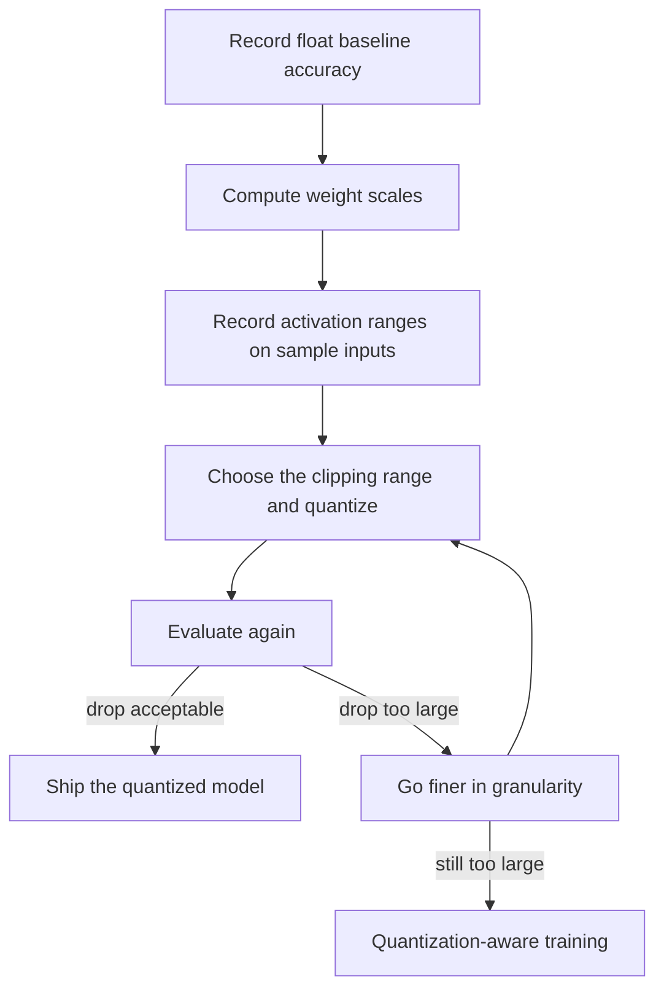

# 04. Quantization

**Level:** Practitioner · **Reading time:** 26 min · **Exercise:** 60 min
**Prerequisites:** [Neural Network Basics for Efficiency](02-neural-network-basics-for-efficiency.md), [Pruning and Sparsity](03-pruning-and-sparsity.md)

> **In one sentence:** After this chapter you can quantize a trained model to 8-bit or 4-bit weights with post-training quantization, judge whether the quality loss needs quantization-aware training, and read a floating-point format from its bit layout.

## Why this matters

You want to run a 7-billion-parameter model on a laptop with 8 GB of memory. In 16-bit, the weights need 14 GB. The model does not load. In 4-bit they need 3.5 GB. It loads, and it answers faster, because there is less to move from memory.

What did that cost in quality? Where is the loss coming from? And what do you do when it is too large? Quantization is very widely used in industry (Lecture 6, [0:00](https://www.youtube.com/watch?v=wrcgWm_nUeE&t=0)), and in practice most failures come from three decisions: the scale, the range and the granularity.

## The core idea

**Quantization** constrains values to a small discrete set (Han's Lecture 5, slide 22). The difference between a value and its quantized replacement is the **quantization error**.

Han's slide shows the idea with a picture: reduce a photograph to 16 colors, with a palette. Each pixel keeps its nearest palette entry. The analogy breaks in one place. A picture is converted once. A network applies its rounding at every layer, for every input, and errors from early layers feed into later ones. That is why networks need [calibration](../GLOSSARY.md) or retraining and photographs do not.

Model size is parameters times bits per parameter (Lecture 5, [0:00](https://www.youtube.com/watch?v=ymAzUz3qlIA&t=0)). Pruning cuts the first factor; quantization cuts the second. Low bit widths also save energy. Han's slide 3, citing Horowitz's 2014 measurements at 45 nm, lists a 32-bit floating-point multiply at 3.7 picojoules and an 8-bit integer multiply at 0.2 (as reported on the slide).

## How it works, step by step

### 1. Know the number formats

| Format | Sign / exponent / fraction bits | Range of values | Typical use |
|---|---|---|---|
| INT8 | 8-bit two's complement | integers from −128 to 127, fixed steps | quantized weights and activations |
| FP32 | 1 / 8 / 23 | about ±3 × 10³⁸, 24 significant bits | training |
| FP16 | 1 / 5 / 10 | about ±65,504, 11 significant bits | activations |
| BF16 | 1 / 8 / 7 | same range as FP32, 8 significant bits | training |
| FP8 (E4M3, E5M2) | 1 / 4 / 3 and 1 / 5 / 2 | E4M3 up to 448; E5M2 for gradients | training and inference on new hardware |
| FP4 (for example E2M1) | 1 / 2 / 1 | 0, 0.5, 1, 1.5, 2, 3, 4, 6 and negatives | weights on supporting hardware |

A floating-point number is `(−1)^s × (1 + fraction) × 2^(exponent − bias)`, where `s` is the sign bit, the **exponent** picks the power of two and the **fraction** (or *mantissa*) holds the digits after the leading 1. Han's rule: exponent width sets the **range**, fraction width sets the **precision** (slide 17).

Worked example from his slide 18. The FP16 bits are `1 10001 1100000000`:

- Sign 1: negative.
- Exponent `10001` is 17; subtract the bias 15 to get 2.
- Fraction `1100000000` is 0.5 + 0.25 = 0.75.
- Value: −1.75 × 2² = **−7**.

### 2. Linear quantization: map reals to integers

Han's slides 47 and 48 give the **affine mapping**:

```
r = S × (q − Z)
```

- `r`: the real number (a weight or an activation).
- `q`: the integer stored, between `q_min` and `q_max`.
- `S`: the **scale**, the real-world size of one integer step.
- `Z`: the **zero point**, the integer that stands for the real number 0.

With symmetric quantization, `Z` is 0 and `S = |r|max / q_max`. Han notes that weights are distributed around zero, so `Z` can be dropped for weights, which removes a whole term from the arithmetic (Lecture 5, [58:00](https://www.youtube.com/watch?v=ymAzUz3qlIA&t=3480)).

Worked numbers. Quantize the weights `[2.09, −0.98, 1.48, 0.09]`.

| Bits | `q_max` | Scale | Quantized weights | Largest error |
|---|---|---|---|---|
| 2 | 1 | 2.09 | 2.09, 0, 2.09, 0 | 0.98 |
| 8 | 127 | 2.09 / 127 = 0.0165 | 2.09, −0.99, 1.48, 0.08 | 0.008 |

Two bits is unusable here: 1.48 becomes 2.09. Eight bits keeps every weight within half a step, `S / 2`.

Once weights and activations are integers, the multiply-accumulate runs in integer arithmetic. The result is rescaled by `Sw × Sx / Sy`, and the additions use 32-bit integers to avoid overflow (Lecture 5, [52:00](https://www.youtube.com/watch?v=ymAzUz3qlIA&t=3120), slides 55 to 57). This is what makes linear quantization faster as well as smaller.

Han groups quantization into three families (Lecture 5, slide 44):

| Family | Storage | Arithmetic | What you gain |
|---|---|---|---|
| K-means with a codebook | small indices plus a table of representative values | floating point (values are looked up first) | storage only |
| Linear | integers | integer | storage and speed |
| Binary and ternary | 1 or 2 bits | XNOR and popcount on special hardware | storage and speed, at a large accuracy cost |

For k-means, his example stores 16 weights with 2-bit indices: a 4-byte index map and a 16-byte table (the codebook, the list of allowed values), 20 bytes instead of 64 ([34:00](https://www.youtube.com/watch?v=ymAzUz3qlIA&t=2040)). The saving is about 32 divided by the bit width: 16 times at 2 bits, 8 times at 4 bits. His verdict on it: "It saved the storage, but it doesn't save the computation" ([48:00](https://www.youtube.com/watch?v=ymAzUz3qlIA&t=2880)). It still pays off for a single user generating text, because that workload is limited by memory.

### 3. Post-training quantization

**Post-training quantization** (PTQ) converts a trained model without retraining it. Han organizes the choices in three topics (Lecture 6, [4:00](https://www.youtube.com/watch?v=wrcgWm_nUeE&t=240)):

**Granularity: how many weights share one scale.**

- *Per-tensor:* one scale for everything. Fine for large models, lossy for small ones.
- *Per-channel:* one scale per output channel. Han's slide 14 shows the weight ranges of different channels in MobileNetV2 differing by more than 100 times. One scale cannot fit them all.
- *Group:* one scale per small block of weights. Han calls this important at 4 bits and below ([6:00](https://www.youtube.com/watch?v=wrcgWm_nUeE&t=360)). The cost is storage for the scales: a 4-bit scale per 16 weights gives an effective width of 4 + 4/16 = 4.25 bits (his VS-Quant slide). Formats such as MX4 and MX6 share an 8-bit scale exponent per block of 16 values and a 1-bit exponent per pair (slide 26).

**Clipping: where to cut the range.** A single large value, an **outlier**, forces a large scale and therefore coarse steps for all the other values. Activations change with every input, so their range has to be collected first: by tracking an exponential moving average of the minimum and maximum during training, or by gathering statistics from sample inputs before deployment ([24:00](https://www.youtube.com/watch?v=wrcgWm_nUeE&t=1440)). Cutting the range below the maximum is a trade-off. Han's example is an activation distribution that reaches about 400 with a long tail, while most values sit below 40: cutting the range near 50 clips the whole tail onto one value. He names KL-divergence calibration, where the KL divergence measures how one distribution differs from another, as a widely used way to choose the cut, because it minimizes the information lost between the distributions before and after quantization ([30:00](https://www.youtube.com/watch?v=wrcgWm_nUeE&t=1800)).

**Rounding.** Round to nearest is the default. Alternatives are stochastic rounding and learned rounding, where the network learns whether each weight should round up or down (Han mentions AdaRound at [38:00](https://www.youtube.com/watch?v=wrcgWm_nUeE&t=2280)).

The procedure:

1. Fix a float baseline. Record its accuracy on held-out data.
2. Compute scales for the weights (per channel, or per group below 8 bits).
3. Run a few hundred representative inputs through the model and record the range of each activation.
4. Choose the clipping range and quantize.
5. Evaluate again, on real tasks and not on one prompt.
6. If the drop is too large, go finer in granularity. If it is still too large, move to quantization-aware training.

**Figure 1.** Post-training quantization: one pass, one decision, and where quantization-aware training begins.



Post-training quantization needs only sample inputs, not training; quantization-aware training is the fallback once finer scales stop helping.

#### Outliers in language models: the SmoothQuant idea

Large language models have a few activation channels with much larger values than the rest. Quantizing those activations to 8 bits with one scale fails. In Lecture 1, Han describes the fix that came out of a course project: the outliers sit in the activations, and since matrix multiplication is linear, you can scale the weights and the activations so that the two are equalized and smoothed, which makes both easier to quantize over the full dynamic range ([34:00](https://www.youtube.com/watch?v=U7EPZv8Kh9w&t=2040)).

The SmoothQuant paper picks the factor per input channel so that both sides end up with the same maximum:

```
Y = (X / s) × (s × W),    s_j = max|X_j| ^ 0.5 / max|W_j| ^ 0.5
```

Worked numbers: activation column `j` peaks at 20, weight column `j` peaks at 0.02. Then `s_j` is the square root of 20 / 0.02, about 31.6. The activation column now peaks at 0.63 and the weight column at 0.63. Both fit an 8-bit range.

### 4. Quantization-aware training

**Quantization-aware training** (QAT) fine-tunes the model with the quantization in place, so that the weights adapt to it. Han notes that even with every post-training technique, small models such as MobileNet still lost accuracy in his experiments, which is where QAT starts (Lecture 6, [40:00](https://www.youtube.com/watch?v=wrcgWm_nUeE&t=2400)). The reverse holds for language models: since they are very costly to train, he says, the goal there is post-training quantization with no fine-tuning at all ([46:00](https://www.youtube.com/watch?v=wrcgWm_nUeE&t=2760)).

1. Keep a full-precision copy of every weight.
2. In the forward pass, quantize and immediately dequantize, so the next layer sees rounded values.
3. In the backward pass, pretend the rounding step is the identity function and pass the gradient through unchanged. This is the **straight-through estimator** ([46:00](https://www.youtube.com/watch?v=wrcgWm_nUeE&t=2760)).
4. Update the float copy. Repeat.

### 5. Mixed precision

Not every layer needs the same bit width. Han's advice (Lecture 6, [66:00](https://www.youtube.com/watch?v=wrcgWm_nUeE&t=3960)): cheap or memory-bound layers can stay in FP16 or FP32; compute-bound layers should go lower if they are not sensitive. Choosing per layer gives higher accuracy at the same latency, or the same accuracy at a lower latency, and the choice can be made automatically: the same hardware-aware search, Han says, can target model size, latency or energy.

### Binary and ternary weights

At one bit, arithmetic turns into logic. **Binary quantization** keeps only the sign of each weight: positive becomes +1 and negative −1, so the multiplications vanish and only additions and subtractions remain. The weights then need 32 times less memory, and the work roughly halves by his count (Lecture 6, [48:00](https://www.youtube.com/watch?v=wrcgWm_nUeE&t=2880)). The sign function alone costs heavily: on his 4 × 4 example matrix it lost 21 points of accuracy, with a quantization error of 9.28. A floating-point scale that keeps the sum of absolute values unchanged, 1.05 here, brought accuracy to 0.2% above the baseline ([50:00](https://www.youtube.com/watch?v=wrcgWm_nUeE&t=3000)).

Binarize the activations as well and a dot product becomes bitwise. **XNOR** gives 1 when two bits agree and 0 otherwise, and **popcount** counts the ones, so for two sign vectors of length n the dot product is 2 × popcount − n, with the doubling done by a one-bit shift (Lecture 6, [52:00](https://www.youtube.com/watch?v=wrcgWm_nUeE&t=3120)). Both operations are cheap in hardware: by his estimate, memory shrinks 32 times and computation roughly 58 times. Accuracy is the price: XNOR-Net recovers some of it, yet with weights and activations both binarized the loss stays visible.

**Ternary weight networks** add a middle value. A threshold Δ, placed by rule of thumb at 0.7 times the average absolute value (0.73 on his matrix), sorts each weight into +1, 0 or −1, and a scale keeps the sum of absolute values the same. Accuracy went from 60% with binary weights to 65%, and full precision gives 69%. **Trained ternary quantization** lets the network learn two scales instead of the fixed one, one for each sign, and comes closer still (Lecture 6, [58:00](https://www.youtube.com/watch?v=wrcgWm_nUeE&t=3480)).

### What each option costs and when to choose it

| Option | Size versus FP16 | Accuracy cost | Data needed | Choose when |
|---|---|---|---|---|
| PTQ, 8-bit weights and activations | 1/2 | near zero for most models | a few hundred samples | default on phones and servers |
| PTQ, 4-bit weights in groups, float activations | 1/4 | small; grows for small models and hard tasks | a little | language models on one machine |
| QAT, 8-bit or 4-bit | 1/2 to 1/4 | smaller than PTQ | training data and compute | PTQ lost too much |
| K-means codebook | 1/8 at 4 bits | small after fine-tuning | none to quantize | storage is the only concern |
| Binary or ternary | 1/8 to 1/16 | large | training | special hardware |

Lower is not always better. Han puts the usual sweet spot at roughly 4 bits, as of his lecture, and adds that it might move lower in the future (Lecture 6, [62:00](https://www.youtube.com/watch?v=wrcgWm_nUeE&t=3720)). His reason is a mismatch: memory shrinks linearly with the bit width, while the computation shrinks faster, quadratically by his account. The expensive part, memory, therefore shrinks more slowly, and the returns diminish. He also advises against turning one design knob to an extreme: pruning, quantization, distillation and architecture search work best together.

## Worked example

Symmetric linear quantization in NumPy, on a weight block with one outlier.

```python
import numpy as np

def quantize(r, bits=8, axis=None):
    """Symmetric linear quantization: r is approximated by q * scale."""
    qmax = 2 ** (bits - 1) - 1                         # largest signed value
    scale = np.abs(r).max(axis=axis, keepdims=True) / qmax
    q = np.clip(np.round(r / scale), -qmax - 1, qmax)
    return q.astype(np.int32), scale                   # dequantize with q * scale

def mean_error(q, scale):
    return np.abs(q * scale - W).mean()

rng = np.random.default_rng(0)
W = rng.standard_normal((4, 1000)) * 0.01              # four channels of small weights
W[0, 0] = 1.0                                         # one outlier in channel 0

q, s = quantize(W)                                    # one scale for everything
print(f"8-bit per-tensor:   mean error {mean_error(q, s):.5f}")
q, s = quantize(W, axis=1)                            # one scale per channel
print(f"8-bit per-channel:  mean error {mean_error(q, s):.5f}")
q, s = quantize(W, bits=4)
print(f"4-bit per-tensor:   mean error {mean_error(q, s):.5f}")
q, s = quantize(W, bits=4, axis=1)
print(f"4-bit per-channel:  mean error {mean_error(q, s):.5f}")
```

What to observe:

- A typical weight is about 0.01. With 8 bits and one scale, the mean error is around 0.002, about a fifth of a typical weight.
- With one scale per channel the error drops by several times: channels 1 to 3 no longer inherit the outlier's scale.
- With 4 bits and one scale, the error is larger than most weights themselves. This is the per-tensor failure Han describes, and the reason group scales exist at low bit widths.

## What the practitioners say

- Han calls quantization very widely adopted in industry, on phones, edge devices and in the cloud (Lecture 6, [0:00](https://www.youtube.com/watch?v=wrcgWm_nUeE&t=0)).
- 8-bit quantization is mature, most hardware has 8-bit integer units, and integer models showed a better latency-accuracy trade-off than float on his plot, and a second chart compared floating-point with integer accuracy for ResNet-50 and Inception-V3 (Lecture 5, [64:00](https://www.youtube.com/watch?v=ymAzUz3qlIA&t=3840)).
- On hardware trends, as of his Fall 2024 lecture: NVIDIA's Blackwell generation supports micro-tensor scaling, and its FP4 tensor cores (matrix-multiply units) have twice the theoretical throughput of the FP8 and INT8 cores (Lecture 6, slide 23; [16:00](https://www.youtube.com/watch?v=wrcgWm_nUeE&t=960)).
- His Deep Compression pipeline prunes, quantizes with a codebook, retrains the codebook, repeats, and then encodes the weights with different bit lengths. SqueezeNet went from 4.8 MB to 0.47 MB (Lecture 5, [46:00](https://www.youtube.com/watch?v=ymAzUz3qlIA&t=2760)).
- He draws the parallel with pruning: layers differ in sensitivity, so they should get different bit widths (Lecture 6, [0:00](https://www.youtube.com/watch?v=wrcgWm_nUeE&t=0)).
- The bit width alone does not decide quality; the method does. His example is LLaVA, a model that answers questions about an image. At 4 bits with plain round to nearest it misreads a meme; with AWQ, an activation-aware method, it describes the meme correctly (Lecture 1, [40:00](https://www.youtube.com/watch?v=U7EPZv8Kh9w&t=2400)). His conclusion is that a proper method speeds up visual language models too, not only language models.

## Pitfalls

1. **Quantizing every layer to the same width.** Embeddings (the layers that turn tokens into vectors), the first layer, the last layer and the final normalization are sensitive. Fix: keep them in 16 bits.
2. **Using one scale at 4 bits.** Fix: per-channel scales, and group scales below 8 bits.
3. **Ignoring activation outliers in language models.** Fix: smooth them into the weights, or quantize weights only.
4. **Judging quality by one prompt or by perplexity alone (how well the model predicts text).** Fix: run your [evaluation set](../03-evaluation/02-a-minimal-eval-harness.md) against the float baseline.
5. **Assuming a smaller file means a faster model.** Fix: check that your inference engine has a fast kernel for that format; otherwise you saved memory only.
6. **Forgetting the cache of past tokens.** With long inputs it can outweigh the weights. See [efficient LLM inference](08-efficient-llm-inference-and-deployment.md).

## Try it

Quantize the weights of a small trained classifier with the `quantize` function above; activations stay in floating point. Put the dequantized weights, `q * scale`, back into the model before you measure accuracy.

1. Record float accuracy and file size.
2. Apply 8-bit per-tensor quantization to every weight. Record accuracy and size.
3. Repeat with 4-bit per-tensor and 4-bit per-channel.
4. Write one paragraph that explains the differences using the scale of each layer.

**You are done when** you have a four-row table (float, INT8, INT4 per-tensor, INT4 per-channel) with accuracy, bytes, and the largest scale you found.

**Stretch:** implement the SmoothQuant rescaling on one layer with an activation outlier and show the 8-bit error before and after.

## Key takeaways

- Model size is parameters times bits. Quantization cuts the bits.
- Linear quantization maps reals to integers with a scale and a zero point. Integer arithmetic then saves time as well as memory.
- Three choices decide quality: granularity, clipping range and rounding.
- Outliers force coarse steps. Per-channel or group scales, and rescaling activations into weights, contain the damage.
- Try post-training quantization first. Move to quantization-aware training only when the evaluation shows a real loss.
- Keep sensitive layers in higher precision.
- Roughly 4 bits is the sweet spot these days, by Han's account. Lower is not always better, and no single lever should be pushed to an extreme.

## Self-check

1. A model has 3 billion parameters. What is its weight memory at 16-bit, 8-bit and 4-bit?
2. In `r = S × (q − Z)`, what do `S` and `Z` mean, and when can `Z` be dropped?
3. FP16 has 5 exponent bits and 10 fraction bits. BF16 has 8 and 7. Which has the wider range, and which the finer precision?
4. A small model loses 4 accuracy points after 4-bit post-training quantization. What do you try before quantization-aware training?
5. What does the straight-through estimator do?
6. Why does k-means codebook quantization not speed up arithmetic on its own?

<details><summary>Show answers</summary>

1. 6 GB, 3 GB and 1.5 GB.
2. `S` is the real size of one integer step. `Z` is the integer that represents the real 0. It can be dropped for symmetric ranges, such as weights centered on zero.
3. BF16 has the wider range. FP16 has the finer precision.
4. Use per-channel or group scales, and check the clipping range. Only then move to QAT.
5. It lets the gradient pass through the rounding step as if rounding were the identity function.
6. The indices are looked up in a floating-point table first, and the arithmetic stays floating point. Only storage shrinks.

</details>

## Sources

- **Lecture:** Song Han, "Lecture 5: Quantization (Part I)", MIT 6.5940 TinyML and Efficient Deep Learning Computing (Fall 2024): [video](https://www.youtube.com/watch?v=ymAzUz3qlIA) · [guide](../lectures/mit-05-quantization-part-i.md), used at [model size](https://www.youtube.com/watch?v=ymAzUz3qlIA&t=0), [k-means storage](https://www.youtube.com/watch?v=ymAzUz3qlIA&t=2040), [k-means saves storage only](https://www.youtube.com/watch?v=ymAzUz3qlIA&t=2880), [zero point for weights](https://www.youtube.com/watch?v=ymAzUz3qlIA&t=3480), [8-bit maturity](https://www.youtube.com/watch?v=ymAzUz3qlIA&t=3840)
- **Lecture:** Song Han, "Lecture 6: Quantization (Part II)", MIT 6.5940 (Fall 2024): [video](https://www.youtube.com/watch?v=wrcgWm_nUeE) · [guide](../lectures/mit-06-quantization-part-ii.md), used at [three topics](https://www.youtube.com/watch?v=wrcgWm_nUeE&t=240), [granularity](https://www.youtube.com/watch?v=wrcgWm_nUeE&t=360), [group quantization](https://www.youtube.com/watch?v=wrcgWm_nUeE&t=960), [calibration](https://www.youtube.com/watch?v=wrcgWm_nUeE&t=1440), [rounding](https://www.youtube.com/watch?v=wrcgWm_nUeE&t=2280), [need for QAT](https://www.youtube.com/watch?v=wrcgWm_nUeE&t=2400), [straight-through estimator](https://www.youtube.com/watch?v=wrcgWm_nUeE&t=2760), [mixed precision](https://www.youtube.com/watch?v=wrcgWm_nUeE&t=3960), [binary weights](https://www.youtube.com/watch?v=wrcgWm_nUeE&t=2880), [XNOR and popcount](https://www.youtube.com/watch?v=wrcgWm_nUeE&t=3120), [ternary weights](https://www.youtube.com/watch?v=wrcgWm_nUeE&t=3480), [sweet spot near 4 bits](https://www.youtube.com/watch?v=wrcgWm_nUeE&t=3720)
- **Lecture:** Song Han, "Lecture 1: Introduction", MIT 6.5940 (Fall 2024): [SmoothQuant as a course project](https://www.youtube.com/watch?v=U7EPZv8Kh9w&t=2040), [4-bit quality depends on the method](https://www.youtube.com/watch?v=U7EPZv8Kh9w&t=2280)
- **Reading:** Benoit Jacob, Skirmantas Kligys, Bo Chen, et al., "Quantization and Training of Neural Networks for Efficient Integer-Arithmetic-Only Inference" (CVPR 2018): [arXiv](https://arxiv.org/abs/1712.05877)
- **Reading:** Guangxuan Xiao, Ji Lin, Miguel Horn, et al., "SmoothQuant: Accurate and Efficient Post-Training Quantization for Large Language Models" (ICML 2023): [arXiv](https://arxiv.org/abs/2211.10438)
- **Reading:** Markus Nagel, Marios Fournarakis, Rana Ali Amjad, et al., "A White Paper on Neural Network Quantization" (2021): [arXiv](https://arxiv.org/abs/2106.08295)

## Next

→ [Knowledge Distillation](06-knowledge-distillation.md), which changes the model instead of its storage, or jump to [Efficient LLM Inference and Deployment](08-efficient-llm-inference-and-deployment.md) to see where quantized weights pay off most.
