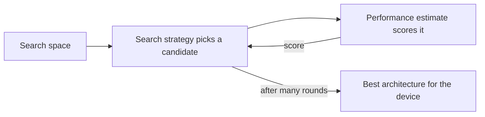

# 05. Neural Architecture Search

**Level:** Practitioner · **Reading time:** 17 min · **Exercise:** 45 min
**Prerequisites:** [Neural Network Basics for Efficiency](02-neural-network-basics-for-efficiency.md), [Pruning and Sparsity](03-pruning-and-sparsity.md)

> **In one sentence:** After this chapter you can define a search space and a cost model for a target device, run a small search over it, and decide when a once-for-all network saves you retraining a model per device.

## Why this matters

You need an image model for a microcontroller with 256 KB of memory. Your options are a pruned ResNet, a narrow MobileNet, or a design of your own. Each of those families was tuned by hand for someone else's hardware and data.

[Chapter 03](03-pruning-and-sparsity.md) shrinks a model that already exists. This chapter asks the question one step earlier: why start from a model designed for a data-center GPU?

## The core idea

**Neural architecture search** (NAS) replaces hand design with a loop over three parts, the same three Han puts on his slides (Lecture 7, slides 43 and 44):

1. A **search space**: the set of allowed architectures, described by a few choices.
2. A **search strategy**: how to pick the next candidate.
3. A **performance estimate**: accuracy together with a cost such as latency or memory.

**Figure 1.** The NAS loop: a strategy proposes, an estimate scores, and the best candidate wins.



Each round trains and measures one candidate, so the estimate is where the search spends its money.

The analogy is a query planner or an autotuner. You state the goal and the constraints; the system picks a plan. The analogy breaks on the price of a lookup. A planner estimates a plan in microseconds. Here the accuracy of one candidate costs a training run of hours, and short runs rank candidates noisily. Most of NAS is about paying for fewer lookups.

## How it works, step by step

### Step 1: Pick the building blocks

Han spends the first half of Lecture 7 on the blocks a search space is built from (slides 16 to 37):

| Block | Used by | Why it is cheap |
|---|---|---|
| Bottleneck | ResNet-50 | a 1 × 1 layer squeezes channels before the expensive 3 × 3 layer |
| Grouped convolution | ResNeXt | weights divided by the number of groups |
| Depthwise separable | MobileNet | one filter per channel, then a cheap 1 × 1 mix |
| Inverted bottleneck | MobileNetV2 | expands channels cheaply, applies depthwise convolution, projects back |
| Grouped 1 × 1 plus channel shuffle | ShuffleNet | groups stay narrow and still exchange information |
| Attention | transformers | every token reaches every other token in one layer |

### Step 2: Define the search space

- **Cell-level.** Design two small cells, a normal one and a downsampling one, and repeat them. Han's example has five operator choices, two ways to combine them and several blocks per cell, which gives on the order of 10¹¹ candidates ([38:00](https://www.youtube.com/watch?v=3W146_T8eCs&t=2280)).
- **Network-level.** Let every stage differ. His objection to repeating one cell: deep and shallow layers behave differently, so one cell for the whole depth is unlikely to be optimal.
- **Fit the space to the resource.** With a few hundred kilobytes of memory, most of a standard space cannot run at all. TinyNAS, from his microcontroller work, first scales resolution and width to the memory budget and only then searches inside the remaining space (Lecture 10, [18:00](https://www.youtube.com/watch?v=uR1KKhIhHEk&t=1080)). Han's summary of the reason: with the same memory constraint, a well-chosen space fits more useful computation, and computation is cheap while memory access is expensive (Lecture 7, [48:00](https://www.youtube.com/watch?v=3W146_T8eCs&t=2880)). His test is a plot of the cumulative share of a space's models against their FLOPs: the space that fits more computation under the same memory budget produced a best model at 78.7% accuracy, against 74% for the other. The heuristic behind the test is that more FLOPs means more capacity, and a space's median FLOPs tracks its accuracy almost linearly ([50:00](https://www.youtube.com/watch?v=3W146_T8eCs&t=3000)). What he wants from all of this is a push-button method: given a new memory or latency target, find the architecture without a human expert.

### Step 3: Choose a search algorithm

| Strategy | How it moves | Han's remark |
|---|---|---|
| Grid search | try every combination | easy to implement, slow to evaluate one by one; throw out the designs that break the constraint before training any of them (Lecture 7, [54:00](https://www.youtube.com/watch?v=3W146_T8eCs&t=3240)) |
| Random search | sample at random | run it first as a sanity check: if the reward does not improve after a few iterations, something is wrong with the search space, the search, the evaluation or the reward ([56:00](https://www.youtube.com/watch?v=3W146_T8eCs&t=3360)) |
| Reinforcement learning | a controller learns by trial and error to propose high-reward architectures | tricky and not easy to use in practice; the controller proposes an architecture with probability `P`, a child network is trained for a reward `R`, and the controller is updated with the gradient of `P` scaled by `R` ([56:00](https://www.youtube.com/watch?v=3W146_T8eCs&t=3360)) |
| Gradient descent | relax the choices to weights and optimize them | differentiable |
| Evolutionary search | mutate and recombine a population | the fitness function selects on latency, accuracy, throughput, memory or energy ([62:00](https://www.youtube.com/watch?v=3W146_T8eCs&t=3720)) |

The gradient descent row needs more than one word. The choices can be made differentiable (Lecture 7, [58:00](https://www.youtube.com/watch?v=3W146_T8eCs&t=3480)). Where a layer might be a 3 × 3, a 5 × 5 or a 1 × 1 convolution, the layer's output becomes a weighted sum of all three, and the weights are learned probabilities of choosing each. The price is memory: training runs every candidate at once. At inference, only the path with the highest probability survives. Latency can be made differentiable too ([60:00](https://www.youtube.com/watch?v=3W146_T8eCs&t=3600)). Each building block's latency is measured beforehand; a layer's expected latency is the sum, over its choices, of probability times latency. Adding that term to the loss, next to the cross-entropy and the weight regularization, lets one gradient descent look for a model that is accurate and fast at the same time.

An evolutionary loop:

1. Sample an initial population of architectures.
2. Score each one: its **fitness**, or reward, is accuracy under the cost constraint.
3. Keep the best half.
4. Create children by **crossover** (take one parent's choice per block) and **mutation** (change one block, or a stage depth).
5. Repeat for a fixed number of generations.

Han's version of the definition: "Mutation takes one input, crossover takes two inputs" (Lecture 7, [64:00](https://www.youtube.com/watch?v=3W146_T8eCs&t=3840)). His students implement it in the course lab.

### Step 4: Estimate performance without paying full price

| Method | Idea | Price |
|---|---|---|
| Train from scratch | train each candidate to the end | Han cites tens of thousands of models and 22,000 GPU hours, on CIFAR-10, a small image data set (Lecture 8, [2:00](https://www.youtube.com/watch?v=5ty12mNV4Sg&t=120)) |
| Inherit weights | candidates share weights trained once | cheaper; rankings are approximate |
| Hypernetwork | one network generates the weights for any candidate | rarely used ([8:00](https://www.youtube.com/watch?v=5ty12mNV4Sg&t=480)) |
| Zero-shot | score an architecture without training it | cheapest; a research topic (slides 75 to 77) |

The zero-shot row rests on heuristics, which Han introduces on networks with random weights (Lecture 8, [46:00](https://www.youtube.com/watch?v=5ty12mNV4Sg&t=2760)). The first, ZenNAS on his slide, rates a network by how much its output changes when its input is nudged a little (a large change is good) and by how large the variance of its batch-normalization statistics is: in that view a good network responds to what it is given. The second, GradSign, starts from the thought that a good network keeps its sample-wise local minima close together, so the gradients from different samples mostly point the same way, and signs are cheap to count. He calls both coarse checks, because the weights matter too, yet says they work well, at least in the paper he shows.

### Step 5: Make it hardware-aware

Han's slides 20 to 22 of Lecture 8 carry one headline: MACs are not real hardware efficiency. Architectures with similar FLOPs can have very different latency. Three fixes:

- Search on the **target task and hardware** instead of a proxy. ProxylessNAS is his example; its specialized model was 1.83 times faster than the non-specialized one on mobile (slides 17 to 19 and 33). The reason is device-dependent behaviour: shrinking a model's hidden dimension cuts latency on a Raspberry Pi and does nothing on a GPU, which has parallelism to spare ([20:00](https://www.youtube.com/watch?v=5ty12mNV4Sg&t=1200)). After the search, the model built for a CPU uses no 7 × 7 kernel at all, only 3 × 3 and 5 × 5, while the GPU model becomes wider and shallower, with fewer kernel calls ([28:00](https://www.youtube.com/watch?v=5ty12mNV4Sg&t=1680)).
- Measure each operator **once** on the device and build a **latency table**. The latency of a candidate is the sum over its layers (Lecture 8, [24:00](https://www.youtube.com/watch?v=5ty12mNV4Sg&t=1440)). Han's caveat: on a GPU the inference engine may fuse two layers into one kernel (one GPU routine), so the sum overestimates. His rule of thumb: fusing two compute-bound layers does not help; a matrix multiplication followed by a memory-bound nonlinearity that shares data with it can be fused.
- Search the **mapping** too. His accelerator work searches the network, the hardware design and the mapping (which loops run in parallel in space, and in which order) together, all by evolutionary search, for the lowest energy-delay product, energy times latency (Lecture 8, [60:00](https://www.youtube.com/watch?v=5ty12mNV4Sg&t=3600)). Non-numerical choices such as loop order are turned into numbers by ranking the loop dimensions by importance: the top two run in parallel and the most important runs outermost ([58:00](https://www.youtube.com/watch?v=5ty12mNV4Sg&t=3480)).

### Step 6: Train once for many devices: once-for-all

Designing a separate model for every phone, laptop and chip does not scale. The **once-for-all** approach trains one large network that contains many smaller ones:

1. Define elastic dimensions: depth (which layers), width (which channels), kernel size, input resolution.
2. During training, sample a sub-network at each step and train only it, so many sub-networks learn together (Lecture 8, [40:00](https://www.youtube.com/watch?v=5ty12mNV4Sg&t=2400)).
3. For each device, search the sub-network that meets its latency using the latency table. No further training.

He lists the fields his lab applied the idea to, language models, generative models, point clouds and pose estimation (Lecture 8, [2:00](https://www.youtube.com/watch?v=5ty12mNV4Sg&t=120)), and notes that NVIDIA applied it to language models: a large sub-network for a data-center GPU, a middle one for a desktop, a small one for mobile ([74:00](https://www.youtube.com/watch?v=5ty12mNV4Sg&t=4440)).

## Worked example

A complete search in 40 lines. The accuracy model is a stand-in: it rewards capacity with diminishing returns. Everything else is real mechanics.

```python
import random

random.seed(0)
KERNELS = (3, 5, 7)                                 # kernel size choices per block
LATENCY_US = {3: 110, 5: 230, 7: 420}               # measured once on the target device

def latency(arch):                                  # arch = one kernel size per block
    return sum(LATENCY_US[k] for k in arch)

def proxy_accuracy(arch):                           # stand-in for a real training run
    capacity = sum(k * k for k in arch)
    return 0.60 + 0.30 * (1 - 2.718 ** (-capacity / 500))

def fitness(arch, budget_us):                       # reward: accuracy under the budget
    return proxy_accuracy(arch) if latency(arch) <= budget_us else 0.0

def random_search(budget, tries=200):
    return max((tuple(random.choice(KERNELS) for _ in range(4)) for _ in range(tries)),
               key=lambda a: fitness(a, budget))

def evolve(budget, size=8, generations=20):
    pop = [tuple(random.choice(KERNELS) for _ in range(4)) for _ in range(size)]
    for _ in range(generations):
        pop.sort(key=lambda a: fitness(a, budget), reverse=True)
        parents = pop[:size // 2]                   # keep the best half
        kids = []
        while len(kids) < size - len(parents):
            a, b = random.sample(parents, 2)
            child = tuple(random.choice((x, y)) for x, y in zip(a, b))     # crossover
            if random.random() < 0.3:                                     # mutation
                i = random.randrange(4)
                child = child[:i] + (random.choice(KERNELS),) + child[i + 1:]
            kids.append(child)
        pop = parents + kids
    return max(pop, key=lambda a: fitness(a, budget))

for name, search in (("random", random_search), ("evolutionary", evolve)):
    best = search(600)                              # 600 microsecond budget
    print(f"{name:>13}: {best}  latency {latency(best)} us  "
          f"accuracy {proxy_accuracy(best):.3f}")
```

What to observe:

- Both searches find a design with three cheap blocks and one expensive one: 560 µs, inside the 600 µs budget.
- The cheapest design, all 3 × 3, scores lower. The most accurate design, all 7 × 7, is rejected. Search finds the point between them.
- Change the budget to 450 µs and to 1,000 µs. The best design moves.

## What the practitioners say

- Han puts accuracy first: low latency, low energy and small storage cannot rescue a model that gives poor answers (Lecture 7, [2:00](https://www.youtube.com/watch?v=3W146_T8eCs&t=120)).
- Energy matters on both ends, in his telling: battery drain on phones, and cooling and emissions for data centers drawing megawatts (same passage).
- On TinyNAS, the searched models use memory more evenly. The hand-designed MobileNetV2 had a per-layer peak 2.2 times its average; a flatter profile lets a larger model fit the same memory (Lecture 10, [28:00](https://www.youtube.com/watch?v=uR1KKhIhHEk&t=1680)).
- The joint search that Step 5 describes (Lecture 8, [50:00](https://www.youtube.com/watch?v=5ty12mNV4Sg&t=3000)) covers three spaces ([52:00](https://www.youtube.com/watch?v=5ty12mNV4Sg&t=3120)): the hardware (buffer sizes, the size of its compute array, the number of processing elements (PEs) and how they connect), the compiler's mapping (loop order, tiling and data flow) and the network (layers, channels, kernel size and precision). In his measurements, sizing alone lowered the energy-delay product by about 20%; adding the connectivity and then the network to the search went further and gave a better trade-off between energy-delay product and accuracy ([61:00](https://www.youtube.com/watch?v=5ty12mNV4Sg&t=3660)). The data flow it found parallelized the output height and the output channels, which he finds very different from a human design.

## Pitfalls

1. **Searching with MACs as the cost.** Fix: measure latency on the device and search against that.
2. **Searching on a proxy dataset or device.** Fix: search on the target, or verify the final candidates on it.
3. **Trusting short training runs to rank candidates.** Fix: retrain the top few to the end before choosing.
4. **A search space larger than the budget can explore.** Fix: shrink it to what fits the resource first.
5. **Counting only parameters for tiny devices.** Fix: constrain activation memory too.
6. **Tuning the search on your test set.** Fix: keep a held-out set; see [a minimal eval harness](../03-evaluation/02-a-minimal-eval-harness.md).

## Try it

Extend the example.

1. Add a width choice per block (for example 16, 32 or 64 channels) and extend the latency table.
2. Run both searches under budgets of 450 µs, 600 µs and 1,000 µs.
3. Write down the size of your search space.

**You are done when** you have the best architecture and its latency for each of the three budgets, the search space size, and one sentence on how the best design changes with the budget.

**Stretch:** replace the proxy accuracy with real short training runs of your top five candidates on a small image dataset.

## Key takeaways

- NAS is a loop: a search space, a search strategy, a performance estimate.
- The building blocks are the efficient operators from Chapter 02, combined by choice.
- The cost function must be measured on the target device. MACs mislead.
- Estimating accuracy is the expensive part. Weight sharing and once-for-all networks cut the bill.
- Once-for-all trains one network and specializes it per device without retraining.

## Self-check

1. Name the three parts of a NAS loop.
2. Why can two architectures with the same MAC count have different latency?
3. What do crossover and mutation each take as input?
4. A search space has 4 blocks, each with 5 operator choices and 2 combination rules. How many candidates?
5. What problem does a once-for-all network solve?
6. In a differentiable search, how does a layer's latency enter the training loss?

<details><summary>Show answers</summary>

1. A search space, a search strategy, and a performance estimate.
2. Latency depends on memory access patterns, kernel efficiency and operator support on the chip, not on the number of multiplies alone.
3. Mutation takes one parent. Crossover takes two.
4. 10,000. Each block has 5 × 2 = 10 choices, and 10⁴ = 10,000.
5. Training and searching a separate model for every hardware platform. One trained network contains sub-networks for many devices.
6. Each building block's latency is measured once. A layer's expected latency is the sum over its choices of probability times latency, and that term is added to the loss beside the cross-entropy and the weight regularization, so gradient descent favors accurate and fast models at once.

</details>

## Sources

- **Lecture:** Song Han, "Lecture 7: Neural Architecture Search (Part I)", MIT 6.5940 TinyML and Efficient Deep Learning Computing (Fall 2024): [video](https://www.youtube.com/watch?v=3W146_T8eCs) · [guide](../lectures/mit-07-neural-architecture-search-part-i.md), used at [goals](https://www.youtube.com/watch?v=3W146_T8eCs&t=120), [search space size](https://www.youtube.com/watch?v=3W146_T8eCs&t=2280), [memory-aware spaces](https://www.youtube.com/watch?v=3W146_T8eCs&t=2880), [grid and random search](https://www.youtube.com/watch?v=3W146_T8eCs&t=3240), [mutation and crossover](https://www.youtube.com/watch?v=3W146_T8eCs&t=3840), [differentiable search and latency](https://www.youtube.com/watch?v=3W146_T8eCs&t=3480)
- **Lecture:** Song Han, "Lecture 8: Neural Architecture Search (Part II)", MIT 6.5940 (Fall 2024): [video](https://www.youtube.com/watch?v=5ty12mNV4Sg) · [guide](../lectures/mit-08-neural-architecture-search-part-ii.md), used at [cost of training from scratch](https://www.youtube.com/watch?v=5ty12mNV4Sg&t=120), [weight estimation strategies](https://www.youtube.com/watch?v=5ty12mNV4Sg&t=480), [latency tables](https://www.youtube.com/watch?v=5ty12mNV4Sg&t=1440), [once-for-all](https://www.youtube.com/watch?v=5ty12mNV4Sg&t=2400), [applications](https://www.youtube.com/watch?v=5ty12mNV4Sg&t=4440), [zero-shot heuristics](https://www.youtube.com/watch?v=5ty12mNV4Sg&t=2640), [joint hardware and network search](https://www.youtube.com/watch?v=5ty12mNV4Sg&t=3000)
- **Lecture:** Song Han, "Lecture 10: MCUNet and TinyML", MIT 6.5940 (Fall 2024): [TinyNAS](https://www.youtube.com/watch?v=uR1KKhIhHEk&t=1080)
- **Reading:** Han Cai, Ligeng Zhu, Song Han, "ProxylessNAS: Direct Neural Architecture Search on Target Task and Hardware" (ICLR 2019): [arXiv](https://arxiv.org/abs/1812.00332)
- **Reading:** Han Cai, Chuang Gan, Tianzhe Wang, Zhekai Zhang, Song Han, "Once-for-All: Train One Network and Specialize It for Efficient Deployment" (ICLR 2020): [arXiv](https://arxiv.org/abs/1908.09791)
- **Reading:** Barret Zoph, Quoc V. Le, "Neural Architecture Search with Reinforcement Learning" (ICLR 2017): [arXiv](https://arxiv.org/abs/1611.01578)
- **Reading:** Ji Lin, Wei-Ming Chen, Yuanyao Lin, et al., "MCUNet: Tiny Deep Learning on IoT Devices" (NeurIPS 2020): [arXiv](https://arxiv.org/abs/2007.10319)

## Next

→ [Knowledge Distillation](06-knowledge-distillation.md), which changes what a small model learns rather than its architecture.
