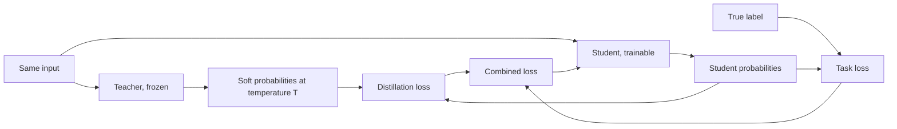

# 06. Knowledge Distillation

**Level:** Practitioner · **Reading time:** 18 min · **Exercise:** 60 min
**Prerequisites:** [Neural Network Basics for Efficiency](02-neural-network-basics-for-efficiency.md)

> **In one sentence:** After this chapter you can set up a teacher-student training run with a distillation loss, choose what the student should match, and say when distillation beats pruning, quantization or architecture search for your goal.

## Why this matters

You have a 70-billion-parameter model that does the job and costs too much to serve. A 7-billion-parameter model trained on its own gives visibly worse answers. You do have one asset, though: the large model can label or score as many examples as you want.

Song Han poses exactly this case in his Fall 2024 lecture: can a 70-billion-parameter model be distilled into a 7-billion-parameter one, saving ten times the memory traffic? (Lecture 9, [2:00](https://www.youtube.com/watch?v=Ubj3QXv4rjw&t=120)). His slide shows a teacher at 82% accuracy next to a student at 52%, as an illustration of the gap to close.

## The core idea

**Knowledge distillation** trains a small **student** model to behave like a large **teacher** model. The same input goes to both. The student's training objective has two parts: the usual task loss, and a **distillation loss** that penalizes disagreement with the teacher.

**Figure 1.** Distillation training: the student is trained on two losses at once, and only the student changes.



The task loss pulls the student toward the label and the distillation loss toward the teacher's soft answer; the teacher's weights never change.

Why does the teacher help? A label says "this is a dog, probability 1". The teacher says "dog 0.85, wolf 0.10, cat 0.04, car 0.001". The second answer carries structure: a wolf is a near miss, a car is not. Han describes the goal as aligning the teacher's and the student's class probability distributions ([8:00](https://www.youtube.com/watch?v=Ubj3QXv4rjw&t=480)).

The analogy is a senior engineer reviewing a junior's work and saying not only "wrong" but "close: you missed X". The analogy breaks in two places. The teacher is fixed and never adapts to this student, and the student inherits the teacher's mistakes along with its skill.

## How it works, step by step

### 1. The loss

A classifier outputs **logits**: one raw score per class, before any normalization. The **softmax** turns logits into probabilities. Distillation divides the logits by a **temperature** `T` first:

```
p_i = exp(z_i / T) / Σ_j exp(z_j / T)
```

- `z_i`: the logit for class `i`.
- `T`: the temperature. `T = 1` gives the usual probabilities. Larger `T` flattens the distribution, so small probabilities become easier to learn from.

Worked numbers for logits `[2.0, 1.0, 0.1]`:

| Temperature | Probabilities |
|---|---|
| 1 | 0.659, 0.242, 0.099 |
| 2 | 0.502, 0.304, 0.194 |

At `T = 2` the smallest class almost doubles its share. The signal in it is no longer drowned out.

The distillation loss is the **KL divergence** between the two softened distributions: a number that is zero when they are identical and grows as they diverge. The full objective:

```
L = (1 − λ) × task loss + λ × T² × KL(teacher at T, student at T)
```

- `task loss`: cross-entropy against the true labels (the usual training loss for classifiers, which rewards a high probability on the correct label).
- `λ`: how much to trust the teacher (often 0.5 to start).
- `T²`: keeps the gradient size comparable as `T` changes.

### 2. The procedure

1. Pick or train the teacher. Freeze it.
2. Choose the student's architecture. It can differ completely from the teacher's.
3. Run the teacher over the training inputs once and save its outputs.
4. Train the student with the combined loss.
5. Evaluate on held-out data against two baselines: the teacher, and a student trained alone.

### 3. What to match

Matching outputs is the simplest option. Han's lecture lists six things a student can copy (Lecture 9, slides 12 to 28):

| What to match | Requirement | Example from the lecture |
|---|---|---|
| Output logits | nothing: any teacher, any student | the standard method |
| Intermediate weights | identical layer shapes | FitNets (ICLR 2015) |
| Intermediate features | a way to compare feature maps | minimizing a discrepancy between maps |
| Attention maps | gradients of the feature maps as an attention signal | well-performing models have similar maps |
| Sparsity patterns | similar layers | matching which values survive `max(0, x)` |
| Relations | a notion of distance between examples | relations between layers, and between samples |

As a rule of thumb, start with logits. Add feature matching only when the student is large enough to benefit and you can fit a small adapter layer (a small trainable layer that makes the shapes match).

### 4. No teacher needed: self and online distillation

- **Self-distillation.** The student has the same architecture as the teacher. You train a network, then train a second network of the same size to copy the first. Han's example trains same-size networks one after another: the first with the classification loss alone, each next one with the classification loss plus a match to the previous one's logits, and the steps are ensembled at the end ([26:00](https://www.youtube.com/watch?v=Ubj3QXv4rjw&t=1560)). Born-Again Networks is the best-known study of the idea.
- **Online distillation.** Several networks train together and teach each other from the start (Deep Mutual Learning).
- **Both.** Han's slides add a method that combines deep supervision with distillation: Be Your Own Teacher.

His summary: a teacher is not necessary, because self-distillation and online distillation train and distill in one run ([56:00](https://www.youtube.com/watch?v=Ubj3QXv4rjw&t=3360)).

### 5. Beyond classification

The same pattern applies to other tasks, with a different thing to copy: feature maps for object detection and segmentation, attention for language models (Han's slides 41 to 58). Detection needs a trick, which Han shows at [36:00](https://www.youtube.com/watch?v=Ubj3QXv4rjw&t=2160): a bounding box is usually predicted by regression, a continuous value with no distribution to match, so he cuts each axis into six bins, 36 in all, and treats the location as a 36-way classification. Training a small model on the outputs of a large one is also how many compact language models are built.

### 6. Tiny models need different regularization

Han reports a result that surprises people ([50:00](https://www.youtube.com/watch?v=Ubj3QXv4rjw&t=3000)). Dropout (randomly zeroing neurons during training) and data augmentation (training on transformed copies of the examples) raise a large model's accuracy: on his ResNet-50 chart, from about 76.5% to above 78%. The same techniques lower a tiny model's accuracy. His explanation: a large model overfits, a tiny model **underfits**. It lacks the capacity to learn, so making training harder hurts it.

His remedy, **network augmentation**, is the opposite of dropout. The tiny model is treated as a subnetwork of wider models, one of which is sampled at each training step, so the small model receives extra supervision ([54:00](https://www.youtube.com/watch?v=Ubj3QXv4rjw&t=3240)). He reports that it is orthogonal to distillation, that the two work best together, and that it transferred better than four times longer training.

### When to choose distillation

| Goal | Best tool |
|---|---|
| Same model, smaller file, no training data | [quantization](04-quantization.md) |
| Same model, somewhat fewer weights | [pruning](03-pruning-and-sparsity.md) |
| A far smaller model, and you have data, compute and a strong teacher | distillation |
| A model shaped for one device from scratch | [architecture search](05-neural-architecture-search.md) |

Distillation costs a full training run for the student plus one pass of the teacher over the data. Its accuracy cost is that the student usually stays below the teacher. Han's advice is to make sure the student stays within an acceptable threshold of the teacher's quality ([36:00](https://www.youtube.com/watch?v=Ubj3QXv4rjw&t=2160)). The techniques combine: distill first, then quantize.

## Worked example

A teacher, a student with almost no labels, and a distilled student, in NumPy. Each model is a linear softmax classifier.

```python
import numpy as np

rng = np.random.default_rng(0)
CENTERS = np.array([[-2.0, 0.0], [2.0, 0.0], [0.0, 3.0]])     # three classes

def sample(n):
    y = rng.integers(0, 3, n)
    X = CENTERS[y] + rng.normal(0, 0.8, (n, 2))
    noisy = rng.random(n) < 0.10                       # 10% of labels are wrong
    return X, np.where(noisy, rng.integers(0, 3, n), y)

def softmax(z):
    z = z - z.max(axis=1, keepdims=True)
    e = np.exp(z)
    return e / e.sum(axis=1, keepdims=True)

def train(X, Y, temperature=1.0, lr=0.5, steps=400):
    """Y holds one-hot labels or the teacher's soft outputs."""
    W, b = np.zeros((2, 3)), np.zeros(3)
    T2 = temperature ** 2
    for _ in range(steps):
        p = softmax((X @ W + b) / temperature)
        g = (p - Y) / len(X)                           # cross-entropy gradient
        W -= lr * T2 * X.T @ g
        b -= lr * T2 * g.sum(axis=0)
    return W, b

def accuracy(W, b, X, y):
    return ((X @ W + b).argmax(axis=1) == y).mean()

X_lab, y_lab = sample(6)                               # six labeled examples
X_unl, _ = sample(288)                                 # more inputs; labels unused
X_test, y_test = sample(2000)

X_full, y_full = sample(300)                           # the teacher has plenty of labels
W_t, b_t = train(X_full, np.eye(3)[y_full])

T = 2.0                                                # distillation temperature
teacher_soft = softmax((X_unl @ W_t + b_t) / T)

W_a, b_a = train(X_lab, np.eye(3)[y_lab])              # student: labels only
W_k, b_k = train(X_unl, teacher_soft, temperature=T)   # student: teacher's outputs

for name, (W, b) in (("teacher", (W_t, b_t)), ("student, labels", (W_a, b_a)),
                     ("student, distilled", (W_k, b_k))):
    print(f"{name:>19}: test accuracy {accuracy(W, b, X_test, y_test):.3f}")
```

What to observe:

- The student trained on six labels is unstable: six points barely define three regions.
- The distilled student never saw a label. It learned the teacher's soft outputs on other inputs and lands close to the teacher's accuracy.
- Raise `T` to 10 and the distilled student fails, with accuracy about 0.07: the step size grows with `T`, so a higher temperature needs a smaller learning rate. Temperature is a setting to tune, not a free improvement.

## What the practitioners say

- Han motivates distillation on both ends: microcontrollers with a few hundred kilobytes of memory, and cloud language models that cost too much to serve (Lecture 9, [0:00](https://www.youtube.com/watch?v=Ubj3QXv4rjw&t=0)).
- He sums up what can be matched: the final output, intermediate feature maps, intermediate weights, intermediate gradients.
- He lists the tasks his lecture covers beyond classification: detection, segmentation, generative models and natural language processing ([56:00](https://www.youtube.com/watch?v=Ubj3QXv4rjw&t=3360)).
- He offers an open project idea: network augmentation was tried on vision tasks only, and he suggests applying it to small language models ([56:00](https://www.youtube.com/watch?v=Ubj3QXv4rjw&t=3360)).

## Pitfalls

1. **A student too small for the teacher.** Fix: use a teacher of intermediate size, or a larger student.
2. **Copying only the teacher's final answer.** Fix: use the soft distribution, with a temperature above 1.
3. **Skipping the labels-only baseline.** Fix: always train a student alone on the same data for comparison.
4. **Inheriting the teacher's mistakes.** Fix: evaluate the student by slice, not only on average; see [slicing](../08-quality-assurance/03-slicing.md).
5. **Assuming a distilled model keeps every property of its teacher.** Fix: re-run your capability and risk evaluations; see [evaluating capabilities and risks](../03-evaluation/06-evaluating-capabilities-and-risks.md).
6. **Distilling when quantization would do.** Fix: for a two-fold size cut of the same model, quantize.
7. **Regularizing a tiny student like a large model.** Fix: reduce dropout and augmentation, or use network augmentation.

## Try it

Distill a small image classifier.

1. Train a teacher about four times larger than the student. Record its held-out accuracy.
2. Train the student on labels only. Record accuracy.
3. Train the student again with the distillation loss at `T` of 2, 4 and 8, `λ` of 0.5.
4. Record parameters and latency for all models.

**You are done when** the distilled student beats the labels-only student on held-out data with the same number of training steps, and your table shows accuracy, parameters and latency for the teacher and both students.

**Stretch:** shrink the student by half again and report at what size distillation stops helping.

## Key takeaways

- Distillation trains a small model to reproduce a large model's outputs.
- The teacher's soft distribution teaches more than a hard label.
- Match logits first. Features and relations are refinements.
- It costs a full training run for the student. Quantize or prune when no training is possible.
- The techniques stack: distill, then quantize.
- Tiny models underfit. Regularization that helps large models can hurt them.

## Self-check

1. A label says "cat". What extra information does the teacher's output give the student?
2. What does raising the temperature do to a softmax distribution, and why is that useful here?
3. A student must copy a teacher's intermediate feature maps. What constraint does that add compared with matching logits?
4. You need the same model at half the size and have no training data. Which technique do you pick?
5. Why can dropout hurt a tiny model while it helps a large one?
6. What two baselines should a distillation experiment compare against?

<details><summary>Show answers</summary>

1. How close the other classes are: which confusions are near misses and which are far-fetched.
2. It flattens the distribution, so small probabilities become large enough to learn from.
3. The two networks need compatible shapes at the matched layers, often via an adapter.
4. Quantization to 8 bits, which needs no training data.
5. A large model has spare capacity and overfits, so dropout helps. A tiny model already lacks capacity and underfits, so dropout removes signal it needed.
6. The teacher, and a student trained alone on the same data.

</details>

## Sources

- **Lecture:** Song Han, "Lecture 9: Knowledge Distillation", MIT 6.5940 TinyML and Efficient Deep Learning Computing (Fall 2024): [video](https://www.youtube.com/watch?v=Ubj3QXv4rjw), used at [motivation](https://www.youtube.com/watch?v=Ubj3QXv4rjw&t=0), [distillation loss](https://www.youtube.com/watch?v=Ubj3QXv4rjw&t=120), [matching distributions](https://www.youtube.com/watch?v=Ubj3QXv4rjw&t=480), [self-distillation](https://www.youtube.com/watch?v=Ubj3QXv4rjw&t=1560), [regularization for tiny models](https://www.youtube.com/watch?v=Ubj3QXv4rjw&t=3000), [network augmentation](https://www.youtube.com/watch?v=Ubj3QXv4rjw&t=3240), [summary](https://www.youtube.com/watch?v=Ubj3QXv4rjw&t=3360)
- **Reading:** Geoffrey Hinton, Oriol Vinyals, Jeff Dean, "Distilling the Knowledge in a Neural Network" (2015): [arXiv](https://arxiv.org/abs/1503.02531)
- **Reading:** Jianping Gou, Baosheng Yu, Stephen J. Maybank, Dacheng Tao, "Knowledge Distillation: A Survey" (IJCV 2021): [arXiv](https://arxiv.org/abs/2006.05525)
- **Reading:** Tommaso Furlanello, Zachary Lipton, Michael Tannenbaum, et al., "Born-Again Neural Networks" (ICML 2018): [arXiv](https://arxiv.org/abs/1805.04770)
- **Reading:** Adriana Romero, Nicolas Ballas, Samira Ebrahimi Kahou, et al., "FitNets: Hints for Thin Deep Nets" (ICLR 2015): [arXiv](https://arxiv.org/abs/1412.6550)
- **Reading:** Han Cai, Chuang Gan, Ji Lin and Song Han, "Network Augmentation for Tiny Deep Learning" (ICLR 2022): [arXiv](https://arxiv.org/abs/2110.08890)

## Next

→ [TinyML: Microcontrollers and TinyEngine](07-tinyml-microcontrollers-and-tinyengine.md), where all four techniques from this part meet on a device with a few hundred kilobytes of memory.
