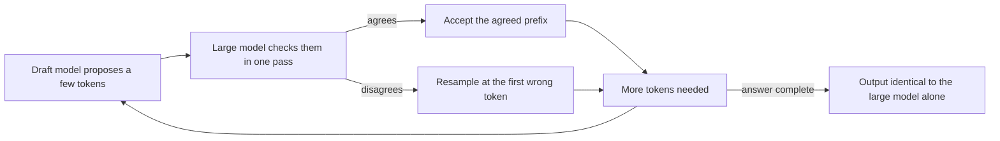

# 08. Efficient LLM Inference and Deployment

**Level:** Practitioner · **Reading time:** 26 min · **Exercise:** 60 min
**Prerequisites:** [Neural Network Basics for Efficiency](02-neural-network-basics-for-efficiency.md) (latency versus throughput), [Quantization](04-quantization.md)

> **In one sentence:** After this chapter you can estimate a language model's memory and speed on paper, and choose among quantization, attention, KV cache, batching and decoding optimizations for your serving situation.

## Why this matters

You deploy a chat model on one GPU. The first user gets answers at a good pace. Thirty users join and memory runs out. The weights did not change. What grew was a cache that nobody had sized, and each new token now waits behind the others.

LLM inference has two phases with opposite bottlenecks and a memory footprint that keeps growing. Most deployment mistakes come from optimizing one phase and not noticing the other.

## The core idea

A modern language model generates text one **token** (a chunk of text, roughly a short word) at a time. Each pass through the model has two phases:

- **Prefill** processes the whole prompt at once. It is large matrix-matrix work: bound by arithmetic.
- **Decode** produces one token per step. The model reads all its weights to produce one token: bound by memory.

The **KV cache** is what makes decode affordable. In **attention**, each token looks at every earlier token. Instead of recomputing the key and value vectors of all earlier tokens at every step, the engine stores them. The cost: the cache grows with every token of every request.

The analogy is an incremental build cache. Recompute nothing, look up what you already have. The analogy breaks on size: a build cache is bounded by your source tree, and the KV cache grows with context length times users, and the model has to read it at every step.

## How it works: count first

```
KV cache bytes = 2 × layers × KV heads × head dimension × tokens × batch × bytes per value
```

The leading 2 is for keys and values, two of the vectors that attention computes for each token. Each layer computes attention in several heads, parallel sub-calculations, each with its own `head dimension`; `KV heads` counts those that produce keys and values. Han's slide from Lecture 15 works the example for Llama-2-70B as if it had no head sharing: 2 × 80 layers × 64 heads × 128 = 2.5 MB per token. Then 4,096 tokens take 10 GB, and a batch of 16 such requests takes 160 GB ([22:00](https://www.youtube.com/watch?v=kgTWKjbnrBA&t=1320)). The cache can outgrow the weights.

Decode speed follows from [Chapter 02](02-neural-network-basics-for-efficiency.md): time per token is about the bytes moved divided by memory bandwidth. Bytes moved per token = weights + KV cache read.

Each technique below attacks one of these three quantities: weight bytes, cache bytes, or arithmetic.

### 1. Quantization: weight-only or weights and activations

- **One user, memory-bound:** quantize the weights only and keep activations in 16-bit (W4A16, weights 4-bit and activations 16-bit). Han makes the point with a roofline chart (speed plotted against arithmetic intensity): 8-bit weights and activations suit batch serving at batch 128, while a single query is still limited by weight traffic (Lecture 13, [16:00](https://www.youtube.com/watch?v=sTz2tXG1T0c&t=960)).
- **Many users, arithmetic-bound:** quantize weights and activations to 8 bits. The obstacle is **outliers**: a few activation channels with much larger values than the rest. Han shows an activation grid of 5,000 channels by 300 tokens with three outlier channels; with one scale, everything else collapses to zero ([2:00](https://www.youtube.com/watch?v=sTz2tXG1T0c&t=120)). His slide dates them to models beyond 6.7 billion parameters.
- **SmoothQuant** moves the difficulty from activations to weights with a per-channel factor (the formula is in [Chapter 04](04-quantization.md)). The factor, the migration strength, decides how much difficulty moves; Han recommends 0.5 as a good recipe. His deployment rule: quantize only the compute-intensive operators (the attention projections, the batched matrix multiplications and the two feed-forward layers) to 8 bits, and keep the nonlinear operations such as layer normalization, softmax and the residual additions in 16-bit, since they cost little latency and protect accuracy ([12:00](https://www.youtube.com/watch?v=sTz2tXG1T0c&t=720)). On his slides, OPT-175B went from 8 GPUs in 16-bit to 4 GPUs, and LLaMA's Wiki perplexity moved by about 0.03 to 0.05.
- **AWQ** for 4-bit weights. Han's lab found that about 1% of weight channels matter a great deal, and that they are found from the **activation** distribution, not from weight magnitude ([22:00](https://www.youtube.com/watch?v=sTz2tXG1T0c&t=1320)). Keeping those channels in FP16 inside a 4-bit tensor makes the kernel messy. Instead each salient channel is scaled up before quantization: scaling by 4 is worth about two extra bits ([26:00](https://www.youtube.com/watch?v=sTz2tXG1T0c&t=1560)). The TinyChat engine supplies fast kernels for it ([34:00](https://www.youtube.com/watch?v=sTz2tXG1T0c&t=2040)).

**TinyChat**, Han's engine for 4-bit models, shows what such a kernel has to solve. A computer's smallest unit is the byte, Han says, and a byte holds eight bits, so two 4-bit weights share one. He stores them interleaved rather than in running order, because that makes the packed weights easier to decode: a mask with `0x0F`, a shift by four bits and a second mask decode a whole vector of weights in three operations, which he says is about 20% faster on ARM NEON. The engine also fuses each whole operation into a single kernel, attention as well as the matrix multiplications, because every kernel launch costs time (Lecture 13, [34:00](https://www.youtube.com/watch?v=sTz2tXG1T0c&t=2040)).

Where a kernel dequantizes decides how fast it runs. A GPU kernel can run on two kinds of unit. Han keeps the main loop of a matrix multiplication on the **tensor cores** and leaves work such as scaling to the **CUDA cores**, and his dissection of quantized matrix multiplication finds CUDA-core operations inside the main loop expensive. The INT8 kernel of TensorRT leaves the main loop to the tensor cores and applies its scales afterwards, in the **epilogue**, the step after the loop, which is efficient. A kernel with 4-bit weights and 4-bit activations is slow when it has to rescale its partial sums, in FP16, inside the main loop: those sums take more registers than the inputs. AWQ, as TensorRT-LLM implements it, converts each 4-bit weight to FP16 before the multiplication and multiplies in FP16. QServe, his group's proposal for 4-bit weights with 8-bit activations, converts the weights to 8-bit integers, multiplies in INT8 and applies the scale in the epilogue. His rule is to keep dequantization out of the main loop and to keep it away from partial sums (Lecture 13, [46:00](https://www.youtube.com/watch?v=sTz2tXG1T0c&t=2760), [48:00](https://www.youtube.com/watch?v=sTz2tXG1T0c&t=2880)).

### 2. Attention without the N × N matrix

Plain attention writes an `N × N` table of attention weights to memory. **FlashAttention** splits the computation into tiles that fit in fast on-chip memory and never writes that table. The result is mathematically the same. Han describes it as fusing the separate kernels for the query-key product, softmax and the multiply by values (Lecture 13, [70:00](https://www.youtube.com/watch?v=sTz2tXG1T0c&t=4200)). Accuracy cost: none. It mainly helps prefill and long contexts, where the table would be large.

### 3. Shrink the KV cache

| Technique | What it does | Cost |
|---|---|---|
| Grouped-query attention | many query heads share a few key-value heads | a little accuracy; needs training or conversion |
| PagedAttention (vLLM) | stores the cache in fixed-size pages allocated as needed | none in accuracy; engineering |
| KV cache quantization | stores keys and values in 8 or 4 bits | small; keys after rotation are harder |
| Attention sinks and windows | keeps the first few tokens plus a sliding window | loses the middle of very long contexts |
| DuoAttention | classifies heads into retrieval heads (full cache) and streaming heads (window) | training a small set of gates |
| Quest | loads only the cache pages that matter for the current token | approximate |

- **Grouped-query attention** comes from Han's list of transformer variants (Lecture 12, slide 36), and he likens multi-head, multi-query and grouped-query attention to normal, depthwise and grouped convolution ([34:00](https://www.youtube.com/watch?v=EV6xb4xY708&t=2040)). He notes that Llama 2 uses it to fit longer contexts ([72:00](https://www.youtube.com/watch?v=EV6xb4xY708&t=4320)).
- **PagedAttention** is Han's first serving technique. A request reserves one contiguous block for a length that is not known in advance, which leaves unused memory: internal fragmentation. Pages fix that (Lecture 13, [64:00](https://www.youtube.com/watch?v=sTz2tXG1T0c&t=3840)).
- **Attention sinks.** The first tokens of a document attract a large share of attention whether or not they matter. A sliding window that evicts them makes the model collapse. Keep them, and the window can stream almost indefinitely: Han's lab observed the effect in 2021 and explained it in 2023 (Lecture 15, slides 25 to 28; he reports tests up to 4 million tokens at [34:00](https://www.youtube.com/watch?v=kgTWKjbnrBA&t=2040)). A plain window fails past its size ([38:00](https://www.youtube.com/watch?v=kgTWKjbnrBA&t=2280)).
- **DuoAttention** gives each attention head a learned gate that blends full attention with window attention, trained by distilling from full attention. For Llama-2 7B that is about a thousand gate values, trained in hours (Lecture 15, [46:00](https://www.youtube.com/watch?v=kgTWKjbnrBA&t=2760)).
- **Quest** uses the current query to pick which cache pages to read. As Han puts it, it does not save memory but saves data movement ([66:00](https://www.youtube.com/watch?v=kgTWKjbnrBA&t=3960)).

### 4. Speculative decoding: several tokens per step

At batch 1, the large model spends its time reading weights. Verifying a wrong token costs as little as verifying a right one, so extra candidates are nearly free.

1. A small **draft model** proposes the next few tokens.
2. The large model checks all of them in one pass.
3. The longest prefix it agrees with is accepted. At the first disagreement it resamples.
4. Repeat.

**Figure 1.** Speculative decoding: a cheap draft, one verification pass, and a loop back for whatever was rejected.



Each turn costs one pass of the large model for several tokens, which is why the gain is largest when one user has the GPU to itself.

The output distribution matches the large model's. Han reports about 2 to 3 times faster generation with identical outputs (Lecture 13, [72:00](https://www.youtube.com/watch?v=sTz2tXG1T0c&t=4320)). It helps most for a single user and least for a full batch, where arithmetic is already the limit.

### 5. Batch the requests

| Batching | Rule | Good for | Problem |
|---|---|---|---|
| None | run each request as it arrives | nothing much | GPU sits idle between steps |
| Static | wait for a full batch | offline jobs | waiting time for real-time use |
| Dynamic | run when the batch is full or a timer fires | workloads of equal length | short requests wait for long ones |
| Continuous (in-flight) | re-form the batch after every token | chat | most complex to build |

Han's picture for dynamic batching is a bus that leaves "when it's full or when the timer expires" ([74:00](https://www.youtube.com/watch?v=sTz2tXG1T0c&t=4440)). For continuous batching, passengers get off at different stops and new ones board at once. The picture breaks in one way: the bus never empties. The engine rebuilds its batch at every single token.

### 6. Long context: extend, then verify

- **Extend** by interpolating the [rotary position encoding](../GLOSSARY.md): the rotary angle is halved, so that a doubled position range fits into the angles the model already knows; this took LLaMA from 2k to 32k tokens with fine-tuning (Lecture 15, slide 5). **LongLoRA** makes that fine-tuning cheaper with sparse attention during training and full attention at inference (slides 7 to 12).
- **Verify.** Models are worst at using information from the middle of a long input: the "lost in the middle" curve (Lecture 15, slide 14). Han's conclusion is that fluent answers and good perplexity prove nothing; use a needle-in-a-haystack test or LongBench ([16:00](https://www.youtube.com/watch?v=kgTWKjbnrBA&t=960)).
- **Consider not extending.** On the LongBench results he cites, retrieval and context compression help, but less than models built for long context ([22:00](https://www.youtube.com/watch?v=kgTWKjbnrBA&t=1320)).

### 7. Metrics and serving choices

| Metric | Meaning | Set by |
|---|---|---|
| Time to first token (TTFT) | delay before the answer starts | prompt length, prefill speed |
| Time per output token (TPOT) | delay between tokens | weight and cache traffic, batch size |
| Throughput | tokens per second across all requests | batch size, arithmetic |

Total latency = TTFT + TPOT × output tokens (Han, Lecture 13, [64:00](https://www.youtube.com/watch?v=sTz2tXG1T0c&t=3840)). Throughput and TPOT pull in opposite directions.

| Situation | Choices |
|---|---|
| One user on a laptop or phone | small model, 4-bit weights, 16-bit activations, head sharing |
| A server with many users | continuous batching, paged cache, 8-bit weights and activations if arithmetic-bound |
| Very long documents | head sharing, cache quantization, retrieval, then a needle test |
| Several GPUs | parallelism; see [parallelism](../10-llm-internals/06-parallelism.md) |

How this fits into a production system is covered in [deploying a model](../07-ml-in-production/07-deploying-a-model.md); the architecture itself in [transformer architectures](../10-llm-internals/03-transformer-architectures-and-hyperparameters.md).

## Worked example

A capacity and speed calculator for a 7-billion-parameter model with 32 layers and 32 heads of dimension 128.

```python
def kv_cache_bytes(tokens, batch, layers, kv_heads, head_dim, bytes_per_value=2):
    return 2 * layers * kv_heads * head_dim * tokens * batch * bytes_per_value

def decode_ms(weights_gb, kv_gb, bandwidth_gbps=50.0):      # laptop-class bandwidth
    return (weights_gb + kv_gb) / bandwidth_gbps * 1e3

W16, W4 = 14.0, 3.5                                          # weight memory in GB

for tokens in (1_000, 8_000, 32_000):
    kv = kv_cache_bytes(tokens, 1, 32, 32, 128) / 1e9        # no head sharing
    kv_gqa = kv_cache_bytes(tokens, 1, 32, 8, 128) / 1e9     # 8 shared KV heads
    print(f"{tokens:>6} tokens: KV {kv:5.2f} GB (shared {kv_gqa:4.2f}) | "
          f"16-bit {decode_ms(W16, kv):5.1f} ms/token | "
          f"4-bit {decode_ms(W4, kv):5.1f} | 4-bit+shared {decode_ms(W4, kv_gqa):5.1f}")
```

What to observe:

- At 1,000 tokens the weights dominate. Going from 16-bit to 4-bit cuts the estimate from about 290 ms to 80 ms per token.
- At 32,000 tokens with 16-bit weights, the cache (16.8 GB) is larger than the weights (14 GB). Quantizing the weights alone no longer solves the problem.
- With shared heads the cache shrinks four times, and the 4-bit estimate at 32,000 tokens drops from about 405 ms to 154 ms.
- Multiply the cache by the number of users: 32 users with 8,000 tokens each need 134 GB of cache without head sharing, 34 GB with it.

The estimates ignore compute time, so they are floors for latency.

## What the practitioners say

- Han stresses that long conversations become expensive to serve because the KV cache grows linearly with the conversation (Lecture 12, [2:00](https://www.youtube.com/watch?v=EV6xb4xY708&t=120)).
- He is blunt about quantization without engineering: lower precision brings "without a good engine, no speed up" (Lecture 13, [48:00](https://www.youtube.com/watch?v=sTz2tXG1T0c&t=2880)).
- On sparsity for language models: pruning by weight magnitude times activation norm (Wanda) beat magnitude pruning, and picking which heads and neurons to skip per input works better than a fixed pattern (Lecture 13, [56:00](https://www.youtube.com/watch?v=sTz2tXG1T0c&t=3360)).
- On training budget: Llama models train on far more tokens per parameter than the Chinchilla rule suggests. He explains this as an inference decision: the same parameter count then gives higher quality, so serving is cheaper (Lecture 12, [76:00](https://www.youtube.com/watch?v=EV6xb4xY708&t=4560)). See [scaling laws](../10-llm-internals/07-scaling-laws.md).
- Beyond transformers: state-space models such as Mamba keep a fixed-size state instead of a growing cache (Lecture 15, [72:00](https://www.youtube.com/watch?v=kgTWKjbnrBA&t=4320)).

## Pitfalls

1. **Quantizing weights to 4 bits on a busy server.** Fix: at large batch the job is arithmetic-bound; use 8-bit weights and activations instead.
2. **Sizing memory from the weights alone.** Fix: add the KV cache at your longest context and largest batch.
3. **Reporting throughput when users feel TPOT.** Fix: record TTFT, TPOT and throughput together.
4. **Static batching for chat traffic.** Fix: continuous batching.
5. **Trusting a long-context claim.** Fix: run a needle test at your real lengths.
6. **Mixed-precision tensors without a kernel for them.** Fix: use a format your engine implements.
7. **Expecting speculative decoding to help a full batch.** Fix: measure at your real batch size.

## Try it

Build a capacity sheet for one open model and one machine.

1. From the model card, collect layers, heads, head dimension, KV heads and parameter count.
2. Compute weight memory at 16-bit and 4-bit, and cache size per 1,000 tokens.
3. Compute how many concurrent users fit at 8,000 tokens each, in both precisions.
4. Run the model locally at two precisions. Measure TTFT and TPOT for a 500-token prompt and 200 output tokens.

**You are done when** the sheet shows a formula next to every number, and one sentence explains any gap larger than 2 times between estimate and measurement.

**Stretch:** repeat the measurement with 1, 4 and 16 concurrent requests and plot TPOT against batch size.

## Key takeaways

- Prefill is arithmetic-bound. Decode is memory-bound. Optimize them separately.
- Memory per token for decode is weights plus KV cache. Both can be cut four times.
- One user: 4-bit weights, 16-bit activations. Many users: 8-bit everywhere plus continuous batching.
- FlashAttention removes the N × N table at no accuracy cost.
- Shrink the cache with shared heads and paging; drop tokens only after testing.
- Speculative decoding turns spare arithmetic into speed. Verify long-context claims with a needle test.

## Self-check

1. A model has 40 layers, 8 KV heads, head dimension 128, 16-bit cache. How much cache does one 2,000-token request use?
2. Why does 4-bit weight quantization help a single user far more than a full batch?
3. What does FlashAttention change about the mathematics of attention?
4. A sliding-window cache makes the model produce garbage after a few thousand tokens. What is missing?
5. In speculative decoding, why is checking four draft tokens almost as cheap as checking one at batch 1?
6. Your p90 time per output token doubles when traffic triples, while throughput rises. Which two techniques do you apply first?
7. A quantized model runs no faster than its 16-bit version. Where should its matrix-multiplication kernel dequantize, and what must it avoid?

<details><summary>Show answers</summary>

1. 2 × 40 × 8 × 128 × 2,000 × 2 bytes = 327,680,000 bytes, about 0.33 GB.
2. At batch 1 the step is limited by reading the weights, and 4-bit weights are a quarter of the bytes. At large batch arithmetic dominates, and 4-bit weights do not reduce the arithmetic.
3. Nothing. It computes the same attention exactly and avoids writing the N × N table to memory.
4. The attention sinks: the first tokens must stay in the cache.
5. Because the large model still reads its weights only once per pass; verifying more candidates adds arithmetic, which is cheap when memory is the limit.
6. Continuous batching and a paged KV cache, then quantization of weights and activations if arithmetic-bound.
7. In the epilogue, after the main loop, as the INT8 kernel of TensorRT does. It must not dequantize inside the loop, and it must not convert the partial sums, which take more registers than the inputs.

</details>

## Sources

- **Lecture:** Song Han, "Lecture 12: Transformer and LLM", MIT 6.5940 TinyML and Efficient Deep Learning Computing (Fall 2024): [video](https://www.youtube.com/watch?v=EV6xb4xY708) · [guide](../lectures/mit-12-transformer-and-llm.md), used at [KV cache growth](https://www.youtube.com/watch?v=EV6xb4xY708&t=120), [variants](https://www.youtube.com/watch?v=EV6xb4xY708&t=2040), [Llama family](https://www.youtube.com/watch?v=EV6xb4xY708&t=4320), [training budget versus inference](https://www.youtube.com/watch?v=EV6xb4xY708&t=4560)
- **Lecture:** Song Han, "Lecture 13: LLM Deployment Techniques", MIT 6.5940 (Fall 2024): [video](https://www.youtube.com/watch?v=sTz2tXG1T0c) · [guide](../lectures/mit-13-efficient-llm-deployment.md), used at [outliers](https://www.youtube.com/watch?v=sTz2tXG1T0c&t=120), [weight-only quantization](https://www.youtube.com/watch?v=sTz2tXG1T0c&t=960), [AWQ](https://www.youtube.com/watch?v=sTz2tXG1T0c&t=1320), [serving metrics and paging](https://www.youtube.com/watch?v=sTz2tXG1T0c&t=3840), [speculative decoding](https://www.youtube.com/watch?v=sTz2tXG1T0c&t=4320), [batching](https://www.youtube.com/watch?v=sTz2tXG1T0c&t=4440)
- **Lecture:** Song Han, "Lecture 15: Long-Context LLM", MIT 6.5940 (Fall 2024): [video](https://www.youtube.com/watch?v=kgTWKjbnrBA) · [guide](../lectures/mit-15-long-context-llm.md), used at [long-context evaluation](https://www.youtube.com/watch?v=kgTWKjbnrBA&t=960), [KV cache size](https://www.youtube.com/watch?v=kgTWKjbnrBA&t=1320), [attention sinks](https://www.youtube.com/watch?v=kgTWKjbnrBA&t=2040), [DuoAttention](https://www.youtube.com/watch?v=kgTWKjbnrBA&t=2760), [Quest](https://www.youtube.com/watch?v=kgTWKjbnrBA&t=3960), [state-space models](https://www.youtube.com/watch?v=kgTWKjbnrBA&t=4320)
- **Reading:** Woosuk Kwon, Zhuohan Li, Siyuan Zhuang, et al., "Efficient Memory Management for Large Language Model Serving with PagedAttention" (SOSP 2023): [arXiv](https://arxiv.org/abs/2309.06180)
- **Reading:** Tri Dao, Daniel Y. Fu, Stefano Ermon, et al., "FlashAttention: Fast and Memory-Efficient Exact Attention with IO-Awareness" (NeurIPS 2022): [arXiv](https://arxiv.org/abs/2205.14135)
- **Reading:** Ji Lin, Jiaming Tang, Haotian Tang, et al., "AWQ: Activation-aware Weight Quantization for LLM Compression and Acceleration" (MLSys 2024): [arXiv](https://arxiv.org/abs/2306.00978)
- **Reading:** Joshua Ainslie, James Lee-Thorp, Michiel de Jong, et al., "GQA: Training Generalized Multi-Query Transformer Models from Multi-Head Checkpoints" (EMNLP 2023): [arXiv](https://arxiv.org/abs/2305.13245)
- **Reading:** Yaniv Leviathan, Matan Kalman, Yossi Matias, "Fast Inference from Transformers via Speculative Decoding" (ICML 2023): [arXiv](https://arxiv.org/abs/2211.17192)
- **Reading:** Guangxuan Xiao, Yuandong Tian, Beidi Chen, et al., "Efficient Streaming Language Models with Attention Sinks" (ICLR 2024): [arXiv](https://arxiv.org/abs/2309.17453)
- **Reading:** Nelson F. Liu, Kevin Lin, John Hewitt, et al., "Lost in the Middle: How Language Models Use Long Contexts" (TACL 2024): [arXiv](https://arxiv.org/abs/2307.03172)

## Next

→ [LLM Post-Training and On-Device Training](09-llm-post-training-and-on-device-training.md), for when the model on the device also has to learn from the device's data.
