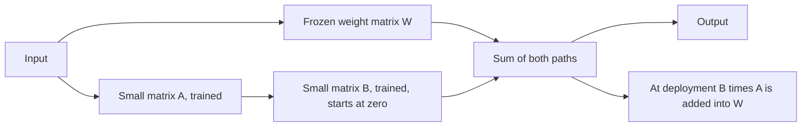

# 09. LLM Post-Training and On-Device Training

**Level:** Practitioner · **Reading time:** 16 min · **Exercise:** 45 min
**Prerequisites:** [Quantization](04-quantization.md); for the fine-tuning vocabulary, [from base model to assistant](../01-foundations/03-from-base-model-to-assistant-post-training.md)

> **In one sentence:** After this chapter you can pick a parameter-efficient fine-tuning method for a model you want to adapt, size its memory, and decide whether the training can happen on the device instead of in the cloud.

## Why this matters

You have an open 7-billion-parameter model and a few thousand examples from your domain. Fine-tuning all of it means storing a gradient and optimizer state for every weight. That is well over a hundred gigabytes before the first activation. One laptop cannot do it, and a phone never will.

Two questions follow. Which parameters do you actually need to train? And can the training stay on the device where the data was collected?

## The core idea

**Post-training** is everything that happens after pre-training: training on a smaller dataset so the model does the job you want (Han, Lecture 14, [0:00](https://www.youtube.com/watch?v=OCdwWfVoQ-Q&t=0)). Its first stage is **supervised fine-tuning** (SFT): the model learns to reproduce good responses, with the loss computed only on the response tokens, not on the prompt ([2:00](https://www.youtube.com/watch?v=OCdwWfVoQ-Q&t=120)). Preference tuning (RLHF, DPO) follows; it belongs to [post-training](../01-foundations/03-from-base-model-to-assistant-post-training.md).

**Parameter-efficient fine-tuning** (PEFT) freezes the pretrained weights and trains a small set of parameters instead.

The analogy is a patch file on top of a package you never modify. The analogy breaks on memory: a patch is all you need at run time, but here the base model still has to be loaded. PEFT saves training memory and storage of adapters. It does not shrink the base.

## How it works: the PEFT menu

Han's slides list the options (Lecture 14, slides 13 to 42):

| Method | What is trained | Added cost at inference |
|---|---|---|
| BitFit | the bias terms only | none |
| TinyTL | biases plus a light residual layer | a small layer |
| Adapter | small layers inserted into each transformer block | a small layer per block |
| Prompt and prefix tuning | soft prompts prepended to the input | a few extra tokens per request |
| LoRA | low-rank branches beside the frozen weights | none once merged |
| QLoRA | LoRA on a 4-bit quantized base model | none once merged |
| BitDelta | the difference between base and fine-tuned model, in one bit | none |

### LoRA, step by step

**LoRA**, short for low-rank adaptation, leaves the weight matrix `W` alone and learns an update as a product of two small matrices.

1. Pick a rank `r` (the width of the two small matrices), for example 8.
2. Add `A` with shape `r × d_in` and `B` with shape `d_out × r`, initialized so that `B × A` starts at zero.
3. Train only `A` and `B`.
4. At deployment, add `B × A` into `W`. The model has the same shape as before.

**Figure 1.** LoRA: a small trained branch beside the frozen weights, merged into them at deployment.

Only `A` and `B` are trained; after the merge the model has exactly the shape and the cost of the original.

Worked numbers for one 4,096 × 4,096 weight matrix:

- Full fine-tuning: 4,096 × 4,096 = 16,777,216 trainable parameters.
- LoRA with `r = 8`: 4,096 × 8 + 8 × 4,096 = 65,536 trainable parameters, 0.39% of the full count.

**QLoRA** goes further: the frozen base is stored in 4 bits while the adapters train in 16-bit.

### Training on the device

**On-device training** adapts a model where the data is created. Han gives the reason in his Fall 2024 lecture on the subject: a gradient is not safe to share. His **deep leakage from gradients** slides show input images and text reconstructed from gradients alone, for vision models and for BERT, a language model (Lecture 21, [10:00](https://www.youtube.com/watch?v=1YuD_5UQxsA&t=600)). His slide concludes that, if training data can be recovered this way, sharing the gradient is not safe. Adding noise as a defense also disrupts the model, he says: only very strong noise stops the leak ([12:00](https://www.youtube.com/watch?v=1YuD_5UQxsA&t=720)). So even federated learning, where devices send updates instead of data ([2:00](https://www.youtube.com/watch?v=1YuD_5UQxsA&t=120)), has a privacy hole. His repair is the compression from the previous lecture: prune the gradients before sending. In his test, 99% of the gradients could be pruned without hurting accuracy, and beyond about 70% there was nothing left to match, so the leak stopped (same block).

The attack is also cheap to build. Han describes deep leakage as about 20 lines of PyTorch: start from a dummy input and a dummy label, compute their gradient, and change the dummy input until its gradient matches the shared one. Pruning breaks that matching. With 1% of the gradient left, he says, the attack has many variables and few equations, so the equations cannot be solved. He adds that the method's code and its website are public on his lab's domain (Lecture 21, [12:00](https://www.youtube.com/watch?v=1YuD_5UQxsA&t=720), [14:00](https://www.youtube.com/watch?v=1YuD_5UQxsA&t=840)).

The obstacle is memory. Training keeps every intermediate activation for the backward pass. Four of Han's remedies:

1. **Update less.** TinyTL trains the biases and a small residual layer, with up to 6.5 times less memory (Lecture 21, slides 49 to 52).
2. **Backpropagate less.** **Sparse back-propagation** updates only some layers and, inside them, only some channels, so only a subset of activations has to be stored ([28:00](https://www.youtube.com/watch?v=1YuD_5UQxsA&t=1680)). Updating only the last layer is cheap but inaccurate; a contribution analysis picks which intermediate layers to train. He reports the same accuracy as LoRA and accuracy comparable to full fine-tuning when adapting Llama-2 7B ([40:00](https://www.youtube.com/watch?v=1YuD_5UQxsA&t=2400)).
3. **Quantize the training.** Fake quantization, the simulation used in quantization-aware training, saves no training memory. Real low-precision training does, but converges worse; his quantization-aware scaling repairs that and, he says, recovers a 12-point accuracy loss ([54:00](https://www.youtube.com/watch?v=1YuD_5UQxsA&t=3240)). His slides report training under 256 KB of memory.
4. **Compile.** PockEngine turns the training graph into static code and removes operators that need no gradient, reorders them, and works in place. As he states, it is about 23 times faster and smaller than TensorFlow Lite, and runs on Jetson boards, Raspberry Pi, phones and an STM32 microcontroller ([60:00](https://www.youtube.com/watch?v=1YuD_5UQxsA&t=3600); [64:00](https://www.youtube.com/watch?v=1YuD_5UQxsA&t=3840)).

A procedure for adapting a model on a laptop:

1. Quantize the base model to 4 bits.
2. Attach LoRA adapters, rank 8 to 16.
3. Keep sequences short and batch size 1.
4. Evaluate before and after on held-out examples.

## Worked example: sizing three training runs

Rules of thumb from engineering practice, not course content, for a 7-billion-parameter model with 16-bit weights and the AdamW optimizer: 2 bytes of gradient and about 12 bytes of optimizer state per trainable parameter. Assume 20 million adapter parameters.

| | Full fine-tuning | LoRA | QLoRA |
|---|---|---|---|
| Weights | 14 GB | 14 GB | 3.5 GB |
| Trainable parameters | 7 billion | 20 million | 20 million |
| Gradients | 14 GB | 0.04 GB | 0.04 GB |
| Optimizer state | 84 GB | 0.24 GB | 0.24 GB |
| Total before activations | 112 GB | 14.3 GB | 3.8 GB |

The optimizer state dominates full fine-tuning, and it almost vanishes with adapters. QLoRA then cuts the weights by four.

## What the practitioners say

- Han places post-training after pre-training in the model's life cycle, with pre-training consuming the most compute (Lecture 14, [0:00](https://www.youtube.com/watch?v=OCdwWfVoQ-Q&t=0)).
- The adapter and prompt methods carry costs Han spells out. Adapters make the model deeper and add inference latency (Lecture 14, [20:00](https://www.youtube.com/watch?v=OCdwWfVoQ-Q&t=1200)). Soft prompts lengthen every request, grow the KV cache and eat into the usable input length ([26:00](https://www.youtube.com/watch?v=OCdwWfVoQ-Q&t=1560)). LoRA avoids both: its two low-rank matrices start as a zero branch and are folded into the frozen weight at deployment, so it adds no latency ([28:00](https://www.youtube.com/watch?v=OCdwWfVoQ-Q&t=1680)).
- For serving many fine-tuned copies of one base model, Han's one-bit delta method stores the base in 16 bits once and the difference of each fine-tune in a single bit per weight, with one learned 16-bit scale per tensor; he reports no loss of accuracy (Lecture 14, [34:00](https://www.youtube.com/watch?v=OCdwWfVoQ-Q&t=2040)).
- Fewer trainable parameters is not the same as less memory. On his measurement, updating only the batch-normalization layers has 12 times fewer trainable parameters but saves only 1.8 times the real memory, because activations, not parameters, are the bottleneck. Updating only the last layer dropped accuracy from 90% to 50% on the CARS data set (Lecture 21, [18:00](https://www.youtube.com/watch?v=1YuD_5UQxsA&t=1080), [20:00](https://www.youtube.com/watch?v=1YuD_5UQxsA&t=1200)).
- On the limits of sparse back-propagation: it fails on some instructions, such as reversing the words of a sentence (Lecture 21, [40:00](https://www.youtube.com/watch?v=1YuD_5UQxsA&t=2400)).
- His class demo trains a person detector on the device itself, with predictions shown live ([56:00](https://www.youtube.com/watch?v=1YuD_5UQxsA&t=3360)).

## Pitfalls

1. **Forgetting activation memory.** Fix: short sequences, batch size 1, and a method that stores fewer activations.
2. **Expecting fake quantization to save memory.** Fix: use real low-precision training with scaling.
3. **Sending gradients to a server and calling it private.** Fix: keep training local.
4. **Assuming an adapter shrinks the deployed model.** Fix: quantize or distill the base for that.
5. **Skipping evaluation after fine-tuning.** Fix: run your [eval harness](../03-evaluation/02-a-minimal-eval-harness.md) before and after; adapters can damage general ability.
6. **Choosing LoRA rank by habit.** Fix: try 8, 16 and 32 and compare on held-out data.

## Try it

Adapt a small open model to a narrow task on your own machine.

1. Prepare 200 instruction and answer pairs.
2. Fine-tune with LoRA, rank 16, using the parameter-efficient fine-tuning tools of your framework. Check its current documentation for the exact interface.
3. Record: adapter size, share of trainable parameters, peak memory, quality on 20 held-out examples before and after.

**You are done when** you have those four numbers and a one-sentence judgment of whether the adaptation helped.

**Stretch:** repeat with the base model quantized to 4 bits and compare quality and peak memory.

## Key takeaways

- Post-training adapts a pretrained model; supervised fine-tuning computes loss on responses only.
- PEFT freezes the base and trains a small set of parameters.
- LoRA learns a low-rank update and merges it at deployment, with no added inference cost.
- Optimizer state dominates full fine-tuning memory. Adapters remove most of it.
- Gradients can leak data, which is an argument for training on the device.
- On-device training memory is about activations: update less, backpropagate less, quantize, compile.

## Self-check

1. A weight matrix is 1,024 × 1,024. With LoRA rank 4, how many trainable parameters does it get?
2. Why does LoRA add no latency at inference?
3. What is the main memory consumer during training, beyond the weights themselves?
4. Why does fake quantization not reduce training memory?
5. What does deep leakage from gradients show?
6. Which saves more memory for a 7B model: LoRA on a 16-bit base, or LoRA on a 4-bit base, and why?
7. How does a deep leakage attack proceed, and why does pruning most of the gradient defeat it?

Show answers

1. 1,024 × 4 + 4 × 1,024 = 8,192.
2. Because the learned update is merged into the original weight matrix.
3. The activations kept for the backward pass, plus optimizer state for every trainable parameter.
4. It rounds values only to simulate low precision; the weights are still stored and updated in high precision.
5. That the original inputs, images and text, can be reconstructed from shared gradients.
6. LoRA on a 4-bit base: the base weights take a quarter of the memory.
7. It starts from a dummy input and a dummy label and changes them until their gradient matches the shared one. After pruning, only 1% of the gradient is left to match, many variables for few equations, so the match cannot be solved.

## Sources

- **Lecture:** Song Han, "Lecture 14: LLM Post-Training", MIT 6.5940 TinyML and Efficient Deep Learning Computing (Fall 2024): [video](https://www.youtube.com/watch?v=OCdwWfVoQ-Q) · [guide](../lectures/mit-14-llm-post-training.md), used at [life cycle](https://www.youtube.com/watch?v=OCdwWfVoQ-Q&t=0), [supervised fine-tuning](https://www.youtube.com/watch?v=OCdwWfVoQ-Q&t=120)
- **Lecture:** Song Han, "Lecture 21: On-Device Training and Transfer Learning", MIT 6.5940 (Fall 2024): [video](https://www.youtube.com/watch?v=1YuD_5UQxsA) · [guide](../lectures/mit-21-on-device-training-and-transfer-learning.md), used at [federated learning](https://www.youtube.com/watch?v=1YuD_5UQxsA&t=120), [deep leakage](https://www.youtube.com/watch?v=1YuD_5UQxsA&t=600), [sparse back-propagation](https://www.youtube.com/watch?v=1YuD_5UQxsA&t=1680), [comparison with LoRA](https://www.youtube.com/watch?v=1YuD_5UQxsA&t=2400), [quantized training](https://www.youtube.com/watch?v=1YuD_5UQxsA&t=3240), [demo](https://www.youtube.com/watch?v=1YuD_5UQxsA&t=3360), [PockEngine](https://www.youtube.com/watch?v=1YuD_5UQxsA&t=3600)
- **Reading:** Edward J. Hu, Yelong Shen, Phillip Wallis, et al., "LoRA: Low-Rank Adaptation of Large Language Models" (ICLR 2022): [arXiv](https://arxiv.org/abs/2106.09685)
- **Reading:** Tim Dettmers, Artidoro Pagnoni, Ari Holtzman, Luke Zettlemoyer, "QLoRA: Efficient Finetuning of Quantized LLMs" (NeurIPS 2023): [arXiv](https://arxiv.org/abs/2305.14314)
- **Reading:** Ligeng Zhu, Zhijian Liu, Song Han, "Deep Leakage from Gradients" (NeurIPS 2019): [arXiv](https://arxiv.org/abs/1906.08935)
- **Reading:** Han Cai, Chuang Gan, Ligeng Zhu and Song Han, "TinyTL: Reduce Activations, Not Trainable Parameters for Efficient On-Device Learning" (NeurIPS 2020): [arXiv](https://arxiv.org/abs/2007.11622)
- **Reading:** Ji Lin, Ligeng Zhu, Wei-Ming Chen, et al., "On-Device Training Under 256KB Memory" (NeurIPS 2022): [arXiv](https://arxiv.org/abs/2206.15472)

## Next

→ [Efficient Vision, Generative Models and Distributed Training](10-efficient-vision-generative-models-and-distributed-training.md), a tour of where the same ideas reappear in images, video and multi-machine training.
