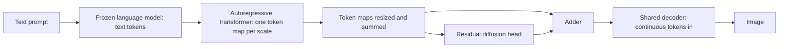

# 12. Vision Transformers

**Level:** Practitioner · **Reading time:** 21 min · **Exercise:** 45 min
**Prerequisites:** [Neural Network Basics for Efficiency](02-neural-network-basics-for-efficiency.md) (attention), [Efficient LLM Inference and Deployment](08-efficient-llm-inference-and-deployment.md) (memory-bound decoding)

> **In one sentence:** After this chapter you can turn an image into tokens on paper, predict how a vision transformer's cost grows with resolution, and pick a way to make it affordable.

## Why this matters

A car's camera feeds a segmentation model, which labels every pixel. At low resolution a cyclist is hard to make out. At high resolution the rider is clear, but the model runs at 1.6 frames per second on the edge GPU Han measured for driving. The chip stays. What makes a sharper image so expensive, and what can change in the model to pay for it?

## The core idea

A transformer reads a sequence of tokens; for text, a token is a piece of a word. An image is a grid of pixels, so the **vision transformer (ViT)** cuts it into small squares, gives each square one vector, and treats that vector as a token. A standard transformer encoder then runs over the tokens as it would over words.

Han's example is a 96 × 96 image cut into 32 × 32 **patches**: 9 of them, in a 3 × 3 grid. Each patch is 3 × 32 × 32 = 3,072 numbers, and a learned projection turns it into 768 numbers ([2:00](https://www.youtube.com/watch?v=v0jYDgaVzlk&t=120)).

The picture is like a document, with two differences. A word is a unit of meaning; a patch is an arbitrary square that can cut a face in half. And a document runs along one axis, while patches lie on two, and attention compares vectors without knowing their order, so the model adds a **positional encoding**, a vector that marks each patch's place, to every patch before the first layer ([4:00](https://www.youtube.com/watch?v=v0jYDgaVzlk&t=240)).

## How it works, step by step

### 1. From pixels to tokens

1. Pick a patch size; 16 × 16 pixels is the common choice.
2. Cut the image into patches: a 224 × 224 image gives 196.
3. Flatten each patch into one vector.
4. Project each vector to the model's hidden size, the width of every token vector inside the encoder.
5. Add the positional encoding and run the standard transformer encoder.

Steps 2 to 4 are one layer in practice: a convolution whose kernel is the patch size, 32 in Han's example, with stride 32 and no padding, 3 input channels and 768 output channels, whose weights form the 3072 × 768 matrix of 2.36 million parameters on his slide ([4:00](https://www.youtube.com/watch?v=v0jYDgaVzlk&t=240)).

ViT-Large has 24 layers, a hidden size of 1,024, 16 heads (parallel attention sub-calculations), a **feed-forward network (FFN)** 4,096 wide, the per-token network that follows attention in each block, and about 300 million parameters. A suffix names the patch size: ViT-L/16 uses 16 × 16 patches, and larger patches give a coarser model.

With little training data a ViT is inferior to a convolutional network (CNN), which is built from small filters that slide over an image; pre-trained on a very large dataset, it overtakes one, so it scales better with data ([4:00](https://www.youtube.com/watch?v=v0jYDgaVzlk&t=240), [6:00](https://www.youtube.com/watch?v=v0jYDgaVzlk&t=360)).

### 2. Why resolution is expensive

Let `n` be the number of tokens. Attention builds a table with one row and one column per token, `n²` entries, so its work grows with `n²`. The other layers process each token on their own, so their work grows with `n`. And `n` grows with the square of the side length: doubling each side gives 4 times the tokens, 16 times the table and 4 times the rest. From 224 to 1,024 pixels, 4.6 times the side, the tokens grow 21 times and the table 436 times.

That is Han's derivation: the attention computation is the resolution to the fourth power. His chart shows the ViT's computation outgrowing a CNN's from 1K to 2K input resolution ([8:00](https://www.youtube.com/watch?v=v0jYDgaVzlk&t=480)). His slide calls the whole model's cost quadratic in the resolution; the per-token layers are the quadratic part. Counted in multiplications with ViT-Large's shape, the table costs as much as the FFN at 4,096 tokens, a 1,024 × 1,024 image, and more beyond.

Why pay? Han names three tasks that need **dense prediction**, an output for every pixel, at high resolution ([6:00](https://www.youtube.com/watch?v=v0jYDgaVzlk&t=360)): medical image segmentation, where fine detail bears on a diagnosis; super-resolution, which turns a low-resolution image into a high-resolution one; and autonomous driving, where a person on a bike is hard to make out at low resolution and the segmentation score, **mIoU** (mean intersection over union, the overlap of predicted and true regions), rises with resolution.

His first speed-up: SegFormer, a pioneering transformer for segmentation, runs at 1.6 frames per second on an NVIDIA Jetson AGX Orin, an edge GPU. EfficientViT, his group's model from Section 4, reaches 21.8 frames per second on his slide (he says 21) at a higher mIoU on Cityscapes, a street-scene dataset, 82.7 against 82.4, with FP16 and batch size 1 ([8:00](https://www.youtube.com/watch?v=v0jYDgaVzlk&t=480)).

Augmented and virtual reality need it too: in Segment Anything, the model he shows, a ViT image encoder takes most of the time, and a **prompt**, a point, a box or a mask, says which object to outline. After acceleration a box prompt runs at 182 images per second, up from 11 ([10:00](https://www.youtube.com/watch?v=v0jYDgaVzlk&t=600), [22:00](https://www.youtube.com/watch?v=v0jYDgaVzlk&t=1320)).

### 3. Window attention

**Window attention** runs attention inside fixed-size local windows instead of across the whole image: 7 × 7 patches in Han's example. Every window holds the same number of tokens, so the work grows with the number of tokens and so with the area; doubling a side now costs 4 times, not 16 ([10:00](https://www.youtube.com/watch?v=v0jYDgaVzlk&t=600)).

The weakness is isolation: in one layer, tokens in neighboring windows never see each other. The Swin Transformer alternates two kinds of layer; the second shifts the window grid, so that patches from the old edge share a window with their neighbors. Over several layers every token reaches every other ([12:00](https://www.youtube.com/watch?v=v0jYDgaVzlk&t=720)). On Han's slide Swin has better accuracy than ViT on ImageNet, a large image-classification benchmark, and applies to detection and segmentation ([14:00](https://www.youtube.com/watch?v=v0jYDgaVzlk&t=840)).

Some data are mostly empty: in a **point cloud**, a set of points in 3-D space, 99.9% of the **voxels**, the cubes of that space, hold no point. FlatFormer, Han's example, skips the empty windows. Groups of equal windows hold 1, 2 or 3 tokens, so the fast ones wait for the slowest. **Equal-size grouping** puts the same number of non-empty tokens in every group; the balanced load is hardware-friendly, and on a Jetson Orin the model runs faster than other transformers and even than convolution models ([16:00](https://www.youtube.com/watch?v=v0jYDgaVzlk&t=960)).

### 4. Linear attention

Softmax attention computes `Q Kᵀ`, a table of `n × n`, from three matrices per head: the query `Q` (what a token looks for), the key `K` (what it offers for matching) and the value `V` (what it contributes), then multiplies by `V` after a softmax (positive weights that sum to 1). Replacing the softmax with **ReLU**, which sets negative numbers to zero, applied to `Q` and `K` keeps the table and the cost of `n²` ([16:00](https://www.youtube.com/watch?v=v0jYDgaVzlk&t=960)).

Matrix multiplication is associative: `(AB)C = A(BC)`. Multiply `Kᵀ` by `V` first: the result is `d × d`, with `d` the width of a head, and it costs `n × d²`. Multiply by `Q` last: `n × d²` again. The table never exists and the cost is linear in `n`. That is **linear attention** ([18:00](https://www.youtube.com/watch?v=v0jYDgaVzlk&t=1080)).

There is no free lunch, Han warns. Softmax attention concentrates on a few tokens, the dog's eyes; ReLU linear attention spreads weak attention everywhere. It captures global context but not local information, and it lacks **multi-scale learning**, seeing patterns at several sizes. On his ImageNet slide, the **top-1 accuracy**, the share of images classified correctly, falls from 77.2% to 76.0% ([20:00](https://www.youtube.com/watch?v=v0jYDgaVzlk&t=1200)).

Convolution exists to extract local features, so EfficientViT gives linear attention a convolution branch: a **depthwise convolution** (one 3 × 3 kernel per channel, mixing neighboring positions) followed by a 1 × 1 **grouped convolution** (mixing channels inside small groups). It also aggregates tokens at several scales before the attention and puts a depthwise convolution inside the FFN. The block adds little computation and scores 78.4% top-1 accuracy on the same slide, above softmax attention.

### 5. Window pruning

Half the resolution with every pixel blurs the details of a driving scene; full resolution with a quarter of the pixels keeps them, at the same total activation size ([26:00](https://www.youtube.com/watch?v=v0jYDgaVzlk&t=1560)). His SparseViT has three steps.

1. **Window activation pruning**. Score each window by the **L2 magnitude** of its activations (the intermediate outputs of a layer), the square root of the sum of their squares: large means important. Keep the best, the people and the cars, and let later layers keep fewer than earlier ones.
2. **Sparsity-aware adaptation**. The network was trained dense, so it is fine-tuned on pruned input with a new sparsity pattern sampled in each iteration. The first layer always stays dense and each later layer is sparser, because a token that is pruned cannot come back.
3. **Resource-constrained search**. An evolutionary search, as in [Chapter 05](05-neural-architecture-search.md), proposes a sparsity for every layer and keeps the proposal if it meets the latency budget. Its accuracy keeps rising across search epochs; random search stays flat ([28:00](https://www.youtube.com/watch?v=v0jYDgaVzlk&t=1680)). [Chapter 03](03-pruning-and-sparsity.md) prunes weights; this prunes activations.

The result is 1.5 times faster than the model without sparsity at 256 and 224 input resolution. The learned masks keep the foreground, the person and the cars, and drop the background ([30:00](https://www.youtube.com/watch?v=v0jYDgaVzlk&t=1800)).

| Move | What changes | What you pay |
|---|---|---|
| Window attention | attention inside fixed windows, shifted in alternate layers | several layers before distant tokens connect |
| Equal-size grouping | sparse data: equal numbers of non-empty tokens per group | bookkeeping: group membership must be tracked |
| Linear attention | no `n × n` table, plus a convolution branch | local detail must be added back |
| Window pruning | unimportant windows dropped | a fine-tuning pass and a search |

### 6. Learning without labels

A ViT needs large datasets, and labels are costly ([30:00](https://www.youtube.com/watch?v=v0jYDgaVzlk&t=1800)). **Self-supervised learning** takes the training target from the data itself; he presents two recipes.

**Contrastive learning** teaches an image encoder to tell images apart. Two random views of one image, two crops of a cat, are positive samples; a view of another image, a dog, is a negative sample. The loss pulls the two cat **embeddings**, the vectors the encoder outputs, together and pushes the dog away. On his slide, ViTs trained from random initialization on a small dataset lose accuracy in most cases as they grow; with self-supervised pre-training they gain accuracy as they grow and beat their supervised counterparts ([32:00](https://www.youtube.com/watch?v=v0jYDgaVzlk&t=1920)).

The multimodal version is CLIP, contrastive language-image pre-training, which [Alignment and Multimodality](../10-llm-internals/12-alignment-and-multimodality.md) develops: paired images and captions pass through an image encoder and a text encoder, and the true pairs get the highest similarity. At inference the image is scored against a list of candidate captions and the best match wins: **zero-shot classification**, with no training example for the class ([34:00](https://www.youtube.com/watch?v=v0jYDgaVzlk&t=2040)).

**Masked image modeling** borrows from BERT, a language model trained by hiding 15% of its input words and predicting them. Patches are hidden, the visible ones pass through a heavy encoder, and a light decoder reconstructs the whole image: in Han's example 25 tokens have 8 visible. The best mask ratio is about 75%, on his slide, against 15% for BERT. His reading of the gap: images have a lower information density and more redundancy than language, so more can be hidden and still recovered ([38:00](https://www.youtube.com/watch?v=v0jYDgaVzlk&t=2280)).

### 7. Generating images

The models so far were **discriminative**: they predict a label from an image. A **generative model** produces an image, and an autoregressive transformer, which predicts the next token from the earlier ones, can generate visual tokens as it generates words. Pixels are continuous, but a next-token loss needs a vocabulary, so **vector quantization** supplies one: an encoder maps each patch to a continuous vector, a **codebook**, a fixed list of learned vectors, replaces each vector with its nearest entry, and the patch is kept as that entry's integer index, the k-means codebook of [Chapter 04](04-quantization.md) applied to patch vectors instead of single weights ([44:00](https://www.youtube.com/watch?v=v0jYDgaVzlk&t=2640)). Google's Gemini technical report, he notes, hints that its models "natively output images using discrete image tokens" ([40:00](https://www.youtube.com/watch?v=v0jYDgaVzlk&t=2400)).

Speed is the next problem. Generating one token per step is bound by memory, since every pass reads all the weights to produce one token, the bottleneck [Chapter 08](08-efficient-llm-inference-and-deployment.md) describes for language models ([42:00](https://www.youtube.com/watch?v=v0jYDgaVzlk&t=2520)). **Next-scale prediction**, the order VAR introduced, follows Han's rule of thumb, generate more tokens at a time ([46:00](https://www.youtube.com/watch?v=v0jYDgaVzlk&t=2760)): step 1 predicts one token for the whole image, step 2 a 2 × 2 map, step 3 a 4 × 4 map, and so on, the coarse picture first. A whole scale comes out in one pass, its tokens attending to all tokens of earlier scales through a block-shaped attention mask ([48:00](https://www.youtube.com/watch?v=v0jYDgaVzlk&t=2880)).

One flaw remains: a discrete tokenizer cannot represent a continuous image exactly, so the reconstructed eyes differ from the reference in Han's example. HART, the hybrid autoregressive transformer, built in his group by the course's teaching assistant, repairs the flaw with two ideas ([50:00](https://www.youtube.com/watch?v=v0jYDgaVzlk&t=3000)). One decoder handles continuous and discrete tokens alike; by his slide it is trained on about half of each. And a **residual token**, the continuous token minus the discrete one, holds the fine detail the codebook misses. Han's **residual diffusion**, a diffusion model (one that generates by removing noise step by step) of only 30 to 40 million parameters, predicts it ([52:00](https://www.youtube.com/watch?v=v0jYDgaVzlk&t=3120)). A prompt in front steers the result: a class name as one token, or the text tokens of a frozen language model (weights fixed) ([54:00](https://www.youtube.com/watch?v=v0jYDgaVzlk&t=3240)).

HART generates coarse to fine and corrects the result with a residual.



The transformer takes the many steps cheaply; only the residual diffusion step works at the full resolution. Han reports about 2 images per second against 0.2 for the diffusion models he names, and his laptop demo, on a mobile 4090 GPU, takes about a second per image ([42:00](https://www.youtube.com/watch?v=v0jYDgaVzlk&t=2520), [56:00](https://www.youtube.com/watch?v=v0jYDgaVzlk&t=3360)). The public demo he gives is hart.mit.edu ([0:00](https://www.youtube.com/watch?v=v0jYDgaVzlk&t=0)).

## Worked example

The table sizes of Section 2 in a few lines of Python, then the trick of Section 4 on tiny matrices.

```python
import random

T = lambda M: [list(r) for r in zip(*M)]            # transpose

def matmul(A, B):
    return [[sum(a * b for a, b in zip(row, col)) for col in T(B)] for row in A]

def pairs(n, window=None):
    """Entries of one head's attention table: the whole table, or all windows added up."""
    return n * n if window is None else n * window * window

for side in (224, 448, 896, 1024):                  # 16 x 16 pixel patches
    n = (side // 16) ** 2
    print(f"{side:>4}px  {n:>5} tokens  full {pairs(n):>11,}  7x7 windows {pairs(n, 7):>9,}")

n, d = 5, 3                                         # tokens, width of one head
grid = lambda: [[random.random() for _ in range(d)] for _ in range(n)]
Q, K, V = grid(), grid(), grid()

left = matmul(matmul(Q, T(K)), V)                   # n*n*d, then n*n*d multiplications
right = matmul(Q, matmul(T(K), V))                  # d*n*d, then n*d*d
# the real module also applies ReLU to Q and K, then divides by a normalizer (a sum over tokens)
gap = max(abs(x - y) for r, s in zip(left, right) for x, y in zip(r, s))
print(f"largest difference: {gap:.1e}")
print("multiplications:", 2 * n * n * d, "versus", 2 * n * d * d)
```

The windowed count is `n × window²`: `n / window²` windows, each with `window⁴` entries. What to observe:

- From 224 to 448 pixels the tokens grow 4 times, the full table 16 times and the windowed table 4 times.
- At 1,024 pixels the full table has 16,777,216 entries and the windowed one 200,704.
- The two multiplication orders agree to within 1e-15. The first does `2n²d` multiplications, the second `2nd²`: for one head of ViT-Large at 4,096 tokens, 2.1 billion against 34 million.

## What the practitioners say

- **Report the metric that matches the deployment.** Han measures latency on the Orin, an edge device with one user, a single driver, and throughput on an A100, a cloud device with many users ([24:00](https://www.youtube.com/watch?v=v0jYDgaVzlk&t=1440)).
- **A speed-up belongs to one device.** His EfficientViT on Cityscapes segmentation gains about 5.8 times on a mobile chip and 1.7 on an A100, in both cases with higher accuracy, and 2.8 on the Orin ([22:00](https://www.youtube.com/watch?v=v0jYDgaVzlk&t=1320)).
- **Super-resolution from 512 to 1K on faces**: Restormer manages 3.6 images per second, SwinIR 4.7 and EfficientViT 17; the slide claims up to 6.4 times the speed ([22:00](https://www.youtube.com/watch?v=v0jYDgaVzlk&t=1320)).
- **Resolution beats token count.** In his lecture on post-training, Han reports for the VILA vision-language model that the resolution a picture started with counts for more than how many tokens it is split into (Lecture 14, [54:00](https://www.youtube.com/watch?v=OCdwWfVoQ-Q&t=3240)). More tokens are not automatically better, and they are never cheap.

## Pitfalls

1. **Leaving out the positional encoding.** Fix: add it before the first layer; attention compares vectors without knowing where they sit.
2. **Trusting the operation count instead of the clock.** Fix: measure on the target device, not on paper.
3. **Shipping linear attention without its convolution branch.** Fix: add the branch; alone, linear attention loses local detail and about a point of ImageNet top-1 accuracy.
4. **Pruning the same share of windows in every layer.** Fix: keep the first layer dense and make each later layer sparser, since a pruned token cannot return.
5. **Halving the resolution to fit the budget.** Fix: keep the resolution and prune unimportant windows instead.
6. **Copying BERT's 15% mask ratio to images.** Fix: mask about 75%; images carry less information per token.

## Try it

Build a cost sheet for one ViT-Large encoder layer at 224, 448, 896 and 1,024 pixels, with 16 × 16 patches, by extending the script of the worked example.

1. Count the attention multiplications under three designs, with 16 heads of width 64: full `2 × 16 × n² × 64`, windowed `2 × 16 × n × 49 × 64`, linear `2 × 16 × n × 64²`.
2. Count the feed-forward network, `2 × n × 1,024 × 4,096`.

**You are done when** every number has its formula next to it, full attention takes under 5% of the total at 224 pixels and 50% at 1,024 pixels, and the windowed and linear designs stay under 2% at all four resolutions.

**Stretch:** on a 28 × 28 grid of activations that is 0 except for a centered 12 × 8 block, the car, split it into sixteen 7 × 7 windows, score each window by its L2 magnitude, keep the best 8 in layer 2 and the best 4 in layer 3, and check that the layer-3 windows are the four that touch the car.

## Key takeaways

- A vision transformer treats patches as tokens. Tokens grow with the image's area and the attention table with the square of their count.
- A ViT needs large data; contrastive learning or masked image modeling pre-train it without labels. Images tolerate about 75% masking, where BERT uses 15%.
- Window attention makes the cost linear; shifted windows cross window borders, and equal-size groups balance sparse data.
- Linear attention drops the attention table but loses local detail; a depthwise convolution branch brings the accuracy back.
- SparseViT prunes unimportant windows: dense first layer, sparser later layers, the schedule found by search under a latency budget.
- Vector-quantized tokens make image generation a next-token task: VAR predicts whole scales, and HART adds a tiny diffusion head for the residual detail.

## Self-check

1. You double each side of the input. By how much do the token count, the full attention table and the 7 × 7 windowed table grow?
2. Why does a window-attention layer need a shifted layer after it?
3. In SparseViT, which layer is always dense, and why do later layers grow sparser?
4. BERT hides 15% of its tokens. What mask ratio works best for images, and why, by Han's account?
5. HART predicts discrete tokens scale by scale. Where do fine details such as eyes and hair come from?

<details><summary>Show answers</summary>

1. The tokens 4 times, the full table 16 times, the windowed table 4 times.
2. Tokens in neighboring windows cannot see each other in one layer. The next layer shifts the grid, and over several layers every token reaches every other.
3. The first layer. A token pruned in one layer is gone for all later layers, so pruning can only increase with depth.
4. About 75%. Images have a lower information density and more redundancy than language, so more can be hidden and still recovered.
5. From residual tokens, the continuous token minus the discrete one, predicted by a diffusion head of 30 to 40 million parameters.

</details>

## Sources

- **Lecture:** Song Han, "Lecture 16: Vision Transformer", MIT 6.5940 TinyML and Efficient Deep Learning Computing (Fall 2024): [video](https://www.youtube.com/watch?v=v0jYDgaVzlk) · [guide](../lectures/mit-16-vision-transformer.md), used at [patching](https://www.youtube.com/watch?v=v0jYDgaVzlk&t=120), [resolution cost](https://www.youtube.com/watch?v=v0jYDgaVzlk&t=480), [window attention](https://www.youtube.com/watch?v=v0jYDgaVzlk&t=600), [SparseViT](https://www.youtube.com/watch?v=v0jYDgaVzlk&t=1560), [HART](https://www.youtube.com/watch?v=v0jYDgaVzlk&t=3000)
- **Lecture:** Song Han, "Lecture 14: LLM Post-Training", course MIT 6.5940 (Fall 2024): [resolution versus tokens](https://www.youtube.com/watch?v=OCdwWfVoQ-Q&t=3240)
- **Reading:** Alexey Dosovitskiy, Lucas Beyer, Alexander Kolesnikov, et al., "An Image is Worth 16x16 Words: Transformers for Image Recognition at Scale" (ICLR 2021): [arXiv](https://arxiv.org/abs/2010.11929)

## Next

→ [Efficient GANs, Video and Point-Cloud Models](13-gans-video-and-point-clouds.md): where the point clouds of Section 3 get models of their own, and image generation continues with GANs and video.
