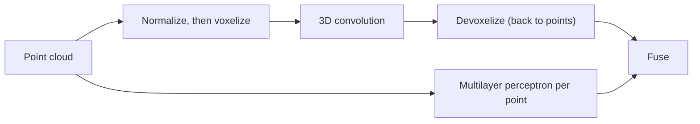

# 13. Efficient GANs, Video and Point-Cloud Models

**Level:** Practitioner · **Reading time:** 21 min · **Exercise:** 60 min
**Prerequisites:** [Neural Architecture Search](05-neural-architecture-search.md) for once-for-all training

> **In one sentence:** After this chapter you can find the wasted work in an image generator, a video model and a LiDAR model, and name the technique that removes it.

## Why this matters

Three models, each too slow for its device:

- A drawing tool turns brush strokes into a photo. Its generator needs about 70 times the arithmetic of ResNet-50, a standard image classifier, and must answer in real time.
- A camera in a car must detect objects in every frame. A network that reads one frame at a time is fast but unstable; one that reads several is accurate but slow.
- A headset segments a room from depth measurements. The model runs out of memory or loses the thin objects.

For each, what can be skipped, shared or moved?

## The core idea

Han picks three workloads that cost a lot and are full of **redundancy**: work spent on data that repeats or is not there. A GAN, in his words, has 2D spatial redundancy, similar values side by side ([0:00](https://www.youtube.com/watch?v=o_60Yhb79W8&t=0)); in a video the table, the paper and the background stay the same between frames ([32:00](https://www.youtube.com/watch?v=o_60Yhb79W8&t=1920)); and a point cloud is empty almost everywhere. The GAN methods below work on **channels**, the parallel **feature maps** a layer outputs: some add little. See the [overview chapter](10-efficient-vision-generative-models-and-distributed-training.md).

| Workload | Redundancy | Method | What it does |
|---|---|---|---|
| GAN | channels that add little | GAN Compression | searches for the channels to drop |
| GAN | models of many sizes | AnyCost GAN | trains them as one network, runs the part that fits the budget |
| Video | frames that repeat | temporal shift module | carries channels between frames; a 2D network does the rest |
| Point cloud | empty space | point-voxel CNN | handles each point exactly and its neighborhood through voxels |

The analogy is a sparse matrix that stores only its non-zero entries. It breaks for GANs and video: redundant channels and repeated frames are not marked as empty, so a search must find the one and a module must bridge the other.

Arithmetic is counted in **MACs** (multiply-accumulates): one multiplication and one addition, as in [Chapter 02](02-neural-network-basics-for-efficiency.md); a GMAC is a billion of them.

## How it works, step by step

### GANs: two networks, one to compress

A **generative model** produces images, video or 3D content instead of a label. A **GAN** (generative adversarial network) pits two networks against each other: the **generator**, which turns an input into an image, and the **discriminator**, which decides whether an image is real or generated. Each has its own loss ([2:00](https://www.youtube.com/watch?v=o_60Yhb79W8&t=120)). An unconditional GAN turns random noise into an image; a conditional one also gives both networks a condition, such as the brush strokes that NVIDIA's GauGAN turns into landscapes (same block).

Only the generator runs after training, so only it is worth making cheaper ([2:00](https://www.youtube.com/watch?v=o_60Yhb79W8&t=120)). It computes an output for every pixel, and such generative models cost far more than recognition models. His costs, by the slide; he says about 400 for GauGAN ([4:00](https://www.youtube.com/watch?v=o_60Yhb79W8&t=240)):

| Model | Parameters | GMACs |
|---|---|---|
| ResNet-50 | 25 million | 4.0 |
| CycleGAN | 11 million | 57 |
| GauGAN | 93 million | 281 |

### GAN Compression: search for fewer channels

1. Keep the trained generator as the **teacher** and define a smaller **student** with fewer channels per layer; each choice of counts is a candidate ([4:00](https://www.youtube.com/watch?v=o_60Yhb79W8&t=240)).
2. Train the candidates together, as [Chapter 05](05-neural-architecture-search.md) does with **once-for-all** networks: sample a channel count per layer at each step and train only that **sub-network**, a smaller network inside the larger one ([6:00](https://www.youtube.com/watch?v=o_60Yhb79W8&t=360)).
3. Use three losses: a **reconstruction loss**, computed pixel by pixel, so a horse still becomes a zebra; a **distillation loss** ([Chapter 06](06-knowledge-distillation.md)) that matches the student's intermediate feature maps to the teacher's, through a projection where the counts differ; plus the original conditional GAN loss ([4:00](https://www.youtube.com/watch?v=o_60Yhb79W8&t=240), [6:00](https://www.youtube.com/watch?v=o_60Yhb79W8&t=360)).
4. Under a target for **latency**, the time one request takes, keep the channel counts that fit (same block).

### AnyCost GAN: one generator for every budget

Editing starts by projecting a photo into a point of a **latent space**, a space of vectors that describe images, then moves that point: one direction adds a smile, another changes the hair. Each movement of a knob costs one run of the generator, which is slow ([8:00](https://www.youtube.com/watch?v=o_60Yhb79W8&t=480)). As ray tracing, which renders a scene by following light rays, previews with fewer rays, a GAN can preview with a small sub-network of a once-for-all generator and render the final image with the full network; the two should agree ([10:00](https://www.youtube.com/watch?v=o_60Yhb79W8&t=600)).

Two settings are made **elastic**: one trained network runs at several values of each.

- **Resolution.** StyleGAN2 shows its discriminator only the largest image; MSG-GAN, every size. AnyCost GAN shows one size picked at random at each step, so every size from 32 × 32 to 1,024 × 1,024 must look real alone ([10:00](https://www.youtube.com/watch?v=o_60Yhb79W8&t=600), [12:00](https://www.youtube.com/watch?v=o_60Yhb79W8&t=720)).
- **Channels.** The count is sampled too, with two faults ([14:00](https://www.youtube.com/watch?v=o_60Yhb79W8&t=840), [16:00](https://www.youtube.com/watch?v=o_60Yhb79W8&t=960)):
  1. Outputs of different sizes disagree; at half the channels the glasses vanish. A distillation loss keeps them alike.
  2. Some sub-networks score poorly on the **FID** (Fréchet Inception Distance), a score of how much the set of generated images differs from the set of real ones; lower is better. The cause is one discriminator, which gives a small generator poor feedback. The **generator-conditioned discriminator** fixes this: the generator's channel counts and resolution go through a fully connected layer that adjusts the discriminator.

### Little data: differentiable augmentation

A GAN also needs many images: the FFHQ data set has 70,000 faces, and such sets take months or even years to collect ([22:00](https://www.youtube.com/watch?v=o_60Yhb79W8&t=1320)).

**Data augmentation** transforms training images at random to create more variety. In a GAN it can be wired three ways ([26:00](https://www.youtube.com/watch?v=o_60Yhb79W8&t=1560), [28:00](https://www.youtube.com/watch?v=o_60Yhb79W8&t=1680)):

| Applied to | Result |
|---|---|
| Real images only | The generator copies the changes (a shifted real image comes out shifted, a darker one darker, and cutout, which blanks a patch, leaves blank patches), because the discriminator learned that real images look so. |
| Real and generated images, for the discriminator only | The discriminator judges transformed images and the generator is trained without them: training is out of step. |
| Real and generated images, for both networks | **Differentiable augmentation**: the transformations pass gradients, so the generator's loss reaches it through them. |

### Video: the temporal shift module

A video model must do **temporal modeling**, reasoning about how frames follow one another. A **convolutional neural network (CNN)** that sees single frames cannot tell whether a hand moves an object left or right ([32:00](https://www.youtube.com/watch?v=o_60Yhb79W8&t=1920)).

| Design | How it models time | Weakness |
|---|---|---|
| 2D CNN on sampled frames, scores averaged | barely | low accuracy |
| Two-stream network (2014) | a second network reads the **optical flow**, each pixel's direction of motion | slow to compute |
| 2D CNN, late fusion by an LSTM | a recurrent network joins the outputs late | low-level motion is lost |
| 3D CNN | convolution over time as well as space | four-dimensional weights; much more computation |

C3D (2014) is an early 3D CNN; I3D inflates a 2D kernel, pre-trained on the ImageNet image data set, into a 3D one by repeating it along time ([36:00](https://www.youtube.com/watch?v=o_60Yhb79W8&t=2160)). The 2D designs are cheap and reuse image classifiers, but optical flow is slow to compute ([34:00](https://www.youtube.com/watch?v=o_60Yhb79W8&t=2040)); the 3D design sees motion at every level ([38:00](https://www.youtube.com/watch?v=o_60Yhb79W8&t=2280)).

Han asks for 3D accuracy at 2D cost ([38:00](https://www.youtube.com/watch?v=o_60Yhb79W8&t=2280)). His **temporal shift module** (TSM) answers with an operation that costs no arithmetic and has no parameters:

1. One group of channels moves into the previous frame, one into the next, and one stays. A frame now holds some channels of its neighbors and some of its own ([40:00](https://www.youtube.com/watch?v=o_60Yhb79W8&t=2400)).
2. The next 1 × 1 convolution mixes them, so one output channel can combine past, present and future (same block).

The share shifted is a **hyperparameter**, fixed before training: too little brings no context, too much leaves the frame nothing of its own (same block).

- **Offline**, with the whole clip available: channels shift both ways, and an identity connection carries the unshifted input past the shift, so a frame keeps the channels it gave away ([42:00](https://www.youtube.com/watch?v=o_60Yhb79W8&t=2520)).
- **Online**, in a car: channels shift only from the past, and those a frame shifts out are cached for the next one. Layer by layer, each frame carries its whole history at a weight that shrinks with age ([40:00](https://www.youtube.com/watch?v=o_60Yhb79W8&t=2400), [44:00](https://www.youtube.com/watch?v=o_60Yhb79W8&t=2640)).

### Point clouds: a voxel branch and a point branch

**LiDAR** measures distance with laser pulses; phones, headsets, drones and cars carry one ([52:00](https://www.youtube.com/watch?v=o_60Yhb79W8&t=3120)). Its reading is a **point cloud**: an unordered set of points, each with a position `x, y, z` and an intensity, the strength of the returned light ([54:00](https://www.youtube.com/watch?v=o_60Yhb79W8&t=3240)). Where nothing is, there is no point: density can be below 0.1%, and the points sit irregularly in memory, which GPUs handle badly. Each older approach hits a wall ([56:00](https://www.youtube.com/watch?v=o_60Yhb79W8&t=3360), [58:00](https://www.youtube.com/watch?v=o_60Yhb79W8&t=3480)):

- **Voxel** models cut space into cubes (a voxel is a 3D pixel). The grid's memory grows as the cube of the resolution: an 8 GB GPU still loses more than 40% of the information where points share a voxel.
- Point models lose much time to irregular memory access. An access to off-chip memory (DRAM) uses far more energy than an arithmetic operation.

The **point-voxel CNN** (PVCNN) combines them in one block ([58:00](https://www.youtube.com/watch?v=o_60Yhb79W8&t=3480)).

**Figure 1.** One block of a point-voxel CNN.



Each point leaves the block with its own features fused with those of the voxels around it.

- The **voxel branch** places the points in a regular voxel grid, applies a 3D convolution and hands each point the feature of its voxel: regular access, neighborhood summarized ([60:00](https://www.youtube.com/watch?v=o_60Yhb79W8&t=3600)).
- The **point branch** applies a multilayer perceptron (**MLP**, a small stack of fully connected layers) to each point on its own, as the earlier network PointNet does, so no detail is merged. The point branch picks out chair legs, the voxel branch the tabletop ([60:00](https://www.youtube.com/watch?v=o_60Yhb79W8&t=3600), [62:00](https://www.youtube.com/watch?v=o_60Yhb79W8&t=3720)).

Voxelization still merges points (same block). The **sparse point-voxel CNN** (SPVCNN) uses **sparse convolution**, computed only on voxels that hold a point, so the voxel branch can run at a finer resolution while the point branch keeps traffic signs and tree trunks ([64:00](https://www.youtube.com/watch?v=o_60Yhb79W8&t=3840)).

A search then picks the model under a latency target: a once-for-all network with elastic channels and depth, a latency predictor that turns down candidates over the target, and **evolutionary search**, which improves a pool of candidates by random changes and pairings (same block; see [Chapter 05](05-neural-architecture-search.md)).

### Sensor fusion: bird's-eye view

A self-driving car carries cameras on all sides, six in his example, and a LiDAR on the roof ([52:00](https://www.youtube.com/watch?v=o_60Yhb79W8&t=3120)). Their readings must meet in one space that every sensor enters without much loss and that serves several tasks ([66:00](https://www.youtube.com/watch?v=o_60Yhb79W8&t=3960)). The **bird's-eye view** (BEV), the scene from above, is that space (same block):

1. A camera encoder turns each image into features.
2. A **view transform** lifts the camera features into BEV. He calls it the critical operator, which his group accelerated.
3. LiDAR features are flattened along the height axis: no car lies on top of another.
4. The two are concatenated and encoded; task-specific heads (small output networks) draw the map segmentation and the 3D boxes ([68:00](https://www.youtube.com/watch?v=o_60Yhb79W8&t=4080)).

## Worked example

The shift in plain Python, on three frames of four channels; a value `10 * t + c` comes from frame `t`, channel `c`.

```python
def temporal_shift(x, fold=1):
    """x[t][c] is channel c of frame t. The first `fold` channels come from
    the next frame, the next `fold` from the previous frame; the rest stay."""
    T, C = len(x), len(x[0])
    out = [[0] * C for _ in range(T)]
    for t in range(T):
        for c in range(C):
            if c < fold:
                out[t][c] = x[t + 1][c] if t + 1 < T else 0
            elif c < 2 * fold:
                out[t][c] = x[t - 1][c] if t > 0 else 0
            else:
                out[t][c] = x[t][c]
    return out

def online_shift(frame, cache, fold=1):
    """One frame at a time: `fold` channels arrive from the previous frame;
    this frame's copy of them leaves in the cache for the next frame."""
    out = [cache[c] if c < fold else frame[c] for c in range(len(frame))]
    cache[:fold] = frame[:fold]
    return out

x = [[10 * t + c for c in range(4)] for t in range(3)]  # 3 frames, 4 channels
for row in temporal_shift(x):
    print(row)

cache, streamed = [0] * 4, []
for frame in x:
    streamed.append(online_shift(frame, cache))
print(streamed[2])
```

It prints:

```
[10, 0, 2, 3]
[20, 1, 12, 13]
[0, 11, 22, 23]
[10, 21, 22, 23]
```

Observe:

1. Neither function computes anything: values are only copied.
2. The middle frame, `[20, 1, 12, 13]`, holds one value from the next frame (20), one from the previous (1) and two of its own; a 1 × 1 convolution after the shift would blend them.
3. The zeros are channels no frame supplied, at the first and last frames; the identity connection repairs that loss.
4. Online, the last frame is `[10, 21, 22, 23]`: its channel 0 is frame 1's, read from no future frame.

## What the practitioners say

**Compress the generator, then measure.** By the slide of his first lecture, GAN Compression takes a horse-to-zebra CycleGAN from 56.8 to 3.50 GMACs (16.2 times) and from 12.1 to 40.0 frames per second on an NVIDIA Jetson Xavier GPU (3.3 times). On this lecture's slides they shrink 11.8 times for edges-to-shoes, 21.2 for horse-to-zebra and 8.8 for GauGAN, at a quality he calls comparable ([6:00](https://www.youtube.com/watch?v=o_60Yhb79W8&t=360), [8:00](https://www.youtube.com/watch?v=o_60Yhb79W8&t=480)).

**The judge must fit the contestant.** With one shared discriminator, the FID of some sub-networks spikes to about 40, for a 256-pixel one at a quarter of its channels ([16:00](https://www.youtube.com/watch?v=o_60Yhb79W8&t=960)); with the generator's configuration fed in, the spikes disappear and the training beats StyleGAN2 and MSG-GAN on FID at low and high resolutions ([18:00](https://www.youtube.com/watch?v=o_60Yhb79W8&t=1080), [12:00](https://www.youtube.com/watch?v=o_60Yhb79W8&t=720)). The generator then runs at 59%, 39% or 19% of its computation with hardly visible loss ([20:00](https://www.youtube.com/watch?v=o_60Yhb79W8&t=1200)). On a MacBook, by his demo, the full model needs 3.24 seconds for each update and the sub-network answers almost at once; one click runs the full network for the final image, and the software is open source ([20:00](https://www.youtube.com/watch?v=o_60Yhb79W8&t=1200), [22:00](https://www.youtube.com/watch?v=o_60Yhb79W8&t=1320)).

**The discriminator overfits first.** StyleGAN2 trained on 100 faces, 160 cats and 389 dog pictures (his slide's count; he says 300) gives poor images ([22:00](https://www.youtube.com/watch?v=o_60Yhb79W8&t=1320)); on his slide its FID climbs from 11.1 to 23.1 and 36.0 with 20% and 10% of the data. At 20% the discriminator's training accuracy rises while its **validation accuracy**, on images held out of training, collapses: it has **overfit**, learned the training images instead of the general pattern, and gives the generator bad feedback ([24:00](https://www.youtube.com/watch?v=o_60Yhb79W8&t=1440)). With differentiable augmentation the FID moves only from 9 to 14 as the data shrinks ([30:00](https://www.youtube.com/watch?v=o_60Yhb79W8&t=1800)).

**Move data, do not compute.** On the Something-Something video benchmark, TSM needs 3 times less computation than the ECO family and 6 times less than the Non-local I3D family, at higher accuracy ([44:00](https://www.youtube.com/watch?v=o_60Yhb79W8&t=2640)). On an NVIDIA Tesla P100 GPU, in 2019 ([46:00](https://www.youtube.com/watch?v=o_60Yhb79W8&t=2760)):

| Measurement | I3D | TSM |
|---|---|---|
| Latency per video, one at a time | 164.3 ms | 17.4 ms |
| **Throughput** (videos per second), 16 at a time | 6.1 | 77.4 |
| Accuracy | 41.6% | 43.4% |

With only 10% or 40% of a clip observed, TSM keeps its accuracy where baselines drop ([46:00](https://www.youtube.com/watch?v=o_60Yhb79W8&t=2760)). In a driving clip a frame-by-frame detector turns a car into a tree; TSM does not ([48:00](https://www.youtube.com/watch?v=o_60Yhb79W8&t=2880)). He reports over 20 frames a second on a CPU and over 70 on a Jetson Nano GPU (same block). Inside a trained network, he shows, single channels respond to one motion, such as moving something away ([50:00](https://www.youtube.com/watch?v=o_60Yhb79W8&t=3000)).

**Light models scale.** On the Summit supercomputer, Han's group trained TSM on 256 nodes in 14 minutes, against 49 hours 50 minutes on one node, at the same accuracy (74.0% against 74.1%): 211 times faster by his slide, against a theoretical 256 ([50:00](https://www.youtube.com/watch?v=o_60Yhb79W8&t=3000)). Accuracy holds to a batch of 12,000 videos, which he says needs its own schedule for the **learning rate**, the step size of each update. He credits the model's size for the scaling: a batch is bound by computation, not by reading data, and the small weights leave little to communicate, so throughput and hardware utilization are about twice a baseline's (1.6 and 2.9 times two I3D models' throughput, by his slide) ([48:00](https://www.youtube.com/watch?v=o_60Yhb79W8&t=2880)).

**Memory costs more than arithmetic.** PVCNN is more than 7 times faster, he reports, at a higher **mIoU** (mean intersection over union, a segmentation score) and lower memory ([62:00](https://www.youtube.com/watch?v=o_60Yhb79W8&t=3720)). The 3D search costs 17 times less than before, 496 instead of 8,500 GPU-hours by his slide, and lowers the GPU latency and the MACs ([64:00](https://www.youtube.com/watch?v=o_60Yhb79W8&t=3840)).

**One space for every sensor.** BEVFusion decodes the map segmentation and the 3D boxes from one fused map ([68:00](https://www.youtube.com/watch?v=o_60Yhb79W8&t=4080)), and his slide ranks it first on the Waymo leaderboard as of November 9, 2022.

## Pitfalls

1. **Compressing the discriminator.** It never runs after training. Fix: make the generator cheaper.
2. **Sharing one discriminator across all sub-generators.** The FID of the small ones spikes. Fix: feed it the generator's channel counts and resolution.
3. **Augmenting real images only.** The changes leak into the generated images. Fix: transform real and generated images alike, for both networks.
4. **Trusting the discriminator's training accuracy.** On a small dataset it rises while validation accuracy collapses. Fix: watch validation accuracy and the FID.
5. **Shifting too many channels, or from the future.** A frame is left with nothing of its own, and a live system has no future frames. Fix: tune the share, add the identity connection, and online shift from the past only, with a cache.
6. **Judging a point-cloud model by its MACs.** Its time and energy go into memory access. Fix: make access regular, compute voxels sparsely, and measure on the device.

## Try it

Turn the worked example into a tested module.

1. Let `fold` take any value from 1 up to half the channel count, and add a batch version of the online shift that reads only the past.
2. Write three tests with the standard library's `unittest`:
   - The shift only moves values: every output value also appears in the input.
   - The middle frame of the offline shift reads `[20, 1, 12, 13]`.
   - Frames fed one by one to `online_shift` match its batch version.
3. For 8 channels, tabulate `fold` = 1, 2 and 4: how many channels of a frame come from the future, the past and itself.

**You are done when** the tests pass and the table shows `fold` = 4 leaving a frame with no channel of its own.

**Stretch:** count the weights of a 3 × 3 × 3 convolution against a 3 × 3 plus a 1 × 1 convolution, and say what the shift saves.

## Key takeaways

- After training, a GAN runs only its generator. GAN Compression searches for its channel counts under a latency target.
- AnyCost GAN trains one generator for previews and final images alike; a distillation loss keeps its outputs consistent across sizes, and a discriminator that knows the generator's size judges each one well.
- On little data the discriminator overfits first. Differentiable augmentation, on real and generated images for both networks, keeps its feedback useful.
- The temporal shift module reaches 3D accuracy at 2D cost by moving channels between frames; an online model shifts from the past only.
- Point clouds are sparse and irregular: a voxel branch and a point branch cover each other's weaknesses, and sensors fuse in bird's-eye view.

## Self-check

1. Which of a GAN's two networks runs at inference, and what follows for compression?
2. Why does AnyCost GAN feed the generator's configuration to the discriminator?
3. A GAN trained on 200 images generates pictures with blank square patches. How was its augmentation wired, and how should it be?
4. What does the temporal shift module do to a frame's channels, and which operation mixes them?
5. What does the point branch of a point-voxel CNN keep that the voxel branch loses?

<details><summary>Show answers</summary>

1. The generator. It is the only network worth making cheaper.
2. One discriminator gives small sub-generators poor feedback; with the generator's channel counts and resolution it judges each size fairly.
3. Real images only. Real and generated images must be transformed alike, for both networks, with gradients passing through.
4. It moves one group into the previous frame and another into the next; the rest stay. The following 1 × 1 convolution mixes them.
5. Fine detail: every point keeps its own features.

</details>

## Sources

- **Lecture:** Song Han, "Lecture 17: Efficient GAN, Video, and Point Cloud", MIT 6.5940 TinyML and Efficient Deep Learning Computing (Fall 2024): [video](https://www.youtube.com/watch?v=o_60Yhb79W8) · [guide](../lectures/mit-17-gan-video-and-point-cloud.md), used at [redundancy](https://www.youtube.com/watch?v=o_60Yhb79W8&t=0), [conditioned discriminator](https://www.youtube.com/watch?v=o_60Yhb79W8&t=960), [BEVFusion](https://www.youtube.com/watch?v=o_60Yhb79W8&t=4080)
- **Reading:** Ji Lin et al., "TSM: Temporal Shift Module for Efficient Video Understanding" (CVPR 2019): [arXiv](https://arxiv.org/abs/1811.08383)

## Next

→ [Efficient Diffusion Models](14-efficient-diffusion-models.md): the generator Han turns to next, with one network to train instead of two, run many times per image.
