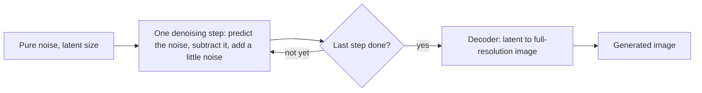

# 14. Efficient Diffusion Models

**Level:** Practitioner · **Reading time:** 21 min · **Exercise:** 40 min
**Prerequisites:** [Neural Network Basics for Efficiency](02-neural-network-basics-for-efficiency.md) for attention and operation counts

> **In one sentence:** After this chapter you can say where a diffusion model spends its time and choose among six levers to cut it: fewer steps, a smaller latent space, linear attention, sparse recomputation, 4-bit arithmetic and several GPUs.

## Why this matters

You add a generate button to a photo editor. A user retouches two small signs in a photo, under 2% of its pixels, and the model behind the button runs its whole network forty times over the whole picture. Song Han's slide for that edit lists 1,855 billion multiply-accumulate operations (MACs) per step, times 40 steps ([56:00](https://www.youtube.com/watch?v=LXrqmQrscf0&t=3360)). Where does the time go, and which part of that work can be skipped?

## The core idea

A **generative model** produces images, video or 3D content instead of a label: it learns the distribution of the data, where a **discriminative model** learns a decision boundary, the border between one label's region and another's ([0:00](https://www.youtube.com/watch?v=LXrqmQrscf0&t=0)). A **diffusion model** learns to remove noise step by step. Starting from pure noise, it produces an image after many steps. Total cost = steps × cost per step.

It has two halves. In the **forward process**, a **Gaussian noise** term (a random value per pixel, from a bell-shaped normal distribution) is added at every step; a **noise schedule**, a list of numbers β_t fixed in advance, sets how much ([2:00](https://www.youtube.com/watch?v=LXrqmQrscf0&t=120), [4:00](https://www.youtube.com/watch?v=LXrqmQrscf0&t=240)). After the last step the image is pure noise.

This half has no network and never has to run step by step: each step only scales the image and adds noise, and two scaled Gaussian noises add up to one Gaussian. The noisy image at step `t` thus comes straight from the clean one, `x0`:

`xt = sqrt(abar[t]) * x0 + sqrt(1 - abar[t]) * e`

Here `e` is the noise and `abar[t]`, the product of the factors 1 − β up to step `t`, falls from 1 to 0. Han calls the shortcut the **diffusion kernel** ([4:00](https://www.youtube.com/watch?v=LXrqmQrscf0&t=240), [6:00](https://www.youtube.com/watch?v=LXrqmQrscf0&t=360)).

The **reverse process** runs the other way, from noise to an image. It needs a network, the **denoiser**, which reads a noisy image and its step number and predicts the noise inside it.

Think of the sampler as a loop over data with one network pass in the body: cost is iterations times the cost of the body. The analogy breaks at parallelism: such a loop can be vectorized, this one cannot, since every pass needs the previous pass's output.

Every technique in the lecture acts on one of six things. The table measures a pass in **tokens**, the small blocks (patches of the image or of its compressed form) that the network processes.

| Lever | What it shrinks | Han's techniques |
|---|---|---|
| Fewer steps | passes per image | DDIM, progressive distillation |
| Fewer tokens per pass | size of each pass | latent diffusion, DC-AE |
| Cheaper attention | attention cost | linear attention |
| Fewer blocks per pass | work per pass | spatially sparse inference |
| Cheaper arithmetic | cost per operation | SVDQuant |
| More processors | wall-clock time | DistriFusion |

## How it works, step by step

### Train the denoiser

Training uses the shortcut and costs one network pass per example ([6:00](https://www.youtube.com/watch?v=LXrqmQrscf0&t=360), [8:00](https://www.youtube.com/watch?v=LXrqmQrscf0&t=480)):

1. Take a clean image `x0` from the training set.
2. Pick a step number `t` at random, from 1 to `T`.
3. Draw Gaussian noise `e` with the image's shape.
4. Build the noisy image `xt` with the diffusion kernel, in one line.
5. Let the denoiser predict the noise: `e_hat = model(xt, t)`.
6. Measure the squared difference between `e_hat` and `e`, and update the weights to shrink it.

### Sample an image

Sampling is the loop ([10:00](https://www.youtube.com/watch?v=LXrqmQrscf0&t=600)):

1. Draw `xT` from pure noise.
2. For `t` from `T` down to 1: run the denoiser, subtract a scaled copy of its prediction from `xt`, then add a little fresh noise, scaled by this step's standard deviation. The result is a slightly cleaner image.
3. Return `x0`.

It is slow for two reasons ([10:00](https://www.youtube.com/watch?v=LXrqmQrscf0&t=600), [12:00](https://www.youtube.com/watch?v=LXrqmQrscf0&t=720)): the same network runs once per step, where earlier models ran once per output, and each pass predicts a value for each pixel, not a class or a box. The reward, on his slide: generated images that outperform GANs (generative adversarial networks) on ImageNet, a standard image data set.

### Conditions: class, text, pixels

A **condition** tells the model what to draw; Han gives three kinds ([12:00](https://www.youtube.com/watch?v=LXrqmQrscf0&t=720), [14:00](https://www.youtube.com/watch?v=LXrqmQrscf0&t=840), [16:00](https://www.youtube.com/watch?v=LXrqmQrscf0&t=960), [18:00](https://www.youtube.com/watch?v=LXrqmQrscf0&t=1080)):

| Condition | How it enters the network |
|---|---|
| A class, such as "cat" | A **multilayer perceptron** (a stack of fully connected layers) turns the class id into a per-channel vector, added at every position of the network's feature map (its grid of intermediate numbers) or used as a scale and a bias. |
| A text prompt | **Cross-attention**: the image's tokens are the queries and the text's tokens the keys and values, so the output is still an image, now carrying the text. **Joint attention**: separate query, key and value matrices for image and for text, one attention over their concatenation, separate output matrices. **Early fusion**: the tokens are concatenated first and one set of matrices serves both. |
| A pixel map: a segmentation map (one class per region), Canny edges (an edge detector's outlines) or a pose | ControlNet, below. |

**ControlNet** adds a pixel map to a trained model ([20:00](https://www.youtube.com/watch?v=LXrqmQrscf0&t=1200), [22:00](https://www.youtube.com/watch?v=LXrqmQrscf0&t=1320)). The denoising network stays frozen. A trainable copy of the encoder half, the stages that shrink the image, takes the pixel map at each stage and feeds the frozen decoder through 1 × 1 convolutions that start at zero, so the new branch changes nothing when training begins and training stays smooth, Han says.

### Guidance: two passes per step

**FID**, short for Fréchet inception distance, is a score that compares generated images with real ones; lower is better.

**Classifier guidance** pushes each sample toward a class with the gradient of a separately trained classifier, multiplied by a strength ω: Han's low value gives varied images that are sometimes not the class; his high value gives faithful ones with little variety. It covers classes only and costs a second network ([22:00](https://www.youtube.com/watch?v=LXrqmQrscf0&t=1320), [24:00](https://www.youtube.com/watch?v=LXrqmQrscf0&t=1440)).

**Classifier-free guidance** needs none: the diffusion model is evaluated twice at every step, once conditioned and once not, and the two estimates are blended, the conditioned one times ω + 1 minus the other times ω. Any condition works, class, text or pixels, with variety again traded for quality, at double the FLOPs ([26:00](https://www.youtube.com/watch?v=LXrqmQrscf0&t=1560), [28:00](https://www.youtube.com/watch?v=LXrqmQrscf0&t=1680)).

`eps = (omega + 1) * model(xt, t, cond) - omega * model(xt, t)`

Han's remark on conditioning techniques applies to the whole family: each technique added for quality adds computation ([30:00](https://www.youtube.com/watch?v=LXrqmQrscf0&t=1800)).

### Latent diffusion: a smaller space to denoise

**Latent diffusion** moves the denoising out of the pixels ([30:00](https://www.youtube.com/watch?v=LXrqmQrscf0&t=1800), [32:00](https://www.youtube.com/watch?v=LXrqmQrscf0&t=1920)). An **autoencoder**, trained beforehand, squeezes the image with its encoder into a **latent**, a much smaller tensor (a multidimensional array) that its decoder expands back into an image. Training and sampling keep their steps. The encoder runs before the noise is added, the decoder after the last denoising step.

**Figure 1.** The denoising loop runs between an autoencoder's two halves.



The loop never sees a pixel of the full image.

Compressing each side 8 times, as the autoencoder of Stable Diffusion does (SD-VAE on the slides), turns a 512 × 512 image into 64 × 64 = 4,096 tokens. Han's **deep compression autoencoder** (DC-AE) compresses each side 64 times and leaves 8 × 8 = 64 tokens: 64 times fewer. Attention cost grows with the square of the token count, so its work falls by a factor of 4,096 ([34:00](https://www.youtube.com/watch?v=LXrqmQrscf0&t=2040)). SD-VAE collapses there: on his chart its reconstruction FID climbs from 0.90 at 8 times per side to 28.3 at 64 and 64.4 at 128, where DC-AE holds steady ([36:00](https://www.youtube.com/watch?v=LXrqmQrscf0&t=2160)). Two ingredients get it there:

1. **Residual autoencoding.** In each downsampling block, a branch without weights moves every 2 × 2 block of pixels into four channels (2 × 2 × 1 becomes 1 × 1 × 4); the inverse in each upsampling block moves them back, so the network does not have to learn this rearrangement.
2. **Decoupled high-resolution adaptation.** Train the whole encoder and decoder on low-resolution images; on high-resolution images tune only the middle layers; and finally refine only the decoder's last layer, at low resolution again on his slide ([38:00](https://www.youtube.com/watch?v=LXrqmQrscf0&t=2280)).

On it Han's group built Sana, whose denoiser is a **diffusion transformer**, a transformer in the denoiser's role. Its **linear attention** costs less as tokens grow: linearly, not quadratically. Chapter 12 explains it in section [4. Linear attention](12-vision-transformers.md#4-linear-attention) ([40:00](https://www.youtube.com/watch?v=LXrqmQrscf0&t=2400)). With this autoencoder he measures 19 times faster generation, not 64: a count is not a timing. 4K images become possible ([38:00](https://www.youtube.com/watch?v=LXrqmQrscf0&t=2280), [40:00](https://www.youtube.com/watch?v=LXrqmQrscf0&t=2400)).

### Fewer steps: DDIM and distillation

**DDPM**, the denoising diffusion probabilistic model, is the original sampler: each step depends on the step before it alone. **DDIM**, the denoising diffusion implicit model, changes only how samples are drawn, not the trained model: each step uses the noisy image together with the model's estimate of the finished image, which lets the sampler skip forward in jumps of 10 steps in Han's example. Squeezed from 1,000 steps to 20 or 10, the original sampler's FID explodes; DDIM's hardly moves ([54:00](https://www.youtube.com/watch?v=LXrqmQrscf0&t=3240)).

DDIM defines a different forward process with the same diffusion kernel and the same training loss, so the trained network serves unchanged; it adds no fresh noise, which makes the sampler deterministic.

**Progressive distillation** trains a copy, the **student**, to replace two neighboring steps of the original, the **teacher**, with one, halving the step count each round, four steps down to one ([56:00](https://www.youtube.com/watch?v=LXrqmQrscf0&t=3360)). The two share one architecture; [Knowledge Distillation](06-knowledge-distillation.md) covers the general method.

### Fewer blocks: spatially sparse inference

**Spatially sparse inference**, which Han's slides call SIGE, short for sparse incremental generative engine, reruns the network only on the edited blocks and reuses the previous pass's feature maps elsewhere ([58:00](https://www.youtube.com/watch?v=LXrqmQrscf0&t=3480)):

1. Compare the original and the edited image. The difference is a mask; snap it to a grid of blocks.
2. Gather the changed blocks, the active ones, and stack them along the batch dimension to run in parallel.
3. Run each layer on those blocks only, and scatter the results back into the cached feature map. Repeat for every denoising step.

Each block goes through an ordinary 2D convolution, so there is no need for a sparse-convolution library, and diffusion transformers work too; scattered zeros alone do not save time, as [Chapter 03](03-pruning-and-sparsity.md) says of pruned weights.

### Cheaper arithmetic: SVDQuant

Quantization, storing numbers with fewer bits, needs another recipe here. Weight-only quantization speeds up a language model run at batch size one (one input at a time), which is bound by memory bandwidth, the speed of reading the weights from memory, but a diffusion model is bound by compute, so Han says weights and activations must both go to 4 bits, **W4A4**, for a measured speed-up ([60:00](https://www.youtube.com/watch?v=LXrqmQrscf0&t=3600)).

That recipe is **SVDQuant** ([62:00](https://www.youtube.com/watch?v=LXrqmQrscf0&t=3720)). Outliers, a few values far larger than the rest, sit in the weights and in the activations, the results one layer passes to the next. A smoothing step borrowed from SmoothQuant ([Chapter 04](04-quantization.md)) shifts them from the activations onto the weights, and a **low-rank side branch**, a product of two narrow full-precision matrices (32 ranks, the width of those matrices, from a singular value decomposition, SVD, of the weight), takes the remaining weight outliers onto itself. What is left quantizes cleanly to 4 bits on both sides.

The branch fits **LoRA**, low-rank adaptation, a fine-tuning that adds low-rank weights to a frozen model: adding one only means adding ranks, 16 or 32 more in full precision, with no re-quantization ([64:00](https://www.youtube.com/watch?v=LXrqmQrscf0&t=3840)). A naive implementation loses time on the branch's two small matrix multiplications; **kernel fusion** merges its down projection into the GPU kernel before it and its up projection into the one after, removing about 40% of the latency overhead (same block).

### Several GPUs: DistriFusion

**Tensor parallelism**, the splitting of one layer's work over several processors (see [parallelism](../10-llm-internals/06-parallelism.md)), would give each GPU one patch of the image. Attention then needs every patch to see every other, so the GPUs must exchange large activations, and Han says the communication would cancel the gain ([68:00](https://www.youtube.com/watch?v=LXrqmQrscf0&t=4080)). DistriFusion, which spreads one image over several GPUs, rests on an observation: the inputs of adjacent denoising steps are nearly the same, so each GPU uses the others' activations from the previous step instead of waiting for the current ones. The exchange becomes asynchronous and overlaps with computation.

## Worked example

The script counts the work of one image, mostly with the lecture's numbers.

```python
def tokens(side, compression):
    """Blocks the denoiser sees after compressing each side `compression` times."""
    return (side // compression) ** 2

def work(steps, n_tokens, passes=1):
    """Per image: network passes, tokens processed, attention entries."""
    return steps * passes, steps * passes * n_tokens, steps * passes * n_tokens ** 2

sd_vae, dc_ae = tokens(512, 8), tokens(512, 64)
print("tokens:", sd_vae, "->", dc_ae, "=", sd_vae // dc_ae, "times fewer")
print("attention entries per pass:", sd_vae ** 2 // dc_ae ** 2, "times fewer")
before, after = work(50, tokens(1024, 8)), work(20, tokens(1024, 64))
print("fewer steps and fewer tokens:", before[1], "->", after[1], "tokens processed,",
      before[1] // after[1], "times fewer")
print("DDIM, stride 10:", work(1000, sd_vae)[0], "->", work(100, sd_vae)[0], "passes")
print("guidance:", work(40, sd_vae)[0], "->", work(40, sd_vae, 2)[0], "passes")
```

It prints:

```
tokens: 4096 -> 64 = 64 times fewer
attention entries per pass: 4096 times fewer
fewer steps and fewer tokens: 819200 -> 5120 tokens processed, 160 times fewer
DDIM, stride 10: 1000 -> 100 passes
guidance: 40 -> 80 passes
```

The first two lines reproduce Han's figures for the 64-times autoencoder ([34:00](https://www.youtube.com/watch?v=LXrqmQrscf0&t=2040)). The third line is an example of two levers together, not one of his figures: 50 steps on a 1,024-pixel image fall to 20 while the compression rises from 8 to 64, so 2.5 times fewer steps and 64 times fewer tokens give 160 times fewer tokens processed. The last two count network passes: a stride of 10 divides them by 10, guidance doubles them.

## What the practitioners say

- **Sana's text encoder and data.** Earlier models encoded the prompt with an encoder-decoder model such as T5; Sana uses a decoder-only language model (one that continues a text, as GPT does), his example being Gemma, prompted with a fixed instruction and a few examples, so `a man is walking` comes back as a detailed visual description. A vision-language model (one that reads images and writes text), VILA, recaptions the training images in paragraphs no human labeler would write, weighted by [CLIP](../10-llm-internals/12-alignment-and-multimodality.md) score, how well caption and image match, to limit hallucination, details the caption invents ([42:00](https://www.youtube.com/watch?v=LXrqmQrscf0&t=2520), [46:00](https://www.youtube.com/watch?v=LXrqmQrscf0&t=2760)). In his words, "Sana and VILA can grow together" ([46:00](https://www.youtube.com/watch?v=LXrqmQrscf0&t=2760)): better captions train a better Sana.
- **Sana's numbers (Fall 2024).** Its 1.6-billion-parameter model draws text, logos and faces in detail. Han puts it at 25 times the speed of FLUX at 1K resolution, about 100 times at 4K (106 on his slide title, an A100), by his account at almost the same quality. He credits the autoencoder, the linear diffusion transformer, kernel fusion and a flow-based solver ([46:00](https://www.youtube.com/watch?v=LXrqmQrscf0&t=2760), [48:00](https://www.youtube.com/watch?v=LXrqmQrscf0&t=2880)).
- **Editing and personalization start from a trained model.** To turn a rough stroke into an image, add noise until the stroke lands where images live, then denoise; Han's stroke becomes a castle ([48:00](https://www.youtube.com/watch?v=LXrqmQrscf0&t=2880), [50:00](https://www.youtube.com/watch?v=LXrqmQrscf0&t=3000)). To draw one particular dog, **DreamBooth** fine-tunes the model on three to five pictures of it, paired with a unique identifier; a prompt can then put that dog on a beach. The price is one fine-tuned model per subject; later training-free methods exist, he notes ([52:00](https://www.youtube.com/watch?v=LXrqmQrscf0&t=3120)).
- **SIGE's measurements.** With 1.7% of the pixels edited, SIGE needs 225 G MACs per step where Stable Diffusion needs 1,855 G, 8.2 times less. An edit to 2.9% of the pixels (about 3% in his speech) runs 4.8 times faster at the same quality, and he shows an interactive edit on a laptop ([56:00](https://www.youtube.com/watch?v=LXrqmQrscf0&t=3360), [60:00](https://www.youtube.com/watch?v=LXrqmQrscf0&t=3600)).
- **SVDQuant's measurements.** **W4A16** (4-bit weights, 16-bit activations) saves memory but no time, since its arithmetic stays 16-bit; the gain needs INT4 or FP4 arithmetic, 4-bit integer or floating-point. Han measures about 3 times the speed on a desktop RTX 4090. On a laptop 4090 a step takes 0.5 seconds where the weight-only method **NF4** needs 1.8, and the unquantized BF16 model does not fit. Memory drops from 23.2 to 6.5 gigabytes (23 in his speech), 3.6 times; the output stays close to BF16 where NF4 and plain INT4 lose quality, and LoRA styles keep their look ([64:00](https://www.youtube.com/watch?v=LXrqmQrscf0&t=3840), [66:00](https://www.youtube.com/watch?v=LXrqmQrscf0&t=3960)).
- **DistriFusion's measurements.** His example takes 12.3 seconds on one GPU. Four GPUs without communication take 3.14 seconds but duplicate subjects; DistriFusion takes 4.16 seconds, 3.0 times faster, without that artifact. Eight GPUs at 3840 × 3840 reach 6.1 times ([70:00](https://www.youtube.com/watch?v=LXrqmQrscf0&t=4200)).

## Pitfalls

1. **Comparing diffusion models by cost per step.** Fix: multiply by the steps, the tokens per pass and the passes per step; guidance doubles the last one.
2. **Compressing the latent with any autoencoder.** Fix: check its reconstruction FID at the ratio; SD-VAE gives very poor quality at 64 times per side.
3. **Cutting steps without changing the sampler.** Fix: sample with DDIM or distill; at 20 steps the original sampler's FID explodes.
4. **Expecting weight-only quantization to speed up a diffusion model.** Fix: it is compute-bound; quantize weights and activations together (W4A4), outliers moved first.
5. **Splitting an image over GPUs without communication.** Fix: exchange the previous step's activations, as DistriFusion does; otherwise each GPU draws its own picture.

## Try it

Cost a configuration of your own with the script above.

1. Choose a compression ratio (8 or 64), a step count and whether guidance is on.
2. Add a line that prints its three numbers beside the five printed ones.
3. Print the same three numbers for a baseline, 8 times compression, 40 steps and no guidance, and write the ratio of your line to it for passes, tokens processed and attention entries.

**You are done when** the script reproduces two of Han's figures, 64 times fewer tokens and 4,096 times fewer attention entries, and your line has its formula.

**Stretch:** Check the diffusion kernel with `random.gauss`: noise one value a hundred steps one at a time and in a single jump, 100,000 times each. Both samples should have almost the same mean and standard deviation.

## Key takeaways

- A diffusion model costs steps × cost per step: training is one network pass per example, sampling a loop with a pass in it.
- The largest lever is the latent space: a 64-times autoencoder leaves 64 tokens where 8 times leaves 4,096, and 4,096 times less attention work.
- DDIM changes the sampler and keeps the model; progressive distillation halves the steps each round.
- Classifier-free guidance doubles the passes per step; spatially sparse inference cuts the work of a small edit.
- A diffusion model is compute-bound: time comes back only when weights and activations are quantized together (W4A4).

## Self-check

1. Training picks a random step `t`. Why is the noisy image built in one line, without looping over the earlier steps?
2. A service turns on classifier-free guidance with ω = 2. What runs in each step, and with which two multipliers?
3. A 512 × 512 image is compressed 64 times per side instead of 8. How many tokens remain, and how much less attention work is there?
4. Why does weight-only 4-bit quantization speed up a language model decoding one token at a time, but not a diffusion model?
5. DDIM cuts an image from 1,000 steps to 20. What did it change, and what did it leave untouched?

<details><summary>Show answers</summary>

1. Each step only scales the image and adds Gaussian noise, and Gaussian noises add up to one Gaussian, so the diffusion kernel jumps from `x0` to `xt`.
2. The model runs twice, with and without the condition: 3 times the conditioned estimate minus 2 times the unconditioned one.
3. 8 × 8 = 64 tokens, 64 times fewer; attention work grows with the square of the token count, so it falls 4,096 times.
4. Decoding is bound by memory bandwidth, so smaller weights are faster. A diffusion model is bound by compute, so the arithmetic itself must get cheaper: 4-bit weights and activations.
5. The sampler: it jumps ahead using the model's estimate of the finished image and adds no fresh noise. The trained network is untouched.

</details>

## Sources

- **Lecture:** Song Han, "Lecture 18: Diffusion Model", MIT 6.5940 TinyML and Efficient Deep Learning Computing (Fall 2024): [video](https://www.youtube.com/watch?v=LXrqmQrscf0) · [guide](../lectures/mit-18-diffusion-model.md), used at [training](https://www.youtube.com/watch?v=LXrqmQrscf0&t=360), [DDIM](https://www.youtube.com/watch?v=LXrqmQrscf0&t=3240), [SVDQuant](https://www.youtube.com/watch?v=LXrqmQrscf0&t=3720), [DistriFusion](https://www.youtube.com/watch?v=LXrqmQrscf0&t=4080)
- **Reading:** Jiaming Song, Chenlin Meng, Stefano Ermon, "Denoising Diffusion Implicit Models" (ICLR 2021): [arXiv](https://arxiv.org/abs/2010.02502)
- **Reading:** Robin Rombach, Andreas Blattmann, Dominik Lorenz, et al., "High-Resolution Image Synthesis with Latent Diffusion Models" (CVPR 2022): [arXiv](https://arxiv.org/abs/2112.10752)

## Next

→ [Distributed Training](15-distributed-training.md): DistriFusion spreads one image over a few GPUs for inference; training a large model needs the same idea at a far larger scale.
