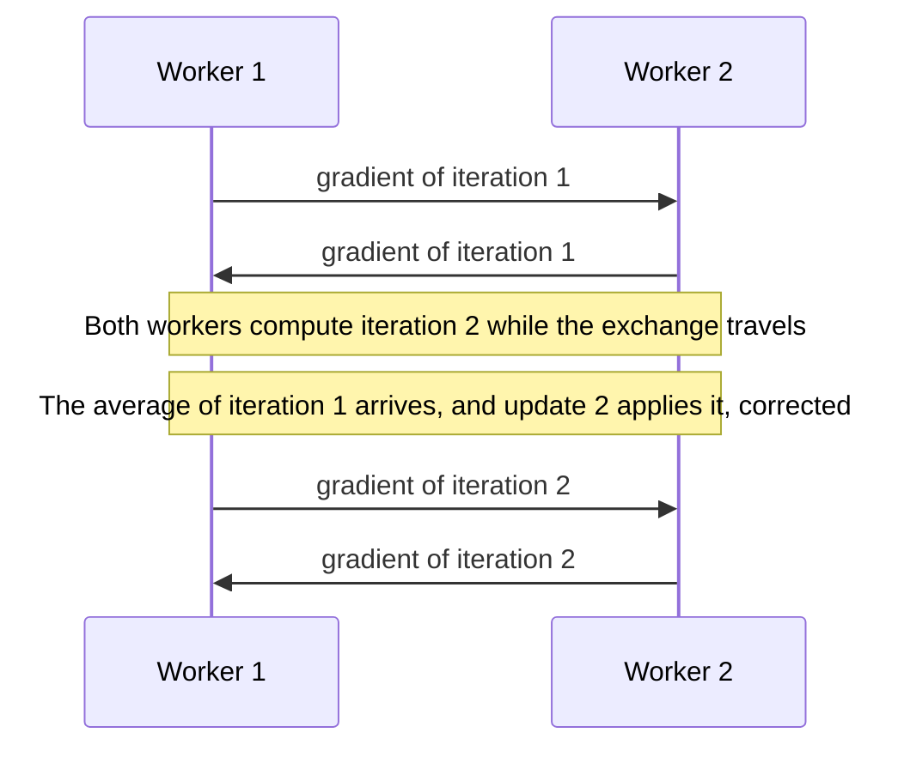

# 15. Distributed Training

**Level:** Practitioner · **Reading time:** 21 min · **Exercise:** 45 min
**Prerequisites:** [Neural Network Basics for Efficiency](02-neural-network-basics-for-efficiency.md) for weights, activations and the batch

> **In one sentence:** By the end you can choose how to split a training job over many GPUs, count the memory a run leaves on one GPU, and reduce what the GPUs send one another.

## Why this matters

Two things push a training job onto many GPUs: too much data for one GPU to get through, or a model that does not fit on one. Take the first. Your team is to train GPT-3, a model of 175 billion parameters. On one NVIDIA A100 that takes 355 years, by Song Han's figure ([2:00](https://www.youtube.com/watch?v=LcOM-nZdqxw&t=120)). His slide imagines the monthly review: you trained the model for one **epoch**, one pass over the training set. It also promises 10 GPU-days of training in 14 minutes on 1,024 GPUs, ideally; he says 40 minutes in the lecture, and the arithmetic gives about 14. To him a developer's time is worth more than the hardware.

The company buys the GPUs, and each step must end with all of them agreeing on one weight update; exchanging the data for it can take longer than computing it. Which split keeps the GPUs busy and the network quiet?

## The core idea

One training step takes a **batch**, a handful of examples: a forward pass computes the predictions, a backward pass gives every weight a **gradient**, the change that would lower the loss, and the **optimizer** turns gradients into new weights. Across many GPUs, four things can be split ([6:00](https://www.youtube.com/watch?v=LcOM-nZdqxw&t=360)):

| Parallelism | What is split | Memory per GPU | Communication |
|---|---|---|---|
| **Data parallelism** | the data; a full model on every GPU | unchanged | low: gradients each step |
| **Pipeline parallelism** | the layers, in stages | reduced | medium: activations between stages |
| **Tensor parallelism** | each weight matrix | reduced | high, at both ends of every block |
| **Sequence parallelism** | the tokens of a long input | activations reduced | inside attention |

Data and sequence parallelism divide the data and copy the model; pipeline and tensor parallelism divide the model and share the data. In Han's rating a pipeline idles its GPUs: its fastest stage still waits for the slowest ([Lecture 20, 2:00](https://www.youtube.com/watch?v=lOVcPooetrM&t=120)).

Data parallelism is a parallel sum, as in map and reduce, except that every GPU, not one process, must receive the total.

## How it works, step by step

### Data parallelism with a parameter server

Han starts with the centralized design, a **parameter server**, one machine that holds the model for the others, the **workers** or nodes. He says it is no longer widely used ([10:00](https://www.youtube.com/watch?v=LcOM-nZdqxw&t=600)):

1. The server replicates the model, every worker pulls a copy, and the data is split randomly but evenly among the workers.
2. Each worker computes gradients on its share; they differ because the data differ.
3. Each worker pushes its gradients, the server sums them and updates the weights, and the workers pull again.

Each iteration thus gains two synchronization steps over single-GPU training, the pull and the push; neither is free ([14:00](https://www.youtube.com/watch?v=LcOM-nZdqxw&t=840)).

### All-reduce: add without a server

**Broadcast** sends the same copy to all nodes, and **reduce** collects and then sums, as the server does with the gradients. **All-reduce** is a reduce whose result every node receives ([16:00](https://www.youtube.com/watch?v=LcOM-nZdqxw&t=960), [18:00](https://www.youtube.com/watch?v=LcOM-nZdqxw&t=1080)).

A worker moves one copy whatever the number N of GPUs, written O(1); the server serves all N, so its **bandwidth**, the bytes it must carry per second, grows as O(N) and caps the scale. All-reduce removes the server; Han compares the shapes ([20:00](https://www.youtube.com/watch?v=LcOM-nZdqxw&t=1200), [26:00](https://www.youtube.com/watch?v=LcOM-nZdqxw&t=1560)):

| Aggregation | Time | Bandwidth of one node | Bandwidth of all nodes |
|---|---|---|---|
| Sequential all-reduce | O(N) | O(N) | O(N) |
| Ring all-reduce | O(N) | O(1) | O(N) |
| Parallel all-reduce | O(1) | O(N) | O(N²) |

In the ring, each node passes what it holds to its neighbor; after N − 1 steps each holds the full sum ([24:00](https://www.youtube.com/watch?v=LcOM-nZdqxw&t=1440)). **Recursive halving**, the butterfly all-reduce, takes the middle way ([28:00](https://www.youtube.com/watch?v=LcOM-nZdqxw&t=1680)): with eight nodes, each exchanges with the node at distance 1, then 2, then 4, and after log N rounds, three here, each node has every contribution ([30:00](https://www.youtube.com/watch?v=LcOM-nZdqxw&t=1800)).

### Shard the memory: ZeRO and FSDP

Data parallelism saves time and no memory. Training one parameter in **FP16**, 16-bit floating point, costs 16 bytes, Han counts ([32:00](https://www.youtube.com/watch?v=LcOM-nZdqxw&t=1920)): a 2-byte weight, a 2-byte gradient and 12 bytes of **optimizer state**, the extra numbers the optimizer keeps per weight, a 32-bit master copy of the weight and two 4-byte statistics. **ZeRO**, the zero-redundancy optimizer, gives each of N GPUs one N-th of these parts instead of a full copy ([34:00](https://www.youtube.com/watch?v=LcOM-nZdqxw&t=2040)):

| Stage | Shared across the GPUs | Bytes per parameter; largest model on an 80 GB GPU, N = 64 |
|---|---|---|
| None | nothing | 16; 5B |
| ZeRO-1 | optimizer state | 4.2; 19B |
| ZeRO-2 | optimizer state and gradients | 2.2; 36B |
| ZeRO-3 | optimizer state, gradients and weights | 0.25; 320B |

He calls the last stage the usual way to train large language models ([36:00](https://www.youtube.com/watch?v=LcOM-nZdqxw&t=2160)), safe below about 70 billion parameters; in PyTorch it goes by **FSDP**, fully sharded data parallel ([38:00](https://www.youtube.com/watch?v=LcOM-nZdqxw&t=2280)). [Parallelism](../10-llm-internals/06-parallelism.md) shows how FSDP gathers and frees a layer's weights.

### Pipeline parallelism: split by layers

Consecutive layers go to different GPUs, each a **stage**. Transformers suit this: their blocks are identical and take equal time. GPT-3's 350 GB of weights over eight GPUs leave 43.75 GB on each, which fits an 80 GB card ([38:00](https://www.youtube.com/watch?v=LcOM-nZdqxw&t=2280)).

Fed one batch at a time, only one GPU computes at any moment: 25% **utilization**, the share of a GPU's time spent computing, with four stages, and the waiting is the **bubble**. The cure is the **micro-batch**: split the batch into pieces, 16 examples into four groups of 4, so the first GPU starts the second piece while the second GPU works on the first ([40:00](https://www.youtube.com/watch?v=LcOM-nZdqxw&t=2400)). Utilization rises to 57%, a gain Han puts at 2.5 times. Split the work finely, Han says ([42:00](https://www.youtube.com/watch?v=LcOM-nZdqxw&t=2520)).

### Tensor parallelism: split inside a layer

The split can go into one layer, as Megatron-LM does for a transformer's two blocks, the **MLP**, a two-layer feed-forward network, and attention; since communication is expensive, each block speaks only at its start and its end ([44:00](https://www.youtube.com/watch?v=LcOM-nZdqxw&t=2640)).

1. **MLP block.** Split the first weight matrix by columns and the second by rows, and broadcast the input to two GPUs.
2. Each GPU multiplies the input by its half of the first matrix, then the result by its rows of the second. The two results are partial sums, and one all-reduce adds them ([46:00](https://www.youtube.com/watch?v=LcOM-nZdqxw&t=2760)).
3. **Attention block.** Attention turns each token into a query, a key and a value with three **projections**, weight matrices. Split these three by columns, which is splitting by **heads**, the independent attention computations; each GPU runs whole heads on its own.
4. Split the output projection by rows, and add the partial results with one all-reduce ([50:00](https://www.youtube.com/watch?v=LcOM-nZdqxw&t=3000)).

### Sequence parallelism: split the tokens

Long sequences need their own split: an hour of 1080p video easily passes 100 million tokens, Han says ([4:00](https://www.youtube.com/watch?v=LcOM-nZdqxw&t=240)). In sequence parallelism every GPU holds the whole model and one part of the sequence ([54:00](https://www.youtube.com/watch?v=LcOM-nZdqxw&t=3240)). It holds only its part's queries, keys and values, yet attention has to connect each part with all the others; with no exchange, the first chapter never attends to the second.

**DeepSpeed Ulysses** re-partitions inside attention ([56:00](https://www.youtube.com/watch?v=LcOM-nZdqxw&t=3360), [58:00](https://www.youtube.com/watch?v=LcOM-nZdqxw&t=3480)): after the projections, an **all-to-all** exchange, in which every GPU sends a different piece to every other GPU, switches the split from tokens to heads, so that each GPU runs the attention of the whole sequence for its own heads. The split cannot begin by heads, because each token's projections are computed where that token sits ([62:00](https://www.youtube.com/watch?v=LcOM-nZdqxw&t=3720)). Its limits are heavy communication and a parallelism at most equal to the number of heads, 8, 16 or 32, the counts Han names ([62:00](https://www.youtube.com/watch?v=LcOM-nZdqxw&t=3720)).

**Ring attention** borrows the ring of the all-reduce ([64:00](https://www.youtube.com/watch?v=LcOM-nZdqxw&t=3840)): each GPU keeps its queries and passes its keys and values around the ring until every block of the attention table is computed, and no count of heads caps it ([66:00](https://www.youtube.com/watch?v=LcOM-nZdqxw&t=3960)).

### Combining the methods, and Alpa

The methods combine ([Lecture 20, 4:00](https://www.youtube.com/watch?v=lOVcPooetrM&t=240)): on four GPUs, two pairs each run a two-stage pipeline, and the two pairs take different shares of the data. **3D parallelism** keeps tensor parallelism, the most communication-heavy, inside a server, splits the layers by pipeline parallelism and runs sharded data parallelism across servers ([Lecture 20, 8:00](https://www.youtube.com/watch?v=lOVcPooetrM&t=480)). Bandwidth decides what goes where: eight GPUs within a node reach up to 900 GB per second over **NVLink**, the link between GPUs in one node, and nodes about 50 GB per second between them. Han's group therefore keeps Ulysses inside a node and lets ring attention cross between nodes ([Lecture 20, 6:00](https://www.youtube.com/watch?v=lOVcPooetrM&t=360), [Lecture 19, 66:00](https://www.youtube.com/watch?v=LcOM-nZdqxw&t=3960)).

The choices multiply, so **Alpa**, a compiler, searches them in two levels: stages first, by dynamic programming, then each operator's split. On his slide it beats a manual baseline by up to 8 times in throughput on 64 V100 GPUs ([10:00](https://www.youtube.com/watch?v=lOVcPooetrM&t=600), [12:00](https://www.youtube.com/watch?v=lOVcPooetrM&t=720)).

### Two costs: bandwidth and latency

Han's premise: computation is cheap and moving data is expensive ([12:00](https://www.youtube.com/watch?v=lOVcPooetrM&t=720)). Three trends make it worse: **synchronous training**, the usual choice, trades gradients among all workers once per iteration; larger models have more to trade, since a gradient has one entry per weight; and more nodes add traffic. Scalability therefore depends on the model: AlexNet, with 240 MB of weights and little arithmetic, does badly on 200 nodes, where Inception does far better ([14:00](https://www.youtube.com/watch?v=lOVcPooetrM&t=840)).

A network charges twice: in bandwidth and in **latency**, the wait before a byte arrives. Two remedies follow: send fewer bytes ([16:00](https://www.youtube.com/watch?v=lOVcPooetrM&t=960)) or send them later ([42:00](https://www.youtube.com/watch?v=lOVcPooetrM&t=2520)).

### Send fewer bytes: prune the gradients

**Gradient pruning** keeps only the gradients of largest magnitude ([18:00](https://www.youtube.com/watch?v=lOVcPooetrM&t=1080)):

1. Rank the gradients and keep the k largest.
2. **Local accumulation**: hold the rest in a buffer on the node and add the next iteration's gradients to them.
3. Send a buffered gradient once it passes the threshold.

An early paper sped up training this way, but on ResNet-110 over CIFAR-10 accuracy fell from 93.75% to 92.75% ([20:00](https://www.youtube.com/watch?v=lOVcPooetrM&t=1200)). Han traces that drop to **momentum**, which nearly every optimizer uses ([20:00](https://www.youtube.com/watch?v=lOVcPooetrM&t=1200), [22:00](https://www.youtube.com/watch?v=lOVcPooetrM&t=1320)): it keeps a **velocity**, a discounted sum of past gradients, and moves the weights by it. An accumulated gradient fed into that rule moves the weights somewhere the ordinary run would not ([24:00](https://www.youtube.com/watch?v=lOVcPooetrM&t=1440)).

**Momentum correction** accumulates the velocity instead, so the late update lands where it would have ([24:00](https://www.youtube.com/watch?v=lOVcPooetrM&t=1440)). **Warm-up** guards the start of training, when the weights move fast: begin with a small **learning rate**, the size of each update, and a low **pruning ratio**, the share of gradients dropped, and raise both gradually over the first epochs ([26:00](https://www.youtube.com/watch?v=lOVcPooetrM&t=1560)). Local accumulation, momentum correction, warm-up and **gradient clipping**, a cap on a gradient's size, together make Han's **deep gradient compression** of 2017 ([36:00](https://www.youtube.com/watch?v=lOVcPooetrM&t=2160)).

### Send fewer bytes: low-rank and quantized gradients

Under all-reduce, pruned gradients lose their sparsity, since nodes keep different large entries and their sum densifies every iteration. A shared coarse-grained pattern, or a second pruning inside the ring, holds that back ([34:00](https://www.youtube.com/watch?v=lOVcPooetrM&t=2040)). **PowerSGD** avoids sparsity: it sends each gradient matrix as two low-rank factors, a 4 × 4 matrix as 1 × 4 and 4 × 1 in Han's example, whose shape is the same on every node, so all-reduce changes nothing ([34:00](https://www.youtube.com/watch?v=lOVcPooetrM&t=2040)). By Han's account its speed-up grows almost linearly with the number of workers, though the caption on his slide calls it nonlinear ([36:00](https://www.youtube.com/watch?v=lOVcPooetrM&t=2160)).

**Gradient quantization** keeps every entry but in fewer bits ([38:00](https://www.youtube.com/watch?v=lOVcPooetrM&t=2280)). **1-bit SGD** sends the sign of each value with a 32-bit scale per column that keeps the sum of absolute values. It keeps its rounding error as a residual for the next gradient, an **error accumulation** that **TernGrad** does not need: TernGrad sends 0 or plus or minus the largest magnitude at random, with probabilities proportional to each gradient's size, so its choices average to the true gradient ([38:00](https://www.youtube.com/watch?v=lOVcPooetrM&t=2280), [40:00](https://www.youtube.com/watch?v=lOVcPooetrM&t=2400)).

### Send them later: delayed gradient averaging

Latency resists money: light itself needs 162 milliseconds from Boston to Shanghai, Han says, and congestion adds more ([42:00](https://www.youtube.com/watch?v=lOVcPooetrM&t=2520), [44:00](https://www.youtube.com/watch?v=lOVcPooetrM&t=2640)). Bandwidth can be bought, with compression or faster hardware up to InfiniBand at 400 gigabits a second; latency cannot ([42:00](https://www.youtube.com/watch?v=lOVcPooetrM&t=2520)). A synchronous worker waits for the exchange before its next iteration ([44:00](https://www.youtube.com/watch?v=lOVcPooetrM&t=2640)).

His analogy is a late day for homework, and only a fixed number is allowed: past some delay the model does not converge ([48:00](https://www.youtube.com/watch?v=lOVcPooetrM&t=2880)).

**Delayed gradient averaging** runs as follows ([46:00](https://www.youtube.com/watch?v=lOVcPooetrM&t=2760), [50:00](https://www.youtube.com/watch?v=lOVcPooetrM&t=3000)):

1. Compute the local gradient, send it with its iteration number, and store it in an array G.
2. Start the next iteration at once.
3. When the average from iteration i − D arrives, D iterations late, update the weights with the learning rate times the fresh local gradient, minus G[i − D], plus that average.

The delayed average is made of **stale gradients**, gradients computed for weights that have since moved. It already contains this worker's gradient from D iterations ago; the correction swaps that one for the fresh one ([52:00](https://www.youtube.com/watch?v=lOVcPooetrM&t=3120)). No gradient is dropped.

**Figure 1.** Delayed gradient averaging with a delay of one iteration: the exchange overlaps the next computation.



Update 2 used iteration 1's average without waiting for its own exchange.

## Worked example

Han's memory figures, with a 7-billion-parameter model added:

```python
def bytes_per_param(gpus, stage):
    """FP16 training: 2 bytes per weight, 2 per gradient, 12 of optimizer state."""
    parts = {"weight": 2, "gradient": 2, "state": 12}
    shared = {0: [], 1: ["state"], 2: ["state", "gradient"], 3: list(parts)}[stage]
    return sum(size / gpus if name in shared else size for name, size in parts.items())

for stage in (0, 1, 2, 3):
    b = bytes_per_param(64, stage)
    print(f"stage {stage}: {b:.2f} bytes per parameter, {80 / b:.0f}B parameters fit in 80 GB")
print("7B model:", 7e9 * bytes_per_param(1, 0) / 1e9, "GB on one GPU,",
      7e9 * bytes_per_param(8, 3) / 1e9, "GB on each of eight GPUs at stage 3")
```

It prints:

```
stage 0: 16.00 bytes per parameter, 5B parameters fit in 80 GB
stage 1: 4.19 bytes per parameter, 19B parameters fit in 80 GB
stage 2: 2.22 bytes per parameter, 36B parameters fit in 80 GB
stage 3: 0.25 bytes per parameter, 320B parameters fit in 80 GB
7B model: 112.0 GB on one GPU, 14.0 GB on each of eight GPUs at stage 3
```

The first four lines reproduce the table above (4.2 and 2.2 rounded); the last shows why one GPU cannot train a 7-billion-parameter model and eight can. Activations are not counted. The linked chapter counts 12 bytes, 84 GB for the same model, because it assumes BF16 training, a second 16-bit format, without a separate 32-bit master copy: 2 + 2 + 8.

## What the practitioners say

- **Han's own large run.** In 2019 his group trained a video model built on the temporal shift module (see [Chapter 13](13-gans-video-and-point-clouds.md)) on 660 hours of video on the Summit supercomputer: 49 hours 50 minutes on one node of 6 V100 GPUs, and, on 1,536 GPUs, 14 minutes: a speed-up of 211 times against an ideal 256, with accuracy moving from 74.1% to 74.0% ([2:00](https://www.youtube.com/watch?v=LcOM-nZdqxw&t=120), [4:00](https://www.youtube.com/watch?v=LcOM-nZdqxw&t=240)).
- **What pruning costs, and recovers.** On ResNet-110 over CIFAR-10, pruning without accumulation never converges. Accumulation alone reaches about 91.4% to 91.9% against a baseline of 92.9%; momentum correction brings 92.56%; warm-up helps further, and all three together reach 93.28% on his slide, above the baseline ([28:00](https://www.youtube.com/watch?v=lOVcPooetrM&t=1680)).
- **What compression buys.** The gradients end up 99.9% sparse and several hundred times smaller: AlexNet's shrinks from 232.56 MB to 0.39 MB, 597 times, its accuracy intact, and a speech model's from 488.08 MB to 0.74 MB, its error rate intact ([30:00](https://www.youtube.com/watch?v=lOVcPooetrM&t=1800), [32:00](https://www.youtube.com/watch?v=lOVcPooetrM&t=1920)). Not 1,000 times: a sparse tensor needs an index per value, and the biases are not pruned ([32:00](https://www.youtube.com/watch?v=lOVcPooetrM&t=1920)). Gradients take far more pruning than weights, for which 90% is already a high ratio, he adds ([36:00](https://www.youtube.com/watch?v=lOVcPooetrM&t=2160)); [Pruning and Sparsity](03-pruning-and-sparsity.md) covers weights.
- **How long a delay is safe.** At least three steps of delay are very safe by his study, and he takes 10 or 20 as still small ([46:00](https://www.youtube.com/watch?v=lOVcPooetrM&t=2760), [52:00](https://www.youtube.com/watch?v=lOVcPooetrM&t=3120)). On ResNet-18 over CIFAR-10 the uncorrected update sinks from 88.7% to 84.2% as the delay grows from 5 to 20; the corrected one stays between 88.7% and 89.3%. Asked whether the learning rate must then be smaller, he answers that it has to grow with the batch size, and more nodes make a bigger batch ([54:00](https://www.youtube.com/watch?v=lOVcPooetrM&t=3240)).
- **Speed-ups.** Summing ten iterations before sending gives about 1.5 times the speed of a baseline of five local steps, and twenty gives 2 times; with the delay, 3 to 4 times, at unchanged accuracy. With eight Raspberry Pis joined by ordinary Ethernet, plain averaging gives 3 to 4 times; delayed averaging, by 7 to 7.5 times ([54:00](https://www.youtube.com/watch?v=lOVcPooetrM&t=3240), [56:00](https://www.youtube.com/watch?v=lOVcPooetrM&t=3360)).

## Pitfalls

1. **Expecting data parallelism to squeeze a large model onto one GPU.** Fix: every GPU still holds a full copy. Share the state with ZeRO or FSDP, or split the model.
2. **Spreading tensor parallelism over several machines.** Fix: confine it to one machine and bridge machines with pipeline parallelism.
3. **Feeding a pipeline one batch at a time.** Fix: split it into micro-batches.
4. **Sending only large gradients without momentum correction.** Fix: accumulate the velocity, not the raw gradients, and warm up the learning rate and the pruning.
5. **All-reducing pruned gradients and expecting them to stay sparse.** Fix: use one coarse pattern, prune again inside the ring, or send low-rank factors as PowerSGD does.
6. **Applying a delayed average as it arrives.** Fix: subtract the worker's own gradient from D iterations ago and add its fresh one.

## Try it

Simulate delayed gradient averaging in plain Python, with two workers, two weights and a delay of one iteration.

1. Give each worker a fresh gradient for each of three iterations.
2. Write the synchronous update: both workers apply the mean of the two fresh gradients.
3. Write the delayed update with and without the correction, and print how far each differs from the synchronous one.

**You are done when** the printout shows that the uncorrected update equals the previous iteration's mean and ignores the fresh gradient, and that the corrected update differs from the synchronous one by half the change of its own gradient over the delay minus half the change of the other's.

**Stretch:** simulate ring all-reduce on four nodes and count the steps until every node holds the full sum.

## Key takeaways

- Four ways to split a training job: data and sequence parallelism divide the data; pipeline and tensor parallelism divide the model.
- All-reduce replaces the parameter server. The ring keeps each node's bandwidth constant; recursive halving finishes in log N rounds.
- Training a parameter takes 16 bytes. ZeRO shares the optimizer state, then the gradients, then the weights; FSDP is the last stage.
- For bandwidth, send fewer bytes, pruning with momentum correction and warm-up. For latency, send them later and subtract the worker's own stale share.

## Self-check

1. A parameter server serves N workers. How does its bandwidth requirement grow with N, and which operation replaces the server?
2. Eight nodes run recursive-halving all-reduce. Which nodes does node 1 exchange with, in order, and how many rounds?
3. Why can an 80 GB GPU train only a 5-billion-parameter model, and what does ZeRO-3 on 64 GPUs change?
4. Pruning with local accumulation loses accuracy under a momentum optimizer. What must be accumulated instead, and what else does Han warm up?
5. With delay D, a worker receives the average of iteration i − D. Which three terms make up its update?

<details><summary>Show answers</summary>

1. Linearly, O(N), where a worker needs O(1). All-reduce, which leaves the sum on every node.
2. With the nodes at distance 1, 2 and 4: nodes 2, 3 and 5, in three rounds.
3. 16 bytes per parameter: weight 2, gradient 2, optimizer state 12. ZeRO-3 shares all three, 0.25 bytes per parameter per GPU, so 320 billion fit.
4. The velocity, not the gradient. The learning rate and the pruning ratio both start low and rise.
5. The fresh local gradient, minus the worker's own gradient from iteration i − D, plus the delayed average.

</details>

## Sources

- **Lecture:** Song Han, "Lecture 19: Distributed Training (Part I)", MIT 6.5940 TinyML and Efficient Deep Learning Computing (Fall 2024): [video](https://www.youtube.com/watch?v=LcOM-nZdqxw) · [guide](../lectures/mit-19-distributed-training-part-i.md), used at [motivation](https://www.youtube.com/watch?v=LcOM-nZdqxw&t=120), [four splits](https://www.youtube.com/watch?v=LcOM-nZdqxw&t=360), [parameter server](https://www.youtube.com/watch?v=LcOM-nZdqxw&t=600), [all-reduce](https://www.youtube.com/watch?v=LcOM-nZdqxw&t=960), [training memory](https://www.youtube.com/watch?v=LcOM-nZdqxw&t=1920), [pipeline parallelism](https://www.youtube.com/watch?v=LcOM-nZdqxw&t=2400), [tensor parallelism](https://www.youtube.com/watch?v=LcOM-nZdqxw&t=2640), [sequence parallelism](https://www.youtube.com/watch?v=LcOM-nZdqxw&t=3240)
- **Lecture:** Song Han, "Lecture 20: Distributed Training (Part II)", MIT 6.5940 TinyML and Efficient Deep Learning Computing (Fall 2024): [video](https://www.youtube.com/watch?v=lOVcPooetrM) · [guide](../lectures/mit-20-distributed-training-part-ii.md), used at [combining](https://www.youtube.com/watch?v=lOVcPooetrM&t=240), [Alpa](https://www.youtube.com/watch?v=lOVcPooetrM&t=600), [communication](https://www.youtube.com/watch?v=lOVcPooetrM&t=720), [gradient pruning](https://www.youtube.com/watch?v=lOVcPooetrM&t=1080), [momentum correction](https://www.youtube.com/watch?v=lOVcPooetrM&t=1440), [pruning results](https://www.youtube.com/watch?v=lOVcPooetrM&t=1680), [PowerSGD](https://www.youtube.com/watch?v=lOVcPooetrM&t=2040), [quantization](https://www.youtube.com/watch?v=lOVcPooetrM&t=2280), [latency](https://www.youtube.com/watch?v=lOVcPooetrM&t=2520), [delayed averaging](https://www.youtube.com/watch?v=lOVcPooetrM&t=2760)
- **Reading:** Samyam Rajbhandari, Jeff Rasley, Olatunji Ruwase, Yuxiong He, "ZeRO: Memory Optimizations Toward Training Trillion Parameter Models" (SC 2020): [arXiv](https://arxiv.org/abs/1910.02054)

## Next

→ [Quantum Machine Learning](16-quantum-machine-learning.md): after one model is spread over many processors, the course asks what a processor of a different kind could compute.
