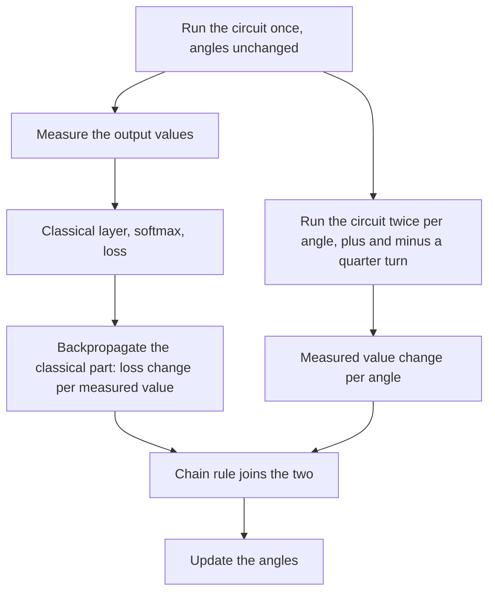

# 16. Quantum Machine Learning

**Level:** Foundation · **Reading time:** 20 min · **Exercise:** 40 min
**Prerequisites:** [Neural Network Basics for Efficiency](02-neural-network-basics-for-efficiency.md) for backpropagation and softmax

> **In one sentence:** After this chapter you can read a quantum machine-learning model as a program, data turned into qubit rotations, gates with learned angles and a final measurement, and say what noise, data loading and the compiler do to it.

## Why this matters

A press release says a quantum computer will train the next generation of models. Song Han ends his course recap on a question, "how far away are we from quantum machine learning" ([2:00](https://www.youtube.com/watch?v=svjjD2uthhQ&t=120)), and Hanrui Wang, who had just finished his PhD in Han's lab and was joining UCLA ([4:00](https://www.youtube.com/watch?v=svjjD2uthhQ&t=240)), answers for the rest of Lecture 22 and all of Lecture 23. What is such a model, and what keeps it from a correct result today?

## The core idea

A **qubit**, short for quantum bit, stores its information in two complex numbers (numbers with a real and an imaginary part): its **state vector**. One more bit adds one bit of information; one more qubit doubles the vector, so n qubits need 2 to the power of n numbers; by Wang's figure, the data the world produces in a day, about 3 exabytes, would in principle fit into 64 qubits (Lecture 22, [10:00](https://www.youtube.com/watch?v=svjjD2uthhQ&t=600)). By his account, 20 to 50 qubits are already too many to simulate classically ([38:00](https://www.youtube.com/watch?v=svjjD2uthhQ&t=2280)).

A quantum machine-learning model is a **parameterized quantum circuit**, a circuit in which some gates carry learned angles and others, such as the CNOT, the NOT gate and the Hadamard gate, are fixed (Lecture 23, [2:00](https://www.youtube.com/watch?v=ZDk-GsyInt8&t=120)). It keeps what a neural network would recognize:

| Neural network | Parameterized quantum circuit |
|---|---|
| weights | rotation angles of some gates |
| gradient | parameter-shift rule (defined below), two circuit runs per angle |
| **Skip connection** (a shortcut past later layers) | unavailable: a quantum state cannot be copied |
| wrong bit | about 1 in 100 per two-qubit gate, as of Fall 2024 |

The first row is Wang's own analogy, gates with angles against weighted layers and fixed gates against parameterless ones. The last three are where it breaks: the intermediate state cannot be read, a state cannot be copied, and the hardware itself flips results. Both lectures stay in one cell of his map of the field: classical data, quantum algorithm; the other cells hold ordinary deep learning, device control and calibration, and quantum sensing ([0:00](https://www.youtube.com/watch?v=ZDk-GsyInt8&t=0), [2:00](https://www.youtube.com/watch?v=ZDk-GsyInt8&t=120)).

## How it works, step by step

### Qubits, gates and entanglement

A qubit's state is a **superposition**, a weighted sum of the bit values 0 and 1, written |0⟩ and |1⟩: α|0⟩ + β|1⟩, with complex weights α and β, called **amplitudes**. A **measurement** returns one classical bit, 0 or 1 at random, and collapses the state to the bit it returned. The chance of a 0 is |α|² and of a 1 is |β|², so the two squares add up to 1. Since nothing reads α and β themselves, a computation is repeated many times and its answer is the distribution of the results (Lecture 22, [22:00](https://www.youtube.com/watch?v=svjjD2uthhQ&t=1320), [24:00](https://www.youtube.com/watch?v=svjjD2uthhQ&t=1440)).

A single-qubit state is a point on the **Bloch sphere**, since the sum-to-one rule leaves two real numbers ([28:00](https://www.youtube.com/watch?v=svjjD2uthhQ&t=1680)). Every single-qubit **gate** is a 2 by 2 matrix and a rotation of the sphere: the **Hadamard gate**, which has no classical counterpart, turns |0⟩ into an equal superposition of 0 and 1, and the general U gate takes three parameters and moves any point to any other ([34:00](https://www.youtube.com/watch?v=svjjD2uthhQ&t=2040), [36:00](https://www.youtube.com/watch?v=svjjD2uthhQ&t=2160)). RZ turns a qubit about the sphere's z axis, RX about its x axis. Every gate is **reversible**: from the gate and its output you recover its input ([28:00](https://www.youtube.com/watch?v=svjjD2uthhQ&t=1680)).

The **CNOT**, short for controlled NOT, has a control and a target and flips the target only when the control is 1: 10 becomes 11, in the order control, target ([40:00](https://www.youtube.com/watch?v=svjjD2uthhQ&t=2400)). A Hadamard on one qubit followed by a CNOT from it to a second produces **entanglement**, the joint state (|00⟩ + |11⟩)/√2. Measured a hundred times, the pair reads 00 in about half of the runs and 11 in the rest, however far apart the qubits are; each result is still random, so this sends no message ([42:00](https://www.youtube.com/watch?v=svjjD2uthhQ&t=2520), [44:00](https://www.youtube.com/watch?v=svjjD2uthhQ&t=2640)).

### A circuit that classifies digits

A **quantum circuit** has three stages: initialize the qubits with the problem, apply gates, measure, with classical post-processing allowed afterwards. A gate is a physical pulse, microwaves on a superconducting chip or laser light on neutral atoms, whose area or duration sets the rotation angle (Lecture 22, [46:00](https://www.youtube.com/watch?v=svjjD2uthhQ&t=2760), [48:00](https://www.youtube.com/watch?v=svjjD2uthhQ&t=2880)). Wang's simple first circuit, an adder, needs a CNOT for the sum and one with two controls for the carry ([50:00](https://www.youtube.com/watch?v=svjjD2uthhQ&t=3000)).

His machine-learning program classifies handwritten digits ([52:00](https://www.youtube.com/watch?v=svjjD2uthhQ&t=3120), [56:00](https://www.youtube.com/watch?v=svjjD2uthhQ&t=3360)):

1. **Encode.** A 4 by 4 downsampled image becomes sixteen rotation angles, one per pixel.
2. **Compute.** Trainable layers of U3 gates, each with three angles, and controlled-U3 gates follow; their angles are the weights.
3. **Measure.** Four qubits yield at least sixteen numbers.
4. **Post-process.** A softmax, which turns numbers into probabilities that add up to 1, gives the class scores.

The same circuit shape serves other tasks: the **variational quantum eigensolver** finds the smallest **eigenvalue** of a matrix, the smallest λ for which the matrix maps some vector to λ times itself, which for a molecule is its ground-state energy, and **QAOA**, the quantum approximate optimization algorithm, attacks combinatorial optimization (Lecture 23, [42:00](https://www.youtube.com/watch?v=ZDk-GsyInt8&t=2520), [44:00](https://www.youtube.com/watch?v=ZDk-GsyInt8&t=2640)). The group's library TorchQuantum writes the classifier as an ordinary PyTorch module and converts it to Qiskit for IBM's devices ([54:00](https://www.youtube.com/watch?v=ZDk-GsyInt8&t=3240), [58:00](https://www.youtube.com/watch?v=ZDk-GsyInt8&t=3480)).

### Four ways to encode data

Encoding turns a classical input into the initial state of the qubits; Wang's four methods trade qubits against gates (Lecture 23, [14:00](https://www.youtube.com/watch?v=ZDk-GsyInt8&t=840)):

| Encoding | How a value enters the qubits | Qubits for n values | Price |
|---|---|---|---|
| **Basis encoding** | A binary string becomes one basis state: 2, which is 10 in binary, becomes 10. | One per bit. | Wasteful for one value, though several can share a state. |
| **Amplitude encoding** | The input vector becomes the state vector, scaled to length 1; the scaling factor stays on a classical computer ([18:00](https://www.youtube.com/watch?v=ZDk-GsyInt8&t=1080)). | The base-2 logarithm of n. | Preparing it takes a long circuit even for four numbers. |
| **Angle encoding** | Each value becomes a rotation angle, one gate per qubit. | One per value. | No state-preparation circuit, so it is cheap. |
| **Arbitrary encoding** | Any circuit whose angles are the input values: rotations, CNOTs, more rotations. | Few: twelve values fit one circuit. | The design is left to you. |

### What makes a circuit good

**Expressivity** says how much of the state space a circuit can reach: a Hadamard and a Z rotation trace only a ring of the Bloch sphere as the angle varies, and adding an RX gate covers the sphere ([4:00](https://www.youtube.com/watch?v=ZDk-GsyInt8&t=240), [6:00](https://www.youtube.com/watch?v=ZDk-GsyInt8&t=360)).

**Entangling capacity** says how strongly a circuit entangles its qubits, by the **Meyer-Wallach measure**, from 0 for unentangled qubits to 1 for fully entangled ones, averaged over random angles. A circuit whose gates each act on one qubit never entangles, however many layers it has; one with many CNOTs between neighboring qubits gets close to 1 within a few layers ([10:00](https://www.youtube.com/watch?v=ZDk-GsyInt8&t=600)). Only entangled qubits use the exponential state space to store data ([12:00](https://www.youtube.com/watch?v=ZDk-GsyInt8&t=720)).

**Hardware efficiency** asks whether a device can run the circuit: it must respect the **connectivity**, the qubit pairs a gate may join, and use **native gates**, the gates the device supports. Any other gate must be decomposed into them, which adds operations ([14:00](https://www.youtube.com/watch?v=ZDk-GsyInt8&t=840)).

### Gradients on a real device: the parameter-shift rule and SPSA

Training follows the classical recipe until the gradient (Lecture 23, [22:00](https://www.youtube.com/watch?v=ZDk-GsyInt8&t=1320)). A finite-difference gradient, the change in the output for a small nudge of one angle, depends on the step, and a large step gives a derivative far from the true one ([24:00](https://www.youtube.com/watch?v=ZDk-GsyInt8&t=1440)). The **parameter-shift rule** gives the analytic gradient instead: run the circuit twice, with the angle moved up by π/2 and down by π/2, and take half the difference of the outputs ([26:00](https://www.youtube.com/watch?v=ZDk-GsyInt8&t=1560)).

On a simulator, backpropagation through the circuit yields the same gradients. It needs every intermediate state, and a real device exposes none, so on hardware it covers only the classical part ([30:00](https://www.youtube.com/watch?v=ZDk-GsyInt8&t=1800)):

**Figure 1.** One training step splits into a classical part and a device part.



The chain rule joins the two parts ([32:00](https://www.youtube.com/watch?v=ZDk-GsyInt8&t=1920)). **SPSA**, simultaneous perturbation stochastic approximation, cuts the rule's two circuit evaluations per angle, 2n per step for n angles, to two: nudge all the angles at once, each by a small amount with a random sign; run the circuit once per perturbation; give every angle an estimate of the same magnitude and the sign of its own nudge ([34:00](https://www.youtube.com/watch?v=ZDk-GsyInt8&t=2040), [36:00](https://www.youtube.com/watch?v=ZDk-GsyInt8&t=2160)).

### Training in noise: probabilistic gradient pruning

On an IBM device, noise makes gradients from the parameter-shift rule inaccurate. Wang's observation: a gradient of small magnitude carries a large relative error, because a little noise can reverse its direction, whereas a large gradient keeps it. His group's **probabilistic gradient pruning** therefore skips the unreliable gradients ([46:00](https://www.youtube.com/watch?v=ZDk-GsyInt8&t=2760), [48:00](https://www.youtube.com/watch?v=ZDk-GsyInt8&t=2880)):

1. **Accumulation window.** Over a few steps, three by his account, add up each angle's absolute gradient.
2. **Pruning window.** Turn the sums into probabilities and sample which gradients not to compute; the small ones are the likeliest.
3. Update only the angles whose gradients were computed, then repeat.

An angle skipped in one window may be updated in the next, so no gradient is dropped for good. With pruning, on-chip training closes most of the gap to a simulator's curve, and it scales where a simulator does not, since a simulator's time and memory grow exponentially with the number of qubits ([50:00](https://www.youtube.com/watch?v=ZDk-GsyInt8&t=3000), [52:00](https://www.youtube.com/watch?v=ZDk-GsyInt8&t=3120)).

### Searching for a robust circuit

Gate types, counts and positions make a search space too large to train every candidate. The group's QuantumNAS trains once and reuses the result, like the once-for-all search in [Neural Architecture Search](05-neural-architecture-search.md) (Lecture 23, [59:00](https://www.youtube.com/watch?v=ZDk-GsyInt8&t=3540)):

1. **Build a supercircuit.** A **supercircuit** holds the most gates the search space allows; each candidate, a **subcircuit**, is a subset of it.
2. **Train it by sampling.** Each step samples one subcircuit and updates its angles once. The inherited angles are less accurate than a from-scratch run would give, but they keep the order of the subcircuits, and the order is all the search needs.
3. **Search on the device.** That chapter's search methods, evolutionary search or reinforcement learning, score subcircuits on the real device, under its noise, until the best one and its placement on qubits are found ([68:00](https://www.youtube.com/watch?v=ZDk-GsyInt8&t=4080)).
4. **Retrain and prune.** Train the winner from scratch, then iteratively drop rotation gates whose angle is close to zero, since they act as the identity, and fine-tune the rest.

### Compiling for a real device

**Qubit mapping** is the first task in fitting a circuit written for ideal qubits to the machine (Lecture 22, [64:00](https://www.youtube.com/watch?v=svjjD2uthhQ&t=3840)):

1. Pick the most reliable physical qubits. The 127 of IBM's Washington chip are not equal.
2. Respect the connectivity. A gate that joins two qubits which are not neighbors can run only after **SWAP** gates, each three CNOTs, have moved them next to each other, and every SWAP adds error.

SABRE, which IBM's Qiskit uses, gives each possible swap a score from a heuristic that favors swaps bringing pending gates together. Since every circuit is reversible, the compiler can also map the circuit backwards and use the result to improve the initial mapping ([68:00](https://www.youtube.com/watch?v=svjjD2uthhQ&t=4080)).

Wang's second platform is the neutral-atom device, whose qubits are identical atoms that are moved by moving the laser light, so the connectivity can change during a computation ([72:00](https://www.youtube.com/watch?v=svjjD2uthhQ&t=4320)). The group's compiler for the platform, Atomique, decides which atoms to use and schedules their movement. It cuts the SWAPs with a **max-k-cut**, a split of the graph of two-qubit gates into one part per array of atoms: gates whose ends land in different parts need no SWAP, because movement brings any two atoms together ([74:00](https://www.youtube.com/watch?v=svjjD2uthhQ&t=4440)).

## Worked example

The script keeps a state vector in plain Python.

```python
import math
import random


def rx(theta):  # the rotation gate RX(theta) as a 2 by 2 matrix
    h = theta / 2
    return [[math.cos(h), -1j * math.sin(h)], [-1j * math.sin(h), math.cos(h)]]


def apply(gate, state):  # matrix times vector: the gate acts on the state
    return [sum(gate[i][j] * state[j] for j in range(len(state))) for i in range(len(gate))]


def p1(theta):  # chance of reading 1 after RX(theta) on a qubit that starts in 0
    return abs(apply(rx(theta), [1, 0])[1]) ** 2


theta = 0.7
shift = (p1(theta + math.pi / 2) - p1(theta - math.pi / 2)) / 2
print("parameter shift: %.4f   true derivative: %.4f" % (shift, math.sin(theta) / 2))
for eps in (1.0, 0.1, 0.01):
    print("finite difference, step %.2f: %.4f" % (eps, (p1(theta + eps) - p1(theta)) / eps))

hadamard = [[2 ** -0.5, 2 ** -0.5], [2 ** -0.5, -2 ** -0.5]]
identity = [[1, 0], [0, 1]]


def kron(a, b):  # a gate on one qubit, acting on a pair
    return [[x * y for x in row for y in brow] for row in a for brow in b]


state = apply(kron(hadamard, identity), [1, 0, 0, 0])  # Hadamard on the first qubit
state[2], state[3] = state[3], state[2]  # CNOT: control is qubit 0, target is qubit 1
probs = [abs(a) ** 2 for a in state]
print("chances of 00, 01, 10, 11:", [round(p, 3) for p in probs])

random.seed(1)
shots = random.choices(range(4), weights=probs, k=100)
print("100 measurements: 00 in", shots.count(0), "runs, 11 in", shots.count(3))
```

It prints:

```
parameter shift: 0.3221   true derivative: 0.3221
finite difference, step 1.00: 0.4468
finite difference, step 0.10: 0.3407
finite difference, step 0.01: 0.3240
chances of 00, 01, 10, 11: [0.5, 0.0, 0.0, 0.5]
100 measurements: 00 in 47 runs, 11 in 53
```

The first line shows the parameter-shift rule equal to the analytic derivative of the chance of reading 1, sin(θ)/2. The next three show finite differences approaching it as the step shrinks, 0.4468, 0.3407 and 0.3240 against 0.3221: the step-size problem Wang names. The last two lines show the entangled pair: only 00 and 11 appear, about half of the runs each.

## What the practitioners say

### Where the devices stand

Everything here is Wang's account (Lecture 22), as of Fall 2024.

- **Milestones.** A day before Lecture 22, Google released **AlphaQubit**, a transformer that decodes a quantum computer's error-correcting codes. Google had earlier shown **quantum supremacy**, a computation its device performed better than the best classical computer, and IBM **quantum utility**, one that is hard to run classically but not yet useful ([4:00](https://www.youtube.com/watch?v=svjjD2uthhQ&t=240)).
- **Size and quality.** Superconducting chips held 5 qubits in 2017, 27 in 2019 and 65 in 2020, before IBM's Condor chip reached over 1,000; by his count qubits double every year, so computing power grows doubly exponentially. A thousand noisy qubits cannot be used together: **quantum error correction** trades redundancy for reliability, in his example 25 physical qubits per one **logical qubit**, and a Harvard team had built 48 logical qubits from neutral atoms ([6:00](https://www.youtube.com/watch?v=svjjD2uthhQ&t=360), [8:00](https://www.youtube.com/watch?v=svjjD2uthhQ&t=480), [10:00](https://www.youtube.com/watch?v=svjjD2uthhQ&t=600)).
- **Several roadmaps.** Quantum devices, unlike classical chips, follow several: superconducting circuits, trapped ions, neutral atoms, photonics and spin qubits ([8:00](https://www.youtube.com/watch?v=svjjD2uthhQ&t=480)).
- **Shor's algorithm.** By MIT's Peter Shor in the 1980s and 1990s, it factors large integers with an exponential speed-up over classical machines and so threatens RSA, which rests on the difficulty of factoring. A National Quantum Initiative followed in the United States in 2018, and NIST (the United States standards body) has narrowed the quantum-safe schemes to four ([12:00](https://www.youtube.com/watch?v=svjjD2uthhQ&t=720)).
- **The gap.** Factoring an RSA key needs an error rate below one in a hundred million. Today's machines are in the **NISQ era**, noisy intermediate-scale quantum: the control pulses are imperfect, the environment disturbs the qubits, and error rates are about one in a thousand for single-qubit gates and one in a hundred for a CNOT. An adder that a laptop gets right every time is wrong some of the time, while a model needs tens, thousands or even millions of gates. On a plot of size against error tolerance, today's devices are nowhere near what Shor's algorithm, Grover's database search and quantum chemistry require ([16:00](https://www.youtube.com/watch?v=svjjD2uthhQ&t=960), [60:00](https://www.youtube.com/watch?v=svjjD2uthhQ&t=3600), [62:00](https://www.youtube.com/watch?v=svjjD2uthhQ&t=3720), [64:00](https://www.youtube.com/watch?v=svjjD2uthhQ&t=3840)).

### The numbers behind the methods

- **Gradient pruning.** Wang credits it with about 5 to 10% more accuracy on a classification task, though his slide says 2 to 4%, and with half the training time, since skipped gradients are never computed (Lecture 23, [48:00](https://www.youtube.com/watch?v=ZDk-GsyInt8&t=2880)). Probabilistic pruning beats deterministic pruning by 1 to 9% accuracy across several tasks ([52:00](https://www.youtube.com/watch?v=ZDk-GsyInt8&t=3120)).
- **Optimizers.** SPSA's training curve stays close to that of plain gradient descent; the quantum natural gradient converges best of all, at a much higher cost ([38:00](https://www.youtube.com/watch?v=ZDk-GsyInt8&t=2280)).
- **Atomique.** It compiles, by his account, circuits of more than a thousand qubits within minutes, where an SMT solver, a program that decides whether logical constraints can all be met, would be optimal but exponential in cost (Lecture 22, [76:00](https://www.youtube.com/watch?v=svjjD2uthhQ&t=4560)).

### The limits the lectures leave open

- **Loading data.** A document long enough to make a transformer's attention cost quadratic would occupy only a logarithmic number of qubits, but qubits start in the 0 state, and the circuit that prepares an arbitrary state in them has a depth that grows exponentially. Wang counts the cost of encoding data among the field's main open problems (Lecture 22, [58:00](https://www.youtube.com/watch?v=svjjD2uthhQ&t=3480)).
- **The barren plateau.** With many qubits and many layers, the variance of the gradients falls exponentially: deep circuits hit the **barren plateau**, the quantum cousin of vanishing gradients, and cannot simply be stacked deeper (Lecture 23, [38:00](https://www.youtube.com/watch?v=ZDk-GsyInt8&t=2280)). Residual connections are no complete fix, because the **no-cloning theorem** rules out copying an intermediate state to a skip connection ([40:00](https://www.youtube.com/watch?v=ZDk-GsyInt8&t=2400)).

## Pitfalls

1. **Budgeting one circuit run per step.** Fix: count 2n evaluations for n angles, or two with SPSA.
2. **Adding layers to gain accuracy on a device.** Fix: on his slide more parameters lower the measured accuracy ([59:00](https://www.youtube.com/watch?v=ZDk-GsyInt8&t=3540)), and depth brings the barren plateau; search for a small circuit and prune it.
3. **Writing a circuit for ideal qubits.** Fix: use native gates, respect the connectivity and count the SWAPs the mapping inserts.
4. **Trusting a small gradient from a device.** Fix: skip it with probabilistic gradient pruning; it carries the largest relative error.

## Try it

The script computes exact probabilities; a device returns counts.

1. Add `estimate(theta, shots)`, the fraction of 1s in `shots` simulated measurements, each reading 1 when a random number falls below `p1(theta)`.
2. Use it with 100 shots in the parameter-shift rule, and compute the gradient 20 times at θ = 0.05 and at θ = 2.5.
3. Print the mean relative error for both angles: the absolute difference from sin(θ)/2, divided by sin(θ)/2.

**You are done when** the script prints both errors and the one at 0.05 is at least five times the one at 2.5, the observation behind gradient pruning.

**Stretch:** Repeat with 400 shots; both errors should fall to about half.

## Key takeaways

- n qubits hold 2 to the power of n amplitudes, but a measurement returns one bit per qubit, so a circuit runs many times and its answer is a distribution.
- A quantum machine-learning model is a parameterized circuit, encoded data, gates with learned angles and a measurement; on hardware its gradients come from the parameter-shift rule, two circuit runs per angle.
- Devices of Fall 2024 erred about once in a hundred per two-qubit gate, against below one in a hundred million for factoring, so the course's answer is to prune unreliable gradients, search for robust circuits and compile around the connectivity; loading data and the barren plateau remain open.

## Self-check

1. A qubit is in the state α|0⟩ + β|1⟩ with |α|² = 0.09. You measure it 200 times. About how many 1s do you expect?
2. Four values are to be encoded. How many qubits do amplitude encoding and angle encoding need, and what does each pay?
3. A circuit has 12 angles. How many circuit runs does one gradient step take with the parameter-shift rule, and with SPSA?
4. Why is a small gradient the one to skip on a real device?
5. A CNOT joins two qubits that are not neighbors. What must the compiler insert, and why does it hurt?

<details><summary>Show answers</summary>

1. About 182: the chance of a 1 is 1 − 0.09 = 0.91.
2. Amplitude encoding: 2 qubits and a long state-preparation circuit. Angle encoding: 4 qubits, one rotation gate each.
3. 24 with the parameter-shift rule, 2 with SPSA.
4. Noise of a given size can flip the sign of a small gradient, so its relative error is large; a large gradient keeps its direction.
5. SWAP gates, each three CNOTs, to bring the qubits together; each adds error.

</details>

## Sources

- **Lecture:** Song Han and Hanrui Wang, "Course Summary + Quantum Machine Learning I", MIT 6.5940 (Fall 2024): [video](https://www.youtube.com/watch?v=svjjD2uthhQ) · [guide](../lectures/mit-22-course-summary-quantum-machine-learning-i.md), used at [qubits and gates](https://www.youtube.com/watch?v=svjjD2uthhQ&t=1080), [a classifier circuit](https://www.youtube.com/watch?v=svjjD2uthhQ&t=3120), [data loading](https://www.youtube.com/watch?v=svjjD2uthhQ&t=3480), [qubit mapping](https://www.youtube.com/watch?v=svjjD2uthhQ&t=3960)
- **Lecture:** Hanrui Wang, "Quantum Machine Learning II", MIT 6.5940 (Fall 2024): [video](https://www.youtube.com/watch?v=ZDk-GsyInt8) · [guide](../lectures/mit-23-quantum-machine-learning-ii.md), used at [expressivity](https://www.youtube.com/watch?v=ZDk-GsyInt8&t=240), [the parameter-shift rule](https://www.youtube.com/watch?v=ZDk-GsyInt8&t=1560), [barren plateaus](https://www.youtube.com/watch?v=ZDk-GsyInt8&t=2280), [architecture search](https://www.youtube.com/watch?v=ZDk-GsyInt8&t=3720)

## Next

→ [Course Summary and Outlook](17-course-summary-and-outlook.md): it places quantum machine learning among the questions the course leaves open and gives a routine for staying current.
